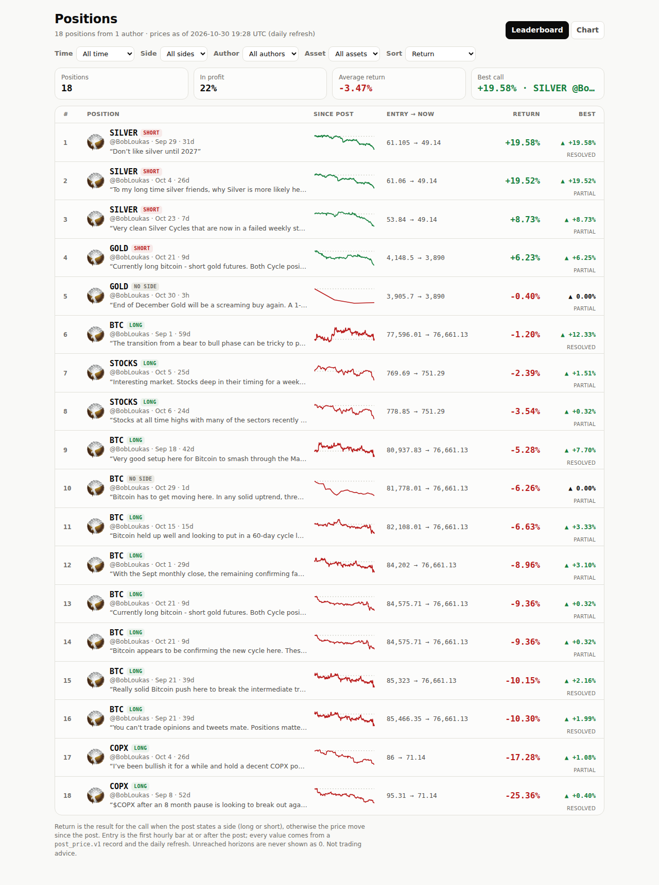
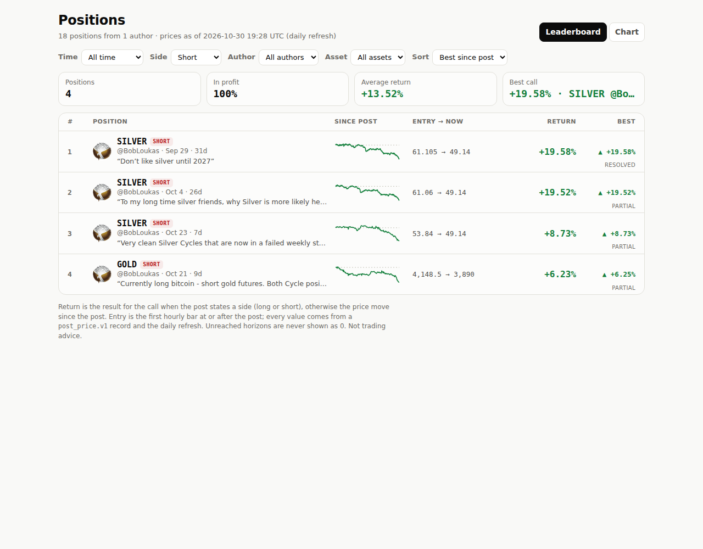
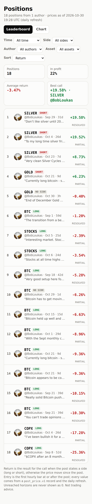
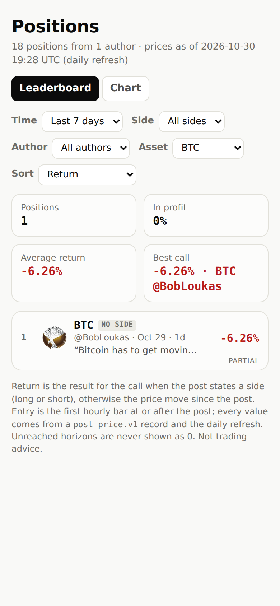

# Step 10 run notes: ranked leaderboard front page

## Where the work is

- **Code commit**: [`f8f450d`](https://github.com/sendoeth/pf-post-signals/commit/f8f450d81d8415f87678349768a5545b9ce1c967): `web/index.html` is the leaderboard (`assets/board.js`, `assets/board.css`), the chart view moved to `web/chart.html` (`assets/chart.js` / `chart.css`), `tests/board_test.js`, existing tests pointed at chart.html, security test extended to the leaderboard.
- **Compare** (everything since step 9's last commit): https://github.com/sendoeth/pf-post-signals/compare/82fb4b16edd49e9d55332e1b16d2381f082e143b...f8f450d81d8415f87678349768a5545b9ce1c967 (also contains the green/red colour change `3590c2c` the leaderboard uses)
- **Live leaderboard**: https://sendoeth.com/pf-post-signals/web/ · shareable views, e.g. https://sendoeth.com/pf-post-signals/web/?side=short&sort=best and https://sendoeth.com/pf-post-signals/web/?asset=BTC&time=7d

## What the page does

- One row per position (18), ranked: rank, asset + LONG / SHORT / NO SIDE badge, author avatar + handle, posted date + age, a quote of the post, a sparkline of the price from the entry bar to the latest bar (the bundle's own bars), entry -> current price, **return** (for the call when a side is stated, else the price move), **best since post**, status. Every row links to its position page.
- Stats strip for the rows shown: positions, share in profit, average return, best call.
- Filters: time (all / last 7 days / today, relative to the refresh's "prices as of" time), side, author, asset; sort: return, best since post, newest. Unresolved values sort last and read `unresolved`, never 0. State lives in the URL; unknown values fall back to the defaults.
- Same record-backed bundle as the position pages, same CSP and frame guard, no new data source, no third-party request. Signed green/red colours with +/- and ▲ kept.

## Results (live site, 2026-10-30 20:54-21:04 UTC)

| Check | Result |
|---|---|
| Every filter x sort combination, loaded fresh from its URL | **432** (3 time x 4 side x 2 author x 6 asset x 3 sort): 174 with rows, 258 correctly empty; row order, ranks, returns, best, stats, empty state and the selects all equal an independent re-implementation of the rules |
| Controls | 18 select changes in the page: rows and the shared URL update correctly |
| Record parity | default view: 144 row fields equal the record files (sha256-checked); every row links to its position page; sparkline points = bundle bars entry -> latest |
| Errors | 0 console errors, 0 CSP violations, 0 third-party requests; no horizontal scroll at 390 px |
| Existing pages | position pages 672 fields + 36 entry placements, chart view, security test (leaderboard + chart + 36 position loads, attack fixtures incl. hostile text in the leaderboard quote, framing): ALL PASS |

## Raw output

```text
$ node tests/board_test.js --url https://sendoeth.com/pf-post-signals/web/ --screenshots verification/step10
page https://sendoeth.com/pf-post-signals/web/
filter/sort combinations loaded from their URL: 432 (174 with rows, 258 correctly empty); select changes: 18; default-view fields checked against records: 144; rows 18; CSP violations 0; console errors 0
ALL PASS
[exit 0]
$ node tests/position_test.js --url https://sendoeth.com/pf-post-signals/web/
page https://sendoeth.com/pf-post-signals/web/
position pages opened 36 (18 posts x default + 1h), recap fields checked 672, entry-bubble placements checked 36, unresolved cells 50, console errors 0
ALL PASS
[exit 0]
$ node tests/browser_test.js --url https://sendoeth.com/pf-post-signals/web/
page https://sendoeth.com/pf-post-signals/web/
assets 5, cards opened 18, card fields checked 264, unresolved cells checked 25, same-hour bubbles 2, console errors 0
ALL PASS
[exit 0]
$ node tests/security_test.js --url https://sendoeth.com/pf-post-signals/web/
site https://sendoeth.com/pf-post-signals/web/: 38 page states checked (leaderboard + chart + 36 position loads), 18 bubbles clicked, 358 requests, origins: https://sendoeth.com
  resources loaded: /pf-post-signals/web/ /pf-post-signals/web/assets/board.css /pf-post-signals/web/assets/board.js /pf-post-signals/web/assets/chart.css /pf-post-signals/web/assets/chart.js /pf-post-signals/web/assets/favicon.svg /pf-post-signals/web/assets/frame-guard.js /pf-post-signals/web/assets/position.css /pf-post-signals/web/assets/position.js /pf-post-signals/web/avatars/bobloukas.jpg /pf-post-signals/web/avatars/index.json /pf-post-signals/web/chart.html /pf-post-signals/web/data/charts.json /pf-post-signals/web/data/ohlc/BTC.json /pf-post-signals/web/data/ohlc/COPX.json /pf-post-signals/web/data/ohlc/GOLD.json /pf-post-signals/web/data/ohlc/SILVER.json /pf-post-signals/web/data/ohlc/STOCKS.json /pf-post-signals/web/position.html /pf-post-signals/web/vendor/lightweight-charts-4.2.3/lightweight-charts.standalone.production.js
framing plain index: hidden inside the frame
framing sandboxed index: hidden inside the frame
framing plain position.html?post=2104977267109896477&asset=SILVER: hidden inside the frame
framing sandboxed position.html?post=2104977267109896477&asset=SILVER: hidden inside the frame
canary window.__pwned: unset on every page; CSP violations: 0; console errors: 0
ALL PASS
[exit 0]
$ curl -s https://sendoeth.com/pf-post-signals/web/ | sha256sum
41eadb808cf3b5547f137b27f147ca3da6f6eb4665d0b78574f9b95a9679946e  -
$ curl -s https://sendoeth.com/pf-post-signals/web/chart.html | sha256sum
0e3e3ff26bb8e379252d15c21009fbb27e67001f9632b05b406ff095413b46ef  -
$ curl -s https://sendoeth.com/pf-post-signals/web/position.html | sha256sum
959c25e46be1d3bffef651624b82a021a3f564380d7a325a212e767abf40c485  -
$ curl -s https://sendoeth.com/pf-post-signals/web/assets/board.js | sha256sum
0aab0baa27c27ab3649d67a47f5c1ff73789218a60e942e248d35f87983c021e  -
$ curl -s https://sendoeth.com/pf-post-signals/web/assets/board.css | sha256sum
834c07a94bcc3c4d0905d0b5c8030cd2c1ce0df60cf0d4aec35818a6f8a3a750  -
$ curl -s https://sendoeth.com/pf-post-signals/web/data/charts.json | sha256sum
5e45fc93da7c22f4cca80ec7dc1f6d938c893cc78e9d250f543eef5c2d970705  -
```

## Screenshots

- [verification/step10/board_desktop.png](step10/board_desktop.png)
- [verification/step10/board_desktop_filtered.png](step10/board_desktop_filtered.png)
- [verification/step10/board_phone.png](step10/board_phone.png)
- [verification/step10/board_phone_filtered.png](step10/board_phone_filtered.png)



Short positions, sorted by best since post (`?side=short&sort=best`):



 

## SHA-256

The page and code files (stable). The data bundle changes with each daily refresh; the value below is the bundle the tests ran against (refresh `ff14e53`), and the live hashes in the raw output above match it.

```text
41eadb808cf3b5547f137b27f147ca3da6f6eb4665d0b78574f9b95a9679946e  web/index.html
0e3e3ff26bb8e379252d15c21009fbb27e67001f9632b05b406ff095413b46ef  web/chart.html
959c25e46be1d3bffef651624b82a021a3f564380d7a325a212e767abf40c485  web/position.html
0aab0baa27c27ab3649d67a47f5c1ff73789218a60e942e248d35f87983c021e  web/assets/board.js
834c07a94bcc3c4d0905d0b5c8030cd2c1ce0df60cf0d4aec35818a6f8a3a750  web/assets/board.css
7a9ba2d808f14456a0b6eb51975d5cfe14cc82d4ae615d0cf48b99df0998d5d5  web/assets/chart.js
cf369fa10f74f23e2193903736e3dbfea3b20864e9328175530046172a9c7567  web/assets/chart.css
4e7f1fa2430399abf4d94188b3c6c5affa9fa0eb27164695f7e6ae33743b52c4  web/assets/position.js
5e45fc93da7c22f4cca80ec7dc1f6d938c893cc78e9d250f543eef5c2d970705  web/data/charts.json
877d07cafba7b32951b78f1995db254667ef299f9812b888d37a713f9739f523  tests/board_test.js
43d91f0ebdec44a86e8920c78fbc98c01ede50b89d4d00e2e4ad6f248757c655  tests/security_test.js
ab4112430a6c4173ae5502c607e052e0aea0ea36399505a6ed43cee4d6c18581  verification/step10/board_desktop.png
eb8547fbaf9b5085ef21eda2173fbcbded02c672efd9ee95cc6159fefbe2657b  verification/step10/board_desktop_filtered.png
53d12ad40731aa944610e6c7fd1654f5abf4daaf92b7d0702adc438f85a43dd4  verification/step10/board_phone.png
0fd5caba64183242090958aa40cb0d0529a39a92a9a4f499fe316346c2769bb6  verification/step10/board_phone_filtered.png
```

## Verification follow-up (2026-10-30 21:20-21:50 UTC)

**Erratum.** The summary line above says `174 with rows, 258 correctly empty`. The correct split is **156 with rows, 276 correctly empty** (of 432). The test's counter also counted the 18 select-change checks (156 + 18 = 174). Every row/rank/value comparison was already correct; only that summary count was wrong. Fixed in [`03874b9`](https://github.com/sendoeth/pf-post-signals/commit/03874b9ef5a1e6dd29cb42345e40cf6c09f513a9) and confirmed by an independent count (Python, same rules): `combinations 432 with rows 156 empty 276`.

**Invalid URL state.** Before `03874b9` the page reset unknown values to the defaults but left them in the address bar. Now it also rewrites the URL to the state shown. Live, after deploy:

```text
load https://sendoeth.com/pf-post-signals/web/?side=bogus&sort=bogus&time=8d
{
 "url": "https://sendoeth.com/pf-post-signals/web/",
 "selects": {
  "time": "all",
  "side": "all",
  "author": "all",
  "asset": "all",
  "sort": "return"
 },
 "stats": [
  "Positions: 18",
  "In profit: 22%",
  "Average return: -3.47%",
  "Best call: +19.58% · SILVER @BobLoukas"
 ],
 "rows": [
  "1. SILVER SHORT +19.58% best ▲ +19.58%",
  "2. SILVER SHORT +19.52% best ▲ +19.52%",
  "3. SILVER SHORT +8.73% best ▲ +8.73%",
  "4. GOLD SHORT +6.23% best ▲ +6.25%",
  "5. GOLD NO SIDE -0.40% best ▲ 0.00%",
  "6. BTC LONG -1.20% best ▲ +12.33%",
  "7. STOCKS LONG -2.39% best ▲ +1.51%",
  "8. STOCKS LONG -3.54% best ▲ +0.32%",
  "9. BTC LONG -5.28% best ▲ +7.70%",
  "10. BTC NO SIDE -6.26% best ▲ 0.00%",
  "11. BTC LONG -6.63% best ▲ +3.33%",
  "12. BTC LONG -8.96% best ▲ +3.10%",
  "13. BTC LONG -9.36% best ▲ +0.32%",
  "14. BTC LONG -9.36% best ▲ +0.32%",
  "15. BTC LONG -10.15% best ▲ +2.16%",
  "16. BTC LONG -10.30% best ▲ +1.99%",
  "17. COPX LONG -17.28% best ▲ +1.08%",
  "18. COPX LONG -25.36% best ▲ +0.40%"
 ],
 "unresolved": [],
 "asOf": "18 positions from 1 author · prices as of 2026-10-30 19:28 UTC (daily refresh)"
}
```

**Unresolved values.** No live position is unresolved today: all 18 have an entry bar and a current price. The ranking rule (unresolved last by return and by best, newest-first by post time) is checked by `tests/board_test.js` section F on a test-only copy of the deployed site files whose bundle adds `tests/fixtures/pending_records/2116212800955576797_GOLD.json` (a real BobLoukas post of 2026-10-30 16:57 UTC resolved against bars that end before it, so it has no entry bar). That copy is never deployed. Screenshot: [verification/step10/board_pending_fixture.png](step10/board_pending_fixture.png).

```text
$ node tests/board_test.js --url https://sendoeth.com/pf-post-signals/web/
page https://sendoeth.com/pf-post-signals/web/
filter/sort combinations loaded from their URL: 432 (156 with rows, 276 correctly empty); select changes: 18; default-view fields checked against records: 144; rows 18; CSP violations 0; console errors 0
ALL PASS
[exit 0]

$ node tests/board_test.js   # local; adds the test-only pending fixture copy
page http://127.0.0.1:40951/
filter/sort combinations loaded from their URL: 432 (156 with rows, 276 correctly empty); select changes: 18; default-view fields checked against records: 144; rows 18; CSP violations 0; console errors 0
unresolved (test-only fixture copy): sort=return: pending post 2116212800955576797 at rank 19 of 19 (last), return "unresolved", best "–", prices "no entry bar" -> OK
unresolved (test-only fixture copy): sort=best: pending post 2116212800955576797 at rank 19 of 19 (last), return "unresolved", best "–", prices "no entry bar" -> OK
unresolved (test-only fixture copy): sort=newest: pending post 2116212800955576797 at rank 1 of 19 (first (newest post)), return "unresolved", best "–", prices "no entry bar" -> OK
ALL PASS
[exit 0]
```

```text
c417991f527be1276e5033eac8909ed8113699ba48121f050d6037f21671649d  web/assets/board.js
7c39cde5c7a97478a7532ea4b412d0ec64f63c8aa1821313964df4531dd9d4ba  tests/board_test.js
a212012499d9821f13c1a7a7c0d16ee72240d0cc6709c74159979aa626529027  tests/fixtures/pending_records/2116212800955576797_GOLD.json
d73a438abdf762f1b02c200c399ce88e10c9484557c956bc653bf448974374ce  verification/step10/board_pending_fixture.png
```
