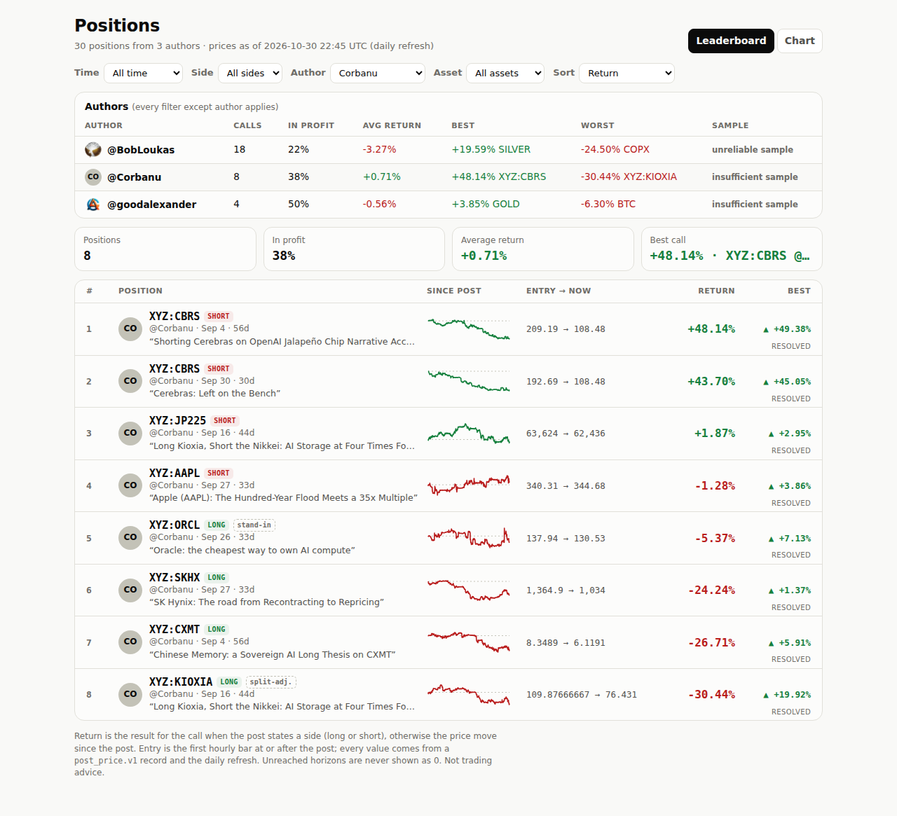
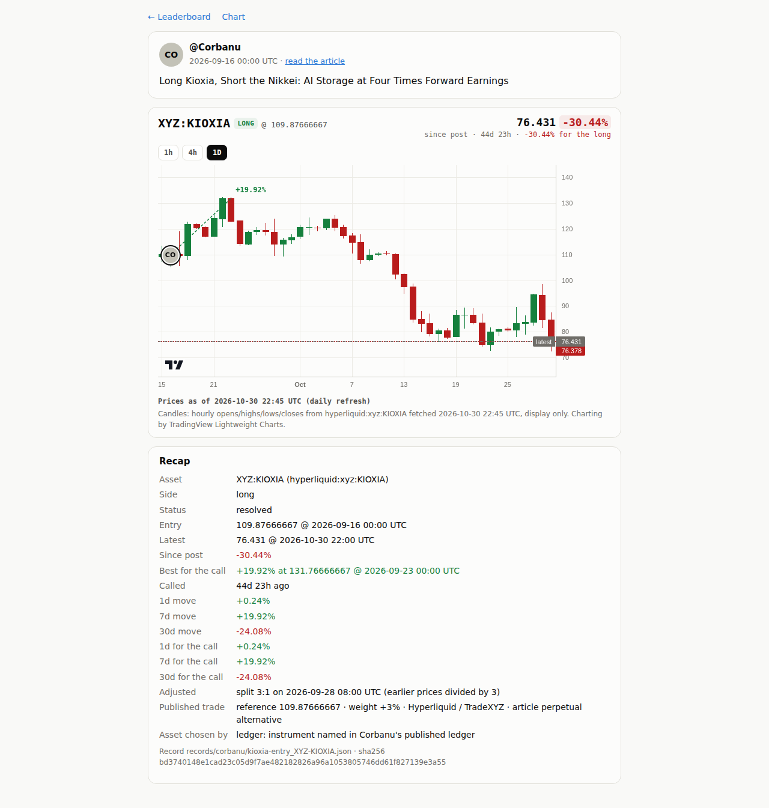
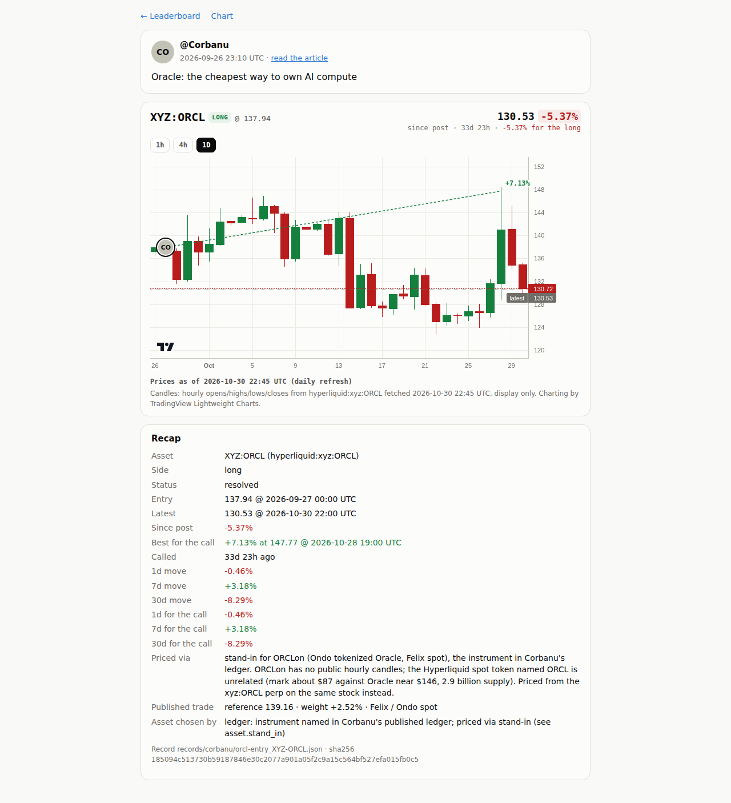

# Step 11 run notes: Corbanu and goodalexander on the leaderboard

## Where the work is

- **Code + data commit**: [`bdddb9c`](https://github.com/sendoeth/pf-post-signals/commit/bdddb9ce1b10e650200d2620c60727f5fd3376ad)
- **Compare**: https://github.com/sendoeth/pf-post-signals/compare/048d015742c8e66c2db5933d084ea37180224c64...bdddb9ce1b10e650200d2620c60727f5fd3376ad
- **Live, filtered to the new authors**: https://sendoeth.com/pf-post-signals/web/?author=Corbanu · https://sendoeth.com/pf-post-signals/web/?author=goodalexander (the author table on the default view compares all three)

## What was added

| | |
|---|---|
| Corbanu | all 8 trade events in the published tracker ledger (`sources/corbanu/portfolio_ledger.json`, sha256 `c13fa539…`; the live corbanu.com ledger on 2026-10-30 had the same 8 events, last updated 2026-10-02). Side from the sign of the published target weight; reference price, weight, venue, article link and article sha256 kept under `trade`; quoted text = the article title. `tools/import_corbanu.py` -> `records/corbanu/` |
| Pricing | Hyperliquid public `candleSnapshot` API (1h) for the HIP-3 `xyz` perps: CBRS, CXMT, KIOXIA, JP225, AAPL, SKHX. Entry = first hourly open at or after the published time, like every post |
| Split | `data/corporate_actions.json`: xyz:KIOXIA 3:1 on 2026-09-28 08:00 UTC (raw opens 340.79 -> 114.93 between 07:00 and 08:00). Bars before it are divided by 3, the basis Corbanu's ledger uses: our entry 109.87666… equals Corbanu's reference price exactly. Any other hour-to-hour move over 40% on a Hyperliquid series stops resolution instead of producing a fake crash |
| Refused source | **Hyperliquid spot token "ORCL"** (token 0x92de6e7e…, deployer 0x9a93d976…, no full name) is not Ondo's ORCLon: mark 87.0 vs Oracle near 146, 2.9 billion supply. Refused |
| Stand-in | ORCLon (Ondo tokenized Oracle on Felix) has no public hourly candles, so the ORCL trade is priced from the **xyz:ORCL** perp on the same stock, labelled `stand-in` on the leaderboard and explained on the position page (`asset.stand_in`) |
| goodalexander | 4 posts that state a position (receipts in `sources/goodalexander/receipts`, step 6 pipeline, side as stated): Long BTC (2113279842636419392, detector: btc) · short Gold (2113602987008356795, detector: gold) · Short S&P 500 futures (2116203980111933911, detector: needs review because the post also mentions oil; manual STOCKS with the reason stored) · short aapl (2115550350832996432, no detector term; manual XYZ:AAPL, reason: he says he shorts stock perps on TradeXYZ). The reason is stored in each record's `asset_choice` and shown on its page |
| Ingest fix | the embed text is HTML-escaped (`S&amp;P`) and starts with the reply's @mentions; ingest now decodes it and keeps only the displayed range (unit test added). Found because the first S&P run was detected as OIL; that record was discarded before anything was committed |
| Author summary | leaderboard table per author: calls, share in profit, average return, best, worst, and the step 3 sample flag (under 10 calls: insufficient sample; under 30: unreliable sample). Today: BobLoukas 18 (unreliable), Corbanu 8 (insufficient), goodalexander 4 (insufficient) |
| Refresh | `refresh.py` keeps ledger trades' post, `trade`, `asset_choice`, stand-in and split labels; frozen values unchanged |

## Comparison with step 1 (`tools/compare_corbanu.py`, `data/corbanu_vs_step1.json`)

Step 1 scored the same 8 trades from the published reference price with exits at Corbanu's tracker marks; step 11 uses the first hourly open after publication and Hyperliquid hourly opens. Sides are identical for all 8.

| trade | side | step 1 entry (ref) | step 11 entry (first open) | entry diff | 1d s1 -> s11 | 7d s1 -> s11 | 30d s1 -> s11 |
|---|---|---|---|---|---|---|---|
| aapl-entry XYZ:AAPL | short | 340.43 @ 2026-09-27T21:27 | 340.31 @ 2026-09-27T22:00 | -0.035% | +0.63% -> +0.60% | +1.97% -> +1.95% | pending -> -1.99% |
| cbrs-add XYZ:CBRS | short | 191.75 @ 2026-09-30T03:33 | 192.69 @ 2026-09-30T04:00 | +0.490% | +5.44% -> +5.84% | +7.85% -> +8.17% | pending -> +42.83% |
| cbrs-entry XYZ:CBRS | short | 209.225 @ 2026-09-04T20:09 | 209.19 @ 2026-09-04T21:00 | -0.017% | -0.37% -> -0.39% | +8.32% -> +8.29% | +12.72% -> +12.41% |
| cxmt-entry XYZ:CXMT | long | 8.3403 @ 2026-09-04T20:09 | 8.3489 @ 2026-09-04T21:00 | +0.103% | +0.41% -> +0.25% | -0.67% -> -0.77% | +0.90% -> +0.77% |
| jp225-entry XYZ:JP225 | short | 63624 @ 2026-09-16T00:00 | 63624 @ 2026-09-16T00:00 | +0.000% | -0.73% -> -1.80% | -5.05% -> -5.66% | -2.37% -> -2.67% |
| kioxia-entry XYZ:KIOXIA (split-adj.) | long | 109.877 @ 2026-09-16T00:00 | 109.877 @ 2026-09-16T00:00 | +0.000% | -2.48% -> +0.24% | +19.73% -> +19.92% | -24.97% -> -24.08% |
| orcl-entry XYZ:ORCL (stand-in) | long | 139.16 @ 2026-09-26T23:10 | 137.94 @ 2026-09-27T00:00 | -0.877% | pending -> -0.46% | +3.13% -> +3.18% | pending -> -8.29% |
| skhx-entry XYZ:SKHX | long | 1367.5 @ 2026-09-27T21:27 | 1364.9 @ 2026-09-27T22:00 | -0.190% | -5.64% -> -5.45% | +0.35% -> +0.56% | pending -> -24.51% |

Why they differ:

- **Entries** differ by under 0.5% (reference quote vs the first hourly open after publication), except ORCL (-0.88%): the stand-in perp vs the ORCLon spot quote. JP225 and KIOXIA are identical (the ledger's reference is itself the publication-hour open, split-adjusted for KIOXIA).
- **Exits** differ by tenths of a point: Corbanu's tracker marks are taken at the end of the hour (e.g. 00:59:59) on Corbanu's feed, ours are hourly opens on Hyperliquid.
- **The only gap over 2 points, KIOXIA 1d (-2.48% -> +0.24%)**: step 1's exit is the mark at 2026-09-17 00:59:59 (107.157), ours the open of the same hour, 00:00 (110.137); Kioxia fell 2.8% inside that one hour (Tokyo open). Same trade, one hour apart.
- **Four 30d horizons** (AAPL, CBRS add, ORCL, SKHX) were pending in the 2026-10-18 snapshot and are resolved now.

## Results

| Check | Result |
|---|---|
| Leaderboard (live) | 1872 filter x sort combinations (3 time x 4 side x 4 author x 13 asset x 3 sort) set in the page, every 10th (187) also loaded fresh from its URL; 339 with rows, 1533 correctly empty (cross-checked by an independent count); 910 author-summary rows equal an independent re-implementation; 240 row fields equal the record files; 0 CSP violations, 0 console errors |
| Position pages (live) | 30 posts x 2 intervals: 1368 recap fields incl. stand-in / split / trade / asset-choice equal the records, 60 entry-avatar placements, 0 console errors |
| Chart view, security (live) | 12 assets, 30 cards; own origin only, 0 CSP violations, canary unset, framing hidden |
| Data | 30 records valid, 30 drawn / 0 refused, entry bars 30/30 equal the candle opens (Hyperliquid incl. split-adjusted), parity 16/16, guard 0 hits over 30 commits, CI guard passed on bdddb9c |

## Raw output: live site

```text
$ node tests/board_test.js --url https://sendoeth.com/pf-post-signals/web/ --screenshots verification/step11
page https://sendoeth.com/pf-post-signals/web/
filter/sort combinations: 1872 set in the page (339 with rows, 1533 correctly empty), 187 of them also loaded fresh from their URL; author-summary rows checked: 910; select changes: 27; default-view fields checked against records: 240; rows 30; CSP violations 0; console errors 0
ALL PASS
[exit 0]
$ node tests/position_test.js --url https://sendoeth.com/pf-post-signals/web/
page https://sendoeth.com/pf-post-signals/web/
position pages opened 60 (30 posts x default + 1h), recap fields checked 1368, entry-bubble placements checked 60, unresolved cells 78, console errors 0
ALL PASS
[exit 0]
$ node tests/browser_test.js --url https://sendoeth.com/pf-post-signals/web/
page https://sendoeth.com/pf-post-signals/web/
assets 12, cards opened 30, card fields checked 444, unresolved cells checked 39, same-hour bubbles 2, console errors 0
ALL PASS
[exit 0]
$ node tests/security_test.js --url https://sendoeth.com/pf-post-signals/web/
site https://sendoeth.com/pf-post-signals/web/: 62 page states checked (leaderboard + chart + 60 position loads), 30 bubbles clicked, 562 requests, origins: https://sendoeth.com
  resources loaded: /pf-post-signals/web/ /pf-post-signals/web/assets/board.css /pf-post-signals/web/assets/board.js /pf-post-signals/web/assets/chart.css /pf-post-signals/web/assets/chart.js /pf-post-signals/web/assets/favicon.svg /pf-post-signals/web/assets/frame-guard.js /pf-post-signals/web/assets/position.css /pf-post-signals/web/assets/position.js /pf-post-signals/web/avatars/bobloukas.jpg /pf-post-signals/web/avatars/goodalexander.jpg /pf-post-signals/web/avatars/index.json /pf-post-signals/web/chart.html /pf-post-signals/web/data/charts.json /pf-post-signals/web/data/ohlc/BTC.json /pf-post-signals/web/data/ohlc/COPX.json /pf-post-signals/web/data/ohlc/GOLD.json /pf-post-signals/web/data/ohlc/SILVER.json /pf-post-signals/web/data/ohlc/STOCKS.json /pf-post-signals/web/data/ohlc/XYZ%3AAAPL.json /pf-post-signals/web/data/ohlc/XYZ%3ACBRS.json /pf-post-signals/web/data/ohlc/XYZ%3ACXMT.json /pf-post-signals/web/data/ohlc/XYZ%3AJP225.json /pf-post-signals/web/data/ohlc/XYZ%3AKIOXIA.json /pf-post-signals/web/data/ohlc/XYZ%3AORCL.json /pf-post-signals/web/data/ohlc/XYZ%3ASKHX.json /pf-post-signals/web/position.html /pf-post-signals/web/vendor/lightweight-charts-4.2.3/lightweight-charts.standalone.production.js
framing plain index: hidden inside the frame
framing sandboxed index: hidden inside the frame
framing plain position.html?post=2104977267109896477&asset=SILVER: hidden inside the frame
framing sandboxed position.html?post=2104977267109896477&asset=SILVER: hidden inside the frame
canary window.__pwned: unset on every page; CSP violations: 0; console errors: 0
ALL PASS
[exit 0]
$ curl -s https://sendoeth.com/pf-post-signals/web/ | sha256sum
92c2543143a5f8482b5d71fa24dbaf50261e095711134498384096f4881a8fee  -
$ curl -s https://sendoeth.com/pf-post-signals/web/position.html | sha256sum
959c25e46be1d3bffef651624b82a021a3f564380d7a325a212e767abf40c485  -
$ curl -s https://sendoeth.com/pf-post-signals/web/data/charts.json | sha256sum
7b120289ebe93778ebaebb24fbaa9f5d7cb4a93143fdce8a18a25f67d61edbaa  -
$ curl -s https://sendoeth.com/pf-post-signals/web/assets/board.js | sha256sum
dbf676d727d6a33ee4a1b10c8c9445dc3a7da8a46467b2b3e5ab43c53394fdbe  -
$ curl -s https://sendoeth.com/pf-post-signals/web/assets/position.js | sha256sum
1ff19c63d723f6d6ffc9efb17a86a8f3bb8328f15ac0559fd5ce4930fe350f36  -
```

## Raw output: local (comparison, checks, detector, refused source, split)

```text
$ python3 tools/compare_corbanu.py
| trade | side | step 1 entry (ref) | step 11 entry (first open) | entry diff | 1d s1 -> s11 | 7d s1 -> s11 | 30d s1 -> s11 |
|---|---|---|---|---|---|---|---|
| aapl-entry XYZ:AAPL | short | 340.43 @ 2026-09-27T21:27 | 340.31 @ 2026-09-27T22:00 | -0.035% | +0.63% -> +0.60% | +1.97% -> +1.95% | pending -> -1.99% |
| cbrs-add XYZ:CBRS | short | 191.75 @ 2026-09-30T03:33 | 192.69 @ 2026-09-30T04:00 | +0.490% | +5.44% -> +5.84% | +7.85% -> +8.17% | pending -> +42.83% |
| cbrs-entry XYZ:CBRS | short | 209.225 @ 2026-09-04T20:09 | 209.19 @ 2026-09-04T21:00 | -0.017% | -0.37% -> -0.39% | +8.32% -> +8.29% | +12.72% -> +12.41% |
| cxmt-entry XYZ:CXMT | long | 8.3403 @ 2026-09-04T20:09 | 8.3489 @ 2026-09-04T21:00 | +0.103% | +0.41% -> +0.25% | -0.67% -> -0.77% | +0.90% -> +0.77% |
| jp225-entry XYZ:JP225 | short | 63624 @ 2026-09-16T00:00 | 63624 @ 2026-09-16T00:00 | +0.000% | -0.73% -> -1.80% | -5.05% -> -5.66% | -2.37% -> -2.67% |
| kioxia-entry XYZ:KIOXIA (split-adj.) | long | 109.877 @ 2026-09-16T00:00 | 109.877 @ 2026-09-16T00:00 | +0.000% | -2.48% -> +0.24% | +19.73% -> +19.92% | -24.97% -> -24.08% |
| orcl-entry XYZ:ORCL (stand-in) | long | 139.16 @ 2026-09-26T23:10 | 137.94 @ 2026-09-27T00:00 | -0.877% | pending -> -0.46% | +3.13% -> +3.18% | pending -> -8.29% |
| skhx-entry XYZ:SKHX | long | 1367.5 @ 2026-09-27T21:27 | 1364.9 @ 2026-09-27T22:00 | -0.190% | -5.64% -> -5.45% | +0.35% -> +0.56% | pending -> -24.51% |

aapl-entry 1d: entry -0.04% (reference quote vs first hourly open); exit: Corbanu tracker mark vs Hyperliquid hourly open
aapl-entry 7d: entry -0.04% (reference quote vs first hourly open); exit: Corbanu tracker mark vs Hyperliquid hourly open
aapl-entry 30d: newly resolved (pending in the step 1 snapshot)
cbrs-add 1d: entry +0.49% (reference quote vs first hourly open); exit: Corbanu tracker mark vs Hyperliquid hourly open
cbrs-add 7d: entry +0.49% (reference quote vs first hourly open); exit: Corbanu tracker mark vs Hyperliquid hourly open
cbrs-add 30d: newly resolved (pending in the step 1 snapshot)
cbrs-entry 1d: entry -0.02% (reference quote vs first hourly open); exit: Corbanu tracker mark vs Hyperliquid hourly open
cbrs-entry 7d: entry -0.02% (reference quote vs first hourly open); exit: Corbanu tracker mark vs Hyperliquid hourly open
cbrs-entry 30d: entry -0.02% (reference quote vs first hourly open); exit: Corbanu tracker mark vs Hyperliquid hourly open
cxmt-entry 1d: entry +0.10% (reference quote vs first hourly open); exit: Corbanu tracker mark vs Hyperliquid hourly open
cxmt-entry 7d: entry +0.10% (reference quote vs first hourly open); exit: Corbanu tracker mark vs Hyperliquid hourly open
cxmt-entry 30d: entry +0.10% (reference quote vs first hourly open); exit: Corbanu tracker mark vs Hyperliquid hourly open
jp225-entry 1d: exit: Corbanu tracker mark vs Hyperliquid hourly open
jp225-entry 7d: exit: Corbanu tracker mark vs Hyperliquid hourly open
jp225-entry 30d: exit: Corbanu tracker mark vs Hyperliquid hourly open
kioxia-entry 1d: exit: Corbanu tracker mark vs Hyperliquid hourly open
kioxia-entry 7d: exit: Corbanu tracker mark vs Hyperliquid hourly open
kioxia-entry 30d: exit: Corbanu tracker mark vs Hyperliquid hourly open
orcl-entry 1d: newly resolved (pending in the step 1 snapshot)
orcl-entry 7d: entry -0.88% (reference quote vs first hourly open); exit: Corbanu tracker mark vs Hyperliquid hourly open; ORCL priced from the xyz:ORCL stand-in, step 1 marked ORCLon
orcl-entry 30d: newly resolved (pending in the step 1 snapshot)
skhx-entry 1d: entry -0.19% (reference quote vs first hourly open); exit: Corbanu tracker mark vs Hyperliquid hourly open
skhx-entry 7d: entry -0.19% (reference quote vs first hourly open); exit: Corbanu tracker mark vs Hyperliquid hourly open
skhx-entry 30d: newly resolved (pending in the step 1 snapshot)

8 trades compared; sides identical; differences over 2 points: kioxia-entry 1d +2.71pt
[exit 0]
$ python3 check_bundle.py
bundle: 30 record files -> 30 drawn, 0 superseded, 0 refused; 90 horizon cells, 30 best-since-post values checked -> ALL MATCH
[exit 0]
$ python3 fetch_ohlc.py --check-only
OK   BTC     2094827036812435935 entry 2026-09-01T17:00:00Z record 77596.01 candle open 77596.01
OK   BTC     2100953898630443447 entry 2026-09-18T15:00:00Z record 80937.83 candle open 80937.83
OK   BTC     2102014028855820403 entry 2026-09-21T13:00:00Z record 85323.0 candle open 85323.0
OK   BTC     2102024327075877097 entry 2026-09-21T14:00:00Z record 85466.35 candle open 85466.35
OK   BTC     2105699317004583026 entry 2026-10-01T17:00:00Z record 84202.0 candle open 84202.0
OK   BTC     2110764348981612915 entry 2026-10-15T17:00:00Z record 82108.01 candle open 82108.01
OK   BTC     2112915214479798344 entry 2026-10-21T15:00:00Z record 84575.71 candle open 84575.71
OK   BTC     2112919830357577753 entry 2026-10-21T15:00:00Z record 84575.71 candle open 84575.71
OK   BTC     2113279842636419392 entry 2026-10-22T15:00:00Z record 81882.0 candle open 81882.0
OK   BTC     2115823513915290059 entry 2026-10-29T16:00:00Z record 81778.01 candle open 81778.01
OK   COPX    2097324043334451439 entry 2026-09-08T14:30:00Z record 95.31 candle open 95.31
OK   COPX    2106750657877434407 entry 2026-10-05T13:30:00Z record 86.0 candle open 86.0
OK   GOLD    2112919830357577753 entry 2026-10-21T15:00:00Z record 4148.5 candle open 4148.5
OK   GOLD    2113602987008356795 entry 2026-10-23T13:00:00Z record 4040.3999 candle open 4040.3999
OK   GOLD    2116199680157647216 entry 2026-10-30T17:00:00Z record 3905.7 candle open 3905.7
OK   SILVER  2104977267109896477 entry 2026-09-29T17:00:00Z record 61.105 candle open 61.105
OK   SILVER  2106744910896312646 entry 2026-10-04T22:00:00Z record 61.06 candle open 61.06
OK   SILVER  2113613893662588966 entry 2026-10-23T13:00:00Z record 53.84 candle open 53.84
OK   STOCKS  2107063137958564197 entry 2026-10-05T13:30:00Z record 769.69 candle open 769.69
OK   STOCKS  2107475725573906895 entry 2026-10-06T14:30:00Z record 778.85 candle open 778.85
OK   STOCKS  2116203980111933911 entry 2026-10-30T16:30:00Z record 757.56 candle open 757.56
OK   XYZ:AAPL corbanu:aapl-entry entry 2026-09-27T22:00:00Z record 340.31 candle open 340.31
OK   XYZ:AAPL 2115550350832996432 entry 2026-10-28T22:00:00Z record 344.54 candle open 344.54
OK   XYZ:CBRS corbanu:cbrs-entry entry 2026-09-04T21:00:00Z record 209.19 candle open 209.19
OK   XYZ:CBRS corbanu:cbrs-add entry 2026-09-30T04:00:00Z record 192.69 candle open 192.69
OK   XYZ:CXMT corbanu:cxmt-entry entry 2026-09-04T21:00:00Z record 8.3489 candle open 8.3489
OK   XYZ:JP225 corbanu:jp225-entry entry 2026-09-16T00:00:00Z record 63624.0 candle open 63624.0
OK   XYZ:KIOXIA corbanu:kioxia-entry entry 2026-09-16T00:00:00Z record 109.87666666666667 candle open 109.87666666666667
OK   XYZ:ORCL corbanu:orcl-entry entry 2026-09-27T00:00:00Z record 137.94 candle open 137.94
OK   XYZ:SKHX corbanu:skhx-entry entry 2026-09-27T22:00:00Z record 1364.9 candle open 1364.9
entry bars: 30/30 candle opens equal the record entry price
[exit 0]
$ python3 validate_records.py
records: 30 checked against post_price.v1 -> ALL VALID
[exit 0]
$ python3 parity.py
EXACT 2094827036812435935 BTC    call        entry 77596.01 @ 2026-09-01T17:00:00Z | 1d -0.55% 7d +1.47% 30d +8.51%
EXACT 2097324043334451439 COPX   call        entry 95.31 @ 2026-09-08T14:30:00Z | 1d +0.22% 7d -11.56% 30d -12.54%
EXACT 2100953898630443447 BTC    call        entry 80937.83 @ 2026-09-18T15:00:00Z | 1d +0.80% 7d +3.80% 30d +0.20%
EXACT 2102014028855820403 BTC    reiteration entry 85323.0 @ 2026-09-21T13:00:00Z | 1d +0.82% 7d -2.04% 30d -2.13%
EXACT 2102024327075877097 BTC    reiteration entry 85466.35 @ 2026-09-21T14:00:00Z | 1d +1.03% 7d -2.13% 30d -1.92%
EXACT 2104977267109896477 SILVER call        entry 61.105 @ 2026-09-29T17:00:00Z | 1d +0.83% 7d -0.80% 30d unresolved
EXACT 2105699317004583026 BTC    call        entry 84202.0 @ 2026-10-01T17:00:00Z | 1d +1.14% 7d -3.86% 30d unresolved
EXACT 2106744910896312646 SILVER reiteration entry 61.06 @ 2026-10-04T22:00:00Z | 1d -0.57% 7d -0.27% 30d unresolved
EXACT 2106750657877434407 COPX   call        entry 86.0 @ 2026-10-05T13:30:00Z | 1d -0.33% 7d -0.83% 30d unresolved
EXACT 2107063137958564197 STOCKS call        entry 769.69 @ 2026-10-05T13:30:00Z | 1d +1.10% 7d +1.18% 30d unresolved
EXACT 2107475725573906895 STOCKS reiteration entry 778.85 @ 2026-10-06T14:30:00Z | 1d -0.56% 7d -0.17% 30d unresolved
EXACT 2110764348981612915 BTC    call        entry 82108.01 @ 2026-10-15T17:00:00Z | 1d -0.82% 7d -1.00% 30d unresolved
EXACT 2112915214479798344 BTC    reiteration entry 84575.71 @ 2026-10-21T15:00:00Z | 1d -3.18% 7d -4.70% 30d unresolved
EXACT 2112919830357577753 BTC    reiteration entry 84575.71 @ 2026-10-21T15:00:00Z | 1d -3.18% 7d -4.70% 30d unresolved
EXACT 2112919830357577753 GOLD   call        entry 4148.5 @ 2026-10-21T15:00:00Z | 1d +1.78% 7d +2.27% 30d unresolved
EXACT 2113613893662588966 SILVER call        entry 53.84 @ 2026-10-23T13:00:00Z | 1d -0.73% 7d unresolved 30d unresolved
parity: 16/16 exact, 16 records schema-valid, 0 duplicates, 0 errors
[exit 0]
$ python3 -m unittest tests.test_resolve tests.test_ingest_detect tests.test_guard tests.test_refresh
....................................................
----------------------------------------------------------------------
Ran 52 tests in 0.288s

OK
[exit 0]
$ python3 tools/guard.py --history
guard: scanned 30 commits (all added lines + messages) -> 0 hits
[exit 0]
$ python3 detect.py --receipt sources/goodalexander/receipts/2113279842636419392.json
{"status": "detected", "asset": "BTC", "matched": [{"asset": "BTC", "term": "btc"}], "reason": null}
[exit 0]
$ python3 detect.py --receipt sources/goodalexander/receipts/2113602987008356795.json
{"status": "detected", "asset": "GOLD", "matched": [{"asset": "GOLD", "term": "gold"}], "reason": null}
[exit 0]
$ python3 detect.py --receipt sources/goodalexander/receipts/2116203980111933911.json
{"status": "needs_review", "asset": null, "matched": [{"asset": "STOCKS", "term": "s&p 500"}, {"asset": "OIL", "term": "oil"}], "reason": "several assets: OIL, STOCKS"}
[exit 3]
$ python3 detect.py --receipt sources/goodalexander/receipts/2115550350832996432.json
{"status": "needs_review", "asset": null, "matched": [], "reason": "no asset words or cashtags"}
[exit 3]
$ python3 -c "...asset_choice of the goodalexander records"
records/posts/2113279842636419392_BTC.json BTC side 1 {'method': 'detector', 'terms': ['btc'], 'reason': None}
records/posts/2113602987008356795_GOLD.json GOLD side -1 {'method': 'detector', 'terms': ['gold'], 'reason': None}
records/posts/2115550350832996432_XYZ-AAPL.json XYZ:AAPL side -1 {'method': 'manual', 'terms': [], 'reason': 'post names aapl (the asset map has no single-stock terms); the same author says he shorts stocks via perps on TradeXYZ (https://x.com/goodalexander/status/2115843393557324078), so the Hyperliquid xyz:AAPL perp'}
records/posts/2116203980111933911_STOCKS.json STOCKS side -1 {'method': 'manual', 'terms': ['s&p 500', 'oil'], 'reason': "the post opens with 'Short S&P 500 futures'; oil is mentioned only as macro context ('Oil up and EURCHF down say Iran and Ukraine are heating up'), not as a position"}
$ python3 -c "...hyperliquid spot token ORCL (refused as the ORCLon source)"
spot ORCL token 0x92de6e7ea04b168f6acc93d18f3becce fullName None deployer 0x9a93d976277bfda0b69b1625358cb257f4908106 markPx 87.0 circulatingSupply 2875999999.9986300468
$ python3 -c "...xyz:KIOXIA raw hourly opens around the split"
2026-09-28T05:00:00Z raw open 345.86
2026-09-28T06:00:00Z raw open 344.4
2026-09-28T07:00:00Z raw open 340.79
2026-09-28T08:00:00Z raw open 114.93
2026-09-28T09:00:00Z raw open 113.89
after data/corporate_actions.json: [['2026-09-28T05:00:00Z', 115.28666666666668], ['2026-09-28T06:00:00Z', 114.8], ['2026-09-28T07:00:00Z', 113.59666666666668], ['2026-09-28T08:00:00Z', 114.93], ['2026-09-28T09:00:00Z', 113.89]]
```

## Screenshots

- [verification/step11/board_corbanu.png](step11/board_corbanu.png)
- [verification/step11/board_goodalexander.png](step11/board_goodalexander.png)
- [verification/step11/position_kioxia_split.png](step11/position_kioxia_split.png)
- [verification/step11/position_orcl_standin.png](step11/position_orcl_standin.png)
- [verification/step11/position_ga_aapl_manual.png](step11/position_ga_aapl_manual.png)
- [verification/step11/board_desktop.png](step11/board_desktop.png)
- [verification/step11/board_phone.png](step11/board_phone.png)







## SHA-256

Code, ledger, corporate actions and screenshots. Records and the bundle change with each daily refresh; the values below are the state the tests ran against (live hashes in the raw output above match).

```text
c13fa539a920270d88d796083afb666c86d439420651aa3313ca2f1997922e2f  sources/corbanu/portfolio_ledger.json
41b5f7f9f8eeea44ac0dca4d1e79b5a687e7a2e54489d694a3f5e42ebcd7fe71  data/corporate_actions.json
3549ede61e24112aa10d0228489095fbdfd53af1a25efb8aa7cd1b2c3a5e03c2  data/corbanu_vs_step1.json
0ba128f381f3b9de497a54dfa0bb665e13538cece3f20d455f9a45cbdb45539b  records/corbanu/aapl-entry_XYZ-AAPL.json
fad2639db99a86ec98dc82df27727a9029341aef8dd060549e9b8c8c6f19516f  records/corbanu/cbrs-add_XYZ-CBRS.json
0af3843767bdbab9ace664bfa7fd39bc86da0694fde2478c46031b85453a55f8  records/corbanu/cbrs-entry_XYZ-CBRS.json
9b94e62f81898a2172e06c4bfc425e20aaf639c3fd3f5550a6e7827db2666620  records/corbanu/cxmt-entry_XYZ-CXMT.json
38f8a63b2a5ed4d0c3fd173f1f4d4c2d2ca2bfc319fa9b028bbd5361de8b3158  records/corbanu/jp225-entry_XYZ-JP225.json
bd3740148e1cad23c05d9f7ae482182826a96a1053805746dd61f827139e3a55  records/corbanu/kioxia-entry_XYZ-KIOXIA.json
185094c513730b59187846e30c2077a901a05f2c9a15c564bf527efa015fb0c5  records/corbanu/orcl-entry_XYZ-ORCL.json
c77cfa0a1bfbd20b662724a2c4fdbe7a68a14d2bb287bc7929f38c0c28a404de  records/corbanu/skhx-entry_XYZ-SKHX.json
ae97de337adb6b9db94bde95530dfd19e31577155f13232d0f9bed398b5e2de1  sources/goodalexander/receipts/2113279842636419392.json
595060bc4139fc30cd5481460884e56e12fb60b76babf86f8144e3a8ce6d1448  sources/goodalexander/receipts/2113602987008356795.json
e920aeec8652fed089a367ab30f17d02681f2dd53da9922263695af9d9c68f02  sources/goodalexander/receipts/2115550350832996432.json
dac1f9d52bc7c0b899ef19b638f8620254e511ee9cb4db938a7dd7489543d4e4  sources/goodalexander/receipts/2116203980111933911.json
7b120289ebe93778ebaebb24fbaa9f5d7cb4a93143fdce8a18a25f67d61edbaa  web/data/charts.json
36d51ed68b8d9f852ba108eeabc968ec1e53dc28379b778706caf09ee06fc118  tools/import_corbanu.py
2c5f740c0a884d57dd9cce83557946953ee87bae91d0475f8702995d0cadfac6  tools/compare_corbanu.py
d9e210d6131d2e0b2cccbcaf5404aea4c371f50cdc1bbea9af7258677c38e658  resolve.py
11cab2a58427208e7cf78776046d9c770924c6e0cf5c899f34f9cd4b80800ebb  refresh.py
64ff617888f25f571cbdf0f8b40e62de5c735fc4a458ab1217d6b3085676c606  ingest.py
78fe5c90b0f5c60d6a1b3413eb7b4564beda8fb9e0d6569c62b6ed3c1fee2dd6  add_post.py
e0c46aa8881ddc09f7c7f335b3d38fde7410316810951cee1a568394387dbfe9  fetch_ohlc.py
74c2dd7865ca72b068e64860a8e2798a12e1b1f64c51a80f3cadb2661248907e  schema/post_price.v1.json
dbf676d727d6a33ee4a1b10c8c9445dc3a7da8a46467b2b3e5ab43c53394fdbe  web/assets/board.js
1ff19c63d723f6d6ffc9efb17a86a8f3bb8328f15ac0559fd5ce4930fe350f36  web/assets/position.js
f4ce48657dd68810ffda7c582a62f548b2694cee0f9dc2cd194e87ec17ba2daa  tests/board_test.js
b2cc0d8fdcc6de7cbc1d5c69d446ef741d2c272fd8c6f832aac7ef201a85455e  tests/position_test.js
60aaee555ff112888e3b7603b0ac25c95cd9bbab3422126ce0eed9af4c252677  verification/step11/board_corbanu.png
958b9ecb29eeeb846413c63490b5af8973dbe157e1e9cf0dfea713e812f1b05a  verification/step11/board_desktop.png
b22abdae26760cbddb9235ba02f3b6cddf9ef9a1243bb3829be4552ea82226c2  verification/step11/board_desktop_filtered.png
49b1cd7effec68fed82bfaaafe77c9ec9dc1f5c34b3982f444909354ce9892b1  verification/step11/board_goodalexander.png
dda2a9dca528e797431f4458a501c97e8e24b85c7519dc621115e69d298cad0d  verification/step11/board_phone.png
d3ae8b92b8215a5097baecd1700a38948c64afd83e822125dd81c38738dc1429  verification/step11/board_phone_filtered.png
1885dfff0fc98261132944cf764cdf5e67794e60bdc5bb3a3fff1964e3a069e9  verification/step11/position_ga_aapl_manual.png
0a2552f28dfabf50cca5184820ffbc97d5a782732184b62d92b463000a819982  verification/step11/position_kioxia_split.png
386df93947f867a0657a84d1c32eefe1ded3441c746b99bc1d906f4e26ab96ae  verification/step11/position_orcl_standin.png
```
