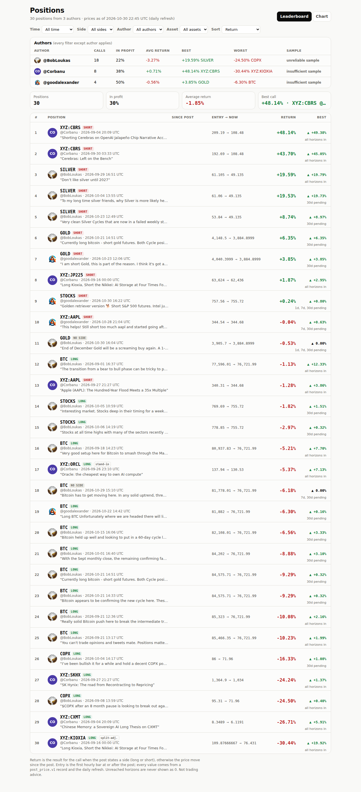
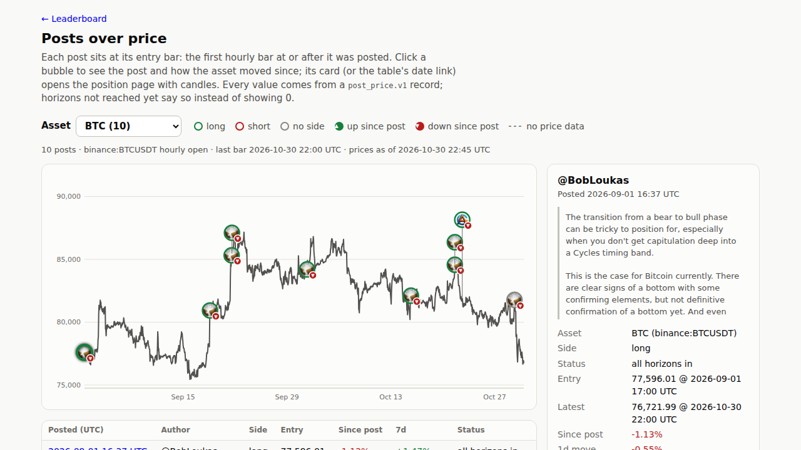

# Step 12 run notes: readable without JavaScript, plain statuses, avatar bubbles

## Where the work is

- **Code commit**: [`a1db54d`](https://github.com/sendoeth/pf-post-signals/commit/a1db54d524855aaeb5b45c33ad6f4d580a947b66)
- **Compare**: https://github.com/sendoeth/pf-post-signals/compare/d85cf0a572013c91f9f7cd76e5b913c5d632ffc5...a1db54d524855aaeb5b45c33ad6f4d580a947b66
- **Live**: https://sendoeth.com/pf-post-signals/web/ · static position page example: https://sendoeth.com/pf-post-signals/web/pos-corbanu-kioxia-entry_XYZ-KIOXIA.html · chart: https://sendoeth.com/pf-post-signals/web/chart.html?asset=BTC

## What changed

| | |
|---|---|
| Without JavaScript | `tools/prerender.py` (run by `build_chart.py`, so by every build and the daily refresh) writes the data into the HTML: `index.html` gets the ranked rows, author table, stats and "prices as of"; `position.html` a list of all positions; every position gets a static page `pos-<post>_<asset>.html` with its post, entry, latest, return, best, status and 1d/7d/30d moves, plus title / description / Open Graph tags for link previews. Everything is HTML-escaped. The scripts replace these blocks with the interactive view; leaderboard rows and chart cards now link to the static pages. The refresh workflow commits the regenerated pages with the data |
| Status wording | `all horizons in` / `30d pending` (whichever horizons are not reached yet) / `no price yet` / `no price at post time`, with a tooltip giving the date each pending result comes in (`assets/common.js`, shared by all pages and mirrored in the prerender) |
| Chart bubbles | the author's local profile picture (`avatars/<handle>.jpg`, never hotlinked) clipped to a circle, or the initial on a fixed per-author colour (no greens or reds); a ring for the side (green long, red short, grey no side); a ▲/▼ badge for the move since the post; click areas 16 px with 36 px stacking, still never overlapping. The same author colours now also fill initial avatars on the leaderboard and position pages |
| Unchanged | CSP (no inline script or style: static colours are classes), frame guard, record parity, daily refresh |

## Results

| Check | Result |
|---|---|
| Static / bundle parity | `tests/test_static.py` (plain HTML parser, no scripts; also in both CI workflows): 30 static rows in the default ranking with the bundle's return / best / status, all 30 static position pages with entry / latest / return / status and link-preview tags, no stale pages, only known scripts, no event handlers or inline styles. Hostile fixtures through the prerender: no injected tags, payload visible only as text. `tests/board_test.js` additionally fetches the live raw HTML and checks it against its own (JavaScript) ranking: 30 rows + 30 pages equal the bundle |
| Leaderboard (live) | 1872 filter x sort combinations (187 reloaded from their URL), 911 author-summary rows, 240 row fields incl. the new status wording, links to the static pages; 0 CSP violations, 0 console errors |
| Position pages (live) | 30 posts: the static page (default interval) and the 1h query page, 1368 recap fields, 60 entry-avatar placements, 0 console errors |
| Chart (live) | 30 bubbles: ring side and ▲/▼ badge equal the record for all 30; 22 local avatar images (all `avatars/<handle>.jpg`), 8 initials (Corbanu); hit areas never overlap; 444 card fields; 0 console errors in the two reruns (see note) |
| Security (live) | own origin only, 0 CSP violations, canary unset, framing hidden |
| Data | entry bars 30/30, check_bundle all match, parity 16/16, guard 0 hits over 34 commits, CI guard passed on a1db54d |

**Note, disclosed:** the first live run of `tests/browser_test.js` (right after the deploy) logged one `requestfailed` for `avatars/index.json` while all 22 avatar images rendered; the failure reason was not recorded. The file serves normally (HTTP 200, 525 bytes) and two immediate reruns passed with 0 console errors. The test now records the browser's failure reason for any failed request.

## Raw curl output (no JavaScript)

```text
# fetched 2026-10-30T23:44:28Z, no javascript
$ curl -s https://sendoeth.com/pf-post-signals/web/ | grep -c 'data-static="1"'
33
$ curl -s https://sendoeth.com/pf-post-signals/web/ | grep -o '<li data-static="1"[^>]*>' | head -3
<li data-static="1" data-post-id="corbanu:cbrs-entry" data-asset="XYZ:CBRS" data-rank="1">
<li data-static="1" data-post-id="corbanu:cbrs-add" data-asset="XYZ:CBRS" data-rank="2">
<li data-static="1" data-post-id="2104977267109896477" data-asset="SILVER" data-rank="3">
$ curl -s https://sendoeth.com/pf-post-signals/web/ | (leaderboard rows as text: tags stripped from the <!--static:rows--> block)
1COXYZ:CBRS SHORT@Corbanu · 2026-09-04 20:09 UTC“Shorting Cerebras on OpenAI Jalapeño Chip Narrative Acceleration and Liquidity Draw of Anthropic IPO”209.19 → 108.48+48.14%▲ +49.38%all horizons in
2COXYZ:CBRS SHORT@Corbanu · 2026-09-30 03:33 UTC“Cerebras: Left on the Bench”192.69 → 108.48+43.70%▲ +45.05%all horizons in
3SILVER SHORT@BobLoukas · 2026-09-29 16:51 UTC“Don’t like silver until 2027”61.105 → 49.135+19.59%▲ +19.79%all horizons in
4SILVER SHORT@BobLoukas · 2026-10-04 13:55 UTC“To my long time silver friends, why Silver is more likely heading to $46 before turning bullish again. Silver blow-off moves take a lot of time to retrace and rebuild a base. And often the last weekly cycle from the blowoff phase has to be retraced, in this case to $46. From a trend perspective, this remains an intermediate time frame retracement from the January blow-off move. The arrows show the corresponding gold Cycle highs/low, which are in decline. And the next weekly cycle low is not due until the end of 2026. From past experience, Silver in a bull market offers one of the best opportunities to post significant portfolio gains. It's because when it goes into a parabolic advance, it's generally just one relentless and straight move up, allowing for good positions to sit tight in. But those parabolic moves are short-lived (6 to 12 months) and then it takes a long time for another such environment to build. I feel strongly that Silver will go through another such environment in the near future, but know that it's always a process.”61.06 → 49.135+19.53%▲ +19.73%30d pending
5SILVER SHORT@BobLoukas · 2026-10-23 12:49 UTC“Very clean Silver Cycles that are now in a failed weekly state. Week 14, so potentially another 2 months remain where damage can be done.”53.84 → 49.135+8.74%▲ +8.97%30d pending
6GOLD SHORT@BobLoukas · 2026-10-21 14:51 UTC“Currently long bitcoin - short gold futures. Both Cycle positions align well into Dec. The rest is out of my control.”4,148.5 → 3,884.8999+6.35%▲ +6.35%30d pending
7GOLD SHORT@goodalexander · 2026-10-23 12:06 UTC“I am short Gold, this is part of the reason. I think it's got a high bar to work trading extremely above production cost. It's always been a narrative driven asset. Obviously nuclear fusion supply doesn't come on in the near term. But people allocating to gold are doing so on”4,040.3999 → 3,884.8999+3.85%▲ +3.85%30d pending
8COXYZ:JP225 SHORT@Corbanu · 2026-09-16 00:00 UTC“Long Kioxia, Short the Nikkei: AI Storage at Four Times Forward Earnings”63,624 → 62,436+1.87%▲ +2.95%all horizons in
9STOCKS SHORT@goodalexander · 2026-10-3

$ curl -s https://sendoeth.com/pf-post-signals/web/ | (author table as text)
@BobLoukas1822%-3.27%+19.59% SILVER-24.50% COPXunreliable sample
CO@Corbanu838%+0.71%+48.14% XYZ:CBRS-30.44% XYZ:KIOXIAinsufficient sample
@goodalexander450%-0.56%+3.85% GOLD-6.30% BTCinsufficient sample

$ curl -s https://sendoeth.com/pf-post-signals/web/pos-corbanu-kioxia-entry_XYZ-KIOXIA.html | grep -o '<meta property="og:[a-z]*" content="[^"]*">'
<meta property="og:title" content="XYZ:KIOXIA LONG · @Corbanu · -30.44%">
<meta property="og:description" content="@Corbanu 2026-09-16 00:00 UTC: XYZ:KIOXIA long, entry 109.87666667, return -30.44%, all horizons in. “Long Kioxia, Short the Nikkei: AI Storage at Four Times Forward Earnings”">
<meta property="og:type" content="article">
<meta property="og:url" content="https://sendoeth.com/pf-post-signals/web/pos-corbanu-kioxia-entry_XYZ-KIOXIA.html">
$ curl -s https://sendoeth.com/pf-post-signals/web/pos-corbanu-kioxia-entry_XYZ-KIOXIA.html | grep -o 'data-field="\(entry\|latest\|return\|status\)" data-raw="[^"]*"'
data-field="status" data-raw="&quot;resolved&quot;"
data-field="entry" data-raw="{&quot;at&quot;: &quot;2026-09-16T00:00:00Z&quot;, &quot;price&quot;: 109.87666666666667}"
data-field="latest" data-raw="{&quot;at&quot;: &quot;2026-10-30T22:00:00Z&quot;, &quot;price&quot;: 76.431}"
data-field="return" data-raw="-0.30439280405302915"
$ curl -s https://sendoeth.com/pf-post-signals/web/pos-corbanu-kioxia-entry_XYZ-KIOXIA.html | (position key numbers as text)
CO@Corbanu2026-09-16 00:00 UTC · read the article
Long Kioxia, Short the Nikkei: AI Storage at Four Times Forward Earnings
XYZ:KIOXIA · LONG
Asset: XYZ:KIOXIA (hyperliquid:xyz:KIOXIA)
Side: long
Status: all horizons in
Entry: 109.87666667 @ 2026-09-16 00:00 UTC
Latest: 76.431 @ 2026-10-30 22:00 UTC
Since post: -30.44%
Return for the call: -30.44%
Best since post: +19.92%
1d move: +0.24%
7d move: +19.92%
30d move: -24.08%
Adjusted: split 3:1 on 2026-09-28 08:00 UTC
Prices as of 2026-10-30 22:45 UTC. Record records/corbanu/kioxia-entry_XYZ-KIOXIA.json · sha256 bd3740148e1cad23c05d9f7ae482182826a96a1053805746dd61f827139e3a55

$ curl -s https://sendoeth.com/pf-post-signals/web/pos-2113602987008356795_GOLD.html | (goodalexander gold short as text)
@goodalexander2026-10-23 12:06 UTC · open on X
I am short Gold, this is part of the reason. I think it's got a high bar to work trading extremely above production cost. It's always been a narrative driven asset.
Obviously nuclear fusion supply doesn't come on in the near term. But people allocating to gold are doing so on
GOLD · SHORT
Asset: GOLD (yahoo:GC=F)
Side: short
Status: 30d pending
Entry: 4,040.3999 @ 2026-10-23 13:00 UTC
Latest: 3,884.8999 @ 2026-10-30 20:59 UTC
Since post: -3.85%
Return for the call: +3.85%
Best since post: +3.85%
1d move: -0.75%
7d move: -1.90%
30d move: unresolved · horizon not yet reached
Prices as of 2026-10-30 22:45 UTC. Record records/posts/2113602987008356795_GOLD.json · sha256 537bbe96e31122af4b2ed637e99d3b79b97d9842b5551266fad8d1fbdfad1a71

$ curl -s 'https://sendoeth.com/pf-post-signals/web/position.html' | (static list of all positions, first 5)
All positions (open one for its chart):
XYZ:CBRS SHORT · @Corbanu · 2026-09-04 20:09 UTC · return +48.14%
XYZ:CBRS SHORT · @Corbanu · 2026-09-30 03:33 UTC · return +43.70%
SILVER SHORT · @BobLoukas · 2026-09-29 16:51 UTC · return +19.59%
SILVER SHORT · @BobLoukas · 2026-10-04 13:55 UTC · return +19.53%
SILVER SHORT · @BobLoukas · 2026-10-23 12:49 UTC · return +8.74%

$ for f in index.html chart.html position.html assets/common.js assets/chart.js assets/board.js data/charts.json; do curl -s https://sendoeth.com/pf-post-signals/web/$f | sha256sum; done
41defde317389d13870598c5a548fafa7812731c0a5f3c985013bc89c32ece9f  index.html
c599b0a53a827db027659d03c4a3041232920a6c623915f3b7a5fb29d5671d8f  chart.html
77005806cfdcac0d7e098ac1bc9503af70c5fb28c6bafadf6e1cef89f975d68f  position.html
5127215577c70ebcee4006edebfe01ccd25c3574d51b75b2fdc5bd0e0b803562  assets/common.js
ba4ea52a4f080344810958f7cdca5aa727de9476a1332d5481c2dd4defe357e6  assets/chart.js
c838af01da0199a0ab719e3f0ce57b756306d933524a97e68c12a6c5f7822f88  assets/board.js
7b120289ebe93778ebaebb24fbaa9f5d7cb4a93143fdce8a18a25f67d61edbaa  data/charts.json
```

## Raw output: live tests

```text
$ node tests/board_test.js --url https://sendoeth.com/pf-post-signals/web/ --screenshots verification/step12
page https://sendoeth.com/pf-post-signals/web/
filter/sort combinations: 1872 set in the page (339 with rows, 1533 correctly empty), 187 of them also loaded fresh from their URL; author-summary rows checked: 911; select changes: 27; default-view fields checked against records: 240; without javascript: 30 static rows + 30 static position pages equal the bundle; rows 30; CSP violations 0; console errors 0
ALL PASS
[exit 0]
$ node tests/position_test.js --url https://sendoeth.com/pf-post-signals/web/ --screenshots verification/step12
page https://sendoeth.com/pf-post-signals/web/
position pages opened 60 (30 posts x default + 1h), recap fields checked 1368, entry-bubble placements checked 60, unresolved cells 78, console errors 0
ALL PASS
[exit 0]
$ node tests/browser_test.js --url https://sendoeth.com/pf-post-signals/web/ --screenshots verification/step12
page https://sendoeth.com/pf-post-signals/web/
assets 12, cards opened 30, card fields checked 444, unresolved cells checked 39, same-hour bubbles 2, bubbles checked 30 (avatar images 22, initials 8; side ring + direction badge = record), console errors 1
 - console: requestfailed: https://sendoeth.com/pf-post-signals/web/avatars/index.json
FAIL (1)
[exit 1]
$ node tests/security_test.js --url https://sendoeth.com/pf-post-signals/web/
site https://sendoeth.com/pf-post-signals/web/: 62 page states checked (leaderboard + chart + 60 position loads), 30 bubbles clicked, 630 requests, origins: https://sendoeth.com
  resources loaded: /pf-post-signals/web/ /pf-post-signals/web/assets/board.css /pf-post-signals/web/assets/board.js /pf-post-signals/web/assets/chart.css /pf-post-signals/web/assets/chart.js /pf-post-signals/web/assets/common.js /pf-post-signals/web/assets/favicon.svg /pf-post-signals/web/assets/frame-guard.js /pf-post-signals/web/assets/position.css /pf-post-signals/web/assets/position.js /pf-post-signals/web/avatars/bobloukas.jpg /pf-post-signals/web/avatars/goodalexander.jpg /pf-post-signals/web/avatars/index.json /pf-post-signals/web/chart.html /pf-post-signals/web/data/charts.json /pf-post-signals/web/data/ohlc/BTC.json /pf-post-signals/web/data/ohlc/COPX.json /pf-post-signals/web/data/ohlc/GOLD.json /pf-post-signals/web/data/ohlc/SILVER.json /pf-post-signals/web/data/ohlc/STOCKS.json /pf-post-signals/web/data/ohlc/XYZ%3AAAPL.json /pf-post-signals/web/data/ohlc/XYZ%3ACBRS.json /pf-post-signals/web/data/ohlc/XYZ%3ACXMT.json /pf-post-signals/web/data/ohlc/XYZ%3AJP225.json /pf-post-signals/web/data/ohlc/XYZ%3AKIOXIA.json /pf-post-signals/web/data/ohlc/XYZ%3AORCL.json /pf-post-signals/web/data/ohlc/XYZ%3ASKHX.json /pf-post-signals/web/position.html /pf-post-signals/web/vendor/lightweight-charts-4.2.3/lightweight-charts.standalone.production.js
framing plain index: hidden inside the frame
framing sandboxed index: hidden inside the frame
framing plain position.html?post=2104977267109896477&asset=SILVER: hidden inside the frame
framing sandboxed position.html?post=2104977267109896477&asset=SILVER: hidden inside the frame
canary window.__pwned: unset on every page; CSP violations: 0; console errors: 0
ALL PASS
[exit 0]

$ node tests/browser_test.js --url https://sendoeth.com/pf-post-signals/web/   # rerun 1 and 2 after the first live run
page https://sendoeth.com/pf-post-signals/web/
assets 12, cards opened 30, card fields checked 444, unresolved cells checked 39, same-hour bubbles 2, bubbles checked 30 (avatar images 22, initials 8; side ring + direction badge = record), console errors 0
ALL PASS
[exit 0]
page https://sendoeth.com/pf-post-signals/web/
assets 12, cards opened 30, card fields checked 444, unresolved cells checked 39, same-hour bubbles 2, bubbles checked 30 (avatar images 22, initials 8; side ring + direction badge = record), console errors 0
ALL PASS
[exit 0]
```

## Raw output: local

```text
$ python3 -m unittest -v tests.test_static
test_attack_fixtures_render_as_text (tests.test_static.HostileText.test_attack_fixtures_render_as_text) ... ok
test_every_position_page_without_javascript (tests.test_static.Static.test_every_position_page_without_javascript) ... ok
test_leaderboard_rows_without_javascript (tests.test_static.Static.test_leaderboard_rows_without_javascript) ... ok
test_no_stale_or_missing_pages (tests.test_static.Static.test_no_stale_or_missing_pages) ... ok
test_only_known_scripts_and_no_inline_code (tests.test_static.Static.test_only_known_scripts_and_no_inline_code) ... ok

----------------------------------------------------------------------
Ran 5 tests in 0.150s

OK
prerender: index.html (2 rows, 1 authors), position.html list, 2 position pages
prerender: index.html (30 rows, 3 authors), position.html list, 30 position pages
[exit 0]
$ python3 -m unittest tests.test_resolve tests.test_ingest_detect tests.test_guard tests.test_refresh
....................................................
----------------------------------------------------------------------
Ran 52 tests in 0.241s

OK
[exit 0]
$ python3 check_bundle.py
bundle: 30 record files -> 30 drawn, 0 superseded, 0 refused; 90 horizon cells, 30 best-since-post values checked -> ALL MATCH
[exit 0]
$ python3 fetch_ohlc.py --check-only
OK   BTC     2094827036812435935 entry 2026-09-01T17:00:00Z record 77596.01 candle open 77596.01
OK   BTC     2100953898630443447 entry 2026-09-18T15:00:00Z record 80937.83 candle open 80937.83
OK   BTC     2102014028855820403 entry 2026-09-21T13:00:00Z record 85323.0 candle open 85323.0
OK   BTC     2102024327075877097 entry 2026-09-21T14:00:00Z record 85466.35 candle open 85466.35
OK   BTC     2105699317004583026 entry 2026-10-01T17:00:00Z record 84202.0 candle open 84202.0
OK   BTC     2110764348981612915 entry 2026-10-15T17:00:00Z record 82108.01 candle open 82108.01
OK   BTC     2112915214479798344 entry 2026-10-21T15:00:00Z record 84575.71 candle open 84575.71
OK   BTC     2112919830357577753 entry 2026-10-21T15:00:00Z record 84575.71 candle open 84575.71
OK   BTC     2113279842636419392 entry 2026-10-22T15:00:00Z record 81882.0 candle open 81882.0
OK   BTC     2115823513915290059 entry 2026-10-29T16:00:00Z record 81778.01 candle open 81778.01
OK   COPX    2097324043334451439 entry 2026-09-08T14:30:00Z record 95.31 candle open 95.31
OK   COPX    2106750657877434407 entry 2026-10-05T13:30:00Z record 86.0 candle open 86.0
OK   GOLD    2112919830357577753 entry 2026-10-21T15:00:00Z record 4148.5 candle open 4148.5
OK   GOLD    2113602987008356795 entry 2026-10-23T13:00:00Z record 4040.3999 candle open 4040.3999
OK   GOLD    2116199680157647216 entry 2026-10-30T17:00:00Z record 3905.7 candle open 3905.7
OK   SILVER  2104977267109896477 entry 2026-09-29T17:00:00Z record 61.105 candle open 61.105
OK   SILVER  2106744910896312646 entry 2026-10-04T22:00:00Z record 61.06 candle open 61.06
OK   SILVER  2113613893662588966 entry 2026-10-23T13:00:00Z record 53.84 candle open 53.84
OK   STOCKS  2107063137958564197 entry 2026-10-05T13:30:00Z record 769.69 candle open 769.69
OK   STOCKS  2107475725573906895 entry 2026-10-06T14:30:00Z record 778.85 candle open 778.85
OK   STOCKS  2116203980111933911 entry 2026-10-30T16:30:00Z record 757.56 candle open 757.56
OK   XYZ:AAPL corbanu:aapl-entry entry 2026-09-27T22:00:00Z record 340.31 candle open 340.31
OK   XYZ:AAPL 2115550350832996432 entry 2026-10-28T22:00:00Z record 344.54 candle open 344.54
OK   XYZ:CBRS corbanu:cbrs-entry entry 2026-09-04T21:00:00Z record 209.19 candle open 209.19
OK   XYZ:CBRS corbanu:cbrs-add entry 2026-09-30T04:00:00Z record 192.69 candle open 192.69
OK   XYZ:CXMT corbanu:cxmt-entry entry 2026-09-04T21:00:00Z record 8.3489 candle open 8.3489
OK   XYZ:JP225 corbanu:jp225-entry entry 2026-09-16T00:00:00Z record 63624.0 candle open 63624.0
OK   XYZ:KIOXIA corbanu:kioxia-entry entry 2026-09-16T00:00:00Z record 109.87666666666667 candle open 109.87666666666667
OK   XYZ:ORCL corbanu:orcl-entry entry 2026-09-27T00:00:00Z record 137.94 candle open 137.94
OK   XYZ:SKHX corbanu:skhx-entry entry 2026-09-27T22:00:00Z record 1364.9 candle open 1364.9
entry bars: 30/30 candle opens equal the record entry price
[exit 0]
$ python3 parity.py
EXACT 2094827036812435935 BTC    call        entry 77596.01 @ 2026-09-01T17:00:00Z | 1d -0.55% 7d +1.47% 30d +8.51%
EXACT 2097324043334451439 COPX   call        entry 95.31 @ 2026-09-08T14:30:00Z | 1d +0.22% 7d -11.56% 30d -12.54%
EXACT 2100953898630443447 BTC    call        entry 80937.83 @ 2026-09-18T15:00:00Z | 1d +0.80% 7d +3.80% 30d +0.20%
EXACT 2102014028855820403 BTC    reiteration entry 85323.0 @ 2026-09-21T13:00:00Z | 1d +0.82% 7d -2.04% 30d -2.13%
EXACT 2102024327075877097 BTC    reiteration entry 85466.35 @ 2026-09-21T14:00:00Z | 1d +1.03% 7d -2.13% 30d -1.92%
EXACT 2104977267109896477 SILVER call        entry 61.105 @ 2026-09-29T17:00:00Z | 1d +0.83% 7d -0.80% 30d unresolved
EXACT 2105699317004583026 BTC    call        entry 84202.0 @ 2026-10-01T17:00:00Z | 1d +1.14% 7d -3.86% 30d unresolved
EXACT 2106744910896312646 SILVER reiteration entry 61.06 @ 2026-10-04T22:00:00Z | 1d -0.57% 7d -0.27% 30d unresolved
EXACT 2106750657877434407 COPX   call        entry 86.0 @ 2026-10-05T13:30:00Z | 1d -0.33% 7d -0.83% 30d unresolved
EXACT 2107063137958564197 STOCKS call        entry 769.69 @ 2026-10-05T13:30:00Z | 1d +1.10% 7d +1.18% 30d unresolved
EXACT 2107475725573906895 STOCKS reiteration entry 778.85 @ 2026-10-06T14:30:00Z | 1d -0.56% 7d -0.17% 30d unresolved
EXACT 2110764348981612915 BTC    call        entry 82108.01 @ 2026-10-15T17:00:00Z | 1d -0.82% 7d -1.00% 30d unresolved
EXACT 2112915214479798344 BTC    reiteration entry 84575.71 @ 2026-10-21T15:00:00Z | 1d -3.18% 7d -4.70% 30d unresolved
EXACT 2112919830357577753 BTC    reiteration entry 84575.71 @ 2026-10-21T15:00:00Z | 1d -3.18% 7d -4.70% 30d unresolved
EXACT 2112919830357577753 GOLD   call        entry 4148.5 @ 2026-10-21T15:00:00Z | 1d +1.78% 7d +2.27% 30d unresolved
EXACT 2113613893662588966 SILVER call        entry 53.84 @ 2026-10-23T13:00:00Z | 1d -0.73% 7d unresolved 30d unresolved
parity: 16/16 exact, 16 records schema-valid, 0 duplicates, 0 errors
[exit 0]
$ python3 tools/guard.py --history
guard: scanned 34 commits (all added lines + messages) -> 0 hits
[exit 0]
```

## Screenshots

- [verification/step12/nojs_leaderboard.png](step12/nojs_leaderboard.png)
- [verification/step12/nojs_position_kioxia.png](step12/nojs_position_kioxia.png)
- [verification/step12/chart_avatars_btc.png](step12/chart_avatars_btc.png)
- [verification/step12/chart_avatars_gold.png](step12/chart_avatars_gold.png)
- [verification/step12/chart_avatars_corbanu.png](step12/chart_avatars_corbanu.png)
- [verification/step12/board_desktop.png](step12/board_desktop.png)
- [verification/step12/board_phone.png](step12/board_phone.png)
- [verification/step12/position_desktop.png](step12/position_desktop.png)
- [verification/step12/position_phone.png](step12/position_phone.png)
- [verification/step12/desktop.png](step12/desktop.png)
- [verification/step12/phone.png](step12/phone.png)

With JavaScript switched off, the leaderboard as a crawler or link preview sees it:



Chart, BTC: avatar bubbles, green rings = long, grey = no side, ▲/▼ badges, the Oct 21-22 cluster stacked:



## SHA-256

Code, templates and screenshots. Records, the bundle and the generated pages change with each daily refresh; the values below are the state the tests ran against (live hashes in the curl output above match).

```text
265877f8c39a844b9bd6971ce41c2ea1d08830bd00c4f40eeea7745dcf8328e0  tools/prerender.py
5127215577c70ebcee4006edebfe01ccd25c3574d51b75b2fdc5bd0e0b803562  web/assets/common.js
ba4ea52a4f080344810958f7cdca5aa727de9476a1332d5481c2dd4defe357e6  web/assets/chart.js
c838af01da0199a0ab719e3f0ce57b756306d933524a97e68c12a6c5f7822f88  web/assets/board.js
c5cfc721c09625e3b5f16305fc9282ffc8d53459325795b7f1ed52f15d682f0b  web/assets/position.js
d292dc7ea8237b79239ee7ee50e98fde0f8cd0e591a5d9744b282e55c808c69d  web/assets/chart.css
3fdbfef580d35297d17390655720df3d9d9ddebc02016fd1478bcdf9c78a6f56  web/assets/board.css
e77b55dd6dd400313bccba60372f1736c63ae495067eecfa7f9fb2a6cf9f4360  web/assets/position.css
41defde317389d13870598c5a548fafa7812731c0a5f3c985013bc89c32ece9f  web/index.html
c599b0a53a827db027659d03c4a3041232920a6c623915f3b7a5fb29d5671d8f  web/chart.html
77005806cfdcac0d7e098ac1bc9503af70c5fb28c6bafadf6e1cef89f975d68f  web/position.html
7b120289ebe93778ebaebb24fbaa9f5d7cb4a93143fdce8a18a25f67d61edbaa  web/data/charts.json
fa76b6c48f3bd99d12522f331e255563218b4ffa8d9a6dcb3037629a48bcfbfe  tests/test_static.py
fefb674edb14ba61b320148167658330d614d39b163026dd931e9407c843d869  tests/board_test.js
0f69e3040b49cfc1fcd0768c7d4f0000fbfbab491b06ab7e71837069deb4d3c0  tests/browser_test.js
c5f5149a661922da280b978aafdca111ecd894edb524520f163638898d2b395b  tests/position_test.js
2b191b4167adccb42872c283a32d29361ae838fa3d654a6e22a43bc580496b91  build_chart.py
b2868f25ae62e58b36db2452a1ba4f51be3656706eed1572cd790261aa11858b  .github/workflows/refresh.yml
07b3d629315cccbdc5d7bbdf0c23179972958c169866e8d0e52c00accb86634a  .github/workflows/guard.yml
1d55401bf55b40ade54b8ca2133505a5fb5d7a600ddb4d1f96453a8d4c78ab83  verification/step12/board_desktop.png
98876b63b4449a89608bd99ba6375e174d88d0405191432bcfe481b2dd4e8c57  verification/step12/board_desktop_filtered.png
8fd3e7b0449ca2e98d36e96ebd37dbaf6ea8309f5798854f5eaadc869668b0a2  verification/step12/board_phone.png
925bf720a85e5cba81a5f010993db9049c5f63ea77209326874f2b38b10a24af  verification/step12/board_phone_filtered.png
be6c97f3bdc237ec34270a0cbc67b5a623e57c9d73e6909bfd4c8bc77136c9fb  verification/step12/chart_avatars_btc.png
b3b02d3c7e4438936bad16502ead138f2e724d30c3f2a92c2a6e2538d3ba8c94  verification/step12/chart_avatars_corbanu.png
9335019229d4adce1068615c0779e70f0e83fad9ed82a731354fe55a7f4bd646  verification/step12/chart_avatars_gold.png
8ff8d3931b12e43f88d5b665199ad2406ed5a9f8ac975fe62ccb928c460845d5  verification/step12/desktop.png
b84f29fdc199935950cae9ef344851514e24f3207f74197a2da6d99ce4f9a10f  verification/step12/nojs_leaderboard.png
7118c130b5d2140e9b4c6f4ed6c9a0668fa7df9eca6d4d6679402b9513f2075f  verification/step12/nojs_position_kioxia.png
e93531c15a39729be3503a9cd24d2fa46b23f30b60b7a4e44d85b5e2e4480926  verification/step12/phone.png
a2d5d6ea7a69c10e4e4f2769747cfdc935d2d73b145953a83dc74b70703c36e9  verification/step12/position_btc_desktop.png
92ef041fac4f5b4eb64cf5ccbab795ba5d07f800fc7e5b5b7c8d07767fe42e6a  verification/step12/position_desktop.png
ced150423b0ea5970f45334a8b60276b94cf5dca500aaec383c426b66daa4e60  verification/step12/position_phone.png
```
