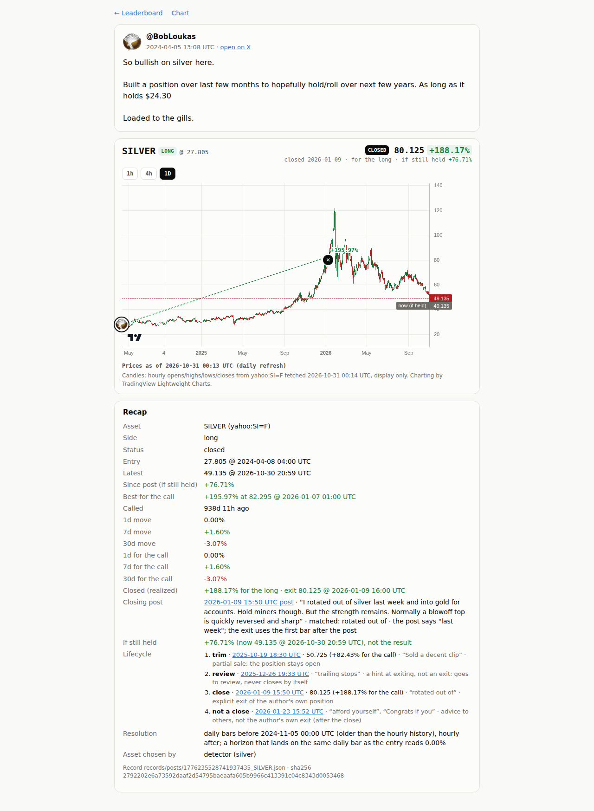

# Step 13 run notes: closing calls

## Where the work is

- **Code commits**: [`0a81eae`](https://github.com/sendoeth/pf-post-signals/commit/0a81eae2c49e76e02b9ae4aa015eb8410e424b75) (lifecycle, classifier, daily-bar history, ledger exits, pages, tests) and [`f8abe5e`](https://github.com/sendoeth/pf-post-signals/commit/f8abe5effdc8a02ac51357640ee1bc732cb10ec8) (closed sparkline ends at the exit; leaderboard note)
- **Compare**: https://github.com/sendoeth/pf-post-signals/compare/2c8d33e1e42edd03a9fbb1b3c0fd71a96640ce6a...f8abe5effdc8a02ac51357640ee1bc732cb10ec8
- **Live BobLoukas silver position**: https://sendoeth.com/pf-post-signals/web/pos-1776235528741937435_SILVER.html · closed positions on the leaderboard: https://sendoeth.com/pf-post-signals/web/?state=closed

## The BobLoukas silver chain (receipts in `sources/bobloukas/receipts`, config in `data/lifecycle.json`)

| Date (UTC) | Post (receipt) | Decision | Matched words | Price | Notes |
|---|---|---|---|---|---|
| 2024-04-05T13:08 | [1776235528741937435](https://x.com/BobLoukas/status/1776235528741937435) · `sources/bobloukas/receipts/1776235528741937435.json` sha256 `fd16698f7e662bbe…` | **open** (long) | silver (detector) | entry 27.805 @ 2024-04-08T04:00 (daily bar) | "Built a position ... Loaded to the gills", stated stop $24.30 |
| 2025-10-19T18:30 | [1979978358214774957](https://x.com/BobLoukas/status/1979978358214774957) · `sources/bobloukas/receipts/1979978358214774957.json` sha256 `143fbf2e79ce051f…` | **trim** | Sold a decent clip | 50.725 @ 2025-10-19T22:00 (+82.43% for the call) | partial sale: the position stays open; the post says "on Friday" (recorded, not used) |
| 2025-12-26T19:33 | [2004636831774871803](https://x.com/BobLoukas/status/2004636831774871803) · `sources/bobloukas/receipts/2004636831774871803.json` sha256 `fdbaae7cfa5a6688…` | **review** | trailing stops | not priced | a hint at exiting, not an exit: goes to review, never closes by itself |
| 2026-01-09T15:50 | [2009654117799739530](https://x.com/BobLoukas/status/2009654117799739530) · `sources/bobloukas/receipts/2009654117799739530.json` sha256 `2bc12afd297e4c76…` | **close** | rotated out of | 80.125 @ 2026-01-09T16:00 (+188.17% for the call) | explicit exit of the author's own position; the post says "last week" (recorded, not used) |
| 2026-01-23T15:52 | [2014728061996896651](https://x.com/BobLoukas/status/2014728061996896651) · `sources/bobloukas/receipts/2014728061996896651.json` sha256 `e0a8b8604fb92996…` | **not close** | afford yourself, Congrats if you | not priced | advice to others, not the author's own exit (after the close) |

**Result:** closed 2026-01-09, realized **+188.17%** (exit 80.125 @ 2026-01-09T16:00); best while held +195.97% on 2026-01-07; if still held today +76.71% (now 49.135 @ 2026-10-30T20:59). Silver's all-time high, $121.30 on 2026-01-29, came after the close and is not counted.

Expected outcomes: 1 open, 1 trim, 1 review, 1 close, 1 not-a-close. All five hold (tests/test_lifecycle.py and the live run below).

## What changed

| | |
|---|---|
| Lifecycle | records gain `lifecycle` (state + events, each with its own post receipt, matched words, reason, decided_by, and for trim/close/flip the exit bar and move) and `closed` (frozen exit bar, realized move / for the call, stated time). Status **closed**. Exit = first bar at or after the follow-up post, same lag rule as entries; stated earlier times are recorded, not used. Lifecycle bars are frozen in the daily refresh like entries |
| Classifier (`classify.py`) | same author + same asset (detector terms); precedence advice-to-others > flip > close > trim > hint. close: rotated out of / sold all / closed / exited / out of / covered / stopped out / no longer hold; flip: now / flipped short or long (opposite side); trim: sold a clip / took some profits / trimmed / scaled out; review: trailing stops / lightened / de-risk / jump ship; not a close: advice ('afford yourself', 'you should', 'congrats if you') or no exit words. Overrides need a reason and show as reviewed |
| Corbanu | a ledger exit event (or a trade to 0% weight) closes every leg of that position at the first bar after it (`tools/import_corbanu.py`); fixture `tests/fixtures/corbanu_ledger_with_exit.json` (the step 1 ledger plus one synthetic exit, labelled as such; the live ledger has no exits) |
| History | Yahoo serves about 730 days of hourly bars; older history comes from daily bars (`resolve.yahoo_bars`), marked `interval: "1d"` on every bar that uses one and `resolved_with.daily_until`; the silver entry (2024-04-05 post) is the 2024-04-08 daily bar |
| Pages | leaderboard: return = realized for closed positions, status filter open / closed, closed tag, "entry -> exit", sparkline ends at the exit, author summary on realized returns; position page: CLOSED badge, realized % in the header with "if still held" beside it, Closed (realized), Closing post (link, text, matched words, stated time), If still held ("not the result"), lifecycle timeline, exit marker on the chart, best since post capped at the exit; chart cards and static (no-JS) pages carry the same |

## Results

| Check | Result |
|---|---|
| Lifecycle unit tests | 12: the real silver posts classify as trim / review / close / not-close; apply() closes at the first bar after the closing post, records 'last week' without using it, keeps the trim open, prices nothing for review / not-close; overrides need a reason; follow-ups must be after the open; flips, closes, other-asset and advice cases; Corbanu ledger close; schema accepts the closed record |
| Leaderboard (live) | 5616 filter x sort combinations incl. the new open / closed filter (618 with rows, 4998 correctly empty, independently cross-checked), 224 reloaded from their URL; realized returns rank closed calls; 1525 author-summary rows; 248 row fields; static no-JS rows and pages equal the bundle; 0 CSP violations, 0 console errors |
| Position pages (live) | 62 loads, 1414 recap fields; the closed silver page (2 loads): Closed raw = the record's `closed`, header result = realized, If still held separate and marked 'not the result', closing post with its stated time, lifecycle timeline |
| Chart, security (live) | 31 bubbles (closed: badge = move to the exit), 459 card fields; own origin only, 0 CSP violations, canary unset |
| Data | 31 records valid, 31 drawn / 0 refused, best since post rechecked (capped at the exit), parity 16/16, guard 0 hits, 69 Python tests OK, CI guard passed |

Known limit (documented on the page): with daily bars a short horizon can land on the entry bar itself; the silver 1d move reads 0.00% because the Friday 2024-04-05 post's next daily bar (Monday) is both the entry and the 1d exit.

## Raw output: local (classifier, lifecycle, ledger fixture, tests)

```text
## silver chain: classifier on the saved receipts
$ python3 classify.py Sold a decent clip of Gold/Silver positions on Friday.  Left the miners alone.  First selling since taking positions in 2023.  

Sold without loss of a trend too, which I try not to do.  

But it’s just hard to ignore how extended its become. How much attention it suddenly has. SILVER 1
{"type": "trim", "terms": ["Sold a decent clip"], "reason": "partial sale: the position stays open", "stated_time": "on Friday"}
[exit 0]
$ python3 classify.py Just a glorious move on Silver.  

It's only trailing stops now. SILVER 1
{"type": "review", "terms": ["trailing stops"], "reason": "a hint at exiting, not an exit: goes to review, never closes by itself", "stated_time": null}
[exit 0]
$ python3 classify.py I rotated out of silver last week and into gold for accounts.  Hold miners though.

But the strength remains. Normally a blowoff top is quickly reversed and sharply lower.  This seems to be setting up for yet another leg higher. SILVER 1
{"type": "close", "terms": ["rotated out of"], "reason": "explicit exit of the author's own position", "stated_time": "last week"}
[exit 0]
$ python3 classify.py $100 Silver. Gold near $5,000.  Miners 4x - 12 months.  Congrats if you’ve been on this ride too. 

A lesson in sitting firm in a Position trade.  But now, afford yourself some profit taking/rebalancing. SILVER 1
{"type": "not_close", "terms": ["afford yourself", "Congrats if you"], "reason": "advice to others, not the author's own exit", "stated_time": null}
[exit 0]
## silver chain: lifecycle (live prices)
$ python3 lifecycle.py
1776235528741937435|SILVER: opened 2024-04-05T13:08 at 27.805 (1d bar 2024-04-08T04:00)
  2025-10-19T18:30 1979978358214774957 -> trim      ['Sold a decent clip'] bar 50.725 @ 2025-10-19T22:00 +82.43% stated 'on Friday'
  2025-12-26T19:33 2004636831774871803 -> review    ['trailing stops'] 
  2026-01-09T15:50 2009654117799739530 -> close     ['rotated out of'] bar 80.125 @ 2026-01-09T16:00 +188.17% stated 'last week'
  2026-01-23T15:52 2014728061996896651 -> not_close ['afford yourself', 'Congrats if you']  (after the close)
  CLOSED: realized +188.17% at 80.125 @ 2026-01-09T16:00; if still held +76.71%
[exit 0]
## corbanu ledger exit (fixture with one synthetic exit)
$ python3 tools/import_corbanu.py --ledger tests/fixtures/corbanu_ledger_with_exit.json --out work/ledger_fixture_out
cbrs-entry   XYZ:CBRS    short ref 209.225 @ 2026-09-04T20:09 -> entry 209.19 @ 2026-09-04T21:00; for the call +47.99%
cxmt-entry   XYZ:CXMT    long  ref 8.3403 @ 2026-09-04T20:09 -> entry 8.3489 @ 2026-09-04T21:00; for the call -26.06%  CLOSED by ledger exit at 8.37 @ 2026-10-01T14:00: realized +0.25%
jp225-entry  XYZ:JP225   short ref 63624.0 @ 2026-09-16T00:00 -> entry 63624.0 @ 2026-09-16T00:00; for the call +1.97%
kioxia-entry XYZ:KIOXIA  long  ref 109.87666666666667 @ 2026-09-16T00:00 -> entry 109.87666666666667 @ 2026-09-16T00:00; for the call -29.97%
orcl-entry   XYZ:ORCL    long  ref 139.16 @ 2026-09-26T23:10 -> entry 137.94 @ 2026-09-27T00:00; for the call -5.05%  [stand-in xyz:ORCL for ORCLon]
aapl-entry   XYZ:AAPL    short ref 340.43 @ 2026-09-27T21:27 -> entry 340.31 @ 2026-09-27T22:00; for the call -1.42%
skhx-entry   XYZ:SKHX    long  ref 1367.5 @ 2026-09-27T21:27 -> entry 1364.9 @ 2026-09-27T22:00; for the call -23.75%
cbrs-add     XYZ:CBRS    short ref 191.75 @ 2026-09-30T03:33 -> entry 192.69 @ 2026-09-30T04:00; for the call +43.54%
8 Corbanu trades imported from tests/fixtures/corbanu_ledger_with_exit.json (sha256 218db1548a07c363367aec76326696f090efb57ee2f0645bca956ebcf447585f) -> work/ledger_fixture_out; ledger exits: 1 (cxmt at 2026-10-01T14:00:00Z)
[exit 0]
## tests
$ python3 -m unittest -v tests.test_lifecycle
test_advice_wins_over_exit_words (tests.test_lifecycle.Classifier.test_advice_wins_over_exit_words) ... ok
test_closes (tests.test_lifecycle.Classifier.test_closes) ... ok
test_flip (tests.test_lifecycle.Classifier.test_flip) ... ok
test_other_asset_is_not_about_this_position (tests.test_lifecycle.Classifier.test_other_asset_is_not_about_this_position) ... ok
test_importer_marks_ledger_exits (tests.test_lifecycle.Ledger.test_importer_marks_ledger_exits) ... ok
test_ledger_exit_closes_at_the_first_bar_after (tests.test_lifecycle.Ledger.test_ledger_exit_closes_at_the_first_bar_after) ... ok
test_apply_closes_at_the_first_bar_after_the_closing_post (tests.test_lifecycle.SilverChain.test_apply_closes_at_the_first_bar_after_the_closing_post) ... ok
test_classifier_on_the_real_posts (tests.test_lifecycle.SilverChain.test_classifier_on_the_real_posts) ... ok
test_followup_must_be_after_the_open (tests.test_lifecycle.SilverChain.test_followup_must_be_after_the_open) ... ok
test_override_needs_and_keeps_a_reason (tests.test_lifecycle.SilverChain.test_override_needs_and_keeps_a_reason) ... ok
test_schema_accepts_the_closed_record (tests.test_lifecycle.SilverChain.test_schema_accepts_the_closed_record) ... ok
test_trim_keeps_the_position_open (tests.test_lifecycle.SilverChain.test_trim_keeps_the_position_open) ... ok

----------------------------------------------------------------------
Ran 12 tests in 0.749s

OK
[exit 0]
$ python3 -m unittest tests.test_static tests.test_resolve tests.test_ingest_detect tests.test_guard tests.test_refresh
.........................................................
----------------------------------------------------------------------
Ran 57 tests in 0.385s

OK
prerender: index.html (2 rows, 1 authors), position.html list, 2 position pages
prerender: index.html (31 rows, 3 authors), position.html list, 31 position pages
[exit 0]
$ python3 check_bundle.py
bundle: 31 record files -> 31 drawn, 0 superseded, 0 refused; 93 horizon cells, 31 best-since-post values checked -> ALL MATCH
[exit 0]
$ python3 validate_records.py
records: 31 checked against post_price.v1 -> ALL VALID
[exit 0]
$ python3 parity.py
EXACT 2094827036812435935 BTC    call        entry 77596.01 @ 2026-09-01T17:00:00Z | 1d -0.55% 7d +1.47% 30d +8.51%
EXACT 2097324043334451439 COPX   call        entry 95.31 @ 2026-09-08T14:30:00Z | 1d +0.22% 7d -11.56% 30d -12.54%
EXACT 2100953898630443447 BTC    call        entry 80937.83 @ 2026-09-18T15:00:00Z | 1d +0.80% 7d +3.80% 30d +0.20%
EXACT 2102014028855820403 BTC    reiteration entry 85323.0 @ 2026-09-21T13:00:00Z | 1d +0.82% 7d -2.04% 30d -2.13%
EXACT 2102024327075877097 BTC    reiteration entry 85466.35 @ 2026-09-21T14:00:00Z | 1d +1.03% 7d -2.13% 30d -1.92%
EXACT 2104977267109896477 SILVER call        entry 61.105 @ 2026-09-29T17:00:00Z | 1d +0.83% 7d -0.80% 30d unresolved
EXACT 2105699317004583026 BTC    call        entry 84202.0 @ 2026-10-01T17:00:00Z | 1d +1.14% 7d -3.86% 30d unresolved
EXACT 2106744910896312646 SILVER reiteration entry 61.06 @ 2026-10-04T22:00:00Z | 1d -0.57% 7d -0.27% 30d unresolved
EXACT 2106750657877434407 COPX   call        entry 86.0 @ 2026-10-05T13:30:00Z | 1d -0.33% 7d -0.83% 30d unresolved
EXACT 2107063137958564197 STOCKS call        entry 769.69 @ 2026-10-05T13:30:00Z | 1d +1.10% 7d +1.18% 30d unresolved
EXACT 2107475725573906895 STOCKS reiteration entry 778.85 @ 2026-10-06T14:30:00Z | 1d -0.56% 7d -0.17% 30d unresolved
EXACT 2110764348981612915 BTC    call        entry 82108.01 @ 2026-10-15T17:00:00Z | 1d -0.82% 7d -1.00% 30d unresolved
EXACT 2112915214479798344 BTC    reiteration entry 84575.71 @ 2026-10-21T15:00:00Z | 1d -3.18% 7d -4.70% 30d unresolved
EXACT 2112919830357577753 BTC    reiteration entry 84575.71 @ 2026-10-21T15:00:00Z | 1d -3.18% 7d -4.70% 30d unresolved
EXACT 2112919830357577753 GOLD   call        entry 4148.5 @ 2026-10-21T15:00:00Z | 1d +1.78% 7d +2.27% 30d unresolved
EXACT 2113613893662588966 SILVER call        entry 53.84 @ 2026-10-23T13:00:00Z | 1d -0.73% 7d unresolved 30d unresolved
parity: 16/16 exact, 16 records schema-valid, 0 duplicates, 0 errors
[exit 0]
$ python3 tools/guard.py --history
guard: scanned 37 commits (all added lines + messages) -> 0 hits
[exit 0]
```

## Raw output: live tests

```text
$ node tests/board_test.js --url https://sendoeth.com/pf-post-signals/web/ --screenshots verification/step13
page https://sendoeth.com/pf-post-signals/web/
filter/sort combinations: 5616 set in the page (618 with rows, 4998 correctly empty), 224 of them also loaded fresh from their URL; author-summary rows checked: 1525; select changes: 30; default-view fields checked against records: 248; without javascript: 31 static rows + 31 static position pages equal the bundle; rows 31; CSP violations 0; console errors 0
ALL PASS
[exit 0]
$ node tests/position_test.js --url https://sendoeth.com/pf-post-signals/web/
page https://sendoeth.com/pf-post-signals/web/
position pages opened 62 (31 posts x default + 1h), recap fields checked 1414, entry-bubble placements checked 62, unresolved cells 78, closed position loads checked 2, console errors 0
ALL PASS
[exit 0]
$ node tests/browser_test.js --url https://sendoeth.com/pf-post-signals/web/
page https://sendoeth.com/pf-post-signals/web/
assets 12, cards opened 31, card fields checked 459, unresolved cells checked 39, same-hour bubbles 2, bubbles checked 31 (avatar images 23, initials 8; side ring + direction badge = record), console errors 0
ALL PASS
[exit 0]
$ node tests/security_test.js --url https://sendoeth.com/pf-post-signals/web/
site https://sendoeth.com/pf-post-signals/web/: 64 page states checked (leaderboard + chart + 62 position loads), 31 bubbles clicked, 650 requests, origins: https://sendoeth.com
  resources loaded: /pf-post-signals/web/ /pf-post-signals/web/assets/board.css /pf-post-signals/web/assets/board.js /pf-post-signals/web/assets/chart.css /pf-post-signals/web/assets/chart.js /pf-post-signals/web/assets/common.js /pf-post-signals/web/assets/favicon.svg /pf-post-signals/web/assets/frame-guard.js /pf-post-signals/web/assets/position.css /pf-post-signals/web/assets/position.js /pf-post-signals/web/avatars/bobloukas.jpg /pf-post-signals/web/avatars/goodalexander.jpg /pf-post-signals/web/avatars/index.json /pf-post-signals/web/chart.html /pf-post-signals/web/data/charts.json /pf-post-signals/web/data/ohlc/BTC.json /pf-post-signals/web/data/ohlc/COPX.json /pf-post-signals/web/data/ohlc/GOLD.json /pf-post-signals/web/data/ohlc/SILVER.json /pf-post-signals/web/data/ohlc/STOCKS.json /pf-post-signals/web/data/ohlc/XYZ%3AAAPL.json /pf-post-signals/web/data/ohlc/XYZ%3ACBRS.json /pf-post-signals/web/data/ohlc/XYZ%3ACXMT.json /pf-post-signals/web/data/ohlc/XYZ%3AJP225.json /pf-post-signals/web/data/ohlc/XYZ%3AKIOXIA.json /pf-post-signals/web/data/ohlc/XYZ%3AORCL.json /pf-post-signals/web/data/ohlc/XYZ%3ASKHX.json /pf-post-signals/web/position.html /pf-post-signals/web/vendor/lightweight-charts-4.2.3/lightweight-charts.standalone.production.js
framing plain index: hidden inside the frame
framing sandboxed index: hidden inside the frame
framing plain position.html?post=2104977267109896477&asset=SILVER: hidden inside the frame
framing sandboxed position.html?post=2104977267109896477&asset=SILVER: hidden inside the frame
canary window.__pwned: unset on every page; CSP violations: 0; console errors: 0
ALL PASS
[exit 0]

$ node tests/board_test.js --url https://sendoeth.com/pf-post-signals/web/ --screenshots verification/step13   # rerun after f8abe5e
page https://sendoeth.com/pf-post-signals/web/
filter/sort combinations: 5616 set in the page (618 with rows, 4998 correctly empty), 224 of them also loaded fresh from their URL; author-summary rows checked: 1525; select changes: 30; default-view fields checked against records: 248; without javascript: 31 static rows + 31 static position pages equal the bundle; rows 31; CSP violations 0; console errors 0
ALL PASS
[exit 0]
```

## Raw curl (no JavaScript)

```text
# fetched 2026-10-31T00:33:28Z, no javascript
$ curl -s https://sendoeth.com/pf-post-signals/web/pos-1776235528741937435_SILVER.html | grep -E '<title>|og:title|og:description'
<title>SILVER LONG (closed) · @BobLoukas · +188.17%</title>
<meta property="og:title" content="SILVER LONG (closed) · @BobLoukas · +188.17%">
<meta property="og:description" content="@BobLoukas 2024-04-05 13:08 UTC: SILVER long, entry 27.805, closed at 80.125 on 2026-01-09, realized +188.17%, if still held +76.71%. “So bullish on silver here. Built a position over last few months to hopefully hold/roll over next few years. As long as it holds $24.30 Load”">
$ curl -s https://sendoeth.com/pf-post-signals/web/pos-1776235528741937435_SILVER.html | (recap rows as text)
@BobLoukas2024-04-05 13:08 UTC · open on X
So bullish on silver here.
Built a position over last few months to hopefully hold/roll over next few years. As long as it holds $24.30
Loaded to the gills.
SILVER · LONG
Asset: SILVER (yahoo:SI=F)
Side: long
Status: closed
Entry: 27.805 @ 2024-04-08 04:00 UTC
Latest: 49.135 @ 2026-10-30 20:59 UTC
Since post: +76.71%
Closed (realized): +188.17% · exit 80.125 @ 2026-01-09 16:00 UTC
Closing post: 2026-01-09 15:50 UTC · https://x.com/BobLoukas/status/2009654117799739530 · matched: rotated out of · the post says "last week"; the exit uses the first bar after the post
If still held: +76.71% (now 49.135), not the result
Return for the call: +188.17%
Best since post: +195.97%
1d move: 0.00%
7d move: +1.60%
30d move: -3.07%
Lifecycle: trim 2025-10-19 18:30 UTC at 50.725 (Sold a decent clip) | review 2025-12-26 19:33 UTC (trailing stops) | close 2026-01-09 15:50 UTC at 80.125 (rotated out of) | not a close 2026-01-23 15:52 UTC (afford yourself, Congrats if you)
Resolution: daily bars before 2024-11-05 00:00 UTC, hourly after
Prices as of 2026-10-31 00:13 UTC. Record records/posts/1776235528741937435_SILVER.json · sha256 2792202e6a73592daaf2d54795baeaafa605b9966c413391c04c8343d0053468

$ curl -s https://sendoeth.com/pf-post-signals/web/ | grep -o '<li data-static="1" data-post-id="1776235528741937435"[^>]*>'
<li data-static="1" data-post-id="1776235528741937435" data-asset="SILVER" data-rank="1">
```

## Screenshots

- [verification/step13/silver_closed.png](step13/silver_closed.png): the live silver position
- [verification/step13/board_closed_filter.png](step13/board_closed_filter.png): leaderboard filtered to closed
- [verification/step13/board_desktop.png](step13/board_desktop.png)
- [verification/step13/board_phone.png](step13/board_phone.png)



## SHA-256

Code, config, fixtures and screenshots. Records, the bundle and generated pages change with each daily refresh; the values below are the state the tests ran against.

```text
da78782b407d3949a44d6a5cbfdc87e8e4c4ad614526824602c4359a79822a5c  classify.py
529de462edb17eae962d92c688d75d8673964dd8b89ea92db321f6b2d90ca7db  lifecycle.py
ff01edc88c7a413399a9b3217788d039d1970aa4794df598e41a5a018e1cb2dd  resolve.py
c52ce487d79ed92ef816ff1883e13163c56dbeb9224e8587d5c70d4153cb36e6  refresh.py
497db5cd02ddec502dadcd17590e3d4c4344710b2bc6d467e2178fe6b1b1e8cd  build_chart.py
dde53817aac7cc2a8432aa0e0e7ec8cbbbbb608f7413fd62114121e59e5815b7  check_bundle.py
f296f9d0800d404cd47ae5ab0130ffe15634672c69129477f51ecbb971de6c5c  fetch_ohlc.py
9a0d1c662d4c3fd0db012f71ace430802b9b4f46aab4d0b7dfb8fea718a2ab2a  tools/import_corbanu.py
c51b2a21d8359f79d802b7fda33f92c66ffa2b6df9ff1f972798711ef39f2401  tools/prerender.py
a0e2ea41bc6a51fe5249a62127c48dab16a3b59fb3648d13d88085fec639e4f0  schema/post_price.v1.json
9c43bd331f9dc2ffd9d98ae41af582e42603b8b13c98eca44fc34b207136e20d  data/lifecycle.json
77201dca7dd087028413473bf1dc0117282c65d41dc742ff9c5c18728c5495b8  tests/test_lifecycle.py
218db1548a07c363367aec76326696f090efb57ee2f0645bca956ebcf447585f  tests/fixtures/corbanu_ledger_with_exit.json
fd16698f7e662bbeadf0fd5973bd29da9d458c443c2e597ee869f8650a359cb6  sources/bobloukas/receipts/1776235528741937435.json
143fbf2e79ce051f22c2a036256b54bb4428a209e2685a0f1865d316f5e2c324  sources/bobloukas/receipts/1979978358214774957.json
fdbaae7cfa5a668815387b14b54610a77e420f296f519ed9b6dabd5f9dd3b50f  sources/bobloukas/receipts/2004636831774871803.json
2bc12afd297e4c76a3ecd99ee6c0a33b5a8b2c6de74d5991a17be3d126914322  sources/bobloukas/receipts/2009654117799739530.json
e0a8b8604fb92996fc48278caf1d196da9204bd6ae7c11fcffab63894f02cb0f  sources/bobloukas/receipts/2014728061996896651.json
2792202e6a73592daaf2d54795baeaafa605b9966c413391c04c8343d0053468  records/posts/1776235528741937435_SILVER.json
8460081c20b96c576a3d7d3e3237f8f821434e78ddae32dc5a30c28ccf92555b  web/data/charts.json
803800e47849a8b4d848546005fb575fb442dcb0029419d12743d83de03e2cc3  web/assets/common.js
08a68a858c5685b2f23b9ae0a578c24152a7c3e66eba6c376dd2c505a056b84b  web/assets/board.js
282014895f3c74caef91922a6b4bfbe5d35dc00a457eb826eb08a386a0444f50  web/assets/position.js
3bc7e07b111206186e1522894356e961233b2ab83f880535caeead0c6276629e  web/assets/chart.js
f478f6e2082fb77ff940babd5e983d3597c1ee053ee10ff8e8e8a0652cd857fa  verification/step13/board_closed_filter.png
8a91feac3de3f03189bc709b0c354b927098e48985a26322732273b2956bd850  verification/step13/board_desktop.png
6a2ca5278ad63ba98fe5b13b3bc26cff8fd395a9a4ecbe628560180488dd9578  verification/step13/board_desktop_filtered.png
f88e184f4aef027b8da5465b3b630aff243ff881f825e6c7e964427735419583  verification/step13/board_phone.png
b6c05bafbed8c7bb3e8367a506bf2605af9be7bd0abb1a303a34df5e720af28f  verification/step13/board_phone_filtered.png
30786ec821e2efe61b55e442f7878f7517abe03e71074b6c24b088bb968c2c87  verification/step13/silver_closed.png
```
