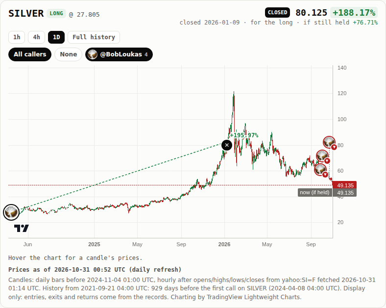
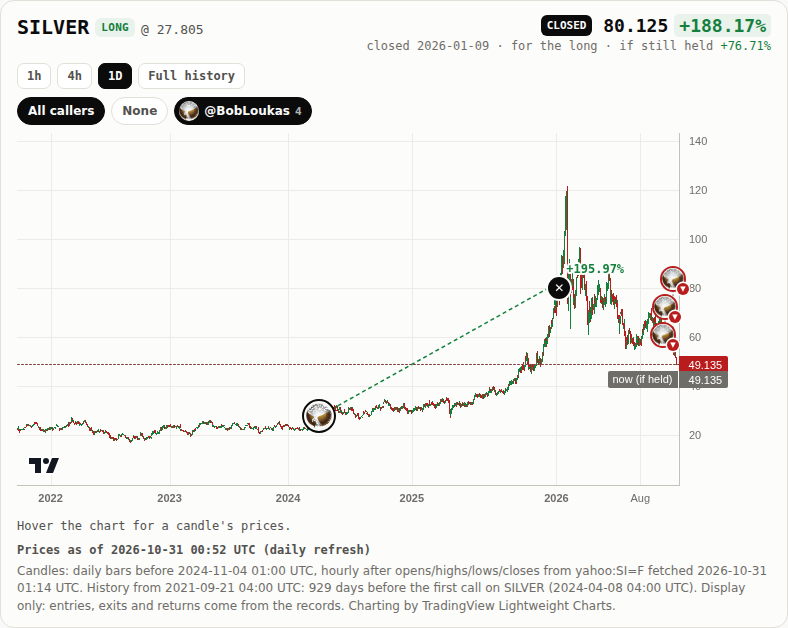
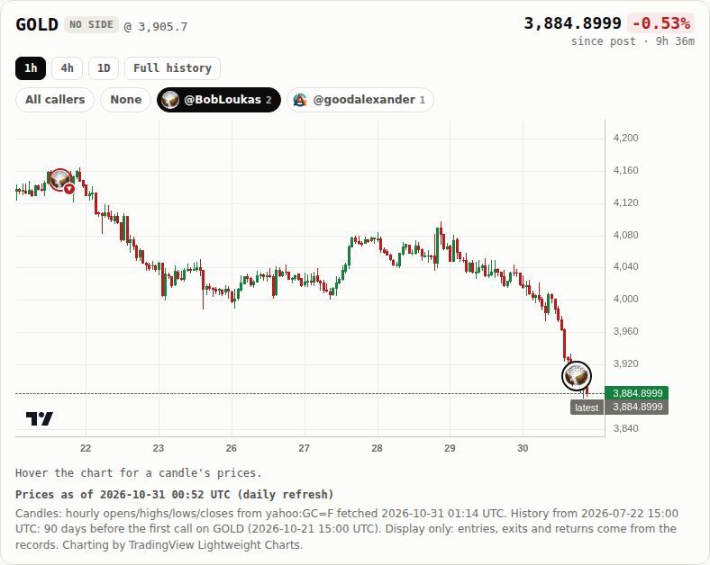

# Step 14 run notes: every caller on the position chart, history before the first call

## Where the work is

- **Code commit (deployed)**: [`038af3ce911bc89b372b8c335927e9b442d7db49`](https://github.com/sendoeth/pf-post-signals/commit/038af3ce911bc89b372b8c335927e9b442d7db49)
- **Served hash**: GitHub Pages built and deployed `038af3ce911bc89b372b8c335927e9b442d7db49` (Pages API `pages/builds/latest` → `status: built, commit: 038af3c…`; check runs on that commit: guard success, build success, deploy success). Every live test below ran against that build. The notes commit that adds this file changes nothing under `web/` (`git diff --stat 038af3c <notes commit> -- web` is empty).
- **Compare**: https://github.com/sendoeth/pf-post-signals/compare/d12dd4a4ce6c1aff341c34177894250a0e8abd23...038af3ce911bc89b372b8c335927e9b442d7db49
- **Live silver position, all callers shown** (no `callers` parameter = every caller): https://sendoeth.com/pf-post-signals/web/pos-1776235528741937435_SILVER.html
- Two-caller example: https://sendoeth.com/pf-post-signals/web/pos-2116199680157647216_GOLD.html (all) · [`?callers=bobloukas`](https://sendoeth.com/pf-post-signals/web/pos-2116199680157647216_GOLD.html?callers=bobloukas) (goodalexander off) · [`?callers=none`](https://sendoeth.com/pf-post-signals/web/pos-2116199680157647216_GOLD.html?callers=none)

## What changed

| | |
|---|---|
| All callers on the position chart (`web/assets/position.js`, `position.css`) | Every other tracked call on the same asset is an avatar bubble (initial on a fixed colour when there is no picture): ring = side (green long / red short / grey none), corner badge = price direction (to the exit for a closed call), same as the chart view. Closed calls get a ✕ at their exit bar. The opened call keeps its larger highlighted bubble and is always shown. Toggles: **All callers**, **None**, one per caller (with the call count), state in the url: no parameter = all, `?callers=none`, `?callers=bobloukas,goodalexander`; reload restores it. A click (or Enter) on a bubble opens that call's card: author, time, side, entry, result (realized for closed calls), status, links to its position page and the post |
| No overlapping click targets | Bubbles are placed opened-call first, then by entry time; one that would overlap a placed bubble moves up past it (down if that would leave the pane) on a dashed stem from its own entry candle |
| Opened-call zoom | The page still opens zoomed on the opened call. Shown calls outside the view get an edge pill ("◀ 3 earlier calls" / "1 later call ▶") that fits every shown call; when that range has more candles than fit the width, it steps to a coarser interval (1h → 4h → 1D) |
| History before the first call (`fetch_ohlc.py`, `resolve.hyperliquid_candles`) | Candles start max(90 days, first-to-last call span) before the asset's first call, instead of 1 day before. Hourly where the source has it, daily bars before that: Yahoo serves ~730 days of hourly bars, Hyperliquid ~5000 hours; whole daily bars only before the first hourly bar, `daily_until` in each ohlc file. Markets listed after the lookback start begin at their first bar (`lookback.starts_at_listing`). The legend line says where daily bars end and how far back the history goes; the hover readout says "daily bar" / "hourly bar" and "before this call". **Full history** button shows all of it |
| Frozen values (`tools/frozen_values.py`) | Candles stay display only. Every entry bar, closed block, lifecycle bar and resolved 1d / 7d / 30d move and signed return is compared with the bundle before this step (`verification/step14/frozen_baseline.json`, from `d12dd4a`) |
| Static pages (`tools/prerender.py`) | Every `pos-*.html` lists the other calls on its asset without JavaScript: author, side, date, return (realized for closed calls), link to its page |
| Tests | `tests/test_history.py` (lookback rule, history before the first call for every asset, daily bars only before `daily_until`, entry candles still equal the records, no frozen value moved, the comparison catches a change), `tests/test_static.py` (other-calls list on all 31 static pages), `tests/callers_test.js` (below); `test_history` added to both CI workflows |

## Lookback per asset (`web/data/ohlc/index.json`, sha256 `157e2d95d662438c057810b23627e8b1aa1ea48146a52096e94a327c6a42a5e2`)

| Asset | First call (entry bar) | Lookback days | Lookback start | First candle | Daily bars before | Listed later | Candles |
|---|---|---|---|---|---|---|---|
| BTC | 2026-09-01T17:00 | 90 | 2026-06-03T17:00 | 2026-06-03T17:00 | – | no | 3585 |
| COPX | 2026-09-08T14:30 | 90 | 2026-06-10T14:30 | 2026-06-09T13:30 | – | no | 708 |
| GOLD | 2026-10-21T15:00 | 90 | 2026-07-23T15:00 | 2026-07-22T15:00 | – | no | 1639 |
| SILVER | 2024-04-08T04:00 | 929 | 2021-09-22T04:00 | 2021-09-21T04:00 | 2024-11-04T01:00 | no | 12228 |
| STOCKS | 2026-10-05T13:30 | 90 | 2026-07-07T13:30 | 2026-07-06T13:30 | – | no | 589 |
| XYZ:AAPL | 2026-09-27T22:00 | 90 | 2026-06-29T22:00 | 2026-06-29T22:00 | – | no | 2956 |
| XYZ:CBRS | 2026-09-04T21:00 | 90 | 2026-06-06T21:00 | 2026-06-06T21:00 | – | no | 3508 |
| XYZ:CXMT | 2026-09-04T21:00 | 90 | 2026-06-06T21:00 | 2026-07-15T01:00 | – | yes (first Hyperliquid bar) | 2593 |
| XYZ:JP225 | 2026-09-16T00:00 | 90 | 2026-06-18T00:00 | 2026-06-18T00:00 | – | no | 3242 |
| XYZ:KIOXIA | 2026-09-16T00:00 | 90 | 2026-06-18T00:00 | 2026-06-25T00:00 | – | yes (first Hyperliquid bar) | 3074 |
| XYZ:ORCL | 2026-09-27T00:00 | 90 | 2026-06-29T00:00 | 2026-06-29T00:00 | – | no | 2978 |
| XYZ:SKHX | 2026-09-27T22:00 | 90 | 2026-06-29T22:00 | 2026-06-29T22:00 | – | no | 2956 |

Silver's calls span 928.4 days (2024-04-08 to 2026-10-23), so its lookback is 929 days. Before the step every file started 1 day before the first call (e.g. SILVER 2024-04-08, BTC 2026-08-31).

## Frozen values: unchanged

```
$ git show d12dd4a:web/data/charts.json > work/charts_before.json
$ python3 tools/frozen_values.py dump work/charts_before.json > verification/step14/frozen_baseline.json
$ python3 tools/frozen_values.py compare verification/step14/frozen_baseline.json
positions 31 (now 31), frozen values compared 177, changed 0
sha256 of the frozen values now: ff4445d2958a01d484db51fa319787162b076d1f000f34ba8b3193732785cacb
```
The frozen values of the `d12dd4a` bundle hash to the same `ff4445d2…cacb`. `web/data/charts.json` itself is byte-identical before and after (sha256 `00caf192a8487cdbe89fbcbca40e0c6e6a2f345b61ec558f7f449b1a94a82c85` at `d12dd4a` and at `038af3c`), and no file under `records/` changed. Silver's realized +188.17% (exit 80.125 @ 2026-01-09T16:00) is part of the 177.

## Results

| Check | Result |
|---|---|
| Caller overlays (live, `tests/callers_test.js`) | position pages 31, caller combinations 196 (incl. 98 reloads), toggle clicks 111, bubbles anchored 120, bubble pairs checked for overlap 498, cards opened 120, exit marks 3, daily readouts 4, console errors 0 → ALL PASS |
| Position pages (live) | position pages opened 62 (31 posts x default + 1h), recap fields checked 1414, entry-bubble placements checked 62, unresolved cells 78, closed position loads checked 2, console errors 0 → ALL PASS |
| Leaderboard (live) | filter/sort combinations: 5616 set in the page (618 with rows, 4998 correctly empty), 224 of them also loaded fresh from their URL; author-summary rows checked: 1525; select changes: 30; default-view fields checked against records: 248; without javascript: 31 static rows + 31 static position pages equal the bundle; rows 31; CSP violations 0; console errors 0  → ALL PASS |
| Chart view (live) | assets 12, cards opened 31, card fields checked 459, unresolved cells checked 39, same-hour bubbles 2, bubbles checked 31 (avatar images 23, initials 8; side ring + direction badge = record), console errors 0 → ALL PASS |
| Security (live) | canary window.__pwned: unset on every page; CSP violations: 0; console errors: 0 → ALL PASS |
| Python | 77 tests OK (25 in history + static + lifecycle, listed below); bundle ALL MATCH; 31/31 entry candles equal the record entry price; guard 0 hits |

What `callers_test.js` checks on each of the 31 position pages: one bubble per other call on the asset with ring = side and badge = direction from the bundle; the candles start before the first call and the legend's `data-raw` equals the ohlc index lookback; after "fit calls" every bubble's anchor is the chart's own coordinate of its entry candle (±1.5 px), no two bubbles (opened call included) overlap, closed calls show an exit mark, each bubble opens its own card (author, entry raw, result raw, position-page link, post link); every subset of the asset's callers by url, loaded and then reloaded (shown set, url, aria-pressed, hidden callers' bubbles hidden, opened call always present); clicking each caller off, then All, then None rewrites the url; on silver (daily bars before 2024-11-04) hovering a pre-2024 candle reads "daily bar".

## Commands and raw output

All browser tests ran with `LD_LIBRARY_PATH=/home/postfiat/chromium-libs/lib` (headless Chromium via puppeteer) against the live site after Pages deployed `038af3c`.

```
$ node tests/callers_test.js --url https://sendoeth.com/pf-post-signals/web/ --screenshots verification/step14
page https://sendoeth.com/pf-post-signals/web/
position pages 31, caller combinations 196 (incl. 98 reloads), toggle clicks 111, bubbles anchored 120, bubble pairs checked for overlap 498, cards opened 120, exit marks 3, daily readouts 4, console errors 0
ALL PASS

$ node tests/position_test.js --url https://sendoeth.com/pf-post-signals/web/
page https://sendoeth.com/pf-post-signals/web/
position pages opened 62 (31 posts x default + 1h), recap fields checked 1414, entry-bubble placements checked 62, unresolved cells 78, closed position loads checked 2, console errors 0
ALL PASS

$ node tests/browser_test.js --url https://sendoeth.com/pf-post-signals/web/
page https://sendoeth.com/pf-post-signals/web/
assets 12, cards opened 31, card fields checked 459, unresolved cells checked 39, same-hour bubbles 2, bubbles checked 31 (avatar images 23, initials 8; side ring + direction badge = record), console errors 0
ALL PASS

$ node tests/security_test.js --url https://sendoeth.com/pf-post-signals/web/
site https://sendoeth.com/pf-post-signals/web/: 64 page states checked (leaderboard + chart + 62 position loads), 31 bubbles clicked, 684 requests, origins: https://sendoeth.com
  resources loaded: /pf-post-signals/web/ /pf-post-signals/web/assets/board.css /pf-post-signals/web/assets/board.js /pf-post-signals/web/assets/chart.css /pf-post-signals/web/assets/chart.js /pf-post-signals/web/assets/common.js /pf-post-signals/web/assets/favicon.svg /pf-post-signals/web/assets/frame-guard.js /pf-post-signals/web/assets/position.css /pf-post-signals/web/assets/position.js /pf-post-signals/web/avatars/bobloukas.jpg /pf-post-signals/web/avatars/goodalexander.jpg /pf-post-signals/web/avatars/index.json /pf-post-signals/web/chart.html /pf-post-signals/web/data/charts.json /pf-post-signals/web/data/ohlc/BTC.json /pf-post-signals/web/data/ohlc/COPX.json /pf-post-signals/web/data/ohlc/GOLD.json /pf-post-signals/web/data/ohlc/SILVER.json /pf-post-signals/web/data/ohlc/STOCKS.json /pf-post-signals/web/data/ohlc/XYZ%3AAAPL.json /pf-post-signals/web/data/ohlc/XYZ%3ACBRS.json /pf-post-signals/web/data/ohlc/XYZ%3ACXMT.json /pf-post-signals/web/data/ohlc/XYZ%3AJP225.json /pf-post-signals/web/data/ohlc/XYZ%3AKIOXIA.json /pf-post-signals/web/data/ohlc/XYZ%3AORCL.json /pf-post-signals/web/data/ohlc/XYZ%3ASKHX.json /pf-post-signals/web/position.html /pf-post-signals/web/vendor/lightweight-charts-4.2.3/lightweight-charts.standalone.production.js
framing plain index: hidden inside the frame
framing sandboxed index: hidden inside the frame
framing plain position.html?post=2104977267109896477&asset=SILVER: hidden inside the frame
framing sandboxed position.html?post=2104977267109896477&asset=SILVER: hidden inside the frame
canary window.__pwned: unset on every page; CSP violations: 0; console errors: 0
ALL PASS

$ node tests/board_test.js --url https://sendoeth.com/pf-post-signals/web/
page https://sendoeth.com/pf-post-signals/web/
filter/sort combinations: 5616 set in the page (618 with rows, 4998 correctly empty), 224 of them also loaded fresh from their URL; author-summary rows checked: 1525; select changes: 30; default-view fields checked against records: 248; without javascript: 31 static rows + 31 static position pages equal the bundle; rows 31; CSP violations 0; console errors 0
ALL PASS
exit 0

$ python3 -m unittest -v tests.test_history tests.test_static tests.test_lifecycle
test_daily_bars_only_before_daily_until (tests.test_history.CandleFiles.test_daily_bars_only_before_daily_until) ... ok
test_entry_candles_still_match_the_records (tests.test_history.CandleFiles.test_entry_candles_still_match_the_records) ... ok
test_every_asset_has_history_before_its_first_call (tests.test_history.CandleFiles.test_every_asset_has_history_before_its_first_call) ... ok
test_compare_catches_a_change (tests.test_history.FrozenValues.test_compare_catches_a_change) ... ok
test_no_frozen_value_moved (tests.test_history.FrozenValues.test_no_frozen_value_moved) ... ok
test_longer_when_the_calls_span_longer (tests.test_history.Lookback.test_longer_when_the_calls_span_longer) ... ok
test_ninety_days_minimum (tests.test_history.Lookback.test_ninety_days_minimum) ... ok
test_attack_fixtures_render_as_text (tests.test_static.HostileText.test_attack_fixtures_render_as_text) ... ok
test_every_position_page_without_javascript (tests.test_static.Static.test_every_position_page_without_javascript) ... ok
test_leaderboard_rows_without_javascript (tests.test_static.Static.test_leaderboard_rows_without_javascript) ... ok
test_no_stale_or_missing_pages (tests.test_static.Static.test_no_stale_or_missing_pages) ... ok
test_only_known_scripts_and_no_inline_code (tests.test_static.Static.test_only_known_scripts_and_no_inline_code) ... ok
test_other_calls_on_the_same_asset (tests.test_static.Static.test_other_calls_on_the_same_asset) ... ok
test_advice_wins_over_exit_words (tests.test_lifecycle.Classifier.test_advice_wins_over_exit_words) ... ok
test_closes (tests.test_lifecycle.Classifier.test_closes) ... ok
test_flip (tests.test_lifecycle.Classifier.test_flip) ... ok
test_other_asset_is_not_about_this_position (tests.test_lifecycle.Classifier.test_other_asset_is_not_about_this_position) ... ok
test_importer_marks_ledger_exits (tests.test_lifecycle.Ledger.test_importer_marks_ledger_exits) ... ok
test_ledger_exit_closes_at_the_first_bar_after (tests.test_lifecycle.Ledger.test_ledger_exit_closes_at_the_first_bar_after) ... ok
test_apply_closes_at_the_first_bar_after_the_closing_post (tests.test_lifecycle.SilverChain.test_apply_closes_at_the_first_bar_after_the_closing_post) ... ok
test_classifier_on_the_real_posts (tests.test_lifecycle.SilverChain.test_classifier_on_the_real_posts) ... ok
test_followup_must_be_after_the_open (tests.test_lifecycle.SilverChain.test_followup_must_be_after_the_open) ... ok
test_override_needs_and_keeps_a_reason (tests.test_lifecycle.SilverChain.test_override_needs_and_keeps_a_reason) ... ok
test_schema_accepts_the_closed_record (tests.test_lifecycle.SilverChain.test_schema_accepts_the_closed_record) ... ok
test_trim_keeps_the_position_open (tests.test_lifecycle.SilverChain.test_trim_keeps_the_position_open) ... ok

----------------------------------------------------------------------
Ran 25 tests in 0.955s

OK
$ python3 -m unittest discover -s tests -p "test_*.py"
Ran 77 tests in 1.200s
OK
$ python3 tools/frozen_values.py compare verification/step14/frozen_baseline.json
positions 31 (now 31), frozen values compared 177, changed 0
sha256 of the frozen values now: ff4445d2958a01d484db51fa319787162b076d1f000f34ba8b3193732785cacb
$ python3 fetch_ohlc.py --check-only | tail -1
entry bars: 31/31 candle opens equal the record entry price
$ python3 check_bundle.py | tail -1
bundle: 31 record files -> 31 drawn, 0 superseded, 0 refused; 93 horizon cells, 31 best-since-post values checked -> ALL MATCH
$ python3 tools/guard.py --tree
guard: scanned 544 files -> 0 hits
```

```
$ curl -s https://sendoeth.com/pf-post-signals/web/pos-1776235528741937435_SILVER.html | grep -o 'Other calls on SILVER ([0-9]*)'
Other calls on SILVER (3)
$ curl -s https://sendoeth.com/pf-post-signals/web/pos-1776235528741937435_SILVER.html | grep -o "<li data-post-id=[^>]*><a [^>]*>[^<]*"
<li data-post-id="2104977267109896477" data-author="BobLoukas"><a href="pos-2104977267109896477_SILVER.html">@BobLoukas · SHORT · 2026-09-29 16:51 UTC · return +19.59%
<li data-post-id="2106744910896312646" data-author="BobLoukas"><a href="pos-2106744910896312646_SILVER.html">@BobLoukas · SHORT · 2026-10-04 13:55 UTC · return +19.53%
<li data-post-id="2113613893662588966" data-author="BobLoukas"><a href="pos-2113613893662588966_SILVER.html">@BobLoukas · SHORT · 2026-10-23 12:49 UTC · return +8.74%
$ curl -s https://sendoeth.com/pf-post-signals/web/data/ohlc/index.json | sha256sum
157e2d95d662438c057810b23627e8b1aa1ea48146a52096e94a327c6a42a5e2  -
$ curl -s https://sendoeth.com/pf-post-signals/web/assets/position.js | sha256sum
17c38fade390d7d31cd5d2eec0a2dfd70e184706d60b02c5570a6dba3acc74c8  -
```

## SHA-256

```
5ef81a571c3ec48988d643c4b7f986f428355c7fba549a780dae0929500e39b2  verification/step14/gold_all_callers.png
b4bb4d9145af1d62decfdae2e87f7621ee313a8959bc865b676c9f46f09da328  verification/step14/gold_one_caller_off.png
a802004b2407b894628eae133db678f87f4316b70c5285269446444047b34cec  verification/step14/silver_all_callers.png
0f6dc3c69b016c948742f0ae058f52d4cf00741901cd00f1385d4eec78e17361  verification/step14/silver_pre_call_history.png
3ba54684780404a80b81f2e1aa2f5df83379db7e2299c12e243f4b0180259d80  verification/step14/frozen_baseline.json
157e2d95d662438c057810b23627e8b1aa1ea48146a52096e94a327c6a42a5e2  web/data/ohlc/index.json
00caf192a8487cdbe89fbcbca40e0c6e6a2f345b61ec558f7f449b1a94a82c85  web/data/charts.json
17c38fade390d7d31cd5d2eec0a2dfd70e184706d60b02c5570a6dba3acc74c8  web/assets/position.js
4c14181f2f03dea201487e58aa0f3ffd57e6608b4642c17ea7084960e1f47d20  web/assets/position.css
b421fd6c8ed2fd38cb31e91bbffcaf6b2fbea628b9e3829a7a100acf1c301de3  fetch_ohlc.py
16fea16753dab590e2dc268432647468c1a7bdf5ebc4c19e678e8bb11027404e  tools/frozen_values.py
1dd2b6b8ceece0179511713526c4e0af55a9560d7223ded48b8dd1bf9d76d2dc  tools/prerender.py
e95061aeb5de564b379507f7d0b1fae61e76526ea8e2df19d33cd4cf18083d0b  tests/callers_test.js
a0b60c8374360ab9917b8b4b18c6fd55da1a8f9df3dd6b547f2d4374f99aedbe  tests/test_history.py
```

## Screenshots (live, taken by `callers_test.js --screenshots`)

- All callers on the silver position (the 2024 long, closed, plus BobLoukas' three 2026 shorts stacked without overlap, each with its ring and badge): [silver_all_callers.png](step14/silver_all_callers.png)
- Silver history before the first call, back to 2021-09-21 on daily bars ("Full history"): [silver_pre_call_history.png](step14/silver_pre_call_history.png)
- Gold with all callers (BobLoukas + goodalexander): [gold_all_callers.png](step14/gold_all_callers.png)
- Gold with one caller off (`?callers=bobloukas`: goodalexander's bubble gone, his toggle unpressed, the opened call still shown): [gold_one_caller_off.png](step14/gold_one_caller_off.png)





## Notes

- Silver has one caller (BobLoukas, 4 calls), so the one-caller-off screenshot uses gold, which has two. On silver, `?callers=none` leaves only the opened call.
- Pre-call candles never feed a value: records, `charts.json` and the 177 frozen values are unchanged; entry candles still equal the record entry prices (31/31).
- Two Hyperliquid markets (CXMT, KIOXIA) listed after their 90-day lookback start; their history starts at the first bar Hyperliquid has, flagged `starts_at_listing`.
- Also fixed: on open positions the step-13 exit marker (`#exit-mark`) was hidden by attribute but shown by CSS at the chart's top-left corner; it is now hidden.
