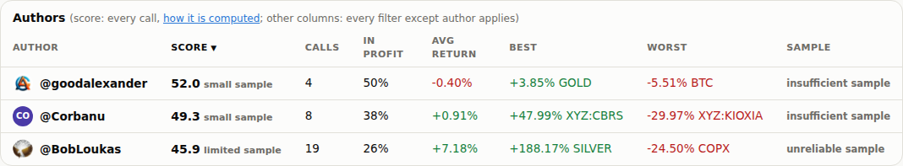
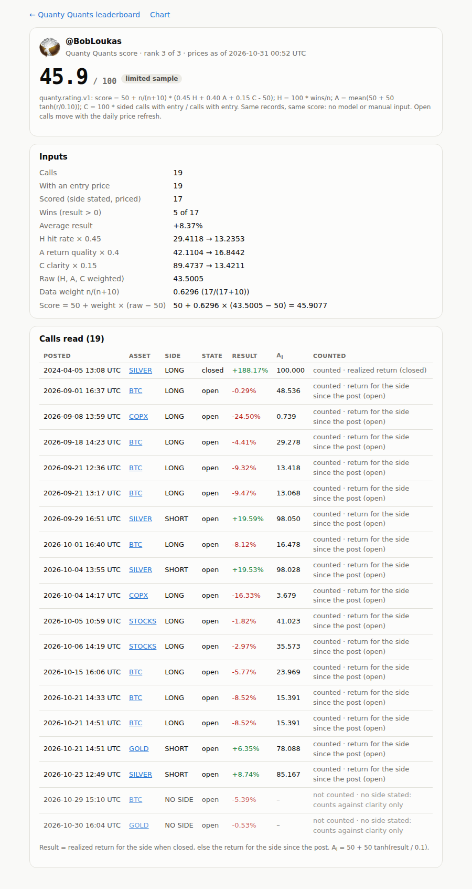

# Step 15 run notes: deterministic 0-100 caller scores

## Where the work is

- **Code commit (deployed)**: [`93bd973452e632930fe96bf3442eb64ac5671107`](https://github.com/sendoeth/pf-post-signals/commit/93bd973452e632930fe96bf3442eb64ac5671107)
- **Served hash**: GitHub Pages built and deployed `93bd973452e632930fe96bf3442eb64ac5671107` (Pages API `pages/builds/latest` → `status: built, commit: 93bd973452e632930fe96bf3442eb64ac5671107`; check runs on that commit: guard success, build success, deploy success, report-build-status success). Every live test below ran against that build. The notes commit that adds this file changes nothing under `web/`.
- **Compare**: https://github.com/sendoeth/pf-post-signals/compare/a7bd926a23e3d9bf6b63d935ab711a8e9119c5cb...93bd973452e632930fe96bf3442eb64ac5671107
- **Live leaderboard with caller scores**: https://sendoeth.com/pf-post-signals/web/
- **Caller breakdowns**: [caller-bobloukas.html](https://sendoeth.com/pf-post-signals/web/caller-bobloukas.html) · [caller-corbanu.html](https://sendoeth.com/pf-post-signals/web/caller-corbanu.html) · [caller-goodalexander.html](https://sendoeth.com/pf-post-signals/web/caller-goodalexander.html)
- Live bundle `web/data/charts.json` sha256 `31c331b7980535098d0db64655da94b2e2d78ec37ca6cc1bb976a947457d26ad` (= the committed file), prices as of 2026-10-31T00:52:10Z. Open calls move with the daily refresh, so the next refresh changes the live scores; to reproduce these exact numbers, check out `93bd973452e632930fe96bf3442eb64ac5671107` and run `python3 rate.py`.

## Scores (prices as of 2026-10-31 00:52 UTC)

| Rank | Caller | Score | Exact | Scored calls (n) | Wins | H | A | C | raw | weight n/(n+10) | Label |
|---|---|---|---|---|---|---|---|---|---|---|---|
| 1 | @goodalexander | **52.0** | 51.9609628349 | 4 of 4 | 2 | 50.0000 | 48.4084 | 100.0000 | 56.8634 | 0.2857 | small sample |
| 2 | @Corbanu | **49.3** | 49.2998150677 | 8 of 8 | 3 | 37.5000 | 41.3740 | 100.0000 | 48.4246 | 0.4444 | small sample |
| 3 | @BobLoukas | **45.9** | 45.9077289442 | 17 of 19 | 5 | 29.4118 | 42.1104 | 89.4737 | 43.5005 | 0.6296 | limited sample |

All three are labelled: no caller has 30 scored calls yet, so every score is still pulled most of the way to 50 (BobLoukas: 17 scored calls, 63% data weight). BobLoukas has the highest average result (+8.37%, carried by the closed silver call at +188.17%), but only 5 of 17 calls are in profit; capping each call with tanh keeps the silver call from carrying the score. His two BTC / GOLD posts without a side are listed but not scored, which lowers his clarity to 89.47.

## The formula (`rate.py`, `quanty.rating.v1`, also in the README and under the leaderboard)

| | |
|---|---|
| Scored calls (n) | calls with an entry price that state a side and have a result |
| Result r | realized return for the side if the call is closed, else the return for the side since the post |
| H | 100 × wins / n (r > 0) |
| A | mean over scored calls of 50 + 50·tanh(r / 0.10) |
| C | 100 × n / calls with an entry |
| raw | 0.45 H + 0.40 A + 0.15 C |
| score | 50 + n/(n+10) × (raw − 50); no scored calls → 50 |
| labels | n < 10 small sample, n < 30 limited sample |

Worked through for BobLoukas (from `caller-bobloukas.html`): H = 5/17 = 29.4118 → ×0.45 = 13.2353; A = 42.1104 → ×0.40 = 16.8442; C = 17/19 = 89.4737 → ×0.15 = 13.4211; raw = 43.5005; weight = 17/27 = 0.6296; score = 50 + 0.6296 × (43.5005 − 50) = **45.9077**.

## What changed

| | |
|---|---|
| `rate.py` | the rating; `rate_bundle()` writes `ratings` into the bundle: version, as_of, formula constants and text, order, and per caller every input (calls, with entry, scored, wins, hit rate, average result), components, raw, weight, score, display (1 decimal, half up), label, rank, and every call it read (post id, asset, side, state, result, A_i, counted or why not). `python3 rate.py` prints all of it |
| `build_chart.py` | adds `ratings` to the bundle (the daily refresh rebuilds it) |
| `check_bundle.py` | recomputes every score a second way, from the record files on disk, and fails on any difference (score to 1e-9, counts, order) |
| Leaderboard | Score column (first after the author, default order), small / limited sample label, tooltip with rank, n, raw and weight; every header sorts (score, author, calls, in profit, avg return), kept in `?asort=` with the filters and restored on reload; the author links to the caller page; a note under the board explains the formula |
| Caller pages | static `caller-<handle>.html` (no script needed): score, rank, as-of, the formula, every input, H / A / C and their weighted parts, the arithmetic, and a table of every call (result, A_i, counted or why not) linking to its position page |
| Position pages, chart cards | the caller's score chip next to the author (position page, every overlay card) and in every chart-view card, linking to the breakdown; static position pages get a "Caller score" row |
| Tests | `tests/test_rating.py` (15), `tests/test_static.py` (+2: static scores and caller pages equal the bundle, a hostile name renders as text), `tests/ratings_test.js` (new, live), `tests/security_test.js` (caller pages; the hostile-author record is refused by the schema so it is never rated), `tests/board_test.js` (author order = score order, score column); `test_rating` added to both CI workflows |

## Results

| Check | Result |
|---|---|
| Ratings (live, `tests/ratings_test.js`) | callers recomputed 3, calls compared 31, author-table sorts 15 (+15 reloads), caller pages 3 (64 fields, 31 call links), position chips 31, overlay cards 19, chart cards 31, CSP violations 0, console errors 0 → ALL PASS |
| Leaderboard (live) | filter/sort combinations: 5616 set in the page (618 with rows, 4998 correctly empty), 224 of them also loaded fresh from their URL; author-summary rows checked: 1525; select changes: 30; default-view fields checked against records: 248; without javascript: 31 static rows + 31 static position pages equal the bundle; rows 31; CSP violations 0; console errors 0 → ALL PASS |
| Position pages (live) | position pages opened 62 (31 posts x default + 1h), recap fields checked 1414, entry-bubble placements checked 62, unresolved cells 78, closed position loads checked 2, console errors 0 → ALL PASS |
| Callers overlay (live) | position pages 31, caller combinations 196 (incl. 98 reloads), toggle clicks 111, bubbles anchored 120, bubble pairs checked for overlap 498, cards opened 120, exit marks 3, daily readouts 4, console errors 0 → ALL PASS |
| Chart view (live) | assets 12, cards opened 31, card fields checked 459, unresolved cells checked 39, same-hour bubbles 2, bubbles checked 31 (avatar images 23, initials 8; side ring + direction badge = record), console errors 0 → ALL PASS |
| Security (live) | canary window.__pwned: unset on every page; CSP violations: 0; console errors: 0 → ALL PASS |
| Python | 94 tests OK; check_bundle ALL MATCH (3 caller ratings recomputed from the record files); frozen values 177, 0 changed; guard 0 hits |

The three implementations of the score (rate.py, check_bundle.py from the record files, ratings_test.js in JavaScript) agree to 1e-9 on every caller. Test coverage in `test_rating.py`: a hand-computed fixture (every step written out in the docstring), the prior for a caller with nothing scored, half-up display, shrinkage (1 vs 30 calls with the same results: the distance from 50 scales by exactly w30/w1), a losing caller pulled up toward 50, a monotonicity fuzz (400 random callers, 1000+ single-call improvements, none lowers the score), a loss turned into a win, stating a side raises clarity, a closed call counted at its realized +25% while the price since fell 40%, short sides, input-order independence, ties by name, hostile names (safe slugs), and the live bundle equal to a fresh computation.

## Commands and raw output

Browser tests ran with `LD_LIBRARY_PATH=/home/postfiat/chromium-libs/lib` (headless Chromium via puppeteer) against the live site after Pages deployed the code commit.

```
$ node tests/ratings_test.js --url https://sendoeth.com/pf-post-signals/web/ --screenshots verification/step15
page https://sendoeth.com/pf-post-signals/web/
  @goodalexander: recomputed 51.960963 (bundle 51.960963, shown 52.0) · n 4 · H 50.0000 A 48.4084 C 100.0000 raw 56.8634 w 0.2857
  @Corbanu: recomputed 49.299815 (bundle 49.299815, shown 49.3) · n 8 · H 37.5000 A 41.3740 C 100.0000 raw 48.4246 w 0.4444
  @BobLoukas: recomputed 45.907729 (bundle 45.907729, shown 45.9) · n 17 · H 29.4118 A 42.1104 C 89.4737 raw 43.5005 w 0.6296
callers recomputed 3, calls compared 31, author-table sorts 15 (+15 reloads), caller pages 3 (64 fields, 31 call links), position chips 31, overlay cards 19, chart cards 31, CSP violations 0, console errors 0
ALL PASS
exit 0

$ node tests/board_test.js --url https://sendoeth.com/pf-post-signals/web/
page https://sendoeth.com/pf-post-signals/web/
filter/sort combinations: 5616 set in the page (618 with rows, 4998 correctly empty), 224 of them also loaded fresh from their URL; author-summary rows checked: 1525; select changes: 30; default-view fields checked against records: 248; without javascript: 31 static rows + 31 static position pages equal the bundle; rows 31; CSP violations 0; console errors 0
ALL PASS
exit 0

$ node tests/position_test.js --url https://sendoeth.com/pf-post-signals/web/
page https://sendoeth.com/pf-post-signals/web/
position pages opened 62 (31 posts x default + 1h), recap fields checked 1414, entry-bubble placements checked 62, unresolved cells 78, closed position loads checked 2, console errors 0
ALL PASS
exit 0

$ node tests/callers_test.js --url https://sendoeth.com/pf-post-signals/web/
page https://sendoeth.com/pf-post-signals/web/
position pages 31, caller combinations 196 (incl. 98 reloads), toggle clicks 111, bubbles anchored 120, bubble pairs checked for overlap 498, cards opened 120, exit marks 3, daily readouts 4, console errors 0
ALL PASS
exit 0

$ node tests/browser_test.js --url https://sendoeth.com/pf-post-signals/web/
page https://sendoeth.com/pf-post-signals/web/
assets 12, cards opened 31, card fields checked 459, unresolved cells checked 39, same-hour bubbles 2, bubbles checked 31 (avatar images 23, initials 8; side ring + direction badge = record), console errors 0
ALL PASS
exit 0

$ node tests/security_test.js --url https://sendoeth.com/pf-post-signals/web/
site https://sendoeth.com/pf-post-signals/web/: 67 page states checked (leaderboard + chart + 65 position loads), 31 bubbles clicked, 695 requests, origins: https://sendoeth.com
  resources loaded: /pf-post-signals/web/ /pf-post-signals/web/assets/board.css /pf-post-signals/web/assets/board.js /pf-post-signals/web/assets/chart.css /pf-post-signals/web/assets/chart.js /pf-post-signals/web/assets/common.js /pf-post-signals/web/assets/favicon.svg /pf-post-signals/web/assets/frame-guard.js /pf-post-signals/web/assets/position.css /pf-post-signals/web/assets/position.js /pf-post-signals/web/avatars/bobloukas.jpg /pf-post-signals/web/avatars/goodalexander.jpg /pf-post-signals/web/avatars/index.json /pf-post-signals/web/caller-bobloukas.html /pf-post-signals/web/caller-corbanu.html /pf-post-signals/web/caller-goodalexander.html /pf-post-signals/web/chart.html /pf-post-signals/web/data/charts.json /pf-post-signals/web/data/ohlc/BTC.json /pf-post-signals/web/data/ohlc/COPX.json /pf-post-signals/web/data/ohlc/GOLD.json /pf-post-signals/web/data/ohlc/SILVER.json /pf-post-signals/web/data/ohlc/STOCKS.json /pf-post-signals/web/data/ohlc/XYZ%3AAAPL.json /pf-post-signals/web/data/ohlc/XYZ%3ACBRS.json /pf-post-signals/web/data/ohlc/XYZ%3ACXMT.json /pf-post-signals/web/data/ohlc/XYZ%3AJP225.json /pf-post-signals/web/data/ohlc/XYZ%3AKIOXIA.json /pf-post-signals/web/data/ohlc/XYZ%3AORCL.json /pf-post-signals/web/data/ohlc/XYZ%3ASKHX.json /pf-post-signals/web/position.html /pf-post-signals/web/vendor/lightweight-charts-4.2.3/lightweight-charts.standalone.production.js
framing plain index: hidden inside the frame
framing sandboxed index: hidden inside the frame
framing plain position.html?post=2104977267109896477&asset=SILVER: hidden inside the frame
framing sandboxed position.html?post=2104977267109896477&asset=SILVER: hidden inside the frame
canary window.__pwned: unset on every page; CSP violations: 0; console errors: 0
ALL PASS
exit 0

$ python3 -m unittest -v tests.test_rating tests.test_static
test_input_order_does_not_matter (tests.test_rating.Deterministic.test_input_order_does_not_matter) ... ok
test_ties_rank_by_name (tests.test_rating.Deterministic.test_ties_rank_by_name) ... ok
test_display_rounds_half_up (tests.test_rating.HandComputed.test_display_rounds_half_up) ... ok
test_no_scored_calls_is_the_prior (tests.test_rating.HandComputed.test_no_scored_calls_is_the_prior) ... ok
test_two_scored_calls_one_without_side (tests.test_rating.HandComputed.test_two_scored_calls_one_without_side)
long +10% (open), short closed at -5% for the call, one call without a side. ... ok
test_hostile_author_is_rated_like_any_other (tests.test_rating.HostileNames.test_hostile_author_is_rated_like_any_other) ... ok
test_slug_keeps_only_safe_characters (tests.test_rating.HostileNames.test_slug_keeps_only_safe_characters) ... ok
test_bundle_ratings_equal_a_fresh_computation (tests.test_rating.LiveBundle.test_bundle_ratings_equal_a_fresh_computation) ... ok
test_a_better_result_never_lowers_the_score (tests.test_rating.Monotonic.test_a_better_result_never_lowers_the_score) ... ok
test_a_loss_turned_into_a_win_raises_it (tests.test_rating.Monotonic.test_a_loss_turned_into_a_win_raises_it) ... ok
test_stating_a_side_never_lowers_clarity (tests.test_rating.Monotonic.test_stating_a_side_never_lowers_clarity) ... ok
test_closed_call_counts_at_its_realized_return_not_the_current_price (tests.test_rating.Realized.test_closed_call_counts_at_its_realized_return_not_the_current_price) ... ok
test_short_open_call_uses_the_side (tests.test_rating.Realized.test_short_open_call_uses_the_side) ... ok
test_losing_caller_is_pulled_up_toward_50 (tests.test_rating.Shrinkage.test_losing_caller_is_pulled_up_toward_50) ... ok
test_same_results_more_calls_moves_further_from_50 (tests.test_rating.Shrinkage.test_same_results_more_calls_moves_further_from_50) ... ok
test_hostile_name_renders_as_text (tests.test_static.HostileCaller.test_hostile_name_renders_as_text) ... ok
test_attack_fixtures_render_as_text (tests.test_static.HostileText.test_attack_fixtures_render_as_text) ... ok
test_caller_scores_without_javascript (tests.test_static.Static.test_caller_scores_without_javascript) ... ok
test_every_position_page_without_javascript (tests.test_static.Static.test_every_position_page_without_javascript) ... ok
test_leaderboard_rows_without_javascript (tests.test_static.Static.test_leaderboard_rows_without_javascript) ... ok
test_no_stale_or_missing_pages (tests.test_static.Static.test_no_stale_or_missing_pages) ... ok
test_only_known_scripts_and_no_inline_code (tests.test_static.Static.test_only_known_scripts_and_no_inline_code) ... ok
test_other_calls_on_the_same_asset (tests.test_static.Static.test_other_calls_on_the_same_asset) ... ok

----------------------------------------------------------------------
Ran 23 tests in 0.646s

OK
$ python3 -m unittest discover -s tests -p "test_*.py"
Ran 94 tests in 1.490s
OK
$ python3 check_bundle.py
bundle: 31 record files -> 31 drawn, 0 superseded, 0 refused; 93 horizon cells, 31 best-since-post values, 3 caller ratings checked -> ALL MATCH
$ python3 tools/frozen_values.py compare verification/step14/frozen_baseline.json
positions 31 (now 31), frozen values compared 177, changed 0
sha256 of the frozen values now: ff4445d2958a01d484db51fa319787162b076d1f000f34ba8b3193732785cacb
$ python3 tools/guard.py --tree
guard: scanned 556 files -> 0 hits

$ curl -s https://sendoeth.com/pf-post-signals/web/ | grep -o '<td data-field="score"[^>]*><strong>[^<]*'
<td data-field="score" data-raw="51.96096283491956" class="score"><strong>52.0
<td data-field="score" data-raw="49.29981506770131" class="score"><strong>49.3
<td data-field="score" data-raw="45.90772894422511" class="score"><strong>45.9
$ curl -s https://sendoeth.com/pf-post-signals/web/caller-bobloukas.html | grep -o 'data-field="score_exact"[^<]*'
data-field="score_exact" data-raw="45.90772894422511">50 + 0.6296 × (43.5005 − 50) = 45.9077
$ curl -s https://sendoeth.com/pf-post-signals/web/data/charts.json | python3 -c 'import json,sys; r=json.load(sys.stdin)["ratings"]; print(r["version"], r["order"], [round(r["callers"][n]["score"],6) for n in r["order"]])'
quanty.rating.v1 ['goodalexander', 'Corbanu', 'BobLoukas'] [51.960963, 49.299815, 45.907729]
$ curl -s https://sendoeth.com/pf-post-signals/web/data/charts.json | sha256sum
31c331b7980535098d0db64655da94b2e2d78ec37ca6cc1bb976a947457d26ad  -
```

## Per-caller score inputs

Full dump (every input, component and call, as written into the bundle): [`verification/step15/ratings_inputs.json`](step15/ratings_inputs.json). The same, printed by `rate.py`:

```
$ python3 rate.py
quanty.rating.v1 · prices as of 2026-10-31T00:52:10Z · score = 50 + n/(n+10) * (0.45 H + 0.40 A + 0.15 C - 50); H = 100 * wins/n; A = mean(50 + 50 tanh(r/0.10)); C = 100 * sided calls with entry / calls with entry
#1 @goodalexander: score 51.9610 (small sample) · calls 4, with entry 4, scored 4 · wins 2 · H 50.0000 A 48.4084 C 100.0000 · raw 56.8634 · weight 0.2857 · avg result -0.40%
    2026-10-22T14:42 BTC        long  open   r    -5.51% A_i  24.929
    2026-10-23T12:06 GOLD       short open   r    +3.85% A_i  68.346
    2026-10-28T21:04 XYZ:AAPL   short open   r    -0.17% A_i  49.144
    2026-10-30T16:22 STOCKS     short open   r    +0.24% A_i  51.214
#2 @Corbanu: score 49.2998 (small sample) · calls 8, with entry 8, scored 8 · wins 3 · H 37.5000 A 41.3740 C 100.0000 · raw 48.4246 · weight 0.4444 · avg result +0.91%
    2026-09-04T20:09 XYZ:CBRS   short open   r   +47.99% A_i  99.993
    2026-09-04T20:09 XYZ:CXMT   long  open   r   -26.06% A_i   0.542
    2026-09-16T00:00 XYZ:JP225  short open   r    +1.97% A_i  59.714
    2026-09-16T00:00 XYZ:KIOXIA long  open   r   -29.97% A_i   0.249
    2026-09-26T23:10 XYZ:ORCL   long  open   r    -5.05% A_i  26.687
    2026-09-27T21:27 XYZ:AAPL   short open   r    -1.42% A_i  42.965
    2026-09-27T21:27 XYZ:SKHX   long  open   r   -23.75% A_i   0.859
    2026-09-30T03:33 XYZ:CBRS   short open   r   +43.54% A_i  99.983
#3 @BobLoukas: score 45.9077 (limited sample) · calls 19, with entry 19, scored 17 · wins 5 · H 29.4118 A 42.1104 C 89.4737 · raw 43.5005 · weight 0.6296 · avg result +8.37%
    2024-04-05T13:08 SILVER     long  closed r  +188.17% A_i 100.000
    2026-09-01T16:37 BTC        long  open   r    -0.29% A_i  48.536
    2026-09-08T13:59 COPX       long  open   r   -24.50% A_i   0.739
    2026-09-18T14:23 BTC        long  open   r    -4.41% A_i  29.278
    2026-09-21T12:36 BTC        long  open   r    -9.32% A_i  13.418
    2026-09-21T13:17 BTC        long  open   r    -9.47% A_i  13.068
    2026-09-29T16:51 SILVER     short open   r   +19.59% A_i  98.050
    2026-10-01T16:40 BTC        long  open   r    -8.12% A_i  16.478
    2026-10-04T13:55 SILVER     short open   r   +19.53% A_i  98.028
    2026-10-04T14:17 COPX       long  open   r   -16.33% A_i   3.679
    2026-10-05T10:59 STOCKS     long  open   r    -1.82% A_i  41.023
    2026-10-06T14:19 STOCKS     long  open   r    -2.97% A_i  35.573
    2026-10-15T16:06 BTC        long  open   r    -5.77% A_i  23.969
    2026-10-21T14:33 BTC        long  open   r    -8.52% A_i  15.391
    2026-10-21T14:51 BTC        long  open   r    -8.52% A_i  15.391
    2026-10-21T14:51 GOLD       short open   r    +6.35% A_i  78.088
    2026-10-23T12:49 SILVER     short open   r    +8.74% A_i  85.167
    2026-10-29T15:10 BTC        none  open   not counted: no side stated: counts against clarity only
    2026-10-30T16:04 GOLD       none  open   not counted: no side stated: counts against clarity only
```

## SHA-256

```
addc5443d7a24cbad1d5f1545440c7f3cbcd24efa6d4de6dccdb199b102d5cc2  verification/step15/author_table_scores.png
45031943de6d399638b44b2a494099a2d685a9a9a35e26a30c73d197d532e9bc  verification/step15/caller_bobloukas_breakdown.png
42bc2daf2fc631f83c6ddfe596b93cc640cd7f1d05a835fb228c948499b7ada2  verification/step15/position_score_chip.png
3304610562da77753ac230e4a4228d6e5a2a7e8da2702327c5b9c846c567aaee  verification/step15/ratings_inputs.json
31c331b7980535098d0db64655da94b2e2d78ec37ca6cc1bb976a947457d26ad  web/data/charts.json
50d5e51ad0055a4bb8700ef06c4ccc6b4e6acf9904d560c3d344e343aa0b6aa1  rate.py
52346a46cadcd389121c1f5d13d1cd439eadd1d0c368b3af8f6207f7a6538804  check_bundle.py
f90d99aa98296ef947248726bd81af52d886d623037f24a645e70b3825e3e252  build_chart.py
3c47bdd63871ac7b316b2fd0f96530708d993f4a2dcac02ec49805f8291a7779  tools/prerender.py
c0775598683dddf0edca50a3d2a4daf4a44de06ee19a902f142eefce8ebe4d20  web/assets/board.js
e1e3f3f29f54f44dff2b967692180631879c6ab18b8828cae079a6f3d5756b11  web/assets/position.js
3ad8c8c647c37db99aa70970b12500afe2e80b6195918ef274c2a540177ac5c5  web/assets/chart.js
78179165c4d1bacc74486a0700051601ff1680405d18671dd82c59059803cd59  web/assets/common.js
04ddf30cbee3002c8ff82b8a58d153347d39654c0810b8d83b42a2fe7059e9ed  web/caller-bobloukas.html
95149aea57c3788a8355aabd3e8fca521972819bda6893560a072eefc92382d0  web/caller-corbanu.html
e0c73eba596b9179b3a74098ef74ce9f8eba78bc2bcc376cb9f5be9a0546f6e7  web/caller-goodalexander.html
75989c92c11ce29fb09927527fc2d12ba624eacecfa9d18404a938ebd699246f  tests/test_rating.py
49a45eb4619405fff8c1a75cf1bce8932e001616688c266c6b2535f1d612666e  tests/ratings_test.js
```

## Screenshots (live, taken by `ratings_test.js --screenshots`)

- Scored author table (default score order, labels): [author_table_scores.png](step15/author_table_scores.png)
- One caller breakdown, BobLoukas (inputs, arithmetic, all 19 calls with result, A_i and counted / why not): [caller_bobloukas_breakdown.png](step15/caller_bobloukas_breakdown.png)
- The score chip on a position page: [position_score_chip.png](step15/position_score_chip.png)




## Notes

- Scores use only priced records. The model that reads posts never sets or adjusts a score.
- With 4, 8 and 17 scored calls, every score is labelled and near 50 by design; it moves further from 50 as the callers' histories grow (step 17 adds a year of history per caller).
- Hostile author names: the record schema already refuses non-handle authors (the attack fixture `author_html.json` is refused), so none is ever rated. If one were rendered anyway it stays text (`tests/test_static.py` HostileCaller), and caller file names keep only `[a-z0-9_-]`.
