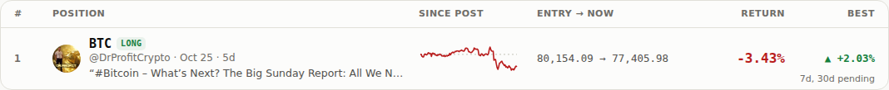
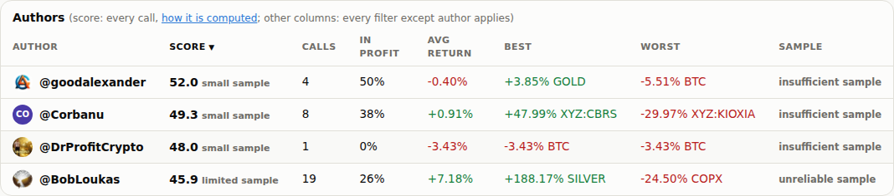
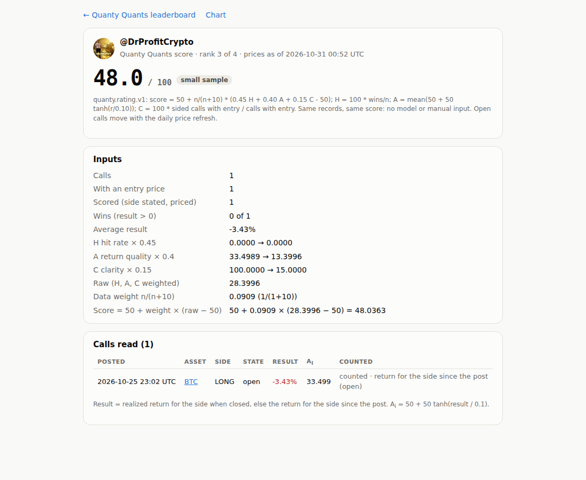

# Step 16 run notes: add a caller from one pasted post

**Live leaderboard: https://sendoeth.com/pf-post-signals/web/**

- **Live position of the added call**: https://sendoeth.com/pf-post-signals/web/pos-2114492799794254164_BTC.html (@DrProfitCrypto, BTC long, posted 2026-10-25 23:02 UTC)
- **New caller breakdown**: https://sendoeth.com/pf-post-signals/web/caller-drprofitcrypto.html
- **Code + data commit (deployed)**: [`d0e7ab4d3d59532a2ee61b23cbbff5450776041c`](https://github.com/sendoeth/pf-post-signals/commit/d0e7ab4d3d59532a2ee61b23cbbff5450776041c)
- **Served commit**: GitHub Pages built and deployed `d0e7ab4d3d59532a2ee61b23cbbff5450776041c` (Pages API `pages/builds/latest` → `status: built, commit: d0e7ab4d3d59532a2ee61b23cbbff5450776041c`; check runs: guard, build, deploy success). Every live test below ran against that build; the notes commit changes nothing under `web/`.
- **Served charts.json sha256**: `85253032a84785b0e0279205a31e17a2f1ff795d920aa032e733785e92f10439` (`curl -s https://sendoeth.com/pf-post-signals/web/data/charts.json | sha256sum`, = the committed file and the `bundle_sha256_after` in the intake log)
- **Compare**: https://github.com/sendoeth/pf-post-signals/compare/6bd5382c9851381cc77bb4dc801b0f56d5202a42...d0e7ab4d3d59532a2ee61b23cbbff5450776041c
- **Post**: https://x.com/DrProfitCrypto/status/2114492799794254164 · receipt `sources/drprofitcrypto/receipts/2114492799794254164.json` sha256 `2bef9d604088b32a5a748795ba79ff281bdd8e48ddba04184fbe4d7d47965731`

## The added call

| | |
|---|---|
| Post | @DrProfitCrypto, 2026-10-25T23:02:23Z: "I have finished building the long positions I announced and entered between $80K and $81K ... this is exactly why I am going long in the $80K–$81K region" (the embed endpoint cuts long posts; the receipt records `textTruncated: true`, and the saved opening is enough for the asset and side) |
| Asset | BTC (binance:BTCUSDT), detector term "bitcoin" |
| Side | LONG, detector words "building the long", "long positions", "the longs" |
| Entry | 80,154.09 at the 2026-10-26T00:00Z bar (first hourly bar after the post) |
| Result | −3.43% for the long since the post (77,405.98 @ 2026-10-31T02:00Z); 1d −0.00%, 7d and 30d pending |
| Caller score | new caller: not tracked → **48.0** (exact 48.03632294237658, rank 3 of 4, 1 scored call, small sample, data weight 1/11) |
| Score: preview vs after --add | 48.03632294237658 = 48.03632294237658 (identical dicts in `intake/log/2114492799794254164_BTC.json`) |
| Other positions | 177 frozen values (step 14 baseline) unchanged; the other three callers' scores unchanged |

## What changed

| | |
|---|---|
| `tools/add_call.py` | owner-only local script, no public intake. **Preview**: receipt (sha256) via the public embed endpoint, asset via `detect.py`, side via `detect.detect_side`, entry on the asset's shared series (every bar the bundle already has is written back; revisions logged, the bundle's value kept), and the bundle built exactly as `--add` will build it in a scratch copy of `records/`. Prints the call, result, current and projected score; writes `intake/pending/` only. **--add**: applies that pending file and nothing else; refuses a stale preview (`charts.json` changed) or a changed receipt; writes the record, saves a new caller's avatar (initials if none), rebuilds bundle / ratings / static pages, refetches candles only if they miss the entry bar, and fails unless the score and ranking equal the preview and no other frozen value moved; logs to `intake/log/` |
| `detect.py` | `detect_side()`: first-person or explicit position words for long / short; both in one post → refused (needs `--side` + `--reason`); none → a call without a side |
| Schema | optional `side_choice` (detector / manual with reason / none) beside `asset_choice` |
| Refusals | deleted or private posts, no detectable asset, post + asset already recorded, both sides, `--asset` / `--side` without `--reason`, stale preview |
| Tests | `tests/test_add_call.py` (11) with fixtures in `tests/fixtures/intake`: new caller, existing caller, duplicate, no detectable asset, override with reason, hostile text; plus stale preview, missing reasons, two-sided post, shared bars, side words. Each runs in a scratch copy of the repo, offline, with prices from the bundle's own series. Added to both CI workflows |

## Exact commands and raw output

Preview (2026-10-31, before the add; `web/` was compared with a copy taken before it: `diff -r web work/web_before_preview` → no difference, and the `records/` tree hash was `22c4327d…` before and after):
```
$ python3 tools/add_call.py https://x.com/DrProfitCrypto/status/2114492799794254164
post      https://x.com/DrProfitCrypto/status/2114492799794254164  @DrProfitCrypto  2026-10-25T23:02:23Z  (new caller)
receipt   sources/drprofitcrypto/receipts/2114492799794254164.json  sha256 2bef9d604088b32a5a748795ba79ff281bdd8e48ddba04184fbe4d7d47965731  saved now  (text cut by the embed endpoint: textTruncated)
text      “#Bitcoin – What’s Next? The Big Sunday Report: All We Need to Know TA / LCA / Psychological Breakdown I have finished building the long positions I announced and entered between $80K and $81K. My aver”
asset     BTC (binance:BTCUSDT) by detector ['bitcoin']
side      LONG by detector ['building the long', 'long positions', 'the longs']
entry     80154.09 @ 2026-10-26T00:00:00Z   latest 77405.98 @ 2026-10-31T02:00:00Z   status partial
result    -3.43% for the long since the post   1d -0.00%   7d pending   30d pending
score now @DrProfitCrypto: not tracked yet
with this @DrProfitCrypto: 48.0 (exact 48.036323, rank 3 of 4, 1 scored calls, small sample)
order     @goodalexander > @Corbanu > @DrProfitCrypto > @BobLoukas
pending   intake/pending/2114492799794254164_BTC.json  (bundle sha256 31c331b7980535098d0db64655da94b2e2d78ec37ca6cc1bb976a947457d26ad)
PREVIEW ONLY: nothing under web/ or records/ changed. Rerun with --add to publish it.
$ diff -r web work/web_before_preview && echo "web/ unchanged"
web/ unchanged
$ find records -type f | sort | xargs sha256sum | sha256sum      # before and after the preview
22c4327d2d6e1663fb87c837b7e7d822b70589f83eef57a4786d0103ad656ad9  -
```

Add:
```
$ python3 tools/add_call.py https://x.com/DrProfitCrypto/status/2114492799794254164 --add
prerender: index.html (32 rows, 4 authors), position.html list, 32 position pages, 4 caller pages
added     records/posts/2114492799794254164_BTC.json  sha256 17970a8a12f05236bd41731810048cbaa729b9be9f1d1c2bd2c170beacacb2dd
avatar    saved web/avatars/drprofitcrypto.jpg
candles   candles already cover the entry bar
bundle    31c331b7980535098d0db64655da94b2e2d78ec37ca6cc1bb976a947457d26ad -> 85253032a84785b0e0279205a31e17a2f1ff795d920aa032e733785e92f10439
score     previewed 48.0 (exact 48.036323, rank 3 of 4, 1 scored calls, small sample)
          after add 48.0 (exact 48.036323, rank 3 of 4, 1 scored calls, small sample)
checks    score = preview: yes; frozen values of every other position unchanged: yes; log intake/log/2114492799794254164_BTC.json
```

The same post again, after the add (refused):
```
$ python3 tools/add_call.py https://x.com/DrProfitCrypto/status/2114492799794254164   # again, after the add
REFUSED   duplicate: post 2114492799794254164 on BTC is already recorded in records/posts/2114492799794254164_BTC.json
exit 2
```

Intake log (`intake/log/2114492799794254164_BTC.json`):
```json
{
 "version": "quanty.intake.v1",
 "added_at": "2026-10-31T02:42:30Z",
 "url": "https://x.com/DrProfitCrypto/status/2114492799794254164",
 "record_file": "records/posts/2114492799794254164_BTC.json",
 "record_sha256": "17970a8a12f05236bd41731810048cbaa729b9be9f1d1c2bd2c170beacacb2dd",
 "receipt": {
  "file": "sources/drprofitcrypto/receipts/2114492799794254164.json",
  "sha256": "2bef9d604088b32a5a748795ba79ff281bdd8e48ddba04184fbe4d7d47965731",
  "created": true,
  "text_truncated": true
 },
 "bundle_sha256_before": "31c331b7980535098d0db64655da94b2e2d78ec37ca6cc1bb976a947457d26ad",
 "bundle_sha256_after": "85253032a84785b0e0279205a31e17a2f1ff795d920aa032e733785e92f10439",
 "avatar": "saved web/avatars/drprofitcrypto.jpg",
 "candles": "candles already cover the entry bar",
 "score_previewed": {
  "score": 48.03632294237658,
  "display": "48.0",
  "rank": 3,
  "label": "small sample",
  "scored": 1,
  "calls_total": 1,
  "with_entry": 1,
  "raw": 28.399552366142345,
  "weight": 0.09090909090909091,
  "of": 4
 },
 "score_after_add": {
  "score": 48.03632294237658,
  "display": "48.0",
  "rank": 3,
  "label": "small sample",
  "scored": 1,
  "calls_total": 1,
  "with_entry": 1,
  "raw": 28.399552366142345,
  "weight": 0.09090909090909091,
  "of": 4
 },
 "score_before": null,
 "matches_preview": true,
 "problems": []
}
```

Checks and tests:
```
$ python3 -m unittest -v tests.test_add_call
test_duplicate_is_refused (tests.test_add_call.Fixtures.test_duplicate_is_refused) ... ok
test_existing_caller (tests.test_add_call.Fixtures.test_existing_caller) ... ok
test_hostile_text_stays_text (tests.test_add_call.Fixtures.test_hostile_text_stays_text) ... ok
test_new_caller (tests.test_add_call.Fixtures.test_new_caller) ... ok
test_no_detectable_asset_is_refused (tests.test_add_call.Fixtures.test_no_detectable_asset_is_refused) ... ok
test_override_keeps_its_reason (tests.test_add_call.Fixtures.test_override_keeps_its_reason) ... ok
test_both_sides_is_refused_without_a_choice (tests.test_add_call.Guards.test_both_sides_is_refused_without_a_choice) ... ok
test_manual_choices_need_a_reason (tests.test_add_call.Guards.test_manual_choices_need_a_reason) ... ok
test_stale_preview_is_refused (tests.test_add_call.Guards.test_stale_preview_is_refused) ... ok
test_the_new_record_shares_the_assets_bars (tests.test_add_call.Guards.test_the_new_record_shares_the_assets_bars) ... ok
test_side_words (tests.test_add_call.Side.test_side_words) ... ok

----------------------------------------------------------------------
Ran 11 tests in 9.318s

OK
$ python3 -m unittest discover -s tests -p "test_*.py"
Ran 105 tests in 11.010s
OK
$ python3 check_bundle.py
bundle: 32 record files -> 32 drawn, 0 superseded, 0 refused; 96 horizon cells, 32 best-since-post values, 4 caller ratings checked -> ALL MATCH
$ python3 validate_records.py | tail -1
records: 32 checked against post_price.v1 -> ALL VALID
$ python3 fetch_ohlc.py --check-only | tail -1
entry bars: 32/32 candle opens equal the record entry price
$ python3 tools/frozen_values.py compare verification/step14/frozen_baseline.json
positions 31 (now 32), frozen values compared 177, changed 0
sha256 of the frozen values now: 337cfce23eba2e5f2eb29008b7c09e9ab811725c0929e70af691819daa250b22
$ python3 tools/guard.py --tree
guard: scanned 575 files -> 0 hits
$ python3 rate.py | grep "^#"
#1 @goodalexander: score 51.9610 (small sample) · calls 4, with entry 4, scored 4 · wins 2 · H 50.0000 A 48.4084 C 100.0000 · raw 56.8634 · weight 0.2857 · avg result -0.40%
#2 @Corbanu: score 49.2998 (small sample) · calls 8, with entry 8, scored 8 · wins 3 · H 37.5000 A 41.3740 C 100.0000 · raw 48.4246 · weight 0.4444 · avg result +0.91%
#3 @DrProfitCrypto: score 48.0363 (small sample) · calls 1, with entry 1, scored 1 · wins 0 · H 0.0000 A 33.4989 C 100.0000 · raw 28.3996 · weight 0.0909 · avg result -3.43%
#4 @BobLoukas: score 45.9077 (limited sample) · calls 19, with entry 19, scored 17 · wins 5 · H 29.4118 A 42.1104 C 89.4737 · raw 43.5005 · weight 0.6296 · avg result +8.37%

$ curl -s https://sendoeth.com/pf-post-signals/web/data/charts.json | sha256sum
85253032a84785b0e0279205a31e17a2f1ff795d920aa032e733785e92f10439  -
$ curl -s https://sendoeth.com/pf-post-signals/web/pos-2114492799794254164_BTC.html | grep -o '<title>[^<]*'
<title>BTC LONG · @DrProfitCrypto · -3.43% · Quanty Quants
$ curl -s https://sendoeth.com/pf-post-signals/web/caller-drprofitcrypto.html | grep -o 'data-field="score_exact"[^<]*'
data-field="score_exact" data-raw="48.03632294237658">50 + 0.0909 × (28.3996 − 50) = 48.0363
```

Live browser suites (headless Chromium via puppeteer, `LD_LIBRARY_PATH=/home/postfiat/chromium-libs/lib`, against the deployed `d0e7ab4d3d59532a2ee61b23cbbff5450776041c`):
```
$ node tests/ratings_test.js --url https://sendoeth.com/pf-post-signals/web/
page https://sendoeth.com/pf-post-signals/web/
  @goodalexander: recomputed 51.960963 (bundle 51.960963, shown 52.0) · n 4 · H 50.0000 A 48.4084 C 100.0000 raw 56.8634 w 0.2857
  @Corbanu: recomputed 49.299815 (bundle 49.299815, shown 49.3) · n 8 · H 37.5000 A 41.3740 C 100.0000 raw 48.4246 w 0.4444
  @DrProfitCrypto: recomputed 48.036323 (bundle 48.036323, shown 48.0) · n 1 · H 0.0000 A 33.4989 C 100.0000 raw 28.3996 w 0.0909
  @BobLoukas: recomputed 45.907729 (bundle 45.907729, shown 45.9) · n 17 · H 29.4118 A 42.1104 C 89.4737 raw 43.5005 w 0.6296
callers recomputed 4, calls compared 32, author-table sorts 15 (+15 reloads), caller pages 4 (76 fields, 32 call links), position chips 32, overlay cards 20, chart cards 32, CSP violations 0, console errors 0
ALL PASS
exit 0

$ node tests/position_test.js --url https://sendoeth.com/pf-post-signals/web/
page https://sendoeth.com/pf-post-signals/web/
position pages opened 64 (32 posts x default + 1h), recap fields checked 1460, entry-bubble placements checked 64, unresolved cells 86, closed position loads checked 2, console errors 0
ALL PASS
exit 0

$ node tests/callers_test.js --url https://sendoeth.com/pf-post-signals/web/
page https://sendoeth.com/pf-post-signals/web/
position pages 32, caller combinations 292 (incl. 146 reloads), toggle clicks 126, bubbles anchored 140, bubble pairs checked for overlap 653, cards opened 140, exit marks 3, daily readouts 4, console errors 0
ALL PASS
exit 0

$ node tests/browser_test.js --url https://sendoeth.com/pf-post-signals/web/
page https://sendoeth.com/pf-post-signals/web/
assets 12, cards opened 32, card fields checked 474, unresolved cells checked 43, same-hour bubbles 2, bubbles checked 32 (avatar images 24, initials 8; side ring + direction badge = record), console errors 0
ALL PASS
exit 0

$ node tests/security_test.js --url https://sendoeth.com/pf-post-signals/web/
site https://sendoeth.com/pf-post-signals/web/: 70 page states checked (leaderboard + chart + 68 position loads), 32 bubbles clicked, 748 requests, origins: https://sendoeth.com
  resources loaded: /pf-post-signals/web/ /pf-post-signals/web/assets/board.css /pf-post-signals/web/assets/board.js /pf-post-signals/web/assets/chart.css /pf-post-signals/web/assets/chart.js /pf-post-signals/web/assets/common.js /pf-post-signals/web/assets/favicon.svg /pf-post-signals/web/assets/frame-guard.js /pf-post-signals/web/assets/position.css /pf-post-signals/web/assets/position.js /pf-post-signals/web/avatars/bobloukas.jpg /pf-post-signals/web/avatars/drprofitcrypto.jpg /pf-post-signals/web/avatars/goodalexander.jpg /pf-post-signals/web/avatars/index.json /pf-post-signals/web/caller-bobloukas.html /pf-post-signals/web/caller-corbanu.html /pf-post-signals/web/caller-drprofitcrypto.html /pf-post-signals/web/caller-goodalexander.html /pf-post-signals/web/chart.html /pf-post-signals/web/data/charts.json /pf-post-signals/web/data/ohlc/BTC.json /pf-post-signals/web/data/ohlc/COPX.json /pf-post-signals/web/data/ohlc/GOLD.json /pf-post-signals/web/data/ohlc/SILVER.json /pf-post-signals/web/data/ohlc/STOCKS.json /pf-post-signals/web/data/ohlc/XYZ%3AAAPL.json /pf-post-signals/web/data/ohlc/XYZ%3ACBRS.json /pf-post-signals/web/data/ohlc/XYZ%3ACXMT.json /pf-post-signals/web/data/ohlc/XYZ%3AJP225.json /pf-post-signals/web/data/ohlc/XYZ%3AKIOXIA.json /pf-post-signals/web/data/ohlc/XYZ%3AORCL.json /pf-post-signals/web/data/ohlc/XYZ%3ASKHX.json /pf-post-signals/web/position.html /pf-post-signals/web/vendor/lightweight-charts-4.2.3/lightweight-charts.standalone.production.js
framing plain index: hidden inside the frame
framing sandboxed index: hidden inside the frame
framing plain position.html?post=2104977267109896477&asset=SILVER: hidden inside the frame
framing sandboxed position.html?post=2104977267109896477&asset=SILVER: hidden inside the frame
canary window.__pwned: unset on every page; CSP violations: 0; console errors: 0
ALL PASS
exit 0

$ node tests/board_test.js --url https://sendoeth.com/pf-post-signals/web/
page https://sendoeth.com/pf-post-signals/web/
filter/sort combinations: 7020 set in the page (678 with rows, 6342 correctly empty), 280 of them also loaded fresh from their URL; author-summary rows checked: 2158; select changes: 31; default-view fields checked against records: 256; without javascript: 32 static rows + 32 static position pages equal the bundle; rows 32; CSP violations 0; console errors 0
ALL PASS
exit 0
```

## SHA-256

```
2bef9d604088b32a5a748795ba79ff281bdd8e48ddba04184fbe4d7d47965731  sources/drprofitcrypto/receipts/2114492799794254164.json
17970a8a12f05236bd41731810048cbaa729b9be9f1d1c2bd2c170beacacb2dd  records/posts/2114492799794254164_BTC.json
be73ccfaad0ef999370564d0954f2c1c0da43e285d40978d71be736f969da5a0  intake/log/2114492799794254164_BTC.json
85253032a84785b0e0279205a31e17a2f1ff795d920aa032e733785e92f10439  web/data/charts.json
0f7274b654832556dac2969af8aadcc34e85eb6846a9c534490a91792dc1070e  web/avatars/drprofitcrypto.jpg
a38fab118476c947dd1f6071ea095ad07989ae488a378dd1773ee6a10e93f097  web/caller-drprofitcrypto.html
28b3d8b5bb3a5ac20523207ad5dbdbf78155894dfef05ee8b9b7c39e9ab91e7d  web/pos-2114492799794254164_BTC.html
15ace708bd4a17cdcc4d0657c960c35914b7ceb0334e16d9325a686a0cdc42bd  tools/add_call.py
e55c4d1cad875af6346ace8fb303dcf5a2b7828ea93b083bf64404a672501953  detect.py
a0dcf90fd3197e9fc8ca4ade7073f4be8582816939ddf807781239cf0d6df6e5  schema/post_price.v1.json
9e35ab87693c5ffe7804dbabc8fcc9230c0f3531021abbad070faff8525817cb  tests/test_add_call.py
943ac8d23fa1033ed06050b560b82d6ba9fd350511ae1f6d8a79f70a7d9a1127  tests/fixtures/intake/duplicate.json
a7c7a02602bdb48fbf035ea2f9777434f432e642f78bb171bbfb539959bc3145  tests/fixtures/intake/existing_caller.json
f03911c59b6f0a43ab978d854d18ed509ef6be6c5621f3c267bb50abb108895b  tests/fixtures/intake/hostile.json
3baeb3a016bd19aca5fd3d9c460bdafd6f254169479f0360d4d0282a10baab4f  tests/fixtures/intake/new_caller.json
90b828e19b944833c28c106763c01460a45fbc057b788a165da22701b63b0274  tests/fixtures/intake/no_asset.json
6a19438b4ec6a587223156c5fa0e80f4c937a63848163207b46ecb0907529099  tests/fixtures/intake/override.json
999b26065935f70c144c3bade9addaa131dd1586e3c5e31abda8f700e5fffd29  verification/step16/caller_drprofitcrypto_breakdown.png
d2a67df7c8f52b3c42ce53feec3545feec48160df7f376e1893a20aa08762bc2  verification/step16/leaderboard_authors_with_new_caller.png
8059a04f92e96aa6f90f6ca47531c77ff7ed7f902330145f87a14966a65afe5a  verification/step16/leaderboard_new_call_row.png
03789ae0df5ab7936b567fe4772c5d53325dfbbea6de2be0af25c8ac3e6983f4  verification/step16/position_new_call_chart.png
23a0a14413526c79991b5ead960088402a30dc16a39456ea87cb26d4bf185394  verification/step16/position_new_call_post.png
```

## Screenshots (live)

- The new call on the leaderboard (filtered to the caller): [leaderboard_new_call_row.png](step16/leaderboard_new_call_row.png)
- The author table with the new caller at 48.0: [leaderboard_authors_with_new_caller.png](step16/leaderboard_authors_with_new_caller.png)
- The new caller's breakdown (inputs, arithmetic, the call): [caller_drprofitcrypto_breakdown.png](step16/caller_drprofitcrypto_breakdown.png)
- The added position (post with score chip; chart with every BTC caller): [position_new_call_post.png](step16/position_new_call_post.png), [position_new_call_chart.png](step16/position_new_call_chart.png)





## Notes

- One real call, one new caller: a single scored call has data weight 1/11, so a −3.43% start moves the score only to 48.0 (raw 28.40). It moves with the daily refresh like every open call.
- The post's full text is longer than the embed endpoint returns; the receipt keeps what the endpoint gives and flags it. Asset and side come only from the saved text.
- The add did not touch any other record: `check_bundle.py` (4 callers recomputed from the record files), `validate_records.py` (32 valid), 32/32 entry candles, and the step 14 frozen-value baseline (177, 0 changed) all pass after it.
