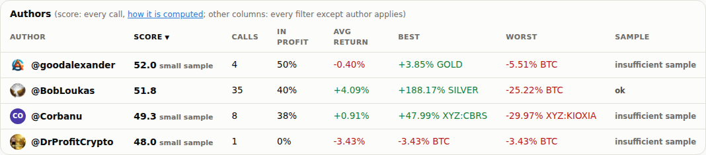
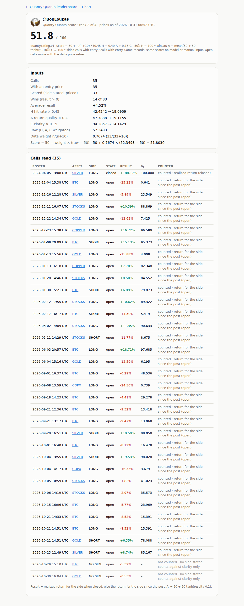

# Step 17 run notes: scan a caller's last 12 months from one post

**Live leaderboard: https://sendoeth.com/pf-post-signals/web/**

- **Live caller breakdown (the scanned caller)**: https://sendoeth.com/pf-post-signals/web/caller-bobloukas.html
- **Committed scan log**: [intake/scans/bobloukas/scan_log.json](https://github.com/sendoeth/pf-post-signals/blob/2512061f88fc252300e313ee6ebff10dc13a22ba/intake/scans/bobloukas/scan_log.json) · **report JSON**: [intake/scans/bobloukas/report.json](https://github.com/sendoeth/pf-post-signals/blob/2512061f88fc252300e313ee6ebff10dc13a22ba/intake/scans/bobloukas/report.json) · [report.md](https://github.com/sendoeth/pf-post-signals/blob/2512061f88fc252300e313ee6ebff10dc13a22ba/intake/scans/bobloukas/report.md) · **review decisions**: [review.json](https://github.com/sendoeth/pf-post-signals/blob/2512061f88fc252300e313ee6ebff10dc13a22ba/intake/scans/bobloukas/review.json) · **add log**: [intake/log/scan-bobloukas.json](https://github.com/sendoeth/pf-post-signals/blob/2512061f88fc252300e313ee6ebff10dc13a22ba/intake/log/scan-bobloukas.json)
- **Served commit**: `2512061f88fc252300e313ee6ebff10dc13a22ba` (GitHub Pages build `built`, see `outputs/served.txt`). Code + scan + data: [`c48cb3190ee992f92de839047922465292fae370`](https://github.com/sendoeth/pf-post-signals/commit/c48cb3190ee992f92de839047922465292fae370); chart fixes found by the live tests: [`5e94cb8`](https://github.com/sendoeth/pf-post-signals/commit/5e94cb80bb1bcf8c66d03bb7124bec1a55be15e7), [`2512061`](https://github.com/sendoeth/pf-post-signals/commit/2512061f88fc252300e313ee6ebff10dc13a22ba). The notes commit changes nothing under `web/`.
- **Served charts.json sha256**: `68abeee8eaf00e25edde1a5e51d15db73787c3e9b14f72ff036f30ccd636c6e8`
- **Compare**: https://github.com/sendoeth/pf-post-signals/compare/86381199da0690ecbb5e4c49456546b9b713eedb...2512061f88fc252300e313ee6ebff10dc13a22ba
- Seed post: https://x.com/BobLoukas/status/2116199680157647216

## Result

| | |
|---|---|
| Scan | @BobLoukas, 365 days (2025-10-31 → 2026-10-31), 47 windows (10 split because the page stopped scrolling), 6 runs, **1,786 own posts**, each saved as a receipt with the harness run id and manifest sha256 |
| Stops (all logged) | run 1 budget (25 searches); run 2 three empty pages in a row (X throttling, re-queued); run 3 budget (14); run 4 empty pages (re-queued); run 5 budget; run 6 complete. Run 1 first took throttled empty pages as "no posts"; that was caught, the 16 windows were re-queued, and the rule was changed (3 empty pages in a row stop the run; a single empty window counts only when a later run sees it empty too) |
| Quiet periods | May 2026 and Jul–Aug 2026 were cross-checked with two independent searches: they found only posts already in the scan (a Mother's Day post; "Checking in to say 👋 and hope the summer going well") — real posting breaks, not missed data |
| Labels | 7 call, 2 needs review, 1,777 no call (mostly replies and commentary); 16 already recorded (found again, not re-added); 15 skipped by review with reasons |
| Added | **16 calls** (5 detected, 11 added in review with an asset, side and written reason each), Nov 2025 → Jun 2026: BTC, SILVER, STOCKS, GOLD, COPPER |
| Score | @BobLoukas **45.9 → 51.8** (17 → 33 scored calls, sample label removed); **projected 51.80295456688874 = after add 51.80295456688874** |
| Others | @goodalexander, @Corbanu, @DrProfitCrypto scores unchanged; 32 existing positions' frozen values unchanged (add-time check) and the step 14 baseline (177 values) unchanged |
| Before add | `web/` and `records/` identical to the committed state after scan + report (`git status` empty, tree hash, `outputs/pre_add_integrity.txt`) |

## Commands and tee-captured outputs (`verification/step17/outputs/`)

| Step | Command | Output file | sha256 |
|---|---|---|---|
| scan run 1 | `python3 tools/scan_caller.py https://x.com/BobLoukas/status/2116199680157647216 scan` | [outputs/scan_run1.txt](step17/outputs/scan_run1.txt) | `8682ee1bfb1fb7824fbe340cb558f9ea24970e76e59afa4a2a95e4107c1cd40e` |
| scan run 2 | `python3 tools/scan_caller.py https://x.com/BobLoukas/status/2116199680157647216 scan` | [outputs/scan_run2.txt](step17/outputs/scan_run2.txt) | `1ab3cadb1b90da1e8ec1d0e59f315a2f6e850af156adbc287f03b33234a79404` |
| scan run 3 | `python3 tools/scan_caller.py https://x.com/BobLoukas/status/2116199680157647216 scan` | [outputs/scan_run3.txt](step17/outputs/scan_run3.txt) | `05d2996173367c990804c438d6965fe56eaf187771590717918c7e60919431ff` |
| scan run 4 | `python3 tools/scan_caller.py https://x.com/BobLoukas/status/2116199680157647216 scan` | [outputs/scan_run4.txt](step17/outputs/scan_run4.txt) | `582c95b5c3e39839589389c033f311b80868fc03e67064505045ac66ed78e4cd` |
| scan run 5 | `python3 tools/scan_caller.py https://x.com/BobLoukas/status/2116199680157647216 scan` | [outputs/scan_run5.txt](step17/outputs/scan_run5.txt) | `9b48796a7507ed74ade29db3697a83f3efd058b594bed557f5a6d4d62f535688` |
| scan run 6 | `python3 tools/scan_caller.py https://x.com/BobLoukas/status/2116199680157647216 scan` | [outputs/scan_run6.txt](step17/outputs/scan_run6.txt) | `166145bb9fdebac558ec0390ca17b277283dc34bb1bc4b0c300e32aeb45a09a3` |
| cross-check | `2 independent harness searches over the quiet periods` | [outputs/crosscheck.txt](step17/outputs/crosscheck.txt) | `464ab5f5abf7149b2348a889c41b6bc30c7911d31aa9489df9bd264fc133e458` |
| report | `python3 tools/scan_caller.py https://x.com/BobLoukas/status/2116199680157647216 report` | [outputs/report_run.txt](step17/outputs/report_run.txt) | `2d23816760baeae49bd8ab4bc0a4e7e96c1bf8c04736cec746a0a506b5ebb65c` |
| before add | `git status --short -- web records; tree sha256` | [outputs/pre_add_integrity.txt](step17/outputs/pre_add_integrity.txt) | `411751324b325cea554e5ae11a4105858676e248a27654a1127339ee44134318` |
| add | `python3 tools/scan_caller.py https://x.com/BobLoukas/status/2116199680157647216 add` | [outputs/add_run.txt](step17/outputs/add_run.txt) | `58d4809224fdf7e11860647b37dc786a3e8eb394fd2228ad9fb71540dd03f978` |
| checks | `check_bundle, validate_records, fetch_ohlc --check-only, frozen_values, rate.py` | [outputs/checks.txt](step17/outputs/checks.txt) | `40d474628f7447403b417ae46b327d2b1a07ef0dd0e23e739c6fa7855943b780` |
| python | `unittest (scan, add_call, all) + guard` | [outputs/python_tests.txt](step17/outputs/python_tests.txt) | `246a2c62e875d11397d591735c2964758ca6c4c71a2c2c3a7181cfda4cfa6468` |
| live ratings_test | `node tests/ratings_test.js --url https://sendoeth.com/pf-post-signals/web/` | [outputs/live_ratings_test.txt](step17/outputs/live_ratings_test.txt) | `10579802310a85550eaca255f75f584a1682bd7ddfb0ab1be1fd64d061011963` |
| live position_test | `node tests/position_test.js --url https://sendoeth.com/pf-post-signals/web/` | [outputs/live_position_test.txt](step17/outputs/live_position_test.txt) | `4bfc854b018cf74d10d98c2fcb9c185623f006baa0d3a98eff33f23322571fea` |
| live callers_test | `node tests/callers_test.js --url https://sendoeth.com/pf-post-signals/web/` | [outputs/live_callers_test.txt](step17/outputs/live_callers_test.txt) | `134585ebf58cf67401f872683d930fed2be19675a03f47d36a017cc48e576b4c` |
| live browser_test | `node tests/browser_test.js --url https://sendoeth.com/pf-post-signals/web/` | [outputs/live_browser_test.txt](step17/outputs/live_browser_test.txt) | `c8d4e76fd0d068c8b7d51964748e84da4efe31c50ee85b0a6a8e78d7e2af010a` |
| live security_test | `node tests/security_test.js --url https://sendoeth.com/pf-post-signals/web/` | [outputs/live_security_test.txt](step17/outputs/live_security_test.txt) | `0cdeacc36708338191b5b7b949c34b74b700e4d710eecbc7dcef4f55ebdb2644` |
| live board_test | `node tests/board_test.js --url https://sendoeth.com/pf-post-signals/web/` | [outputs/live_board_test.txt](step17/outputs/live_board_test.txt) | `54738ed0af47e12553a3f7ba6e79c3ff6ac18ddb823ebb064e0b65a33bd33a1c` |
| served | `curl charts.json sha256, caller page, Pages build` | [outputs/served.txt](step17/outputs/served.txt) | `a0c16c81ffe0de4dbfe697221cdf045a4aa875b397f776ca9c8cbf5794bfa59f` |

Key raw outputs:
```
report @BobLoukas: {'call': 7, 'no_call': 1777, 'needs_review': 2} · to add 16
score now      45.9 (exact 45.907729, rank 4 of 4, 17 scored calls, limited sample)
with the calls 51.8 (exact 51.802955, rank 2 of 4, 33 scored calls)
order          @goodalexander > @BobLoukas > @Corbanu > @DrProfitCrypto
files          intake/scans/bobloukas/report.md, report.json; pending intake/pending/scan-bobloukas.json
NOT PUBLISHED: nothing under web/ or records/ changed. Run 'add' to publish the batch.

$ git status --short -- web records   # after scan + report, before add (empty = unchanged)
$ git diff --stat HEAD -- web records | tail -1
$ sha256sum web/data/charts.json
85253032a84785b0e0279205a31e17a2f1ff795d920aa032e733785e92f10439  web/data/charts.json
$ find web records -type f | sort | xargs sha256sum | sha256sum
3f7b4c45b0a1c859a4d3992c82e9d0704e33dc982b665d90a0d11a599e1ed687  -

$ python3 tools/scan_caller.py https://x.com/BobLoukas/status/2116199680157647216 add
prerender: index.html (48 rows, 4 authors), position.html list, 48 position pages, 4 caller pages
@BobLoukas: previewed 51.8 (exact 51.802955, rank 2 of 4, 33 scored calls)
           after add 51.8 (exact 51.802955, rank 2 of 4, 33 scored calls)
records added 16; bundle 85253032a84785b0e0279205a31e17a2f1ff795d920aa032e733785e92f10439 -> 68abeee8eaf00e25edde1a5e51d15db73787c3e9b14f72ff036f30ccd636c6e8
other callers unchanged: @Corbanu, @DrProfitCrypto, @goodalexander; frozen values checked 32, moved 0
candles: {'BTC': 'candles refetched (fetch_ohlc.py): entry bars: 48/48 candle opens equal the record entry price', 'SILVER': 'candles already cover the entry bar', 'STOCKS': 'candles already cover the entry bar', 'GOLD': 'candles already cover the entry bar', 'COPPER': 'candles already cover the entry bar'}
log intake/log/scan-bobloukas.json
exit 0

$ python3 check_bundle.py
bundle: 48 record files -> 48 drawn, 0 superseded, 0 refused; 144 horizon cells, 48 best-since-post values, 4 caller ratings checked -> ALL MATCH
$ python3 validate_records.py | tail -1
records: 48 checked against post_price.v1 -> ALL VALID
$ python3 fetch_ohlc.py --check-only | tail -1
entry bars: 48/48 candle opens equal the record entry price
$ python3 tools/frozen_values.py compare verification/step14/frozen_baseline.json | head -1
positions 31 (now 48), frozen values compared 177, changed 0
$ python3 rate.py | grep "^#"
#1 @goodalexander: score 51.9610 (small sample) · calls 4, with entry 4, scored 4 · wins 2 · H 50.0000 A 48.4084 C 100.0000 · raw 56.8634 · weight 0.2857 · avg result -0.40%
#2 @BobLoukas: score 51.8030 (sample ok) · calls 35, with entry 35, scored 33 · wins 14 · H 42.4242 A 47.7888 C 94.2857 · raw 52.3493 · weight 0.7674 · avg result +4.52%
#3 @Corbanu: score 49.2998 (small sample) · calls 8, with entry 8, scored 8 · wins 3 · H 37.5000 A 41.3740 C 100.0000 · raw 48.4246 · weight 0.4444 · avg result +0.91%
#4 @DrProfitCrypto: score 48.0363 (small sample) · calls 1, with entry 1, scored 1 · wins 0 · H 0.0000 A 33.4989 C 100.0000 · raw 28.3996 · weight 0.0909 · avg result -3.43%

$ curl -s https://sendoeth.com/pf-post-signals/web/data/charts.json | sha256sum
68abeee8eaf00e25edde1a5e51d15db73787c3e9b14f72ff036f30ccd636c6e8  -
$ curl -s https://sendoeth.com/pf-post-signals/web/caller-bobloukas.html | grep -o 'data-field="score_exact"[^<]*'
data-field="score_exact" data-raw="51.80295456688874">50 + 0.7674 × (52.3493 − 50) = 51.8030
$ curl -s -H 'Authorization: token …' https://api.github.com/repos/sendoeth/pf-post-signals/pages/builds/latest  (status, commit)
built 2512061f88fc252300e313ee6ebff10dc13a22ba

$ node tests/ratings_test.js --url https://sendoeth.com/pf-post-signals/web/
callers recomputed 4, calls compared 48, author-table sorts 15 (+15 reloads), caller pages 4 (92 fields, 48 call links), position chips 48, overlay cards 35, chart cards 48, CSP violations 0, console errors 0
ALL PASS
exit 0
$ node tests/position_test.js --url https://sendoeth.com/pf-post-signals/web/
position pages opened 96 (48 posts x default + 1h), recap fields checked 2196, entry-bubble placements checked 96, unresolved cells 86, closed position loads checked 2, console errors 0
ALL PASS
exit 0
$ node tests/callers_test.js --url https://sendoeth.com/pf-post-signals/web/
position pages 48, caller combinations 448 (incl. 224 reloads), toggle clicks 192, bubbles anchored 354, bubble pairs checked for overlap 2292, cards opened 354, exit marks 4, daily readouts 5, console errors 0
ALL PASS
exit 0
$ node tests/browser_test.js --url https://sendoeth.com/pf-post-signals/web/
assets 13, cards opened 48, card fields checked 714, unresolved cells checked 43, same-hour bubbles 2, bubbles checked 48 (avatar images 40, initials 8; side ring + direction badge = record), console errors 0
ALL PASS
exit 0
$ node tests/security_test.js --url https://sendoeth.com/pf-post-signals/web/
canary window.__pwned: unset on every page; CSP violations: 0; console errors: 0
ALL PASS
exit 0
$ node tests/board_test.js --url https://sendoeth.com/pf-post-signals/web/
filter/sort combinations: 7560 set in the page (738 with rows, 6822 correctly empty), 302 of them also loaded fresh from their URL; author-summary rows checked: 2338; select changes: 32; default-view fields checked against records: 384; without javascript: 48 static rows + 48 static position pages equal the bundle; rows 48; CSP violations 0; console errors 0
ALL PASS
exit 0
Ran 114 tests in 36.838s
OK
$ python3 tools/guard.py --tree
guard: scanned 2145 files -> 0 hits
```

## Live test fixes found during this step

- The chart view stacked bubbles off the plot once BTC carried a year of history (two bubbles opened another bubble's card in the live ratings and position tests). Bubbles are now placed with a collision check (up, down, then sideways, inside the plot): `5e94cb8`. Date ticks on long ranges are monthly: `2512061`.

## SHA-256 (artifacts)

```
70e66c062981ca466b4f3d9f8365ce99bc5a2a437675019a834b0afe5d9dd987  intake/scans/bobloukas/scan_log.json
39dfc85075c0a35a474ada36270c7dfb55ead17dcde98c428efc71bba8d1781c  intake/scans/bobloukas/report.json
8ec1b81cdd13dd2e6dd448fec0747d7d48ac2fdc77ab0910f9c891e9ee6dc244  intake/scans/bobloukas/report.md
bec935ca13f4b365da42a78aed52e8f4ad6ef2f95f1489354432949c4776702e  intake/scans/bobloukas/review.json
6f6ad1797473fef722fdda9436334caf686af1dab2e60bcbb4bd6a04f78f9b06  intake/log/scan-bobloukas.json
68abeee8eaf00e25edde1a5e51d15db73787c3e9b14f72ff036f30ccd636c6e8  web/data/charts.json
3f034061face8f0e25226fb095b0c7de40efa03eab23ad29fdb6c77fc840245e  tools/scan_caller.py
5f6c03a4cb53677d760ee6ea0b4aac009045c748239d2f28ff201e5587787715  tools/add_call.py
38664a5d0951dea85c69f46d05acb8c737725428362ce9134e0ebc65286d4fa2  detect.py
24328a000270b684b263b688a20e6747d4181b71df0acce66b8eb5e85c61ec08  tests/test_scan_caller.py
aef8918e3f5dc185ee425057e9183268ac92fb60878032f5f608e6c10056d237  verification/step17/author_table.png
45ac959cab2195220f6aae21be7775845f592a24d69a9d0b53d5b4ef06a51fde  verification/step17/caller_bobloukas_breakdown.png
7b75895723f0eb8ed082f997976fbaccb1c154d7bf2c5c91b7e964bea12fbb38  verification/step17/chart_btc_year.png
674486a5317e3d8ede6c1e2d7a8dfaf16c95cc71a593f3dfac2a075607083fdd  verification/step17/leaderboard_bobloukas_calls.png
```

## Screenshots (live)

- Caller breakdown, @BobLoukas (51.8, 35 calls, every input and call): [caller_bobloukas_breakdown.png](step17/caller_bobloukas_breakdown.png)
- Leaderboard calls, filtered to @BobLoukas, newest first: [leaderboard_bobloukas_calls.png](step17/leaderboard_bobloukas_calls.png)
- Author table (BobLoukas now #2, sample ok): [author_table.png](step17/author_table.png)
- BTC chart view with a year of calls: [chart_btc_year.png](step17/chart_btc_year.png)



