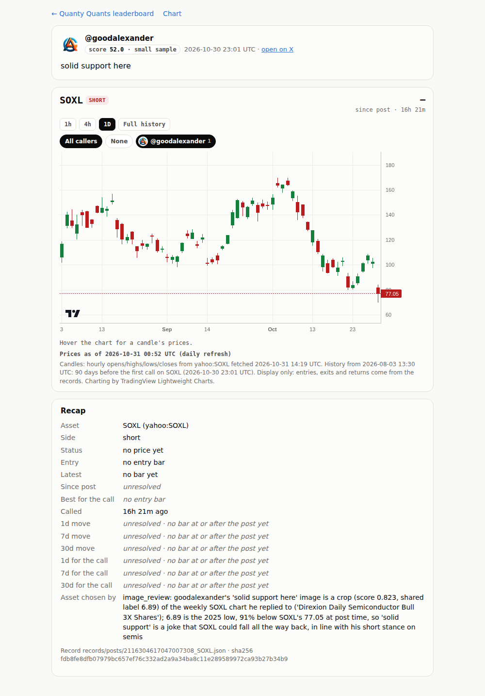
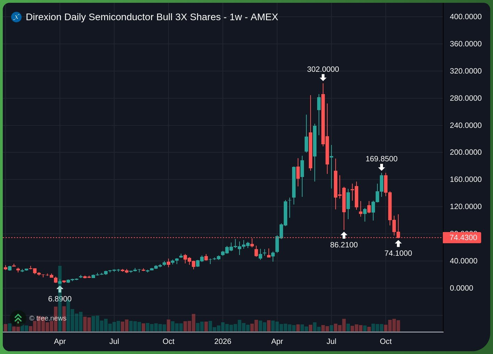
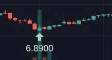

# Step 18 run notes: calls read from chart screenshots

**Live leaderboard: https://sendoeth.com/pf-post-signals/web/**

- **Live SOXL position (added after review, waiting for its first price)**: https://sendoeth.com/pf-post-signals/web/pos-2116304617047007308_SOXL.html
- **Review record**: [intake/images/review.json](https://github.com/sendoeth/pf-post-signals/blob/f1bbb50168ad8451b83bf77cea244205f197c3a0/intake/images/review.json) · **evidence**: [intake/images/2116304617047007308.json](https://github.com/sendoeth/pf-post-signals/blob/f1bbb50168ad8451b83bf77cea244205f197c3a0/intake/images/2116304617047007308.json) ([.md](https://github.com/sendoeth/pf-post-signals/blob/f1bbb50168ad8451b83bf77cea244205f197c3a0/intake/images/2116304617047007308.md)) · **record**: [records/posts/2116304617047007308_SOXL.json](https://github.com/sendoeth/pf-post-signals/blob/f1bbb50168ad8451b83bf77cea244205f197c3a0/records/posts/2116304617047007308_SOXL.json) · **add log**: [intake/log/2116304617047007308_SOXL.json](https://github.com/sendoeth/pf-post-signals/blob/f1bbb50168ad8451b83bf77cea244205f197c3a0/intake/log/2116304617047007308_SOXL.json)
- **Served commit**: `f1bbb50168ad8451b83bf77cea244205f197c3a0` (GitHub Pages build `built`, `outputs/served.txt`). Feature commit: [`26eedcf`](https://github.com/sendoeth/pf-post-signals/commit/26eedcf1b4deaa683e34f516e28d01b1ae6464e7); the live screenshot showed a stray avatar on a position with no entry yet (`#entry-bubble` display overrode `hidden`), fixed in [`f1bbb50`](https://github.com/sendoeth/pf-post-signals/commit/f1bbb50168ad8451b83bf77cea244205f197c3a0) and every live suite rerun on it. The notes commit changes nothing under `web/`
- **Served charts.json sha256**: `c108501a5969871e06322b9db2a2bdca6a35b76acd229641f9119e8e6edd54db`
- **Compare**: https://github.com/sendoeth/pf-post-signals/compare/72825a104a160fc2cc1f7f45831f51cd944ce288...f1bbb50168ad8451b83bf77cea244205f197c3a0
- Post: https://x.com/goodalexander/status/2116304617047007308 ("solid support here", 2026-10-30 23:01 UTC, a reply to https://x.com/based16z/status/2116217175962776030)

## The SOXL evidence chain

| Step | Result |
|---|---|
| Images | post image `sources/goodalexander/media/2116304617047007308_0.png` sha256 `d0e46316395bd27baa68986aab6cfce1877e814629781425555a4e35f6c0c1bb` (218×118); replied-to image `sources/based16z/media/2116217175962776030_0.jpg` sha256 `1490ecfc2f3e38aa4f4afd95392971b7619248e0da3ea690fa2500e3e46389ee` (1416×1016) |
| OCR (post image) | "a \| rt / ho / 1+ / 6.8900": no title, no ticker, one label **6.89** (cached: `…png.ocr.json`) |
| OCR (replied-to image) | title **"Direxion Daily Semiconductor Bull 3X Shares - 1w - AMEX"**, labels 302, 169.85, 86.21, 74.10, **6.89** (and the axis) |
| Name map | `detect/image_names.json`: "Direxion Daily Semiconductor Bull 3X Shares" → **SOXL** (yahoo:SOXL, added to the known assets) |
| Crop | the post image is a crop of the replied-to chart: normalized cross-correlation **0.823** (≥ 0.70), box around the 6.89 label (x 83–339, y 743–881 of 1416×1016), shared label 6.89 |
| Price | SOXL at post time **77.05** (last bar before the post, 2026-10-30 20:00 UTC): label 6.89 is **−91.1%** away (far, not an entry); nearest daily low in the 2 years before: **7.23 on 2025-04-07** (−4.7%: the chart's vendor shows 6.89 for the same April 2025 low) |
| Flags | "support / resistance words ('solid support') with a price label 6.89 that is −91.1% from the price at post time: sarcasm or a target level, not an entry" |
| Result | **needs_review**, asset SOXL, confidence **high**, **side not set** (an image or a joke never sets one); nothing added |
| Review | `intake/images/review.json`: add SOXL **short**, reason: "goodalexander's 'solid support here' image is a crop (score 0.823, shared label 6.89) of the weekly SOXL chart he replied to (...); 6.89 is the 2025 low, 91% below SOXL's 77.05 at post time, so 'solid support' is a joke that SOXL could fall all the way back, in line with his short stance on semis" |
| Gate | `add_call` refused the post without a reason (twice) and without `--pending` (no SOXL bar after a Friday 23:01 UTC post); with `--pending` the preview left `web/` + `records/` unchanged (tree sha256 equal before and after) |
| Added | record with `asset_choice.method = image_review` + evidence file and sha256, side short with the same reason, status **pending** ("no price yet"); not scored, so @goodalexander stays 51.960963 (previewed = after add); the daily refresh fills the entry from the first SOXL bar after the post (Monday 2026-11-02 13:30 UTC) |

## Commands and tee-captured outputs (`verification/step18/outputs/`)

| Step | Output file | sha256 |
|---|---|---|
| read_images | [outputs/read_images.txt](step18/outputs/read_images.txt) | `45ff85f9c0d0b1d942db1622c875d86eb8f6aa613c292b570f34b5728a3b63c6` |
| add_call_refusals | [outputs/add_call_refusals.txt](step18/outputs/add_call_refusals.txt) | `2676579d40b23c0ff39f6fa78b4b1a4c2a59099843168a89db2ff3c1f0ace6b2` |
| add_call_preview | [outputs/add_call_preview.txt](step18/outputs/add_call_preview.txt) | `3b53788c86089ccc6136e5158401be149b9715559864ae7465767f6d75002c6d` |
| add_call_add | [outputs/add_call_add.txt](step18/outputs/add_call_add.txt) | `ba4ec8264697ca62b117eb777c5c95c5b1bf07c7fd1bc8834b5c9f04d487b197` |
| checks | [outputs/checks.txt](step18/outputs/checks.txt) | `35d902c3a8385a00e967587d2cfc73612fdbb6cd2059828898ffc35fdc238bc2` |
| live_ratings_test | [outputs/live_ratings_test.txt](step18/outputs/live_ratings_test.txt) | `69b1f9aeb79ebfb7e8cdae83026defec4a15358209a3cec5f45ebf77ba998924` |
| live_position_test | [outputs/live_position_test.txt](step18/outputs/live_position_test.txt) | `b2b44de567eaf9bb5907ed980b19c6f849fed37541d1d55049f74d1ea9b87772` |
| live_callers_test | [outputs/live_callers_test.txt](step18/outputs/live_callers_test.txt) | `134585ebf58cf67401f872683d930fed2be19675a03f47d36a017cc48e576b4c` |
| live_browser_test | [outputs/live_browser_test.txt](step18/outputs/live_browser_test.txt) | `9557e2f8e7c7faa1abfba4fec33ed6e605f8cecc5ba16808275108e192ce44fa` |
| live_security_test | [outputs/live_security_test.txt](step18/outputs/live_security_test.txt) | `45972f05e47f475b5835de9e0e395c5afa3cb7f1183b7ce2ef8221a01f93f692` |
| live_board_test | [outputs/live_board_test.txt](step18/outputs/live_board_test.txt) | `9a11a0847eba089e4b7293bb7eda98198278545fbc3482708e9c927a0e2c0514` |
| served | [outputs/served.txt](step18/outputs/served.txt) | `16ab1c74934f6ac3770c750c28a3de6102657806f56d9d6962db0fc3624d8b20` |

```
$ .venv/bin/python tools/read_images.py https://x.com/goodalexander/status/2116304617047007308
post      https://x.com/goodalexander/status/2116304617047007308 @goodalexander 2026-10-30T23:01:54Z
post      sources/goodalexander/media/2116304617047007308_0.png sha256 d0e46316395bd27baa68986aab6cfce1877e814629781425555a4e35f6c0c1bb
          titles [] tickers [] labels [6.89]
reply_to  sources/based16z/media/2116217175962776030_0.jpg sha256 1490ecfc2f3e38aa4f4afd95392971b7619248e0da3ea690fa2500e3e46389ee
          titles ['Direxion Daily Semiconductor Bull 3X Shares'] tickers [] labels [0.0, 6.89, 40.0, 74.1, 86.21, 120.0, 160.0, 169.85, 200.0, 240.0, 280.0, 302.0, 320.0, 360.0, 400.0]
crop      sources/goodalexander/media/2116304617047007308_0.png in sources/based16z/media/2116217175962776030_0.jpg: score 0.823 -> CROP; shared labels [6.89]
candidate SOXL: title in the reply_to post's image (the post's image is a crop of it): 'Direxion Daily Semiconductor Bull 3X Shares'
price     SOXL at post 77.05 @ 2026-10-30T20:00:00Z: label 6.89 -91.1%; nearest daily low (2 yrs before): 7.23 on 2025-04-07 (-4.7%)
flag      support / resistance words ('solid support') with a price label 6.89 that is -91.1% from the price at post time: sarcasm or a target level, not an entry
result    needs_review: asset SOXL (confidence high), side not set
evidence  intake/images/2116304617047007308.json sha256 7823d4c7e41fff7697e73515ff0f99c32bc5a53c692ed85ae967c80696b47ac5
NOTHING ADDED: add only after review, with tools/add_call.py --asset --side --reason.
exit 0

$ python3 tools/add_call.py https://x.com/goodalexander/status/2116304617047007308   # no reason
REFUSED   image-inferred call: intake/images/2116304617047007308.json exists; add it only with --asset, --side and a written --reason
exit 2
$ python3 tools/add_call.py https://x.com/goodalexander/status/2116304617047007308 --asset SOXL --side short   # no reason
REFUSED   --asset needs --reason: an asset chosen by hand is always explained
exit 2
$ python3 tools/add_call.py https://x.com/goodalexander/status/2116304617047007308 --asset SOXL --side short --reason "<review.json reason>"   # no --pending
REFUSED   no price at or after the post within the lag limit (pending): nothing to score yet; --pending adds it now and the daily refresh fills the entry from the first bar
exit 2

$ find web records -type f | sort | xargs sha256sum | sha256sum   # before the preview
f727e623c39483a0cf719e4362c510cecb8007cf92f82ed44da54f2d394089b2  -
$ python3 tools/add_call.py https://x.com/goodalexander/status/2116304617047007308 --asset SOXL --side short --reason "<review.json reason>" --pending
post      https://x.com/goodalexander/status/2116304617047007308  @goodalexander  2026-10-30T23:01:54Z
receipt   sources/goodalexander/receipts/2116304617047007308.json  sha256 b883b4f302806ae9bc0918f685d98e82f40792c4af079027f74dc924a1387b26  already saved
text      “solid support here”
asset     SOXL (yahoo:SOXL) by image_review [] reason: goodalexander's 'solid support here' image is a crop (score 0.823, shared label 6.89) of the weekly SOXL chart he replied to ('Direxion Daily Semiconductor Bull 3X Shares'); 6.89 is the 2025 low, 91% below SOXL's 77.05 at post time, so 'solid support' is a joke that SOXL could fall all the way back, in line with his short stance on semis
side      SHORT by manual [] reason: goodalexander's 'solid support here' image is a crop (score 0.823, shared label 6.89) of the weekly SOXL chart he replied to ('Direxion Daily Semiconductor Bull 3X Shares'); 6.89 is the 2025 low, 91% below SOXL's 77.05 at post time, so 'solid support' is a joke that SOXL could fall all the way back, in line with his short stance on semis
entry     none yet: status pending (no bar after the post: market closed); the daily refresh fills it from the first bar
evidence  intake/images/2116304617047007308.json sha256 7823d4c7e41fff7697e73515ff0f99c32bc5a53c692ed85ae967c80696b47ac5 (image read, confidence high, suggested SOXL)
result    unresolved for the short since the post   1d pending   7d pending   30d pending
score now @goodalexander: 52.0 (exact 51.960963, rank 1 of 4, 4 scored calls, small sample)
with this @goodalexander: 52.0 (exact 51.960963, rank 1 of 4, 4 scored calls, small sample)   delta +0.000000
order     @goodalexander > @BobLoukas > @Corbanu > @DrProfitCrypto
pending   intake/pending/2116304617047007308_SOXL.json  (bundle sha256 68abeee8eaf00e25edde1a5e51d15db73787c3e9b14f72ff036f30ccd636c6e8)
PREVIEW ONLY: nothing under web/ or records/ changed. Rerun with --add to publish it.
exit 0
$ find web records -type f | sort | xargs sha256sum | sha256sum   # after the preview (unchanged)
f727e623c39483a0cf719e4362c510cecb8007cf92f82ed44da54f2d394089b2  -

$ python3 tools/add_call.py https://x.com/goodalexander/status/2116304617047007308 --asset SOXL --add
prerender: index.html (49 rows, 4 authors), position.html list, 49 position pages, 4 caller pages
added     records/posts/2116304617047007308_SOXL.json  sha256 fdb8fe8dfb07979bc657ef76c332ad2a9a34ba8c11e289589972ca93b27b34b9
avatar    kept
candles   candles refetched (fetch_ohlc.py): entry bars: 48/48 candle opens equal the record entry price
bundle    68abeee8eaf00e25edde1a5e51d15db73787c3e9b14f72ff036f30ccd636c6e8 -> c108501a5969871e06322b9db2a2bdca6a35b76acd229641f9119e8e6edd54db
score     previewed 52.0 (exact 51.960963, rank 1 of 4, 4 scored calls, small sample)
          after add 52.0 (exact 51.960963, rank 1 of 4, 4 scored calls, small sample)
checks    score = preview: yes; frozen values of every other position unchanged: yes; log intake/log/2116304617047007308_SOXL.json
exit 0

$ python3 check_bundle.py
bundle: 49 record files -> 49 drawn, 0 superseded, 0 refused; 147 horizon cells, 49 best-since-post values, 4 caller ratings checked -> ALL MATCH
$ python3 validate_records.py | tail -1
records: 49 checked against post_price.v1 -> ALL VALID
$ python3 fetch_ohlc.py --check-only | tail -1
entry bars: 48/48 candle opens equal the record entry price
$ python3 tools/frozen_values.py compare verification/step14/frozen_baseline.json | head -1
positions 31 (now 49), frozen values compared 177, changed 0
$ python3 rate.py | grep "^#"
#1 @goodalexander: score 51.9610 (small sample) · calls 5, with entry 4, scored 4 · wins 2 · H 50.0000 A 48.4084 C 100.0000 · raw 56.8634 · weight 0.2857 · avg result -0.40%
#2 @BobLoukas: score 51.8030 (sample ok) · calls 35, with entry 35, scored 33 · wins 14 · H 42.4242 A 47.7888 C 94.2857 · raw 52.3493 · weight 0.7674 · avg result +4.52%
#3 @Corbanu: score 49.2998 (small sample) · calls 8, with entry 8, scored 8 · wins 3 · H 37.5000 A 41.3740 C 100.0000 · raw 48.4246 · weight 0.4444 · avg result +0.91%
#4 @DrProfitCrypto: score 48.0363 (small sample) · calls 1, with entry 1, scored 1 · wins 0 · H 0.0000 A 33.4989 C 100.0000 · raw 28.3996 · weight 0.0909 · avg result -3.43%
$ .venv/bin/python -m unittest -v tests.test_read_images
test_a_joke_marker_never_sets_a_side (tests.test_read_images.Analyse.test_a_joke_marker_never_sets_a_side) ... ok
test_add_call_needs_a_reason_and_records_the_evidence (tests.test_read_images.Analyse.test_add_call_needs_a_reason_and_records_the_evidence) ... ok
test_no_readable_text_and_no_title (tests.test_read_images.Analyse.test_no_readable_text_and_no_title) ... ok
test_pending_post_is_refused_unless_allowed (tests.test_read_images.Analyse.test_pending_post_is_refused_unless_allowed) ... ok
test_the_soxl_pattern_goes_to_review_without_a_side (tests.test_read_images.Analyse.test_the_soxl_pattern_goes_to_review_without_a_side) ... ok
test_a_crop_is_found_where_it_was_cut (tests.test_read_images.Crop.test_a_crop_is_found_where_it_was_cut) ... ok
test_an_unrelated_chart_is_not_a_crop (tests.test_read_images.Crop.test_an_unrelated_chart_is_not_a_crop) ... ok
test_the_real_soxl_crop (tests.test_read_images.Crop.test_the_real_soxl_crop) ... ok
test_near_and_far_labels (tests.test_read_images.Prices.test_near_and_far_labels) ... ok
test_a_ticker_on_the_chart (tests.test_read_images.Read.test_a_ticker_on_the_chart) ... ok
test_a_title_needs_every_word (tests.test_read_images.Read.test_a_title_needs_every_word) ... ok
test_no_readable_text (tests.test_read_images.Read.test_no_readable_text) ... ok
test_title_maps_to_the_asset (tests.test_read_images.Read.test_title_maps_to_the_asset) ... ok

----------------------------------------------------------------------
Ran 13 tests in 9.410s

OK
$ .venv/bin/python -m unittest discover -s tests -p "test_*.py"
Ran 128 tests in 45.806s
OK

$ curl -s https://sendoeth.com/pf-post-signals/web/data/charts.json | sha256sum
c108501a5969871e06322b9db2a2bdca6a35b76acd229641f9119e8e6edd54db  -
$ curl -s https://sendoeth.com/pf-post-signals/web/pos-2116304617047007308_SOXL.html | grep -o '<title>[^<]*'
<title>SOXL SHORT · @goodalexander · unresolved · Quanty Quants
$ curl -s https://api.github.com/repos/sendoeth/pf-post-signals/pages/builds/latest (status, commit)
built f1bbb50168ad8451b83bf77cea244205f197c3a0

$ node tests/ratings_test.js --url https://sendoeth.com/pf-post-signals/web/
callers recomputed 4, calls compared 49, author-table sorts 15 (+15 reloads), caller pages 4 (93 fields, 49 call links), position chips 49, overlay cards 35, chart cards 48, CSP violations 0, console errors 0
ALL PASS
exit 0
$ node tests/position_test.js --url https://sendoeth.com/pf-post-signals/web/
position pages opened 98 (49 posts x default + 1h), recap fields checked 2242, entry-bubble placements checked 96, unresolved cells 98, closed position loads checked 2, console errors 0
ALL PASS
exit 0
$ node tests/callers_test.js --url https://sendoeth.com/pf-post-signals/web/
position pages 48, caller combinations 448 (incl. 224 reloads), toggle clicks 192, bubbles anchored 354, bubble pairs checked for overlap 2292, cards opened 354, exit marks 4, daily readouts 5, console errors 0
ALL PASS
exit 0
$ node tests/browser_test.js --url https://sendoeth.com/pf-post-signals/web/
assets 14, cards opened 48, card fields checked 714, unresolved cells checked 43, same-hour bubbles 2, bubbles checked 48 (avatar images 40, initials 8; side ring + direction badge = record), console errors 0
ALL PASS
exit 0
$ node tests/security_test.js --url https://sendoeth.com/pf-post-signals/web/
canary window.__pwned: unset on every page; CSP violations: 0; console errors: 0
ALL PASS
exit 0
$ node tests/board_test.js --url https://sendoeth.com/pf-post-signals/web/
filter/sort combinations: 8100 set in the page (786 with rows, 7314 correctly empty), 324 of them also loaded fresh from their URL; author-summary rows checked: 2448; select changes: 33; default-view fields checked against records: 392; without javascript: 49 static rows + 49 static position pages equal the bundle; rows 49; CSP violations 0; console errors 0
ALL PASS
exit 0
```

## What changed

| | |
|---|---|
| `tools/read_images.py` | collect (post + replied-to / quoted images, sha256, receipts), OCR (tesseract.js via the read-only research harness, cached with the image sha256), title name map, tickers, labels (thousands separators read whole), multi-scale NCC crop matching (FFT + integral images), price-label checks vs the price at post time and the nearest 2-year daily extreme, joke / sarcasm flags; output `intake/images/<post>.json` + `.md`, status needs_review / no_asset, never a side |
| `detect/image_names.json` | written fund / chart title map (every word must be present) |
| `tools/add_call.py` | image evidence: refused without a written reason; record gets `asset_choice.method = image_review` and `asset_choice.evidence` (file, sha256, confidence, suggested); `--pending` adds a post with no bar yet (not scored; the refresh fills the entry) |
| Schema | `asset_choice.method` adds `image_review`; `asset_choice.evidence` |
| `resolve.py` | SOXL (yahoo:SOXL) |
| Pending posts | `fetch_ohlc.py` counts a post with no price yet from its post time; the chart view shows "no prices after these posts yet" for such an asset; static pages write `data-raw="null"` for an entry that does not exist yet |
| Tests | `tests/test_read_images.py` (13): crop found where it was cut / unrelated chart is not a crop / the real SOXL pair; title, ticker, unreadable text, partial title; near and far labels with the nearest daily extreme; the SOXL pattern end-to-end (needs_review, no side, web/ + records/ unchanged, no pending intake); joke markers never set a side; reason required and evidence recorded; pending refused unless allowed. Fixture images from `tests/fixtures/images/make.py`. `tests/test_history.py` (+1). CI installs pillow + numpy |

## SHA-256 (artifacts)

```
7823d4c7e41fff7697e73515ff0f99c32bc5a53c692ed85ae967c80696b47ac5  intake/images/2116304617047007308.json
adfa45b1285605f732edab5119a121fad561854a774be9b4fce65cddfe57daf5  intake/images/2116304617047007308.md
d6a4ef6448222e0a615e5dc1a21ad2d6acd72b0af8c5da5460522cf0b5cbd584  intake/images/review.json
fdb8fe8dfb07979bc657ef76c332ad2a9a34ba8c11e289589972ca93b27b34b9  records/posts/2116304617047007308_SOXL.json
def9e5cc98b4c8d1557e0167adddd3962d4f39ec54904e455aa30b20f53d68b5  intake/log/2116304617047007308_SOXL.json
d0e46316395bd27baa68986aab6cfce1877e814629781425555a4e35f6c0c1bb  sources/goodalexander/media/2116304617047007308_0.png
1490ecfc2f3e38aa4f4afd95392971b7619248e0da3ea690fa2500e3e46389ee  sources/based16z/media/2116217175962776030_0.jpg
617cc0f0ce06a716d77329b2ecac642302598f5493d35d5822cdd3bb5979130d  sources/goodalexander/media/2116304617047007308_0.png.ocr.json
23ba39dd231ddffcd76bf4ee6762262a1d2b3d3781bda99f2a28fc4e4a8ae04c  sources/based16z/media/2116217175962776030_0.jpg.ocr.json
c108501a5969871e06322b9db2a2bdca6a35b76acd229641f9119e8e6edd54db  web/data/charts.json
7eeab6069119a8c8ad7b99e15fb2f9863a435d1296f87bd37c48fe00f613e451  web/data/ohlc/SOXL.json
1cf695528e0d41ca7d1563e9822f342740188e13b19ef5c0dcf5a712bf8c3289  tools/read_images.py
a8b68e331968d8839eb2ab27c4c63f529ff60b5337b35f3dc3f3da59bea45461  tools/add_call.py
5090e98b20e70c30e9a258b5ec1ba2acb50ab0d0aec98e6458428c2a736f0728  detect/image_names.json
6cfe426bdae2188f8b5280d624a519f098c8ee54df67d9af8a0e467214e5206d  tests/test_read_images.py
3275d4dd1889abbf2cf065e631b7b3954609c0ea28b578ac3d8921bf7ee0c06a  tests/fixtures/images/chart.png
f11bf722f9d15280188ec23a9c50bfd933e661fbe4b90653f1694768e22985b4  tests/fixtures/images/crop.png
6cf895b0bd3232750425e8e4f783d7d9a41a373704e7c542c9122549c5bfa542  tests/fixtures/images/other.png
788082614f52ee10e7febc2f387e5fa35190f9ee62f282a93d6d5093f574a5e8  verification/step18/leaderboard_soxl_row.png
d09b2c8e893738c0880585e1d3522090d6b5743b2df3f8e3f45040280963ba61  verification/step18/soxl_position.png
```

## Screenshots

- The live SOXL position (no price yet, short, the reviewed reason and image evidence): [soxl_position.png](step18/soxl_position.png)
- The SOXL row on the live leaderboard: [leaderboard_soxl_row.png](step18/leaderboard_soxl_row.png)
- The two images: [post crop](../sources/goodalexander/media/2116304617047007308_0.png) and [replied-to chart](../sources/based16z/media/2116217175962776030_0.jpg)




