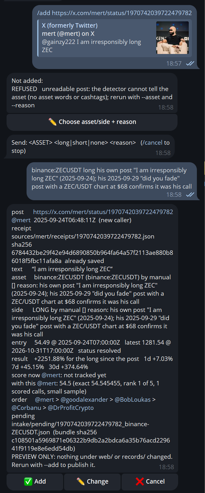
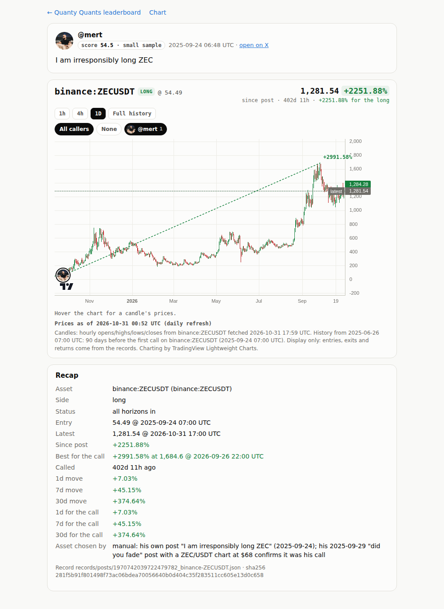
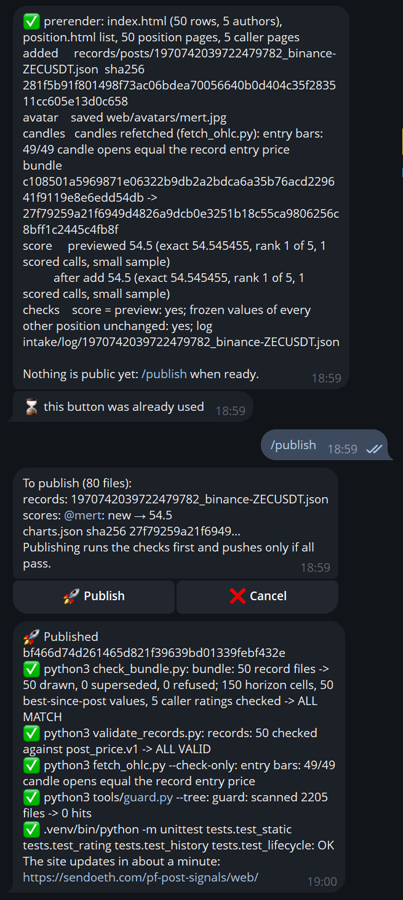
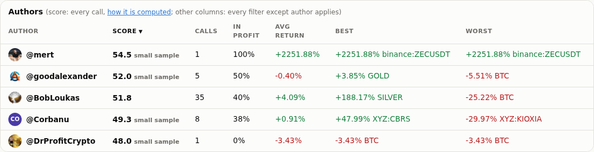
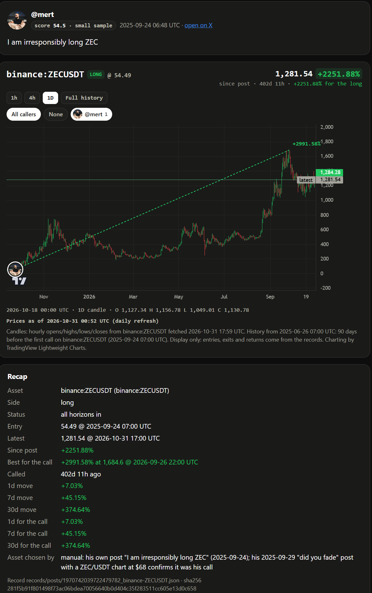

# Step 19 run notes: private owner-only Telegram admin bot

**Live leaderboard: https://sendoeth.com/pf-post-signals/web/**

- **Live position of the call added through the bot**: https://sendoeth.com/pf-post-signals/web/pos-1970742039722479782_binance-ZECUSDT.html (@mert, ZEC long, 2025-09-24)
- **New caller page**: https://sendoeth.com/pf-post-signals/web/caller-mert.html
- **Published by the bot**: [`bf466d74d261465d821f39639bd01339febf432e`](https://github.com/sendoeth/pf-post-signals/commit/bf466d74d261465d821f39639bd01339febf432e) ("admin bot: publish 1 record(s)"), pushed from the phone session with the bot's repository-scoped token; this is the served commit (GitHub Pages build `built`, `outputs/served.txt`). The notes commit changes nothing under `web/`.
- **Served charts.json sha256**: `27f79259a21f6949d4826a9dcb0e3251b18c55ca9806256c8bff1c2445c4fb8f`
- **Compare** (everything the bot published): https://github.com/sendoeth/pf-post-signals/compare/94316c719bc4ac9e307b028d99a31dee66065901...bf466d74d261465d821f39639bd01339febf432e
- **Public intake log of the add**: [intake/log/1970742039722479782_binance-ZECUSDT.json](https://github.com/sendoeth/pf-post-signals/blob/bf466d74d261465d821f39639bd01339febf432e/intake/log/1970742039722479782_binance-ZECUSDT.json) · **record**: [records/posts/1970742039722479782_binance-ZECUSDT.json](https://github.com/sendoeth/pf-post-signals/blob/bf466d74d261465d821f39639bd01339febf432e/records/posts/1970742039722479782_binance-ZECUSDT.json) · **receipt**: [sources/mert/receipts/1970742039722479782.json](https://github.com/sendoeth/pf-post-signals/blob/bf466d74d261465d821f39639bd01339febf432e/sources/mert/receipts/1970742039722479782.json)

The bot is private by design: its source, tests, token, owner chat id and the server address are not published. This note proves it through public results, sha256 fingerprints of the private files, the private test output, the redacted audit log and redacted screenshots.

## The bot

| | |
|---|---|
| Transport | Telegram Bot API long polling (getUpdates), outbound HTTPS only; no webhook, **no listening port** (checked: the service process has no listening socket, one outbound connection to the Telegram API) |
| Access | every message **and every button press** must come from the owner's user id **in the owner's private chat** (both checked); anyone else gets no reply and one audit line with ids only; joining groups is disabled in @BotFather |
| Secrets | token, owner id and a **repository-scoped** GitHub token (fine-grained, contents read/write on `sendoeth/pf-post-signals` only: push handshake HTTP 200 there, HTTP 403 on another repository) in a private directory (700 / 600), never in a repository; credentials never on a command line (git uses a temporary GIT_ASKPASS helper, removed after use); tokens, GitHub tokens, the owner id and IPv4 addresses are redacted from every message and audit line |
| Jobs | one at a time (flock held for the whole job, background scans included); tools run as argument lists, no shell |
| Buttons | stored server side, used once, expire after 30 min, refused when the site data changed since they were shown; after a restart every old button is dead; an add or push that times out is reported UNCERTAIN and never retried; the update offset is persisted so no message is processed twice |
| Commands | /add (add_call preview → Add / Change / Cancel), /image (read_images evidence, never a side), /scan (scan_caller in the background, stop reasons, resume), /review (candidates one by one, every decision with a written reason into review.json), /callers, /status, /sync, /publish |
| Publish | fixed repository, branch main, fixed remote; only allowlisted paths (records, receipts, intake logs, the built site) are staged; any other change blocks it; refuses when the live repository moved or the files differ from the summary; runs check_bundle, validate_records, fetch_ohlc --check-only, guard and the static / rating / history / lifecycle tests, then commits and pushes, all under the lock |
| Service | systemd user service, Restart=on-failure, UMask 0077, NoNewPrivileges; reviewed before deployment (owner-id + private-chat checks, publish allowlist and lock, wider redaction and a repository-scoped token, replay / no-retry rules were added from that review) |

## The phone session (2026-10-31, Telegram Desktop)

1. `/add https://x.com/mert/status/1972686220850541031` ("did you fade" + a ZEC/USDT chart): **refused**, the detector cannot tell the asset. The post is a victory lap after the move, so the call was traced back to Mert's own earlier post.
2. `/add https://x.com/mert/status/1970742039722479782` ("I am irresponsibly long ZEC", 2025-09-24): refused (no asset words) → **✏️ Choose asset/side + reason** → `binance:ZECUSDT long <reason>` → preview: entry **54.49** @ 2025-09-24T07:00, **+2251.88%**, @mert **new caller → 54.5** (1 scored call, small sample).
3. **✅ Add** → "score = preview: yes; frozen values of every other position unchanged: yes" (previewed 54.545455 = after add 54.545455). A second tap on the same button was refused: "this button was already used".
4. `/publish` → "80 files · records: 1970742039722479782_binance-ZECUSDT.json · scores: @mert: new → 54.5 · charts.json sha256 27f79259a21f6949…" → **🚀 Publish** → all five checks ✅ → **Published `bf466d74d261465d821f39639bd01339febf432e`**.

| Telegram (redacted: nothing to redact, no ids or tokens are visible) | Published result on the site |
|---|---|
|  |  |
|  |  |
| The owner's own view of the published position, right after the push: |  |

## Commands and tee-captured outputs (`verification/step19/outputs/`)

| What | File | sha256 |
|---|---|---|
| private_fingerprints | [outputs/private_fingerprints.txt](step19/outputs/private_fingerprints.txt) | `530a3c9105103f88c073e3c51ce2fc870c3d0d71180255812518652aa5b8c407` |
| private_tests | [outputs/private_tests.txt](step19/outputs/private_tests.txt) | `d213a7db53dd0ae9450ae726b7fc05a5820c6771d1a665265a585956b890fb94` |
| audit_redacted | [outputs/audit_redacted.jsonl](step19/outputs/audit_redacted.jsonl) | `d4ec2b97487f08ecb3903c08cf38424b79af8064148f61cf511985a97ba6a3f3` |
| live_ratings_test | [outputs/live_ratings_test.txt](step19/outputs/live_ratings_test.txt) | `4e01d00609d79c4ce5b12e9d94c7c0e594f228ac5c61a3e5ab177149c552896c` |
| live_position_test | [outputs/live_position_test.txt](step19/outputs/live_position_test.txt) | `20f13a7aa26bddfdd94a1daee5abf65f37192cdda08e01954aec2e30d7acaec7` |
| live_callers_test | [outputs/live_callers_test.txt](step19/outputs/live_callers_test.txt) | `d44fd42416f633e11a44fd5357e90f3844ca3b0bd7f0221033156a763275183a` |
| live_browser_test | [outputs/live_browser_test.txt](step19/outputs/live_browser_test.txt) | `ba525f28f1e07fb917474feeb89c3bddbb718219ebdec97241bd1a55c4bb81e0` |
| live_security_test | [outputs/live_security_test.txt](step19/outputs/live_security_test.txt) | `e03ae6e48f9cc9b7686ca65339c6437ce624cbac0e5edb23c63e98238ef93888` |
| live_board_test | [outputs/live_board_test.txt](step19/outputs/live_board_test.txt) | `096cb5728ecf4c52689e2e19de7a00a3d849177bcce91a0de0d051e85fd1de5c` |
| served | [outputs/served.txt](step19/outputs/served.txt) | `c6ebe9f499ebd8fcf1e2f284377461855077defcfc5c1e8626044262608ce4f0` |

### Private file fingerprints (source not published)
```
# sha256 of every private bot file (source not published)
0628a18b78a6e0cc2b0f59ccf5ee36c5ebe216b16b6c61e9b25f8371deb368e3  quanty_admin.py
869ddcf8a29df9c92d7c2447a527149d0ee1cd7320284e29c9ffcbb9ca9c9d63  tests/test_bot.py
e3b0c44298fc1c149afbf4c8996fb92427ae41e4649b934ca495991b7852b855  tests/__init__.py
834edeb1ce49e765bab3e4bf1b75ed9fbb8f0f6294efc346c701ebeb41330387  ~/.config/systemd/user/quanty-admin.service
```

### Private tests (fake Telegram API + fake tools)
```
$ python3 -m unittest -v tests.test_bot   # private tests (fake Telegram API + fake tools), run in /home/postfiat/quanty-admin
test_a_strangers_button_is_ignored (tests.test_bot.Access.test_a_strangers_button_is_ignored) ... /home/postfiat/quanty-admin/quanty_admin.py:70: ResourceWarning: unclosed file <_io.TextIOWrapper name='/tmp/qa-test-mjl1eovk/home/github_token' mode='r' encoding='UTF-8'>
  self.github = open(gh).read().strip() if self.github_file else None
ResourceWarning: Enable tracemalloc to get the object allocation traceback
ok
test_owner_gets_help (tests.test_bot.Access.test_owner_gets_help) ... /home/postfiat/quanty-admin/quanty_admin.py:70: ResourceWarning: unclosed file <_io.TextIOWrapper name='/tmp/qa-test-rh6n1eg9/home/github_token' mode='r' encoding='UTF-8'>
  self.github = open(gh).read().strip() if self.github_file else None
ResourceWarning: Enable tracemalloc to get the object allocation traceback
ok
test_strangers_get_nothing (tests.test_bot.Access.test_strangers_get_nothing) ... /home/postfiat/quanty-admin/quanty_admin.py:70: ResourceWarning: unclosed file <_io.TextIOWrapper name='/tmp/qa-test-2pcewlcp/home/github_token' mode='r' encoding='UTF-8'>
  self.github = open(gh).read().strip() if self.github_file else None
ResourceWarning: Enable tracemalloc to get the object allocation traceback
ok
test_a_button_works_once_and_expires (tests.test_bot.Add.test_a_button_works_once_and_expires) ... /home/postfiat/quanty-admin/quanty_admin.py:70: ResourceWarning: unclosed file <_io.TextIOWrapper name='/tmp/qa-test-1yi8aweb/home/github_token' mode='r' encoding='UTF-8'>
  self.github = open(gh).read().strip() if self.github_file else None
ResourceWarning: Enable tracemalloc to get the object allocation traceback
ok
test_bad_url_is_refused_without_running_anything (tests.test_bot.Add.test_bad_url_is_refused_without_running_anything) ... /home/postfiat/quanty-admin/quanty_admin.py:70: ResourceWarning: unclosed file <_io.TextIOWrapper name='/tmp/qa-test-cnw68otj/home/github_token' mode='r' encoding='UTF-8'>
  self.github = open(gh).read().strip() if self.github_file else None
ResourceWarning: Enable tracemalloc to get the object allocation traceback
ok
test_one_job_at_a_time (tests.test_bot.Add.test_one_job_at_a_time) ... /home/postfiat/quanty-admin/quanty_admin.py:70: ResourceWarning: unclosed file <_io.TextIOWrapper name='/tmp/qa-test-91enfgj8/home/github_token' mode='r' encoding='UTF-8'>
  self.github = open(gh).read().strip() if self.github_file else None
ResourceWarning: Enable tracemalloc to get the object allocation traceback
ok
test_pending_post_asks_for_asset_side_reason (tests.test_bot.Add.test_pending_post_asks_for_asset_side_reason) ... /home/postfiat/quanty-admin/quanty_admin.py:70: ResourceWarning: unclosed file <_io.TextIOWrapper name='/tmp/qa-test-x30na_hk/home/github_token' mode='r' encoding='UTF-8'>
  self.github = open(gh).read().strip() if self.github_file else None
ResourceWarning: Enable tracemalloc to get the object allocation traceback
ok
test_preview_then_add (tests.test_bot.Add.test_preview_then_add) ... /home/postfiat/quanty-admin/quanty_admin.py:70: ResourceWarning: unclosed file <_io.TextIOWrapper name='/tmp/qa-test-wcwpu0w5/home/github_token' mode='r' encoding='UTF-8'>
  self.github = open(gh).read().strip() if self.github_file else None
ResourceWarning: Enable tracemalloc to get the object allocation traceback
ok
test_stale_preview_is_refused (tests.test_bot.Add.test_stale_preview_is_refused) ... /home/postfiat/quanty-admin/quanty_admin.py:70: ResourceWarning: unclosed file <_io.TextIOWrapper name='/tmp/qa-test-5eoxpyqm/home/github_token' mode='r' encoding='UTF-8'>
  self.github = open(gh).read().strip() if self.github_file else None
ResourceWarning: Enable tracemalloc to get the object allocation traceback
ok
test_uncertain_add_is_not_retried (tests.test_bot.Add.test_uncertain_add_is_not_retried) ... /home/postfiat/quanty-admin/quanty_admin.py:70: ResourceWarning: unclosed file <_io.TextIOWrapper name='/tmp/qa-test-p3l9h_tn/home/github_token' mode='r' encoding='UTF-8'>
  self.github = open(gh).read().strip() if self.github_file else None
ResourceWarning: Enable tracemalloc to get the object allocation traceback
ok
test_image_flow_needs_a_side_and_a_reason (tests.test_bot.Image.test_image_flow_needs_a_side_and_a_reason) ... /home/postfiat/quanty-admin/quanty_admin.py:70: ResourceWarning: unclosed file <_io.TextIOWrapper name='/tmp/qa-test-z7x7c1pv/home/github_token' mode='r' encoding='UTF-8'>
  self.github = open(gh).read().strip() if self.github_file else None
ResourceWarning: Enable tracemalloc to get the object allocation traceback
/home/postfiat/quanty-admin/quanty_admin.py:521: ResourceWarning: unclosed file <_io.TextIOWrapper name='/tmp/qa-test-z7x7c1pv/repo/intake/images/2116304617047007308.json' mode='r' encoding='UTF-8'>
  e = json.load(open(ev))
ResourceWarning: Enable tracemalloc to get the object allocation traceback
ok
test_blocked_files_stop_it (tests.test_bot.Publish.test_blocked_files_stop_it) ... /home/postfiat/quanty-admin/quanty_admin.py:70: ResourceWarning: unclosed file <_io.TextIOWrapper name='/tmp/qa-test-utv_3qon/home/github_token' mode='r' encoding='UTF-8'>
  self.github = open(gh).read().strip() if self.github_file else None
ResourceWarning: Enable tracemalloc to get the object allocation traceback
ok
test_changed_files_since_preview (tests.test_bot.Publish.test_changed_files_since_preview) ... /home/postfiat/quanty-admin/quanty_admin.py:70: ResourceWarning: unclosed file <_io.TextIOWrapper name='/tmp/qa-test-jax5gfck/home/github_token' mode='r' encoding='UTF-8'>
  self.github = open(gh).read().strip() if self.github_file else None
ResourceWarning: Enable tracemalloc to get the object allocation traceback
/home/postfiat/quanty-admin/quanty_admin.py:601: ResourceWarning: unclosed file <_io.TextIOWrapper name='/tmp/qa-test-jax5gfck/repo/web/data/charts.json' mode='r' encoding='UTF-8'>
  after = json.load(open(os.path.join(self.repo, "web", "data", "charts.json")))["ratings"]["callers"]
ResourceWarning: Enable tracemalloc to get the object allocation traceback
ok
test_failed_check_pushes_nothing (tests.test_bot.Publish.test_failed_check_pushes_nothing) ... /home/postfiat/quanty-admin/quanty_admin.py:70: ResourceWarning: unclosed file <_io.TextIOWrapper name='/tmp/qa-test-cnm07i1z/home/github_token' mode='r' encoding='UTF-8'>
  self.github = open(gh).read().strip() if self.github_file else None
ResourceWarning: Enable tracemalloc to get the object allocation traceback
/home/postfiat/quanty-admin/quanty_admin.py:601: ResourceWarning: unclosed file <_io.TextIOWrapper name='/tmp/qa-test-cnm07i1z/repo/web/data/charts.json' mode='r' encoding='UTF-8'>
  after = json.load(open(os.path.join(self.repo, "web", "data", "charts.json")))["ratings"]["callers"]
ResourceWarning: Enable tracemalloc to get the object allocation traceback
ok
test_publish_happy_path_keeps_credentials_off_argv (tests.test_bot.Publish.test_publish_happy_path_keeps_credentials_off_argv) ... /home/postfiat/quanty-admin/quanty_admin.py:70: ResourceWarning: unclosed file <_io.TextIOWrapper name='/tmp/qa-test-bh3pk_sy/home/github_token' mode='r' encoding='UTF-8'>
  self.github = open(gh).read().strip() if self.github_file else None
ResourceWarning: Enable tracemalloc to get the object allocation traceback
/home/postfiat/quanty-admin/quanty_admin.py:601: ResourceWarning: unclosed file <_io.TextIOWrapper name='/tmp/qa-test-bh3pk_sy/repo/web/data/charts.json' mode='r' encoding='UTF-8'>
  after = json.load(open(os.path.join(self.repo, "web", "data", "charts.json")))["ratings"]["callers"]
ResourceWarning: Enable tracemalloc to get the object allocation traceback
ok
test_remote_moved_stops_it (tests.test_bot.Publish.test_remote_moved_stops_it) ... /home/postfiat/quanty-admin/quanty_admin.py:70: ResourceWarning: unclosed file <_io.TextIOWrapper name='/tmp/qa-test-gy6zh5is/home/github_token' mode='r' encoding='UTF-8'>
  self.github = open(gh).read().strip() if self.github_file else None
ResourceWarning: Enable tracemalloc to get the object allocation traceback
ok
test_stale_publish_button (tests.test_bot.Publish.test_stale_publish_button) ... /home/postfiat/quanty-admin/quanty_admin.py:70: ResourceWarning: unclosed file <_io.TextIOWrapper name='/tmp/qa-test-dhoriull/home/github_token' mode='r' encoding='UTF-8'>
  self.github = open(gh).read().strip() if self.github_file else None
ResourceWarning: Enable tracemalloc to get the object allocation traceback
/home/postfiat/quanty-admin/quanty_admin.py:601: ResourceWarning: unclosed file <_io.TextIOWrapper name='/tmp/qa-test-dhoriull/repo/web/data/charts.json' mode='r' encoding='UTF-8'>
  after = json.load(open(os.path.join(self.repo, "web", "data", "charts.json")))["ratings"]["callers"]
ResourceWarning: Enable tracemalloc to get the object allocation traceback
ok
test_audit_log_is_private (tests.test_bot.Redaction.test_audit_log_is_private) ... /home/postfiat/quanty-admin/quanty_admin.py:70: ResourceWarning: unclosed file <_io.TextIOWrapper name='/tmp/qa-test-9q74v93q/home/github_token' mode='r' encoding='UTF-8'>
  self.github = open(gh).read().strip() if self.github_file else None
ResourceWarning: Enable tracemalloc to get the object allocation traceback
ok
test_secrets_never_reach_a_message_or_the_audit_log (tests.test_bot.Redaction.test_secrets_never_reach_a_message_or_the_audit_log) ... /home/postfiat/quanty-admin/quanty_admin.py:70: ResourceWarning: unclosed file <_io.TextIOWrapper name='/tmp/qa-test-rdj9s6b4/home/github_token' mode='r' encoding='UTF-8'>
  self.github = open(gh).read().strip() if self.github_file else None
ResourceWarning: Enable tracemalloc to get the object allocation traceback
ok
test_offset_persists_and_old_buttons_die (tests.test_bot.Restart.test_offset_persists_and_old_buttons_die) ... /home/postfiat/quanty-admin/quanty_admin.py:70: ResourceWarning: unclosed file <_io.TextIOWrapper name='/tmp/qa-test-y2ob3m7r/home/github_token' mode='r' encoding='UTF-8'>
  self.github = open(gh).read().strip() if self.github_file else None
ResourceWarning: Enable tracemalloc to get the object allocation traceback
/home/postfiat/quanty-admin/quanty_admin.py:170: ResourceWarning: unclosed file <_io.TextIOWrapper name='/tmp/qa-test-y2ob3m7r/home/state.json' mode='r' encoding='UTF-8'>
  self.state = json.load(open(self.state_path)) if os.path.exists(self.state_path) else {"offset": 0}
ResourceWarning: Enable tracemalloc to get the object allocation traceback
ok
test_walk_decide_with_reasons_then_report (tests.test_bot.Review.test_walk_decide_with_reasons_then_report) ... /home/postfiat/quanty-admin/quanty_admin.py:70: ResourceWarning: unclosed file <_io.TextIOWrapper name='/tmp/qa-test-v5wdhxf2/home/github_token' mode='r' encoding='UTF-8'>
  self.github = open(gh).read().strip() if self.github_file else None
ResourceWarning: Enable tracemalloc to get the object allocation traceback
/home/postfiat/quanty-admin/quanty_admin.py:427: ResourceWarning: unclosed file <_io.TextIOWrapper name='/tmp/qa-test-v5wdhxf2/repo/intake/scans/somecaller/report.json' mode='r' encoding='UTF-8'>
  r = json.load(open(os.path.join(d, "report.json")))
ResourceWarning: Enable tracemalloc to get the object allocation traceback
/home/postfiat/quanty-admin/quanty_admin.py:452: ResourceWarning: unclosed file <_io.TextIOWrapper name='/tmp/qa-test-v5wdhxf2/repo/intake/scans/somecaller/review.json' mode='r' encoding='UTF-8'>
  data = json.load(open(path)) if os.path.exists(path) else {}
ResourceWarning: Enable tracemalloc to get the object allocation traceback
ok
test_background_scan_reports_and_releases_the_lock (tests.test_bot.Scan.test_background_scan_reports_and_releases_the_lock) ... /home/postfiat/quanty-admin/quanty_admin.py:70: ResourceWarning: unclosed file <_io.TextIOWrapper name='/tmp/qa-test-bdrazvdu/home/github_token' mode='r' encoding='UTF-8'>
  self.github = open(gh).read().strip() if self.github_file else None
ResourceWarning: Enable tracemalloc to get the object allocation traceback
ok

----------------------------------------------------------------------
Ran 22 tests in 0.046s

OK
```

### Audit log of the session (redacted: ids → [owner] / [id])
```
{"at": "2026-10-31T17:44:03Z", "event": "start", "pid": 668135}
{"at": "2026-10-31T17:44:04Z", "event": "command", "text": "/start"}
{"at": "2026-10-31T17:44:04Z", "event": "command", "text": "hello test"}
{"at": "2026-10-31T17:46:31Z", "event": "command", "text": "/status"}
{"at": "2026-10-31T17:51:24Z", "event": "command", "text": "/add https://x.com/mert/status/1972686220850541031"}
{"at": "2026-10-31T17:51:25Z", "event": "tool", "argv": ["python3", "tools/add_call.py", "https://x.com/mert/status/1972686220850541031"], "code": 2, "tail": "REFUSED   unreadable post: the detector cannot tell the asset (no asset words or cashtags); rerun with --asset and --reason"}
{"at": "2026-10-31T17:54:11Z", "event": "button", "kind": "choose", "ok": true, "why": null}
{"at": "2026-10-31T17:54:27Z", "event": "command", "text": "binance:ZECUSDT long his own post \"I am irresponsibly long ZEC\" (2025-09-24); his 2025-09-29 \"did you fade\" post with a ZEC/USDT chart at $68 confirms it was his call\n     binance:ZECUSDT"}
{"at": "2026-10-31T17:54:35Z", "event": "tool", "argv": ["python3", "tools/add_call.py", "https://x.com/mert/status/1972686220850541031", "--asset", "BINANCE:ZECUSDT", "--side", "long", "--reason", "his own post \"I am irresponsibly long ZEC\" (2025-09-24); his 2025-09-29 \"did you fade\" post with a ZEC/USDT chart at ..."], "code": 0, "tail": "  @mert > @goodalexander > @BobLoukas > @Corbanu > @DrProfitCrypto\npending   intake/pending/1972686220850541031_binance-ZECUSDT.json  (bundle sha256 c108501a5969871e06322b9db2a2bdca6a35b76acd229641f9119e8e6edd54db)\nPREVIEW ONLY: nothing under web/ or records/ changed. Rerun with --add to publish it."}
{"at": "2026-10-31T17:57:48Z", "event": "button", "kind": "cancel", "ok": true, "why": null}
{"at": "2026-10-31T17:57:58Z", "event": "command", "text": "/add https://x.com/mert/status/1970742039722479782"}
{"at": "2026-10-31T17:57:59Z", "event": "tool", "argv": ["python3", "tools/add_call.py", "https://x.com/mert/status/1970742039722479782"], "code": 2, "tail": "REFUSED   unreadable post: the detector cannot tell the asset (no asset words or cashtags); rerun with --asset and --reason"}
{"at": "2026-10-31T17:58:05Z", "event": "button", "kind": "choose", "ok": true, "why": null}
{"at": "2026-10-31T17:58:07Z", "event": "command", "text": "binance:ZECUSDT long his own post \"I am irresponsibly long ZEC\" (2025-09-24); his 2025-09-29 \"did you fade\" post with a ZEC/USDT chart at $68 confirms it was his call"}
{"at": "2026-10-31T17:58:14Z", "event": "tool", "argv": ["python3", "tools/add_call.py", "https://x.com/mert/status/1970742039722479782", "--asset", "BINANCE:ZECUSDT", "--side", "long", "--reason", "his own post \"I am irresponsibly long ZEC\" (2025-09-24); his 2025-09-29 \"did you fade\" post with a ZEC/USDT chart at ..."], "code": 0, "tail": "  @mert > @goodalexander > @BobLoukas > @Corbanu > @DrProfitCrypto\npending   intake/pending/1970742039722479782_binance-ZECUSDT.json  (bundle sha256 c108501a5969871e06322b9db2a2bdca6a35b76acd229641f9119e8e6edd54db)\nPREVIEW ONLY: nothing under web/ or records/ changed. Rerun with --add to publish it."}
{"at": "2026-10-31T17:58:37Z", "event": "button", "kind": "add", "ok": true, "why": null}
{"at": "2026-10-31T17:59:08Z", "event": "tool", "argv": ["python3", "tools/add_call.py", "https://x.com/mert/status/1970742039722479782", "--add", "--asset", "BINANCE:ZECUSDT"], "code": 0, "tail": "viewed 54.5 (exact 54.545455, rank 1 of 5, 1 scored calls, small sample)\n          after add 54.5 (exact 54.545455, rank 1 of 5, 1 scored calls, small sample)\nchecks    score = preview: yes; frozen values of every other position unchanged: yes; log intake/log/1970742039722479782_binance-ZECUSDT.json"}
{"at": "2026-10-31T17:59:09Z", "event": "button", "kind": "add", "ok": false, "why": "this button was already used"}
{"at": "2026-10-31T17:59:32Z", "event": "command", "text": "/publish"}
{"at": "2026-10-31T17:59:43Z", "event": "button", "kind": "publish", "ok": true, "why": null}
{"at": "2026-10-31T17:59:44Z", "event": "tool", "argv": ["python3", "check_bundle.py"], "code": 0, "tail": "bundle: 50 record files -> 50 drawn, 0 superseded, 0 refused; 150 horizon cells, 50 best-since-post values, 5 caller ratings checked -> ALL MATCH"}
{"at": "2026-10-31T17:59:46Z", "event": "tool", "argv": ["python3", "validate_records.py"], "code": 0, "tail": "records: 50 checked against post_price.v1 -> ALL VALID"}
{"at": "2026-10-31T17:59:46Z", "event": "tool", "argv": ["python3", "fetch_ohlc.py", "--check-only"], "code": 0, "tail": "09-27T00:00:00Z record 137.94 candle open 137.94\nOK   XYZ:SKHX corbanu:skhx-entry entry 2026-09-27T22:00:00Z record 1364.9 candle open 1364.9\nOK   binance:ZECUSDT 1970742039722479782 entry 2025-09-24T07:00:00Z record 54.49 candle open 54.49\nentry bars: 49/49 candle opens equal the record entry price"}
{"at": "2026-10-31T17:59:54Z", "event": "tool", "argv": ["python3", "tools/guard.py", "--tree"], "code": 0, "tail": "guard: scanned 2205 files -> 0 hits"}
{"at": "2026-10-31T17:59:55Z", "event": "tool", "argv": [".venv/bin/python", "-m", "unittest", "tests.test_static", "tests.test_rating", "tests.test_history", "tests.test_lifecycle"], "code": 0, "tail": "thors), position.html list, 2 position pages, 1 caller pages\nprerender: index.html (50 rows, 5 authors), position.html list, 50 position pages, 5 caller pages\n...........................................\n----------------------------------------------------------------------\nRan 43 tests in 1.550s\n\nOK"}
{"at": "2026-10-31T17:59:58Z", "event": "published", "commit": "bf466d74d261465d821f39639bd01339febf432e", "files": 80}
```

### Public suites, live on the published build
```
$ node tests/ratings_test.js --url https://sendoeth.com/pf-post-signals/web/
callers recomputed 5, calls compared 50, author-table sorts 15 (+15 reloads), caller pages 5 (105 fields, 50 call links), position chips 50, overlay cards 35, chart cards 49, CSP violations 0, console errors 0
ALL PASS
exit 0
$ node tests/position_test.js --url https://sendoeth.com/pf-post-signals/web/
position pages opened 100 (50 posts x default + 1h), recap fields checked 2288, entry-bubble placements checked 98, unresolved cells 98, closed position loads checked 2, console errors 0
ALL PASS
exit 0
$ node tests/callers_test.js --url https://sendoeth.com/pf-post-signals/web/
position pages 49, caller combinations 452 (incl. 226 reloads), toggle clicks 195, bubbles anchored 354, bubble pairs checked for overlap 2292, cards opened 354, exit marks 4, daily readouts 5, console errors 0
ALL PASS
exit 0
$ node tests/browser_test.js --url https://sendoeth.com/pf-post-signals/web/
assets 15, cards opened 49, card fields checked 729, unresolved cells checked 43, same-hour bubbles 2, bubbles checked 49 (avatar images 41, initials 8; side ring + direction badge = record), console errors 0
ALL PASS
exit 0
$ node tests/security_test.js --url https://sendoeth.com/pf-post-signals/web/
canary window.__pwned: unset on every page; CSP violations: 0; console errors: 0
ALL PASS
exit 0
$ node tests/board_test.js --url https://sendoeth.com/pf-post-signals/web/
filter/sort combinations: 10368 set in the page (822 with rows, 9546 correctly empty), 414 of them also loaded fresh from their URL; author-summary rows checked: 3105; select changes: 35; default-view fields checked against records: 400; without javascript: 50 static rows + 50 static position pages equal the bundle; rows 50; CSP violations 0; console errors 0
ALL PASS
exit 0
$ curl -s https://sendoeth.com/pf-post-signals/web/data/charts.json | sha256sum
27f79259a21f6949d4826a9dcb0e3251b18c55ca9806256c8bff1c2445c4fb8f  -
$ curl -s https://sendoeth.com/pf-post-signals/web/pos-1970742039722479782_binance-ZECUSDT.html | grep -o '<title>[^<]*'
<title>binance:ZECUSDT LONG · @mert · +2251.88% · Quanty Quants
$ curl -s https://api.github.com/repos/sendoeth/pf-post-signals/pages/builds/latest (status, commit)
built bf466d74d261465d821f39639bd01339febf432e
$ git show --stat --format='%H %an %s' bf466d74d261465d821f39639bd01339febf432e | tail -3
 web/pos-corbanu-skhx-entry_XYZ-SKHX.html           |     2 +-
 web/position.html                                  |     3 +-
 80 files changed, 77854 insertions(+), 180 deletions(-)
```

## SHA-256 (public artifacts)

```
281f5b91f801498f73ac06bdea70056640b0d404c35f283511cc605e13d0c658  records/posts/1970742039722479782_binance-ZECUSDT.json
9dc8a62040782321f03e267c0c5d505c3422167ed7bb42a24c3f114d98a7c722  intake/log/1970742039722479782_binance-ZECUSDT.json
6784432be29f42e94d6890850b964fa64a57f2113ae880b86018f5fbc11afa8a  sources/mert/receipts/1970742039722479782.json
1a7666198e9f5983b4049d72aac3fb88ae837cdbc8a4e8df20ebfb3810c77d49  sources/mert/receipts/1972686220850541031.json
27f79259a21f6949d4826a9dcb0e3251b18c55ca9806256c8bff1c2445c4fb8f  web/data/charts.json
56a67eebe730af930357195de192342b5ed29affc25dbc1b69f233d29993c6c5  web/avatars/mert.jpg
c84d9ca7e5394adfe874b92ea9f5e59c671afddf102a60df050cc3e1c4a34687  verification/step19/owner_view_published_position.png
518077b5dff00915f46a433ecd2629df14c95b631302bdb81d6879d0225d45fd  verification/step19/site_author_table.png
7a940514273e1b0009fa1d452b33f65c021ab5f09c6133ed8bf5b319115adc74  verification/step19/site_mert_zec_position.png
b398d1122535bd49eae9018a738efb01216c7b19bf6e96eea81fddd79f0413f3  verification/step19/telegram_1_add_choose_preview.png
42b4d206807274e621e7835884eb943aebec46d35d882539d248de208b2a158a  verification/step19/telegram_2_add_publish.png
```
