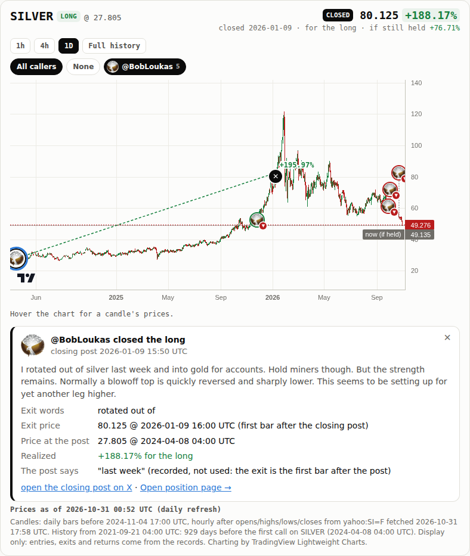
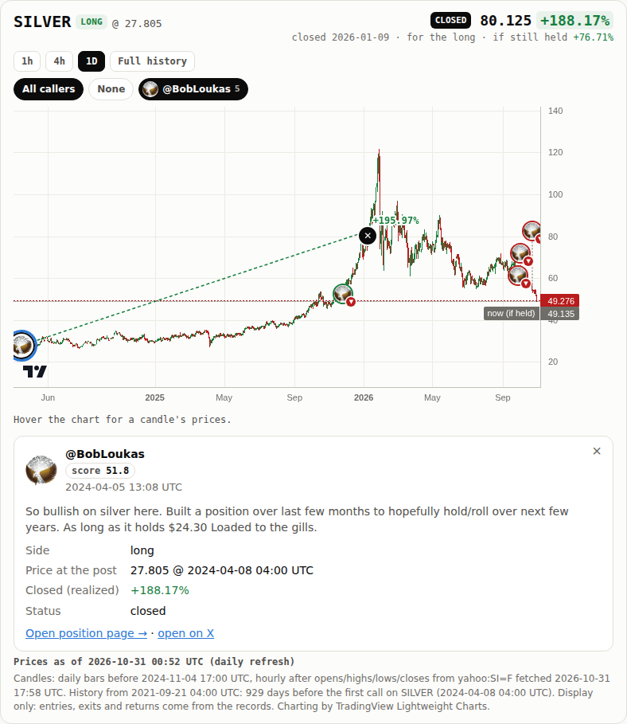
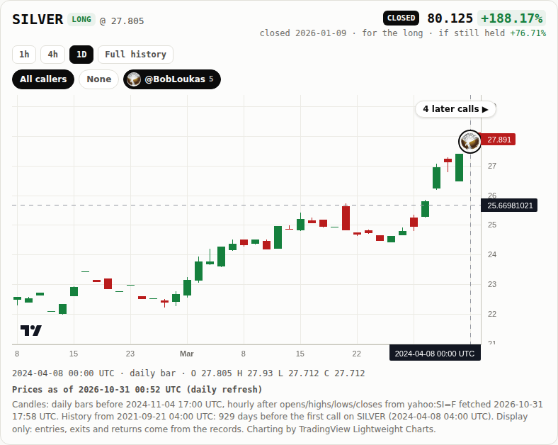
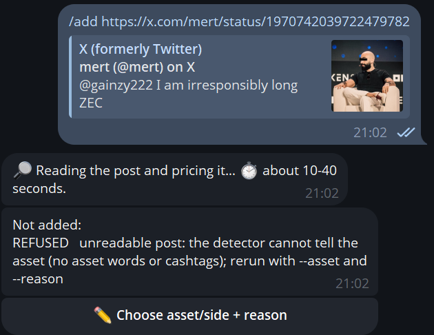

# Step 20 run notes: site polish

**Live leaderboard: https://sendoeth.com/pf-post-signals/web/**

- **Live BobLoukas silver position**: https://sendoeth.com/pf-post-signals/web/pos-1776235528741937435_SILVER.html (click the ✕ for the close card)
- **Code commit (deployed, served)**: [`5d7f4be5696c830bae1fe32073b8c4c3a148dd85`](https://github.com/sendoeth/pf-post-signals/commit/5d7f4be5696c830bae1fe32073b8c4c3a148dd85) (GitHub Pages build, `outputs/served.txt`); the notes commit changes nothing under `web/`
- **Served charts.json sha256**: `27f79259a21f6949d4826a9dcb0e3251b18c55ca9806256c8bff1c2445c4fb8f`, fetched from the full path **https://sendoeth.com/pf-post-signals/web/data/charts.json** (the same bundle as step 19: step 20 changes how the site presents the data, not the data; `git diff --stat 6c3792c 5d7f4be -- web/data` is empty)
- **Compare**: https://github.com/sendoeth/pf-post-signals/compare/6c3792c521dc3a8772a980820880da706a58ccd9...5d7f4be5696c830bae1fe32073b8c4c3a148dd85

## What changed

| | |
|---|---|
| Not financial advice | one notice (`#nfa`, identical wording) on the leaderboard, the chart view, `position.html`, all 50 position pages and all 5 caller pages, static and no-JS included; the leaderboard notes link to it: "Not financial advice. The calls on this site are public posts by their authors, tracked and priced for analysis. They are the authors' expressions of opinion, not recommendations: nothing here is advice to buy, sell or hold anything, and past results say nothing about future ones." |
| Clickable closes | the ✕ of a closed call (the opened call's and other callers' on the same chart) is a button (click / Enter / Space): a close card with the closing post (text, time, link: the post, or the article / ledger for Corbanu), the matched exit words, the exit price at the first bar after the closing post, the price at the post and the realized result, plus a stated earlier time as recorded-not-used; the chart view's card for a closed call links its closing post |
| Price at the post | every call card shows the entry bar as "Price at the post" (the first bar at or after the post); the opened call's own bubble is now clickable too, so every call on the chart has a card |
| Markers inside the chart | the overlay is exactly the plot area (price scale and time axis excluded) with `overflow: hidden`; a bubble, stem or exit mark whose bar is outside the visible range is hidden. Before: the opened call's bubble drew outside the chart onto the page when zoomed or scrolled (measured at x = -52.6 px on the old build, below). The opened call's default view starts 12 bars before the entry and shows everything up to today when it fits, else as many bars as fit, so at 1h an old entry is no longer pushed off-screen |
| Admin bot (private) | every slow command (preview, add, context, scan, report, batch add, image, apply follow-ups, sync, publish) first replies what it is doing and the expected time; a failed progress send (even with a failed audit write) never leaves the job locked. Reviewed before the restart (the lock-safety points came from that review) |

## The silver close card (live)

Clicking (or Enter on) the ✕ at 80.125 on 2026-01-09: **@BobLoukas closed the long** · closing post 2026-01-09 15:50 UTC "… rotated out of …" · exit words "rotated out of" · **exit price 80.125 @ 2026-01-09 16:00 UTC (first bar after the closing post)** · price at the post 27.805 @ 2024-04-08 04:00 UTC · **realized +188.17% for the long** · "the post says "last week" (recorded, not used)" · link to https://x.com/BobLoukas/status/2009654117799739530. Every value is checked against `records/posts/1776235528741937435_SILVER.json` by `tests/polish_test.js`.

## Before and after (the same test)

`tests/polish_test.js` was run against the live site **before** the deploy (the step 19 build) and **after** it (`5d7f4be5696c830bae1fe32073b8c4c3a148dd85`):

| Check | Before (step 19 build) | After (`5d7f4be5696c830bae1fe32073b8c4c3a148dd85`) |
|---|---|---|
| notice missing (58 pages + the leaderboard link) | 59 failures | 0 |
| close card / exit mark | 6 failures | 0 |
| price at the post on cards | 404 failures | 0 |
| chart-view cards (label / closing post) | 49 failures | 0 |
| overlay not exactly the plot / not clipping | 784 failures | 0 |
| markers drawn outside the plot | 101 failures | 0 |
| **total** | **1403 failures** | **ALL PASS** |

## Commands and tee-captured outputs (`verification/step20/outputs/`)

| What | File | sha256 |
|---|---|---|
| polish_test_before_fix | [outputs/polish_test_before_fix.txt](step20/outputs/polish_test_before_fix.txt) | `072f2a4c29858f5dbb314b31839f50ff7c6634c6909a457b2300f9162625b6bd` |
| live_polish_test | [outputs/live_polish_test.txt](step20/outputs/live_polish_test.txt) | `c752a40c707b2b0dfbe6b57a9c94176fadb669baf70bc752027a3f1161c6632d` |
| live_ratings_test | [outputs/live_ratings_test.txt](step20/outputs/live_ratings_test.txt) | `4e01d00609d79c4ce5b12e9d94c7c0e594f228ac5c61a3e5ab177149c552896c` |
| live_position_test | [outputs/live_position_test.txt](step20/outputs/live_position_test.txt) | `20f13a7aa26bddfdd94a1daee5abf65f37192cdda08e01954aec2e30d7acaec7` |
| live_callers_test | [outputs/live_callers_test.txt](step20/outputs/live_callers_test.txt) | `d44fd42416f633e11a44fd5357e90f3844ca3b0bd7f0221033156a763275183a` |
| live_browser_test | [outputs/live_browser_test.txt](step20/outputs/live_browser_test.txt) | `ba525f28f1e07fb917474feeb89c3bddbb718219ebdec97241bd1a55c4bb81e0` |
| live_security_test | [outputs/live_security_test.txt](step20/outputs/live_security_test.txt) | `e03ae6e48f9cc9b7686ca65339c6437ce624cbac0e5edb23c63e98238ef93888` |
| live_board_test | [outputs/live_board_test.txt](step20/outputs/live_board_test.txt) | `096cb5728ecf4c52689e2e19de7a00a3d849177bcce91a0de0d051e85fd1de5c` |
| python_tests | [outputs/python_tests.txt](step20/outputs/python_tests.txt) | `4135117dca33279db836d6a554620fb215badbcde7cf656e4c824d6ef1184274` |
| private_tests | [outputs/private_tests.txt](step20/outputs/private_tests.txt) | `a8ddd45fabd9d7182ea104020aad34536ea028a56776161ac46e32438722b1bf` |
| private_fingerprints | [outputs/private_fingerprints.txt](step20/outputs/private_fingerprints.txt) | `d9cabc5b138dfacc9dd4c77b4a19b149e16251bb07a592b4bab55193b173d4e5` |
| served | [outputs/served.txt](step20/outputs/served.txt) | `e04b8a64b26746213214fe6eb8df571f58a8321416b4e741f6db044e439475cc` |

```
$ node tests/polish_test.js --url https://sendoeth.com/pf-post-signals/web/ --screenshots verification/step20
notice on 58 pages, close cards 6 (+1 by keyboard), price-at-post cards 404, chart-view cards 49, views checked 392 (8 per position page), visible markers inside the plot 1514, hidden outside the view 2134, console errors 0
ALL PASS
exit 0
$ node tests/ratings_test.js --url https://sendoeth.com/pf-post-signals/web/
callers recomputed 5, calls compared 50, author-table sorts 15 (+15 reloads), caller pages 5 (105 fields, 50 call links), position chips 50, overlay cards 35, chart cards 49, CSP violations 0, console errors 0
ALL PASS
exit 0
$ node tests/position_test.js --url https://sendoeth.com/pf-post-signals/web/
position pages opened 100 (50 posts x default + 1h), recap fields checked 2288, entry-bubble placements checked 98, unresolved cells 98, closed position loads checked 2, console errors 0
ALL PASS
exit 0
$ node tests/callers_test.js --url https://sendoeth.com/pf-post-signals/web/
position pages 49, caller combinations 452 (incl. 226 reloads), toggle clicks 195, bubbles anchored 354, bubble pairs checked for overlap 2292, cards opened 354, exit marks 4, daily readouts 5, console errors 0
ALL PASS
exit 0
$ node tests/browser_test.js --url https://sendoeth.com/pf-post-signals/web/
assets 15, cards opened 49, card fields checked 729, unresolved cells checked 43, same-hour bubbles 2, bubbles checked 49 (avatar images 41, initials 8; side ring + direction badge = record), console errors 0
ALL PASS
exit 0
$ node tests/security_test.js --url https://sendoeth.com/pf-post-signals/web/
canary window.__pwned: unset on every page; CSP violations: 0; console errors: 0
ALL PASS
exit 0
$ node tests/board_test.js --url https://sendoeth.com/pf-post-signals/web/
filter/sort combinations: 10368 set in the page (822 with rows, 9546 correctly empty), 414 of them also loaded fresh from their URL; author-summary rows checked: 3105; select changes: 35; default-view fields checked against records: 400; without javascript: 50 static rows + 50 static position pages equal the bundle; rows 50; CSP violations 0; console errors 0
ALL PASS
exit 0
$ .venv/bin/python -m unittest -v tests.test_static
Ran 9 tests in 0.516s
OK
$ .venv/bin/python -m unittest discover -s tests -p "test_*.py"
Ran 143 tests in 61.088s
OK
$ python3 check_bundle.py
bundle: 50 record files -> 50 drawn, 0 superseded, 0 refused; 150 horizon cells, 50 best-since-post values, 5 caller ratings checked -> ALL MATCH
$ python3 tools/guard.py --tree
guard: scanned 2234 files -> 0 hits
$ curl -s https://sendoeth.com/pf-post-signals/web/data/charts.json | sha256sum
27f79259a21f6949d4826a9dcb0e3251b18c55ca9806256c8bff1c2445c4fb8f  -
$ curl -s -o /dev/null -w '%{http_code}' https://sendoeth.com/pf-post-signals/web/pos-1776235528741937435_SILVER.html
200
$ curl -s https://sendoeth.com/pf-post-signals/web/pos-1776235528741937435_SILVER.html | grep -c 'id="nfa"'
1
$ git ls-remote https://github.com/sendoeth/pf-post-signals.git refs/heads/main
5d7f4be5696c830bae1fe32073b8c4c3a148dd85	refs/heads/main
$ curl -s https://api.github.com/repos/sendoeth/pf-post-signals/pages/builds/latest (status, commit)
built 5d7f4be5696c830bae1fe32073b8c4c3a148dd85
```

### Private bot evidence (fingerprints and private test output only)

The bot's source is private. Its private test output has the deliberately provoked "disk full" tracebacks removed (they print lines of the private source); every test result line is kept.

```
# sha256 of every private bot file (source not published)
71b60fa1ad60be6bd66ee239ae8e5130ef83717d7fbb2f4c011230d1dc1513ab  quanty_admin.py
33ceeaab0528092ffa9479b304eb80fd66cabd9d0b8d693aec63a37debc9d783  tests/test_bot.py
e3b0c44298fc1c149afbf4c8996fb92427ae41e4649b934ca495991b7852b855  tests/__init__.py
834edeb1ce49e765bab3e4bf1b75ed9fbb8f0f6294efc346c701ebeb41330387  ~/.config/systemd/user/quanty-admin.service

$ python3 -m unittest -v tests.test_bot   # private (fake Telegram API + fake tools), run in the private bot directory
test_a_strangers_button_is_ignored (tests.test_bot.Access.test_a_strangers_button_is_ignored) ... /home/postfiat/quanty-admin/quanty_admin.py:70: ResourceWarning: unclosed file <_io.TextIOWrapper name='/tmp/qa-test-8e6ijnqi/home/github_token' mode='r' encoding='UTF-8'>
  self.github = open(gh).read().strip() if self.github_file else None
ResourceWarning: Enable tracemalloc to get the object allocation traceback
ok
test_owner_gets_help (tests.test_bot.Access.test_owner_gets_help) ... /home/postfiat/quanty-admin/quanty_admin.py:70: ResourceWarning: unclosed file <_io.TextIOWrapper name='/tmp/qa-test-anip9fua/home/github_token' mode='r' encoding='UTF-8'>
  self.github = open(gh).read().strip() if self.github_file else None
ResourceWarning: Enable tracemalloc to get the object allocation traceback
ok
test_strangers_get_nothing (tests.test_bot.Access.test_strangers_get_nothing) ... /home/postfiat/quanty-admin/quanty_admin.py:70: ResourceWarning: unclosed file <_io.TextIOWrapper name='/tmp/qa-test-2_fahtep/home/github_token' mode='r' encoding='UTF-8'>
  self.github = open(gh).read().strip() if self.github_file else None
ResourceWarning: Enable tracemalloc to get the object allocation traceback
ok
test_a_button_works_once_and_expires (tests.test_bot.Add.test_a_button_works_once_and_expires) ... /home/postfiat/quanty-admin/quanty_admin.py:70: ResourceWarning: unclosed file <_io.TextIOWrapper name='/tmp/qa-test-q10nss9t/home/github_token' mode='r' encoding='UTF-8'>
  self.github = open(gh).read().strip() if self.github_file else None
ResourceWarning: Enable tracemalloc to get the object allocation traceback
ok
test_bad_url_is_refused_without_running_anything (tests.test_bot.Add.test_bad_url_is_refused_without_running_anything) ... /home/postfiat/quanty-admin/quanty_admin.py:70: ResourceWarning: unclosed file <_io.TextIOWrapper name='/tmp/qa-test-qj9z23xa/home/github_token' mode='r' encoding='UTF-8'>
  self.github = open(gh).read().strip() if self.github_file else None
ResourceWarning: Enable tracemalloc to get the object allocation traceback
ok
test_one_job_at_a_time (tests.test_bot.Add.test_one_job_at_a_time) ... /home/postfiat/quanty-admin/quanty_admin.py:70: ResourceWarning: unclosed file <_io.TextIOWrapper name='/tmp/qa-test-7ka906w4/home/github_token' mode='r' encoding='UTF-8'>
  self.github = open(gh).read().strip() if self.github_file else None
ResourceWarning: Enable tracemalloc to get the object allocation traceback
ok
test_pending_post_asks_for_asset_side_reason (tests.test_bot.Add.test_pending_post_asks_for_asset_side_reason) ... /home/postfiat/quanty-admin/quanty_admin.py:70: ResourceWarning: unclosed file <_io.TextIOWrapper name='/tmp/qa-test-fne15uvg/home/github_token' mode='r' encoding='UTF-8'>
  self.github = open(gh).read().strip() if self.github_file else None
ResourceWarning: Enable tracemalloc to get the object allocation traceback
ok
test_preview_then_add (tests.test_bot.Add.test_preview_then_add) ... /home/postfiat/quanty-admin/quanty_admin.py:70: ResourceWarning: unclosed file <_io.TextIOWrapper name='/tmp/qa-test-iewhjmbr/home/github_token' mode='r' encoding='UTF-8'>
  self.github = open(gh).read().strip() if self.github_file else None
ResourceWarning: Enable tracemalloc to get the object allocation traceback
ok
test_stale_preview_is_refused (tests.test_bot.Add.test_stale_preview_is_refused) ... /home/postfiat/quanty-admin/quanty_admin.py:70: ResourceWarning: unclosed file <_io.TextIOWrapper name='/tmp/qa-test-3gyo11tk/home/github_token' mode='r' encoding='UTF-8'>
  self.github = open(gh).read().strip() if self.github_file else None
ResourceWarning: Enable tracemalloc to get the object allocation traceback
ok
test_uncertain_add_is_not_retried (tests.test_bot.Add.test_uncertain_add_is_not_retried) ... /home/postfiat/quanty-admin/quanty_admin.py:70: ResourceWarning: unclosed file <_io.TextIOWrapper name='/tmp/qa-test-bxtp6b2d/home/github_token' mode='r' encoding='UTF-8'>
  self.github = open(gh).read().strip() if self.github_file else None
ResourceWarning: Enable tracemalloc to get the object allocation traceback
ok
test_context_runs_after_a_preview_and_offers_the_original (tests.test_bot.Context.test_context_runs_after_a_preview_and_offers_the_original) ... /home/postfiat/quanty-admin/quanty_admin.py:70: ResourceWarning: unclosed file <_io.TextIOWrapper name='/tmp/qa-test-ui7u_m6d/home/github_token' mode='r' encoding='UTF-8'>
  self.github = open(gh).read().strip() if self.github_file else None
ResourceWarning: Enable tracemalloc to get the object allocation traceback
/home/postfiat/quanty-admin/tests/test_bot.py:223: ResourceWarning: unclosed file <_io.TextIOWrapper name='/tmp/qa-test-ui7u_m6d/home/job.lock' mode='a' encoding='UTF-8'>
  self.bot = self.make_bot(context=True)
ResourceWarning: Enable tracemalloc to get the object allocation traceback
/home/postfiat/quanty-admin/quanty_admin.py:403: ResourceWarning: unclosed file <_io.TextIOWrapper name='/tmp/qa-test-ui7u_m6d/repo/intake/context/1972686220850541031.json' mode='r' encoding='UTF-8'>
  c = json.load(open(path)) if os.path.exists(path) else {}
ResourceWarning: Enable tracemalloc to get the object allocation traceback
ok
test_lock_is_safe_across_threads (tests.test_bot.Context.test_lock_is_safe_across_threads) ... /home/postfiat/quanty-admin/quanty_admin.py:70: ResourceWarning: unclosed file <_io.TextIOWrapper name='/tmp/qa-test-nl_horrf/home/github_token' mode='r' encoding='UTF-8'>
  self.github = open(gh).read().strip() if self.github_file else None
ResourceWarning: Enable tracemalloc to get the object allocation traceback
ok
test_no_context_without_an_asset (tests.test_bot.Context.test_no_context_without_an_asset) ... /home/postfiat/quanty-admin/quanty_admin.py:70: ResourceWarning: unclosed file <_io.TextIOWrapper name='/tmp/qa-test-kd6mx8au/home/github_token' mode='r' encoding='UTF-8'>
  self.github = open(gh).read().strip() if self.github_file else None
ResourceWarning: Enable tracemalloc to get the object allocation traceback
/home/postfiat/quanty-admin/tests/test_bot.py:261: ResourceWarning: unclosed file <_io.TextIOWrapper name='/tmp/qa-test-kd6mx8au/home/job.lock' mode='a' encoding='UTF-8'>
  self.bot = self.make_bot(context=True)
ResourceWarning: Enable tracemalloc to get the object allocation traceback
ok
test_publish_allows_lifecycle_and_context_files (tests.test_bot.Context.test_publish_allows_lifecycle_and_context_files) ... /home/postfiat/quanty-admin/quanty_admin.py:70: ResourceWarning: unclosed file <_io.TextIOWrapper name='/tmp/qa-test-bm4u5sod/home/github_token' mode='r' encoding='UTF-8'>
  self.github = open(gh).read().strip() if self.github_file else None
ResourceWarning: Enable tracemalloc to get the object allocation traceback
ok
test_image_flow_needs_a_side_and_a_reason (tests.test_bot.Image.test_image_flow_needs_a_side_and_a_reason) ... /home/postfiat/quanty-admin/quanty_admin.py:70: ResourceWarning: unclosed file <_io.TextIOWrapper name='/tmp/qa-test-xzisntu6/home/github_token' mode='r' encoding='UTF-8'>
  self.github = open(gh).read().strip() if self.github_file else None
ResourceWarning: Enable tracemalloc to get the object allocation traceback
/home/postfiat/quanty-admin/quanty_admin.py:590: ResourceWarning: unclosed file <_io.TextIOWrapper name='/tmp/qa-test-xzisntu6/repo/intake/images/2116304617047007308.json' mode='r' encoding='UTF-8'>
  e = json.load(open(ev))
ResourceWarning: Enable tracemalloc to get the object allocation traceback
ok
test_a_failed_progress_send_never_leaves_the_job_locked (tests.test_bot.Progress.test_a_failed_progress_send_never_leaves_the_job_locked) ... /home/postfiat/quanty-admin/quanty_admin.py:70: ResourceWarning: unclosed file <_io.TextIOWrapper name='/tmp/qa-test-5u38_0o_/home/github_token' mode='r' encoding='UTF-8'>
  self.github = open(gh).read().strip() if self.github_file else None
ResourceWarning: Enable tracemalloc to get the object allocation traceback
ok
test_add_button (tests.test_bot.Progress.test_add_button) ... /home/postfiat/quanty-admin/quanty_admin.py:70: ResourceWarning: unclosed file <_io.TextIOWrapper name='/tmp/qa-test-tw5m7kk7/home/github_token' mode='r' encoding='UTF-8'>
  self.github = open(gh).read().strip() if self.github_file else None
ResourceWarning: Enable tracemalloc to get the object allocation traceback
ok
test_add_preview (tests.test_bot.Progress.test_add_preview) ... /home/postfiat/quanty-admin/quanty_admin.py:70: ResourceWarning: unclosed file <_io.TextIOWrapper name='/tmp/qa-test-tn_n6jyb/home/github_token' mode='r' encoding='UTF-8'>
  self.github = open(gh).read().strip() if self.github_file else None
ResourceWarning: Enable tracemalloc to get the object allocation traceback
ok
test_failed_send_and_failed_audit_still_release_the_lock (tests.test_bot.Progress.test_failed_send_and_failed_audit_still_release_the_lock) ... /home/postfiat/quanty-admin/quanty_admin.py:70: ResourceWarning: unclosed file <_io.TextIOWrapper name='/tmp/qa-test-qgk81fon/home/github_token' mode='r' encoding='UTF-8'>
  self.github = open(gh).read().strip() if self.github_file else None
ResourceWarning: Enable tracemalloc to get the object allocation traceback

During handling of the above exception, another exception occurred:

ok
test_fast_commands_do_not_announce (tests.test_bot.Progress.test_fast_commands_do_not_announce) ... /home/postfiat/quanty-admin/quanty_admin.py:70: ResourceWarning: unclosed file <_io.TextIOWrapper name='/tmp/qa-test-wdeiddfk/home/github_token' mode='r' encoding='UTF-8'>
  self.github = open(gh).read().strip() if self.github_file else None
ResourceWarning: Enable tracemalloc to get the object allocation traceback
ok
test_image (tests.test_bot.Progress.test_image) ... /home/postfiat/quanty-admin/quanty_admin.py:70: ResourceWarning: unclosed file <_io.TextIOWrapper name='/tmp/qa-test-_4qu4j4j/home/github_token' mode='r' encoding='UTF-8'>
  self.github = open(gh).read().strip() if self.github_file else None
ResourceWarning: Enable tracemalloc to get the object allocation traceback
ok
test_publish (tests.test_bot.Progress.test_publish) ... /home/postfiat/quanty-admin/quanty_admin.py:70: ResourceWarning: unclosed file <_io.TextIOWrapper name='/tmp/qa-test-qn2zaq6m/home/github_token' mode='r' encoding='UTF-8'>
  self.github = open(gh).read().strip() if self.github_file else None
ResourceWarning: Enable tracemalloc to get the object allocation traceback
/home/postfiat/quanty-admin/quanty_admin.py:671: ResourceWarning: unclosed file <_io.TextIOWrapper name='/tmp/qa-test-qn2zaq6m/repo/web/data/charts.json' mode='r' encoding='UTF-8'>
  after = json.load(open(os.path.join(self.repo, "web", "data", "charts.json")))["ratings"]["callers"]
ResourceWarning: Enable tracemalloc to get the object allocation traceback
ok
test_scan (tests.test_bot.Progress.test_scan) ... /home/postfiat/quanty-admin/quanty_admin.py:70: ResourceWarning: unclosed file <_io.TextIOWrapper name='/tmp/qa-test-soghg1hx/home/github_token' mode='r' encoding='UTF-8'>
  self.github = open(gh).read().strip() if self.github_file else None
ResourceWarning: Enable tracemalloc to get the object allocation traceback
ok
test_blocked_files_stop_it (tests.test_bot.Publish.test_blocked_files_stop_it) ... /home/postfiat/quanty-admin/quanty_admin.py:70: ResourceWarning: unclosed file <_io.TextIOWrapper name='/tmp/qa-test-9ot15uwx/home/github_token' mode='r' encoding='UTF-8'>
  self.github = open(gh).read().strip() if self.github_file else None
ResourceWarning: Enable tracemalloc to get the object allocation traceback
ok
test_changed_files_since_preview (tests.test_bot.Publish.test_changed_files_since_preview) ... /home/postfiat/quanty-admin/quanty_admin.py:70: ResourceWarning: unclosed file <_io.TextIOWrapper name='/tmp/qa-test-ge13qnk2/home/github_token' mode='r' encoding='UTF-8'>
  self.github = open(gh).read().strip() if self.github_file else None
ResourceWarning: Enable tracemalloc to get the object allocation traceback
/home/postfiat/quanty-admin/quanty_admin.py:671: ResourceWarning: unclosed file <_io.TextIOWrapper name='/tmp/qa-test-ge13qnk2/repo/web/data/charts.json' mode='r' encoding='UTF-8'>
  after = json.load(open(os.path.join(self.repo, "web", "data", "charts.json")))["ratings"]["callers"]
ResourceWarning: Enable tracemalloc to get the object allocation traceback
ok
test_failed_check_pushes_nothing (tests.test_bot.Publish.test_failed_check_pushes_nothing) ... /home/postfiat/quanty-admin/quanty_admin.py:70: ResourceWarning: unclosed file <_io.TextIOWrapper name='/tmp/qa-test-07gi3e1u/home/github_token' mode='r' encoding='UTF-8'>
  self.github = open(gh).read().strip() if self.github_file else None
ResourceWarning: Enable tracemalloc to get the object allocation traceback
/home/postfiat/quanty-admin/quanty_admin.py:671: ResourceWarning: unclosed file <_io.TextIOWrapper name='/tmp/qa-test-07gi3e1u/repo/web/data/charts.json' mode='r' encoding='UTF-8'>
  after = json.load(open(os.path.join(self.repo, "web", "data", "charts.json")))["ratings"]["callers"]
ResourceWarning: Enable tracemalloc to get the object allocation traceback
ok
test_publish_happy_path_keeps_credentials_off_argv (tests.test_bot.Publish.test_publish_happy_path_keeps_credentials_off_argv) ... /home/postfiat/quanty-admin/quanty_admin.py:70: ResourceWarning: unclosed file <_io.TextIOWrapper name='/tmp/qa-test-x03y061z/home/github_token' mode='r' encoding='UTF-8'>
  self.github = open(gh).read().strip() if self.github_file else None
ResourceWarning: Enable tracemalloc to get the object allocation traceback
/home/postfiat/quanty-admin/quanty_admin.py:671: ResourceWarning: unclosed file <_io.TextIOWrapper name='/tmp/qa-test-x03y061z/repo/web/data/charts.json' mode='r' encoding='UTF-8'>
  after = json.load(open(os.path.join(self.repo, "web", "data", "charts.json")))["ratings"]["callers"]
ResourceWarning: Enable tracemalloc to get the object allocation traceback
ok
test_remote_moved_stops_it (tests.test_bot.Publish.test_remote_moved_stops_it) ... /home/postfiat/quanty-admin/quanty_admin.py:70: ResourceWarning: unclosed file <_io.TextIOWrapper name='/tmp/qa-test-riq5l3ph/home/github_token' mode='r' encoding='UTF-8'>
  self.github = open(gh).read().strip() if self.github_file else None
ResourceWarning: Enable tracemalloc to get the object allocation traceback
ok
test_stale_publish_button (tests.test_bot.Publish.test_stale_publish_button) ... /home/postfiat/quanty-admin/quanty_admin.py:70: ResourceWarning: unclosed file <_io.TextIOWrapper name='/tmp/qa-test-9z_auuyb/home/github_token' mode='r' encoding='UTF-8'>
  self.github = open(gh).read().strip() if self.github_file else None
ResourceWarning: Enable tracemalloc to get the object allocation traceback
/home/postfiat/quanty-admin/quanty_admin.py:671: ResourceWarning: unclosed file <_io.TextIOWrapper name='/tmp/qa-test-9z_auuyb/repo/web/data/charts.json' mode='r' encoding='UTF-8'>
  after = json.load(open(os.path.join(self.repo, "web", "data", "charts.json")))["ratings"]["callers"]
ResourceWarning: Enable tracemalloc to get the object allocation traceback
ok
test_audit_log_is_private (tests.test_bot.Redaction.test_audit_log_is_private) ... /home/postfiat/quanty-admin/quanty_admin.py:70: ResourceWarning: unclosed file <_io.TextIOWrapper name='/tmp/qa-test-uebfpuvd/home/github_token' mode='r' encoding='UTF-8'>
  self.github = open(gh).read().strip() if self.github_file else None
ResourceWarning: Enable tracemalloc to get the object allocation traceback
ok
test_secrets_never_reach_a_message_or_the_audit_log (tests.test_bot.Redaction.test_secrets_never_reach_a_message_or_the_audit_log) ... /home/postfiat/quanty-admin/quanty_admin.py:70: ResourceWarning: unclosed file <_io.TextIOWrapper name='/tmp/qa-test-5w9x0z6g/home/github_token' mode='r' encoding='UTF-8'>
  self.github = open(gh).read().strip() if self.github_file else None
ResourceWarning: Enable tracemalloc to get the object allocation traceback
ok
test_offset_persists_and_old_buttons_die (tests.test_bot.Restart.test_offset_persists_and_old_buttons_die) ... /home/postfiat/quanty-admin/quanty_admin.py:70: ResourceWarning: unclosed file <_io.TextIOWrapper name='/tmp/qa-test-tf4y5ao9/home/github_token' mode='r' encoding='UTF-8'>
  self.github = open(gh).read().strip() if self.github_file else None
ResourceWarning: Enable tracemalloc to get the object allocation traceback
/home/postfiat/quanty-admin/quanty_admin.py:170: ResourceWarning: unclosed file <_io.TextIOWrapper name='/tmp/qa-test-tf4y5ao9/home/state.json' mode='r' encoding='UTF-8'>
  self.state = json.load(open(self.state_path)) if os.path.exists(self.state_path) else {"offset": 0}
ResourceWarning: Enable tracemalloc to get the object allocation traceback
/home/postfiat/quanty-admin/tests/test_bot.py:370: ResourceWarning: unclosed file <_io.TextIOWrapper name='/tmp/qa-test-tf4y5ao9/home/job.lock' mode='a' encoding='UTF-8'>
  self.bot = bot2
ResourceWarning: Enable tracemalloc to get the object allocation traceback
ok
test_walk_decide_with_reasons_then_report (tests.test_bot.Review.test_walk_decide_with_reasons_then_report) ... /home/postfiat/quanty-admin/quanty_admin.py:70: ResourceWarning: unclosed file <_io.TextIOWrapper name='/tmp/qa-test-3e13wq1j/home/github_token' mode='r' encoding='UTF-8'>
  self.github = open(gh).read().strip() if self.github_file else None
ResourceWarning: Enable tracemalloc to get the object allocation traceback
/home/postfiat/quanty-admin/quanty_admin.py:493: ResourceWarning: unclosed file <_io.TextIOWrapper name='/tmp/qa-test-3e13wq1j/repo/intake/scans/somecaller/report.json' mode='r' encoding='UTF-8'>
  r = json.load(open(os.path.join(d, "report.json")))
ResourceWarning: Enable tracemalloc to get the object allocation traceback
/home/postfiat/quanty-admin/quanty_admin.py:518: ResourceWarning: unclosed file <_io.TextIOWrapper name='/tmp/qa-test-3e13wq1j/repo/intake/scans/somecaller/review.json' mode='r' encoding='UTF-8'>
  data = json.load(open(path)) if os.path.exists(path) else {}
ResourceWarning: Enable tracemalloc to get the object allocation traceback
ok
test_background_scan_reports_and_releases_the_lock (tests.test_bot.Scan.test_background_scan_reports_and_releases_the_lock) ... /home/postfiat/quanty-admin/quanty_admin.py:70: ResourceWarning: unclosed file <_io.TextIOWrapper name='/tmp/qa-test-yv28qyfm/home/github_token' mode='r' encoding='UTF-8'>
  self.github = open(gh).read().strip() if self.github_file else None
ResourceWarning: Enable tracemalloc to get the object allocation traceback
ok

----------------------------------------------------------------------
Ran 34 tests in 0.065s

OK
```

## Screenshots

| | |
|---|---|
| The notice (leaderboard) |  |
| The silver close card |  |
| Price at the post (the silver call's own card) |  |
| The silver chart scrolled so the entry sits at the right edge: nothing outside the plot |  |
| The admin bot's progress messages (Telegram, nothing to redact) |  |

## SHA-256 (screenshots and changed files)

```
5d3844a249c327474e64305a75146720e73b829a5a9832d20486d36c2a313a90  verification/step20/bot_progress.png
e9341009518fda6434a468a07d43b917b74fce67e58389cb340513acd3705263  verification/step20/notice_leaderboard.png
e3c76592e7a6356edb93b865812b2ac8ff6f13ca6b0fd04607d0e79a6676299d  verification/step20/silver_chart_entry_at_edge.png
feba4c9461765fc70a38947726d51a7f459bc603375fd6aad1d120a692b57aec  verification/step20/silver_close_card.png
e4b7a11488d9b7d7a14c4694fd43d60ade7a8e8cc01f1bdbd2acfed777ad40c8  verification/step20/silver_price_at_post_card.png
7cfa84955905a2f81ef29490cc17b06f2ad51ad378b2384b5621e831cda1a9f7  web/assets/position.js
ab9551f39a7e1f3b6617c5ac1a879a0753cac60e10395677a689114a03a66b96  web/assets/position.css
80c491d5accb14807b2147dc9f366568e358e8a5393f7a07821d6431a9d94c20  web/assets/chart.js
a375e67fda0a21f28c2856ce97dab493224560cb71428865cf04cb5feb712020  web/index.html
e89a6369ed9a681f39e887ef5cad617ea39807f546126f34fb1365416068c737  web/chart.html
c04f031ddee432c6589109defab1ed855de47b495d3a4bce16e936e74d443fb2  web/position.html
926fc0c742a1140be1dfcc1cb7892a6c7fbc019759fbebed838b28dfce596287  web/caller.html
eff683c369aadde2eb608f410a1c7a6d148a857a7354e7f8ec7c534898c0de28  web/pos-1776235528741937435_SILVER.html
2d1d7e84ad2db9ba86f6ed146131e631074036dbc87d0232aaadaf305e4d3522  tests/polish_test.js
3bdef62421064ca62a9b692988cd90e63c44cc19ae07740a2c77201c99f8edea  tests/test_static.py
```
