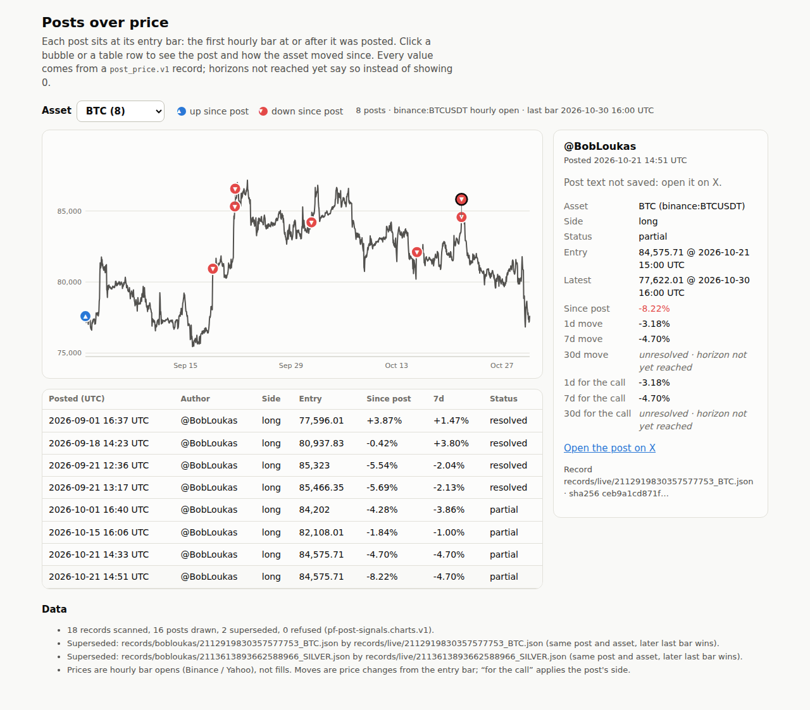
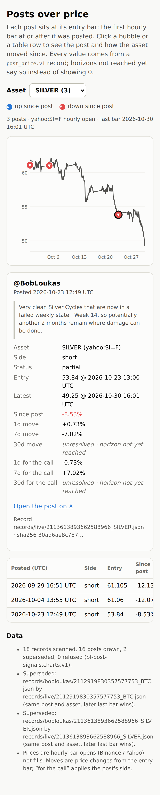

# Step 5 run notes: posts-over-price chart page

Live page: **https://sendoeth.com/pf-post-signals/web/** (GitHub Pages for this repo; `sendoeth.github.io/pf-post-signals/web/` redirects there). Pages build of commit `f7c1b12` (same page and bundle as this commit; this commit adds these notes and the README link).

Run 2026-10-30 17:37 UTC on Linux, Python 3.12, Node v22.23.4, headless Chromium via puppeteer. Commands in order; output is raw (stdout + stderr) with its exit code.

What the output shows:

- **Invalid records are refused, never drawn**: the fixture run refuses 4 records (schema violation, a move that does not match its prices, a null move with no unresolved reason, broken JSON) and draws only the valid one.
- **Same-hour bubbles are separate**: BTC posts 2112915214479798344 and 2112919830357577753 share the 2026-10-21 15:00 entry bar (`same-hour bubbles 2`); the test also asserts that no two hit areas overlap on any asset and clicks each bubble, checking the card opens for that exact post.
- **Unresolved never rendered as zero**: 22 unresolved cells were checked: text must read `unresolved · <reason>` and must not match a zero percentage; the raw value must be null like the record.
- **Every card matches its record**: 16 cards, 240 fields compared (displayed text and raw value) against the record file on disk, sha256-checked, locally and on the live page; 0 console errors, warnings, failed requests or HTTP errors.
- The step 4 records are unchanged: `validate_records.py` all valid, `parity.py` 16/16 exact.

```text
$ python3 build_chart.py
SUPERSEDED records/bobloukas/2112919830357577753_BTC.json by records/live/2112919830357577753_BTC.json (2112919830357577753 BTC: later last bar wins)
SUPERSEDED records/bobloukas/2113613893662588966_SILVER.json by records/live/2113613893662588966_SILVER.json (2113613893662588966 SILVER: later last bar wins)
BTC     binance:BTCUSDT  1416 bars, 8 posts
COPX    yahoo:COPX     255 bars, 2 posts
GOLD    yahoo:GC=F     117 bars, 1 posts
SILVER  yahoo:SI=F     531 bars, 3 posts
STOCKS  yahoo:SPY      123 bars, 2 posts
18 records scanned, 16 drawn, 2 superseded, 0 refused -> web/data/charts.json
[exit 0]
$ python3 build_chart.py --records tests/fixtures/records_with_invalid --out /tmp/step5_invalid_bundle.json
REFUSED tests/fixtures/records_with_invalid/invalid_move.json: 7d move != exit / entry - 1
REFUSED tests/fixtures/records_with_invalid/invalid_not_json.json: not json: Expecting property name enclosed in double quotes: line 1 column 29 (char 28)
REFUSED tests/fixtures/records_with_invalid/invalid_schema.json: schema: entry: {'at': '2026-09-01T17:00:00Z', 'price': -1} is not valid under any of the given schemas; schema: status: 'maybe' is not one of ['resolved', 'partial', 'pending', 'no_entry']
REFUSED tests/fixtures/records_with_invalid/invalid_unresolved_as_null_without_reason.json: 30d must be either a move or unresolved
BTC     binance:BTCUSDT  1367 bars, 1 posts
5 records scanned, 1 drawn, 0 superseded, 4 refused -> ../../../tmp/step5_invalid_bundle.json
[exit 0]
$ python3 -c import json; b=json.load(open('/tmp/step5_invalid_bundle.json')); print('drawn:', [p['record_file'] for a in b['assets'] for p in a['posts']]); print('refused:', [r['file'] for r in b['refused']])
drawn: ['tests/fixtures/records_with_invalid/valid_2094827036812435935_BTC.json']
refused: ['tests/fixtures/records_with_invalid/invalid_move.json', 'tests/fixtures/records_with_invalid/invalid_not_json.json', 'tests/fixtures/records_with_invalid/invalid_schema.json', 'tests/fixtures/records_with_invalid/invalid_unresolved_as_null_without_reason.json']
[exit 0]
$ python3 check_bundle.py
bundle: 18 record files -> 16 drawn, 2 superseded, 0 refused; 48 horizon cells checked -> ALL MATCH
[exit 0]
$ node tests/browser_test.js --screenshots verification/step5
page http://127.0.0.1:45473/
assets 5, cards opened 16, card fields checked 240, unresolved cells checked 22, same-hour bubbles 2, console errors 0
ALL PASS
[exit 0]
$ node tests/browser_test.js --url https://sendoeth.com/pf-post-signals/web/
page https://sendoeth.com/pf-post-signals/web/
assets 5, cards opened 16, card fields checked 240, unresolved cells checked 22, same-hour bubbles 2, console errors 0
ALL PASS
[exit 0]
$ python3 validate_records.py
records: 18 checked against post_price.v1 -> ALL VALID
[exit 0]
$ python3 parity.py
EXACT 2094827036812435935 BTC    call        entry 77596.01 @ 2026-09-01T17:00:00Z | 1d -0.55% 7d +1.47% 30d +8.51%
EXACT 2097324043334451439 COPX   call        entry 95.31 @ 2026-09-08T14:30:00Z | 1d +0.22% 7d -11.56% 30d -12.54%
EXACT 2100953898630443447 BTC    call        entry 80937.83 @ 2026-09-18T15:00:00Z | 1d +0.80% 7d +3.80% 30d +0.20%
EXACT 2102014028855820403 BTC    reiteration entry 85323.0 @ 2026-09-21T13:00:00Z | 1d +0.82% 7d -2.04% 30d -2.13%
EXACT 2102024327075877097 BTC    reiteration entry 85466.35 @ 2026-09-21T14:00:00Z | 1d +1.03% 7d -2.13% 30d -1.92%
EXACT 2104977267109896477 SILVER call        entry 61.105 @ 2026-09-29T17:00:00Z | 1d +0.83% 7d -0.80% 30d unresolved
EXACT 2105699317004583026 BTC    call        entry 84202.0 @ 2026-10-01T17:00:00Z | 1d +1.14% 7d -3.86% 30d unresolved
EXACT 2106744910896312646 SILVER reiteration entry 61.06 @ 2026-10-04T22:00:00Z | 1d -0.57% 7d -0.27% 30d unresolved
EXACT 2106750657877434407 COPX   call        entry 86.0 @ 2026-10-05T13:30:00Z | 1d -0.33% 7d -0.83% 30d unresolved
EXACT 2107063137958564197 STOCKS call        entry 769.69 @ 2026-10-05T13:30:00Z | 1d +1.10% 7d +1.18% 30d unresolved
EXACT 2107475725573906895 STOCKS reiteration entry 778.85 @ 2026-10-06T14:30:00Z | 1d -0.56% 7d -0.17% 30d unresolved
EXACT 2110764348981612915 BTC    call        entry 82108.01 @ 2026-10-15T17:00:00Z | 1d -0.82% 7d -1.00% 30d unresolved
EXACT 2112915214479798344 BTC    reiteration entry 84575.71 @ 2026-10-21T15:00:00Z | 1d -3.18% 7d -4.70% 30d unresolved
EXACT 2112919830357577753 BTC    reiteration entry 84575.71 @ 2026-10-21T15:00:00Z | 1d -3.18% 7d -4.70% 30d unresolved
EXACT 2112919830357577753 GOLD   call        entry 4148.5 @ 2026-10-21T15:00:00Z | 1d +1.78% 7d +2.27% 30d unresolved
EXACT 2113613893662588966 SILVER call        entry 53.84 @ 2026-10-23T13:00:00Z | 1d -0.73% 7d unresolved 30d unresolved
parity: 16/16 exact, 16 records schema-valid, 0 duplicates, 0 errors
[exit 0]
```

## Screenshots

Desktop (1280 px, BTC, the upper same-hour bubble selected): [verification/step5/desktop.png](step5/desktop.png)



Phone (390 px, SILVER, a bubble tapped; card opens under the chart, no horizontal page scroll): [verification/step5/phone.png](step5/phone.png)



## SHA-256: bundle, page and screenshots

The live files are byte-identical to these: `curl -s https://sendoeth.com/pf-post-signals/web/data/charts.json | sha256sum` gives `1626aeb9…9c380` and `curl -s https://sendoeth.com/pf-post-signals/web/ | sha256sum` gives `5fbc64d6…1924f`, checked after the Pages build.

```text
1626aeb9f5f51d3151c68c8d593827b7769c317c98b8e502f747f1844ef9c380  web/data/charts.json
5fbc64d6e81374f20b691ffe7905d5effd607788291489bfbd93e41c7c81924f  web/index.html
fc5a1ca561db77e90ec747b109e89130707ec67055ee76286aebce6753b85183  verification/step5/desktop.png
765fb736909290171bf3413263bc0543dc708b83caaa48b614978e2cb75903a1  verification/step5/phone.png
```

## SHA-256: code and test inputs

```text
9fb242d7d9c878d48efbd4c25b28cb33629cef84473612bf2c9f2c4d11cefd53  build_chart.py
9a94d99612086019eed80476da42bfb9f918eb383abae71695fb4da4da35493a  check_bundle.py
e7c30805cd07cb29f04e0ee2a1989e8fec56ba8ed7e3087739ef592c3a89b0a0  tests/browser_test.js
143250809503faea7dc170978424b3ccb3ef810f14a2d0f95d8e322176265bbd  resolve.py
569a44a3e13c19a22f109ad06db285592ed90c5e54517d59820c3ec258e18e7a  validate_records.py
f383e578c2af020a9be45f8df1aa55b2253963fa7fe9ac7f3182408c3f95e8ac  schema/post_price.v1.json
99625d7b4c622ded2186226e0c1060e7b0732db5530bddeec9590f951c6b73bf  tests/fixtures/records_with_invalid/invalid_move.json
62e1334ee661bbdb3cf11259d767c90b715628c5c8084469fbb9c2e916c1afad  tests/fixtures/records_with_invalid/invalid_not_json.json
2143cd1ec9a8cdd815bd0a912a9d0c49b6e6abb32191d31acc7087df14df624a  tests/fixtures/records_with_invalid/invalid_schema.json
54e27ebe9cfb57e3b19685a47eb74894380691cdf58a3b0c93447ca423a4a5d0  tests/fixtures/records_with_invalid/invalid_unresolved_as_null_without_reason.json
78a4c201683ffb0701d02f495905162ee8843d18d65526535c2449ba82fecf64  tests/fixtures/records_with_invalid/valid_2094827036812435935_BTC.json
```
