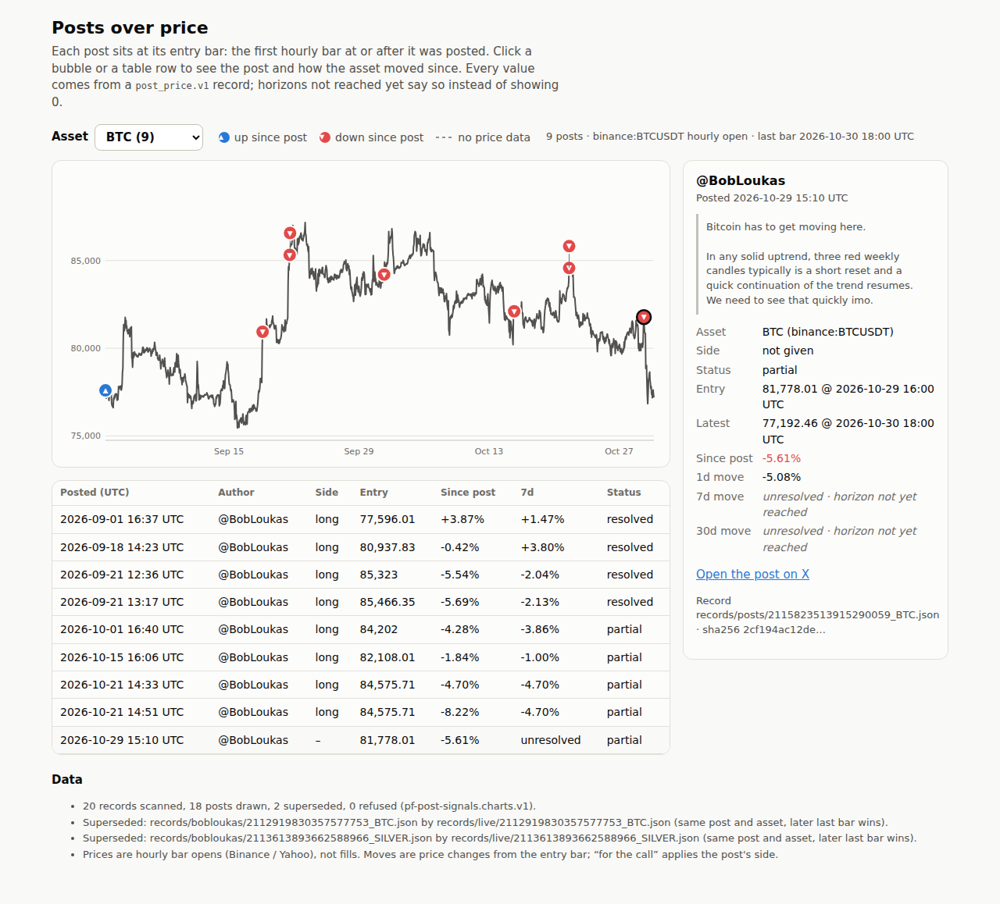
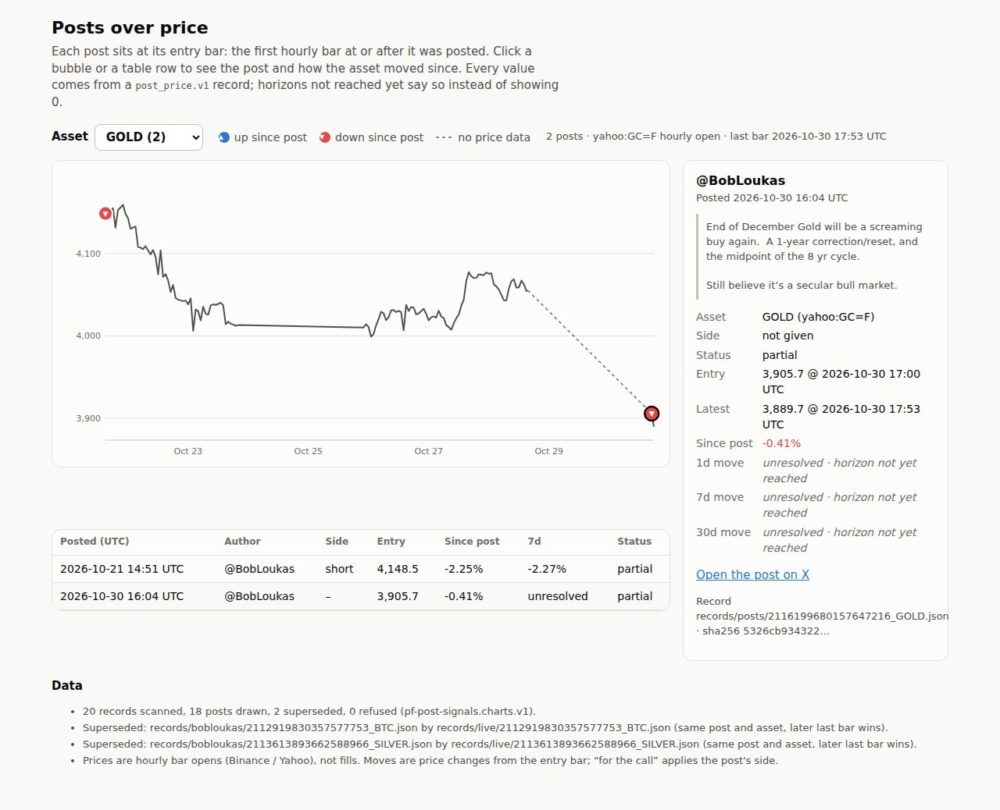

# Step 6 run notes: paste a post link -> receipt, asset, record, chart

Live page: **https://sendoeth.com/pf-post-signals/web/** (GitHub Pages, served from commit `170eb20`; this notes commit changes no page or data file). Run 2026-10-30 ~18:00 UTC, Linux, Python 3.12, Node v22.23.4, headless Chromium. Output is raw (stdout + stderr) with exit codes.

## Summary

- **New posts** (both after the step 3 window, which ends 2026-10-28):
  - [2115823513915290059](https://x.com/BobLoukas/status/2115823513915290059), Thu 2026-10-29 15:10 UTC, "Bitcoin has to get moving here": detected **BTC**, 24/7 rule (session_lag_days 2), entry 81,778.01 at the 16:00 bar.
  - [2116199680157647216](https://x.com/BobLoukas/status/2116199680157647216), Fri 2026-10-30 16:04 UTC, "End of December Gold will be a screaming buy again": detected **GOLD**, exchange-hours rule (session_lag_days 4), entry 3,905.7 at the 17:00 bar.
  - Both appear as bubbles on the live page and open their own cards (`--expect` run against the live URL below).
- **Unavailable post**: a nonexistent id fails with `embed HTTP 404` and nothing is written (ingest exit 1). **Needs review**: the `$XMR` post (2115946473057898598) stops before resolving: no price source for XMR (add_post exit 1, detect exit 3).
- **Detector, scored once on the 59 hand-labelled step 3 posts** (map written before scoring, no tuning):

| post kind | outcome | n |
|---|---|---|
| call, one asset | exact match | 12 |
| call, one asset | needs review | 2 |
| call, two-asset pair | needs review, both assets found | 1 |
| not a call (not scored) | detected an asset | 15 |
| not a call (not scored) | needs review | 29 |

  The 44 non-calls have no asset label, so they are counted, not scored: the detector proposes an asset, deciding whether a post is a call stays manual.
- **Friday case**: `test_friday_evening_stock_post_enters_at_monday_open` (entry Fri 21:15 -> Mon 13:00 open, its 7d exit Fri 21:15 -> Mon open too), `test_stock_post_before_a_long_weekend_enters_tuesday`, and `test_friday_evening_crypto_rule_unchanged` (same gap on BTC is still no_entry). The step 4 test that pinned the old behaviour was replaced by these. All 22 resolver tests + 16 ingest/detect tests pass.
- **Parity**: step 4 16/16 exact; step 3 `validate_authors.py` all pass. Re-running parity rewrote `records/bobloukas/*` with the new `resolved_with.session_lag_days` field only (entries, exits, returns unchanged).
- **Embed limit found**: long posts come back cut to ~270 characters with no full text; receipts carry `textTruncated` (both new posts are complete). Existing full-text receipts are never overwritten.

## 1. Ingest, detect, add (fetches live data)

```text
$ python3 ingest.py https://x.com/BobLoukas/status/2115823513915290059 https://x.com/BobLoukas/status/2116199680157647216 https://x.com/BobLoukas/status/2116199680157647999
ERROR post 2116199680157647999 unavailable (embed HTTP 404: deleted, private or never existed)
EXISTS sources/bobloukas/receipts/2115823513915290059.json @BobLoukas 2026-10-29T15:10:10Z source=syndication truncated=False cashtags=[] sha256=b4d10d784737cee51c832dc0fa5e2eaeddd9258abe07c1e327f341d745061766
EXISTS sources/bobloukas/receipts/2116199680157647216.json @BobLoukas 2026-10-30T16:04:55Z source=syndication truncated=False cashtags=[] sha256=d95b5832b1b4140b2a003bfbd4f3970149176f1e9fecd2be7996a34d519228be
[exit 1]
$ python3 detect.py --receipt sources/bobloukas/receipts/2115823513915290059.json
{"status": "detected", "asset": "BTC", "matched": [{"asset": "BTC", "term": "bitcoin"}], "reason": null}
[exit 0]
$ python3 detect.py --receipt sources/bobloukas/receipts/2116199680157647216.json
{"status": "detected", "asset": "GOLD", "matched": [{"asset": "GOLD", "term": "gold"}], "reason": null}
[exit 0]
$ python3 detect.py --receipt sources/bobloukas/receipts/2115946473057898598.json
{"status": "needs_review", "asset": null, "matched": [], "reason": "cashtag $XMR has no price source in the asset map"}
[exit 3]
$ python3 add_post.py https://x.com/BobLoukas/status/2115823513915290059 https://x.com/BobLoukas/status/2116199680157647216
reused receipt sources/bobloukas/receipts/2115823513915290059.json; detector: detected BTC ['bitcoin']
record 2115823513915290059 BTC partial: entry 81778.01 @ 2026-10-29T16:00:00Z, since post -5.61%, session_lag_days 2
reused receipt sources/bobloukas/receipts/2116199680157647216.json; detector: detected GOLD ['gold']
record 2116199680157647216 GOLD partial: entry 3905.7 @ 2026-10-30T17:00:00Z, since post -0.41%, session_lag_days 4
bundle: 20 records scanned, 18 drawn, 2 superseded, 0 refused
[exit 0]
$ python3 add_post.py https://x.com/BobLoukas/status/2115946473057898598
reused receipt sources/bobloukas/receipts/2115946473057898598.json; detector: needs_review  [] cashtag $XMR has no price source in the asset map
STOP https://x.com/BobLoukas/status/2115946473057898598: needs review (cashtag $XMR has no price source in the asset map); rerun with --asset to resolve it
bundle: 20 records scanned, 18 drawn, 2 superseded, 0 refused
[exit 1]
```

## 2. Detector score, tests, parity, checks, local browser test

```text
$ python3 score_detector.py
59 labelled posts: call 15, excluded 21, off_topic 23
| post kind | outcome | n |
|---|---|---|
| call, one asset | exact match | 12 |
| call, one asset | needs review | 2 |
| call, two-asset pair | needs review, both assets found | 1 |
| not a call (not scored) | detected an asset | 15 |
| not a call (not scored) | needs review | 29 |
call 2102024327075877097 label ['BTC']: needs review (no asset words or cashtags; matched [])
call 2106744910896312646 label ['SILVER']: needs review (several assets: GOLD, SILVER; matched ['silver', 'gold'])
call 2112919830357577753 label ['BTC', 'GOLD']: needs review, both assets found (several assets: BTC, GOLD; matched ['gold futures', 'bitcoin'])
[exit 0]
$ python3 -m unittest -v tests.test_resolve
test_bad_url_and_bad_side (tests.test_resolve.Resolver.test_bad_url_and_bad_side) ... ok
test_duplicate_post_kept_once (tests.test_resolve.Resolver.test_duplicate_post_kept_once) ... ok
test_empty_series_is_pending (tests.test_resolve.Resolver.test_empty_series_is_pending) ... ok
test_entry_is_first_bar_at_or_after_post (tests.test_resolve.Resolver.test_entry_is_first_bar_at_or_after_post) ... ok
test_exit_in_long_closure_is_unresolved (tests.test_resolve.Resolver.test_exit_in_long_closure_is_unresolved) ... ok
test_friday_evening_crypto_rule_unchanged (tests.test_resolve.Resolver.test_friday_evening_crypto_rule_unchanged) ... ok
test_friday_evening_stock_post_enters_at_monday_open (tests.test_resolve.Resolver.test_friday_evening_stock_post_enters_at_monday_open) ... ok
test_long_closure_gives_no_entry (tests.test_resolve.Resolver.test_long_closure_gives_no_entry) ... ok
test_post_exactly_on_a_bar_uses_that_bar (tests.test_resolve.Resolver.test_post_exactly_on_a_bar_uses_that_bar) ... ok
test_post_newer_than_last_bar_is_pending (tests.test_resolve.Resolver.test_post_newer_than_last_bar_is_pending) ... ok
test_prefixed_asset_missing_from_snapshot (tests.test_resolve.Resolver.test_prefixed_asset_missing_from_snapshot) ... ok
test_receipt_and_url_must_agree (tests.test_resolve.Resolver.test_receipt_and_url_must_agree) ... ok
test_rerun_writes_identical_bytes (tests.test_resolve.Resolver.test_rerun_writes_identical_bytes) ... ok
test_same_post_two_assets_is_not_a_duplicate (tests.test_resolve.Resolver.test_same_post_two_assets_is_not_a_duplicate) ... ok
test_saturday_post_enters_monday_open_within_2_days (tests.test_resolve.Resolver.test_saturday_post_enters_monday_open_within_2_days) ... ok
test_schema_rejects_a_broken_record (tests.test_resolve.Resolver.test_schema_rejects_a_broken_record) ... ok
test_snowflake_matches_every_saved_receipt (tests.test_resolve.Resolver.test_snowflake_matches_every_saved_receipt) ... ok
test_stock_post_before_a_long_weekend_enters_tuesday (tests.test_resolve.Resolver.test_stock_post_before_a_long_weekend_enters_tuesday) ... ok
test_unknown_asset_in_batch_reports_error_and_keeps_others (tests.test_resolve.Resolver.test_unknown_asset_in_batch_reports_error_and_keeps_others) ... ok
test_unknown_asset_is_a_clear_error (tests.test_resolve.Resolver.test_unknown_asset_is_a_clear_error) ... ok
test_unreached_horizons_are_unresolved_not_guessed (tests.test_resolve.Resolver.test_unreached_horizons_are_unresolved_not_guessed) ... ok
test_weekend_post_enters_at_monday_open (tests.test_resolve.Resolver.test_weekend_post_enters_at_monday_open) ... ok

----------------------------------------------------------------------
Ran 22 tests in 0.145s

OK
[exit 0]
$ python3 -m unittest -v tests.test_ingest_detect
test_cashtags (tests.test_ingest_detect.Detect.test_cashtags) ... ok
test_longer_term_wins (tests.test_ingest_detect.Detect.test_longer_term_wins) ... ok
test_manual_override_wins (tests.test_ingest_detect.Detect.test_manual_override_wins) ... ok
test_nothing_found_needs_review (tests.test_ingest_detect.Detect.test_nothing_found_needs_review) ... ok
test_several_assets_need_review (tests.test_ingest_detect.Detect.test_several_assets_need_review) ... ok
test_single_asset_words (tests.test_ingest_detect.Detect.test_single_asset_words) ... ok
test_whole_words_only (tests.test_ingest_detect.Detect.test_whole_words_only) ... ok
test_author_must_match_the_url (tests.test_ingest_detect.Ingest.test_author_must_match_the_url) ... ok
test_bad_url (tests.test_ingest_detect.Ingest.test_bad_url) ... ok
test_cashtags_are_kept (tests.test_ingest_detect.Ingest.test_cashtags_are_kept) ... ok
test_embed_token_is_stable (tests.test_ingest_detect.Ingest.test_embed_token_is_stable) ... ok
test_existing_receipt_is_reused_not_overwritten (tests.test_ingest_detect.Ingest.test_existing_receipt_is_reused_not_overwritten) ... ok
test_long_post_is_marked_truncated (tests.test_ingest_detect.Ingest.test_long_post_is_marked_truncated) ... ok
test_saves_a_receipt_in_the_step3_format (tests.test_ingest_detect.Ingest.test_saves_a_receipt_in_the_step3_format) ... ok
test_timestamp_must_match_the_post_id (tests.test_ingest_detect.Ingest.test_timestamp_must_match_the_post_id) ... ok
test_unavailable_posts_fail_clearly_and_write_nothing (tests.test_ingest_detect.Ingest.test_unavailable_posts_fail_clearly_and_write_nothing) ... ok

----------------------------------------------------------------------
Ran 16 tests in 0.010s

OK
[exit 0]
$ python3 parity.py
EXACT 2094827036812435935 BTC    call        entry 77596.01 @ 2026-09-01T17:00:00Z | 1d -0.55% 7d +1.47% 30d +8.51%
EXACT 2097324043334451439 COPX   call        entry 95.31 @ 2026-09-08T14:30:00Z | 1d +0.22% 7d -11.56% 30d -12.54%
EXACT 2100953898630443447 BTC    call        entry 80937.83 @ 2026-09-18T15:00:00Z | 1d +0.80% 7d +3.80% 30d +0.20%
EXACT 2102014028855820403 BTC    reiteration entry 85323.0 @ 2026-09-21T13:00:00Z | 1d +0.82% 7d -2.04% 30d -2.13%
EXACT 2102024327075877097 BTC    reiteration entry 85466.35 @ 2026-09-21T14:00:00Z | 1d +1.03% 7d -2.13% 30d -1.92%
EXACT 2104977267109896477 SILVER call        entry 61.105 @ 2026-09-29T17:00:00Z | 1d +0.83% 7d -0.80% 30d unresolved
EXACT 2105699317004583026 BTC    call        entry 84202.0 @ 2026-10-01T17:00:00Z | 1d +1.14% 7d -3.86% 30d unresolved
EXACT 2106744910896312646 SILVER reiteration entry 61.06 @ 2026-10-04T22:00:00Z | 1d -0.57% 7d -0.27% 30d unresolved
EXACT 2106750657877434407 COPX   call        entry 86.0 @ 2026-10-05T13:30:00Z | 1d -0.33% 7d -0.83% 30d unresolved
EXACT 2107063137958564197 STOCKS call        entry 769.69 @ 2026-10-05T13:30:00Z | 1d +1.10% 7d +1.18% 30d unresolved
EXACT 2107475725573906895 STOCKS reiteration entry 778.85 @ 2026-10-06T14:30:00Z | 1d -0.56% 7d -0.17% 30d unresolved
EXACT 2110764348981612915 BTC    call        entry 82108.01 @ 2026-10-15T17:00:00Z | 1d -0.82% 7d -1.00% 30d unresolved
EXACT 2112915214479798344 BTC    reiteration entry 84575.71 @ 2026-10-21T15:00:00Z | 1d -3.18% 7d -4.70% 30d unresolved
EXACT 2112919830357577753 BTC    reiteration entry 84575.71 @ 2026-10-21T15:00:00Z | 1d -3.18% 7d -4.70% 30d unresolved
EXACT 2112919830357577753 GOLD   call        entry 4148.5 @ 2026-10-21T15:00:00Z | 1d +1.78% 7d +2.27% 30d unresolved
EXACT 2113613893662588966 SILVER call        entry 53.84 @ 2026-10-23T13:00:00Z | 1d -0.73% 7d unresolved 30d unresolved
parity: 16/16 exact, 16 records schema-valid, 0 duplicates, 0 errors
[exit 0]
$ python3 validate_records.py
records: 20 checked against post_price.v1 -> ALL VALID
[exit 0]
$ python3 validate_authors.py
checks: 16 rows, 59 candidates, 59 labelled ids -> ALL PASS
[exit 0]
$ python3 check_bundle.py
bundle: 20 record files -> 18 drawn, 2 superseded, 0 refused; 54 horizon cells checked -> ALL MATCH
[exit 0]
$ node tests/browser_test.js --expect 2115823513915290059,2116199680157647216 --screenshots verification/step6
expected post 2115823513915290059: bubble on BTC, card opens OK
expected post 2116199680157647216: bubble on GOLD, card opens OK
page http://127.0.0.1:46481/
assets 5, cards opened 18, card fields checked 264, unresolved cells checked 27, same-hour bubbles 2, console errors 0
ALL PASS
[exit 0]
```

## 3. Live page

```text
$ node tests/browser_test.js --url https://sendoeth.com/pf-post-signals/web/ --expect 2115823513915290059,2116199680157647216
expected post 2115823513915290059: bubble on BTC, card opens OK
expected post 2116199680157647216: bubble on GOLD, card opens OK
page https://sendoeth.com/pf-post-signals/web/
assets 5, cards opened 18, card fields checked 264, unresolved cells checked 27, same-hour bubbles 2, console errors 0
ALL PASS
[exit 0]
$ curl -s https://sendoeth.com/pf-post-signals/web/data/charts.json | sha256sum
0a277d05790d348e5403cce951b297a3ed29e62dc506c2db8633ea268ee57c7b  -
$ curl -s https://sendoeth.com/pf-post-signals/web/ | sha256sum
94497a86307cd03e850a8756af254339a551b4984dd776c493d18692b5f87641  -
```

## Screenshots (live data, card of each new post)

BTC post: [verification/step6/post_2115823513915290059.png](step6/post_2115823513915290059.png)



Gold post: [verification/step6/post_2116199680157647216.png](step6/post_2116199680157647216.png)



## SHA-256: new receipts, new records, bundle, page

```text
b4d10d784737cee51c832dc0fa5e2eaeddd9258abe07c1e327f341d745061766  sources/bobloukas/receipts/2115823513915290059.json
d95b5832b1b4140b2a003bfbd4f3970149176f1e9fecd2be7996a34d519228be  sources/bobloukas/receipts/2116199680157647216.json
506a85086a4d91f2743a9aa72df92286c19c030c43eac421a0ee1822eb2e7789  sources/bobloukas/receipts/2115946473057898598.json
2cf194ac12ded235e7fe85f9255d6018003371836d18dbedbc730cadf242f7a4  records/posts/2115823513915290059_BTC.json
5326cb934322e169c7c060de7dbc6e9c260f53cabd47ada13d7a99c1906c270e  records/posts/2116199680157647216_GOLD.json
0a277d05790d348e5403cce951b297a3ed29e62dc506c2db8633ea268ee57c7b  web/data/charts.json
94497a86307cd03e850a8756af254339a551b4984dd776c493d18692b5f87641  web/index.html
df54bc61ea8f52d5e400e4c6acf5b3184e7afeae77845db059f616003c4729f4  data/detector_scores.json
096877051f558ea8610b4d24329c909ad8c7012c83749a88e6d3e57562d54cef  verification/step6/post_2115823513915290059.png
68d4be501184c9d94d5dd36776158609bf2d55df76b8aeb00b5c4bffb8a6818a  verification/step6/post_2116199680157647216.png
```

## SHA-256: code and map

```text
df910a5ea9f7691e5a0c003f16f74898cb6974f46f07f9a403c9a6792b2a3e3e  ingest.py
99cc160bffda51040ad012a7efa933b8d364f6f6a44c51dbdcf54def964a1908  detect.py
e511eebe7012ff71765f2298c5bd47ea8e68031adffaa4f628e75ef4dd9f4d41  detect/asset_map.json
2e07d10850cd73d1dc9bf35d78ab03c13cafc4d48d8ad65bf411eac1e06ca670  score_detector.py
8242ca46a2d1a36f06a742eac907d934219dbbb1d7638651b2d9706d3d72fa98  add_post.py
7642eb24da8f53865293b97c9b1517fb6cb33c7e36bdbb29311bc2f81c178e4b  resolve.py
9fb242d7d9c878d48efbd4c25b28cb33629cef84473612bf2c9f2c4d11cefd53  build_chart.py
69972b90706c7a3f0a65e829322c2d7b782cc57bd0692d293b2622804fae02f4  schema/post_price.v1.json
9a2c85dfd7e52f9107fd63b1b932099f7be7fa02f8060f2c9c1dfeeda5faf2e1  tests/test_resolve.py
eb38fbcc614cb155577266a854bf7849a119af6864ff7f976ca67aaa7a35680d  tests/test_ingest_detect.py
aa9a413e73c2b9585040535e9429dddda7357f071a76715c574c14a3081d5a17  tests/browser_test.js
```
