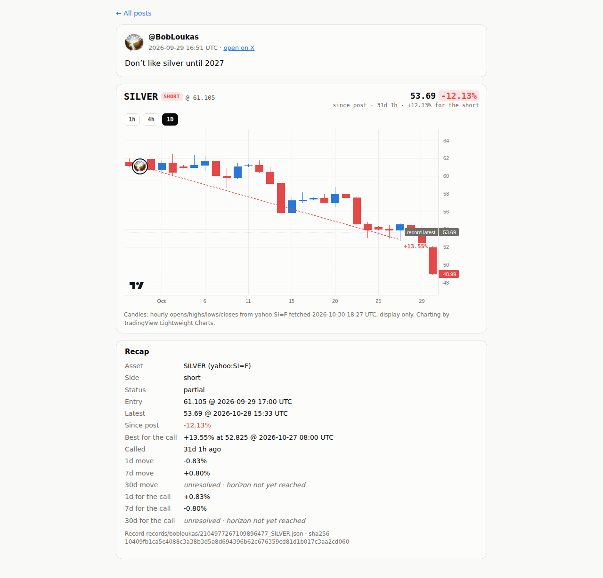
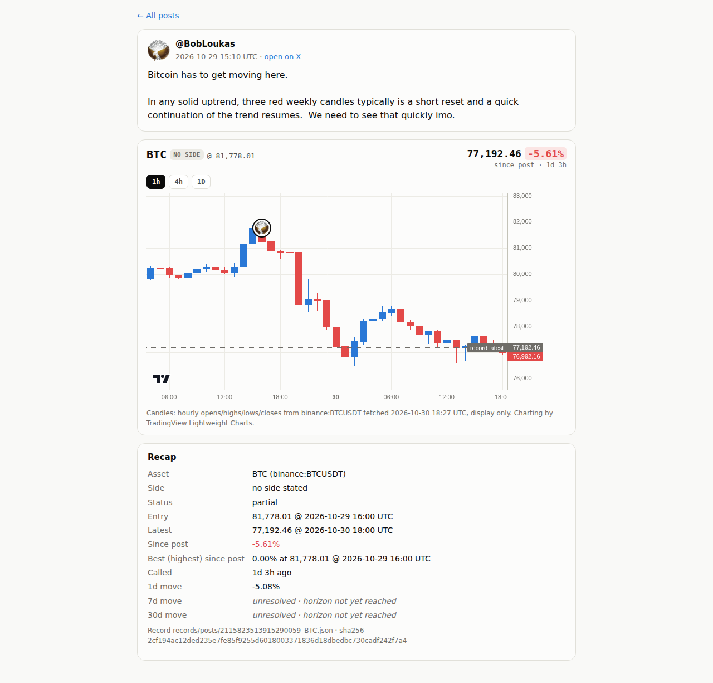
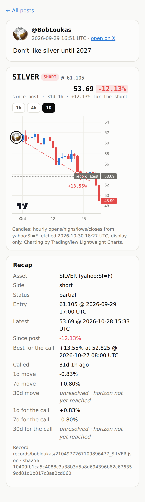

# Step 7 run notes: position pages

## Where the work is

- **Code + data commit**: [`a787190`](https://github.com/sendoeth/pf-post-signals/commit/a787190b475148f0b18ad1453af8a300c0fbe554) (fetch_ohlc.py, web/position.html, build_chart.py best-since-post, check_bundle.py, ingest.py avatars, tests/position_test.js, web/data/ohlc/*, web/avatars/*, main-page links). This notes commit adds only this file and the screenshots.
- **Full step 7 diff**: https://github.com/sendoeth/pf-post-signals/compare/787f0a9b085f5baf5e67e36de0663d96c786a2c6...a787190b475148f0b18ad1453af8a300c0fbe554
- **Live position page**: https://sendoeth.com/pf-post-signals/web/position.html?post=2104977267109896477&asset=SILVER (every post has one; the main page https://sendoeth.com/pf-post-signals/web/ links each card and table date to it).

Run 2026-10-30 ~18:25-18:32 UTC, Linux, Python 3.12, Node v22.23.4, headless Chromium. Raw output with exit codes below.

## Summary

- **Candles match the records**: `fetch_ohlc.py` fetched 1h OHLC for the 5 assets from the records' own source/symbol (sha256 + fetch time in `web/data/ohlc/index.json`); **18/18 entry bars: candle open == record entry price**. Candles are display only.
- **Best % since post** comes from the record's own series (`build_chart.py`) and is recomputed independently by `check_bundle.py` (18/18) and again by the browser test. With a side it is the best bar for the call, without one the highest price.
- **Every position page tested** (`tests/position_test.js`): 18 posts, each at the default interval and at 1h = 36 page loads; 636 recap fields equal the record file (text + raw value); avatar centre within 1.5 px of the chart's own coordinate for the entry candle on all 36; at 1h the entry candle's open equals the record entry; 54 unresolved cells never shown as 0; every main-page card and table date links to the right position page; **0 console errors**, warnings, failed requests or HTTP errors. Same result locally and against the live site.
- Avatars are saved once at ingest (`web/avatars/`, source + sha256 in `index.json`) and served from our own page, never hotlinked; initials are the fallback. The chart library (TradingView Lightweight Charts 4.2.3) is pinned with a subresource-integrity hash; its attribution logo is kept.
- Earlier steps unchanged: parity 16/16 exact, 20 records valid, step 5/6 browser test all pass.

## 1. Candles, bundle, checks, tests (local)

```text
$ python3 fetch_ohlc.py
BTC     binance:BTCUSDT  1442 candles 2026-08-31T17:00:00Z -> 2026-10-30T18:00:00Z sha256 69c62663779cd6ce5553cd31ff00d14b2413de8a295846f4009b9b84b0f6c47a
COPX    yahoo:COPX     272 candles 2026-09-08T13:30:00Z -> 2026-10-30T18:27:39Z sha256 977615e51576b7a376d1bb85bb94c7145662920682b86da53241cf0f39b9ad98
GOLD    yahoo:GC=F     189 candles 2026-10-20T15:00:00Z -> 2026-10-30T18:17:36Z sha256 c60914a71d78135d9f6cb01e74c0e8abb10d3ee103ccf81d702c63a7ea11be1a
SILVER  yahoo:SI=F     555 candles 2026-09-28T17:00:00Z -> 2026-10-30T18:17:31Z sha256 6e8da06e73a609407bb27ed1129781381a8e3cc408f631224a5d83512c866968
STOCKS  yahoo:SPY      139 candles 2026-10-05T13:30:00Z -> 2026-10-30T18:27:43Z sha256 12587a86081640c8df48a876912fe3d87e75053a97ea321ebe100a9191274e2a
OK   BTC     2094827036812435935 entry 2026-09-01T17:00:00Z record 77596.01 candle open 77596.01
OK   BTC     2100953898630443447 entry 2026-09-18T15:00:00Z record 80937.83 candle open 80937.83
OK   BTC     2102014028855820403 entry 2026-09-21T13:00:00Z record 85323.0 candle open 85323.0
OK   BTC     2102024327075877097 entry 2026-09-21T14:00:00Z record 85466.35 candle open 85466.35
OK   BTC     2105699317004583026 entry 2026-10-01T17:00:00Z record 84202.0 candle open 84202.0
OK   BTC     2110764348981612915 entry 2026-10-15T17:00:00Z record 82108.01 candle open 82108.01
OK   BTC     2112915214479798344 entry 2026-10-21T15:00:00Z record 84575.71 candle open 84575.71
OK   BTC     2112919830357577753 entry 2026-10-21T15:00:00Z record 84575.71 candle open 84575.71
OK   BTC     2115823513915290059 entry 2026-10-29T16:00:00Z record 81778.01 candle open 81778.01
OK   COPX    2097324043334451439 entry 2026-09-08T14:30:00Z record 95.31 candle open 95.31
OK   COPX    2106750657877434407 entry 2026-10-05T13:30:00Z record 86.0 candle open 86.0
OK   GOLD    2112919830357577753 entry 2026-10-21T15:00:00Z record 4148.5 candle open 4148.5
OK   GOLD    2116199680157647216 entry 2026-10-30T17:00:00Z record 3905.7 candle open 3905.7
OK   SILVER  2104977267109896477 entry 2026-09-29T17:00:00Z record 61.105 candle open 61.105
OK   SILVER  2106744910896312646 entry 2026-10-04T22:00:00Z record 61.06 candle open 61.06
OK   SILVER  2113613893662588966 entry 2026-10-23T13:00:00Z record 53.84 candle open 53.84
OK   STOCKS  2107063137958564197 entry 2026-10-05T13:30:00Z record 769.69 candle open 769.69
OK   STOCKS  2107475725573906895 entry 2026-10-06T14:30:00Z record 778.85 candle open 778.85
entry bars: 18/18 candle opens equal the record entry price
[exit 0]
$ python3 build_chart.py
SUPERSEDED records/bobloukas/2112919830357577753_BTC.json by records/live/2112919830357577753_BTC.json (2112919830357577753 BTC: later last bar wins)
SUPERSEDED records/bobloukas/2113613893662588966_SILVER.json by records/live/2113613893662588966_SILVER.json (2113613893662588966 SILVER: later last bar wins)
BTC     binance:BTCUSDT  1418 bars, 9 posts
COPX    yahoo:COPX     255 bars, 2 posts
GOLD    yahoo:GC=F     119 bars, 2 posts
SILVER  yahoo:SI=F     531 bars, 3 posts
STOCKS  yahoo:SPY      123 bars, 2 posts
20 records scanned, 18 drawn, 2 superseded, 0 refused -> web/data/charts.json
[exit 0]
$ python3 check_bundle.py
bundle: 20 record files -> 18 drawn, 2 superseded, 0 refused; 54 horizon cells, 18 best-since-post values checked -> ALL MATCH
[exit 0]
$ python3 fetch_ohlc.py --check-only
OK   BTC     2094827036812435935 entry 2026-09-01T17:00:00Z record 77596.01 candle open 77596.01
OK   BTC     2100953898630443447 entry 2026-09-18T15:00:00Z record 80937.83 candle open 80937.83
OK   BTC     2102014028855820403 entry 2026-09-21T13:00:00Z record 85323.0 candle open 85323.0
OK   BTC     2102024327075877097 entry 2026-09-21T14:00:00Z record 85466.35 candle open 85466.35
OK   BTC     2105699317004583026 entry 2026-10-01T17:00:00Z record 84202.0 candle open 84202.0
OK   BTC     2110764348981612915 entry 2026-10-15T17:00:00Z record 82108.01 candle open 82108.01
OK   BTC     2112915214479798344 entry 2026-10-21T15:00:00Z record 84575.71 candle open 84575.71
OK   BTC     2112919830357577753 entry 2026-10-21T15:00:00Z record 84575.71 candle open 84575.71
OK   BTC     2115823513915290059 entry 2026-10-29T16:00:00Z record 81778.01 candle open 81778.01
OK   COPX    2097324043334451439 entry 2026-09-08T14:30:00Z record 95.31 candle open 95.31
OK   COPX    2106750657877434407 entry 2026-10-05T13:30:00Z record 86.0 candle open 86.0
OK   GOLD    2112919830357577753 entry 2026-10-21T15:00:00Z record 4148.5 candle open 4148.5
OK   GOLD    2116199680157647216 entry 2026-10-30T17:00:00Z record 3905.7 candle open 3905.7
OK   SILVER  2104977267109896477 entry 2026-09-29T17:00:00Z record 61.105 candle open 61.105
OK   SILVER  2106744910896312646 entry 2026-10-04T22:00:00Z record 61.06 candle open 61.06
OK   SILVER  2113613893662588966 entry 2026-10-23T13:00:00Z record 53.84 candle open 53.84
OK   STOCKS  2107063137958564197 entry 2026-10-05T13:30:00Z record 769.69 candle open 769.69
OK   STOCKS  2107475725573906895 entry 2026-10-06T14:30:00Z record 778.85 candle open 778.85
entry bars: 18/18 candle opens equal the record entry price
[exit 0]
$ python3 -m unittest tests.test_resolve tests.test_ingest_detect
......................................
----------------------------------------------------------------------
Ran 38 tests in 0.161s

OK
[exit 0]
$ python3 parity.py
EXACT 2094827036812435935 BTC    call        entry 77596.01 @ 2026-09-01T17:00:00Z | 1d -0.55% 7d +1.47% 30d +8.51%
EXACT 2097324043334451439 COPX   call        entry 95.31 @ 2026-09-08T14:30:00Z | 1d +0.22% 7d -11.56% 30d -12.54%
EXACT 2100953898630443447 BTC    call        entry 80937.83 @ 2026-09-18T15:00:00Z | 1d +0.80% 7d +3.80% 30d +0.20%
EXACT 2102014028855820403 BTC    reiteration entry 85323.0 @ 2026-09-21T13:00:00Z | 1d +0.82% 7d -2.04% 30d -2.13%
EXACT 2102024327075877097 BTC    reiteration entry 85466.35 @ 2026-09-21T14:00:00Z | 1d +1.03% 7d -2.13% 30d -1.92%
EXACT 2104977267109896477 SILVER call        entry 61.105 @ 2026-09-29T17:00:00Z | 1d +0.83% 7d -0.80% 30d unresolved
EXACT 2105699317004583026 BTC    call        entry 84202.0 @ 2026-10-01T17:00:00Z | 1d +1.14% 7d -3.86% 30d unresolved
EXACT 2106744910896312646 SILVER reiteration entry 61.06 @ 2026-10-04T22:00:00Z | 1d -0.57% 7d -0.27% 30d unresolved
EXACT 2106750657877434407 COPX   call        entry 86.0 @ 2026-10-05T13:30:00Z | 1d -0.33% 7d -0.83% 30d unresolved
EXACT 2107063137958564197 STOCKS call        entry 769.69 @ 2026-10-05T13:30:00Z | 1d +1.10% 7d +1.18% 30d unresolved
EXACT 2107475725573906895 STOCKS reiteration entry 778.85 @ 2026-10-06T14:30:00Z | 1d -0.56% 7d -0.17% 30d unresolved
EXACT 2110764348981612915 BTC    call        entry 82108.01 @ 2026-10-15T17:00:00Z | 1d -0.82% 7d -1.00% 30d unresolved
EXACT 2112915214479798344 BTC    reiteration entry 84575.71 @ 2026-10-21T15:00:00Z | 1d -3.18% 7d -4.70% 30d unresolved
EXACT 2112919830357577753 BTC    reiteration entry 84575.71 @ 2026-10-21T15:00:00Z | 1d -3.18% 7d -4.70% 30d unresolved
EXACT 2112919830357577753 GOLD   call        entry 4148.5 @ 2026-10-21T15:00:00Z | 1d +1.78% 7d +2.27% 30d unresolved
EXACT 2113613893662588966 SILVER call        entry 53.84 @ 2026-10-23T13:00:00Z | 1d -0.73% 7d unresolved 30d unresolved
parity: 16/16 exact, 16 records schema-valid, 0 duplicates, 0 errors
[exit 0]
$ python3 validate_records.py
records: 20 checked against post_price.v1 -> ALL VALID
[exit 0]
$ node tests/browser_test.js
page http://127.0.0.1:34839/
assets 5, cards opened 18, card fields checked 264, unresolved cells checked 27, same-hour bubbles 2, console errors 0
ALL PASS
[exit 0]
$ node tests/position_test.js --screenshots verification/step7
page http://127.0.0.1:33401/
position pages opened 36 (18 posts x default + 1h), recap fields checked 636, entry-bubble placements checked 36, unresolved cells 54, console errors 0
ALL PASS
[exit 0]
```

## 2. Live site (after the Pages build of a787190)

```text
$ node tests/position_test.js --url https://sendoeth.com/pf-post-signals/web/
page https://sendoeth.com/pf-post-signals/web/
position pages opened 36 (18 posts x default + 1h), recap fields checked 636, entry-bubble placements checked 36, unresolved cells 54, console errors 0
ALL PASS
[exit 0]
$ node tests/browser_test.js --url https://sendoeth.com/pf-post-signals/web/
page https://sendoeth.com/pf-post-signals/web/
assets 5, cards opened 18, card fields checked 264, unresolved cells checked 27, same-hour bubbles 2, console errors 0
ALL PASS
[exit 0]
$ curl -s https://sendoeth.com/pf-post-signals/web/data/charts.json | sha256sum
4620e7c57f975e88b1f057fefbcc2911a590c8ff15d1a01f685b1f8cf0eed59c  -
$ curl -s https://sendoeth.com/pf-post-signals/web/position.html | sha256sum
a054dbc5ef681e0906f875006b48a4f4247ad1c425bf96919b4ac8cdb2076c76  -
$ curl -s https://sendoeth.com/pf-post-signals/web/ | sha256sum
ffe4c670c8cc236fb0efab67466a1fe909502c17e013d08e96b3bda2a2fa6efb  -
$ curl -s https://sendoeth.com/pf-post-signals/web/data/ohlc/index.json | sha256sum
d364385a48bfee7d8571e95df2f71c1790081d4838d336b44ff446aa20a9b0ae  -
$ curl -s https://sendoeth.com/pf-post-signals/web/avatars/bobloukas.jpg | sha256sum
652f969bca2ad3eac787684fdb32cb500641ea3b71a36b0cc55cd0dbb00c74ad  -
```

## Screenshots

Desktop, short call (SILVER, 1D auto interval, best +13.55% for the short): [verification/step7/position_desktop.png](step7/position_desktop.png)



Desktop, newest post (BTC, 1h): [verification/step7/position_btc_desktop.png](step7/position_btc_desktop.png)



Phone (390 px): [verification/step7/position_phone.png](step7/position_phone.png)



## SHA-256: bundle, candles, pages, avatars, screenshots

```text
4620e7c57f975e88b1f057fefbcc2911a590c8ff15d1a01f685b1f8cf0eed59c  web/data/charts.json
69c62663779cd6ce5553cd31ff00d14b2413de8a295846f4009b9b84b0f6c47a  web/data/ohlc/BTC.json
977615e51576b7a376d1bb85bb94c7145662920682b86da53241cf0f39b9ad98  web/data/ohlc/COPX.json
c60914a71d78135d9f6cb01e74c0e8abb10d3ee103ccf81d702c63a7ea11be1a  web/data/ohlc/GOLD.json
6e8da06e73a609407bb27ed1129781381a8e3cc408f631224a5d83512c866968  web/data/ohlc/SILVER.json
12587a86081640c8df48a876912fe3d87e75053a97ea321ebe100a9191274e2a  web/data/ohlc/STOCKS.json
d364385a48bfee7d8571e95df2f71c1790081d4838d336b44ff446aa20a9b0ae  web/data/ohlc/index.json
a054dbc5ef681e0906f875006b48a4f4247ad1c425bf96919b4ac8cdb2076c76  web/position.html
ffe4c670c8cc236fb0efab67466a1fe909502c17e013d08e96b3bda2a2fa6efb  web/index.html
652f969bca2ad3eac787684fdb32cb500641ea3b71a36b0cc55cd0dbb00c74ad  web/avatars/bobloukas.jpg
cc01c530fadb9f44d6b97a4a56352e969e5d5106bb1b55ff26042b8755a50411  web/avatars/index.json
2512987a9703abe68d825df6bc9a2372417622725f298b9f66c996fec10d5f1c  verification/step7/position_btc_desktop.png
17e5108c5753b6183f540771c90fa6138aca9abf716feb053f78af7aac353326  verification/step7/position_desktop.png
df1aac62c91869d685e28ac176417eb3f7174f1eafcbe63f3d340ac0651184b7  verification/step7/position_phone.png
```

The live files equal these (section 2): charts.json `4620e7c5…`, position.html `a054dbc5…`, index.html `ffe4c670…`, ohlc/index.json `d364385a…`, bobloukas.jpg `652f969b…`.

## SHA-256: code

```text
b5bb8a7b433c3dd2326115a8a7425834c1700406be31ac8d8e1a2c1c408724f8  fetch_ohlc.py
6290bbe88109d831d7a39aa7c776af9816fa4a21e2bb87c3fafcd4859fa27eee  build_chart.py
605f7b893eba202ec3b96c1066ba200e0973752abc742e4b02cb5601cceebabf  check_bundle.py
7c0e9139d1159a9619d01cbe21c4814ccac78b910c6c0b9d5c6e7ef8177d81df  ingest.py
5df6d3677356a20b8f6ee3cffab365b642b5e719c73594c5412e9064f1a5b9f2  add_post.py
0f155939a3d091055c62f4be07d189beb5a07db8c6fef6a7d8c30c2a768ddbcb  tests/position_test.js
aa9a413e73c2b9585040535e9429dddda7357f071a76715c574c14a3081d5a17  tests/browser_test.js
```
