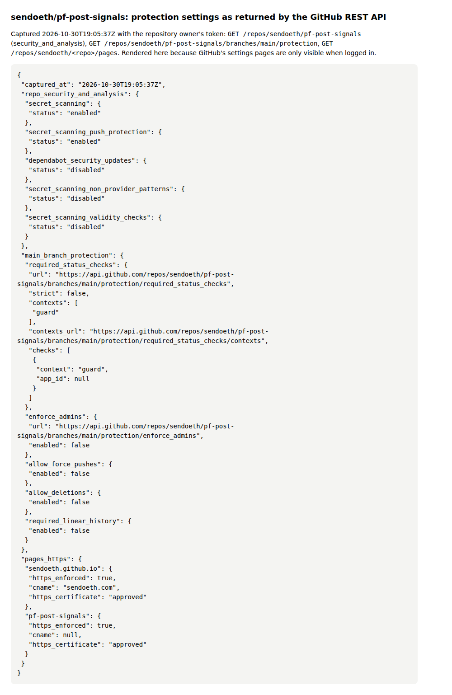
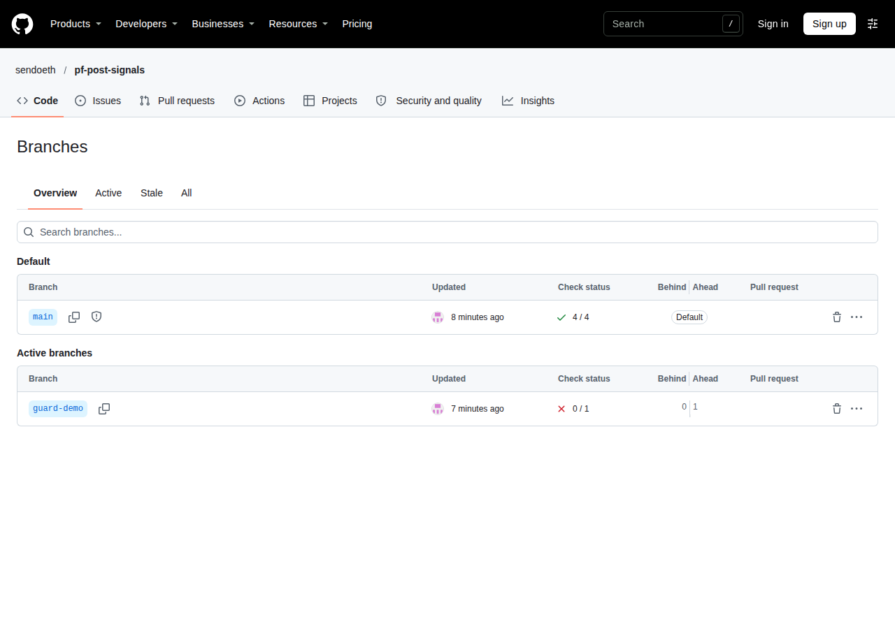
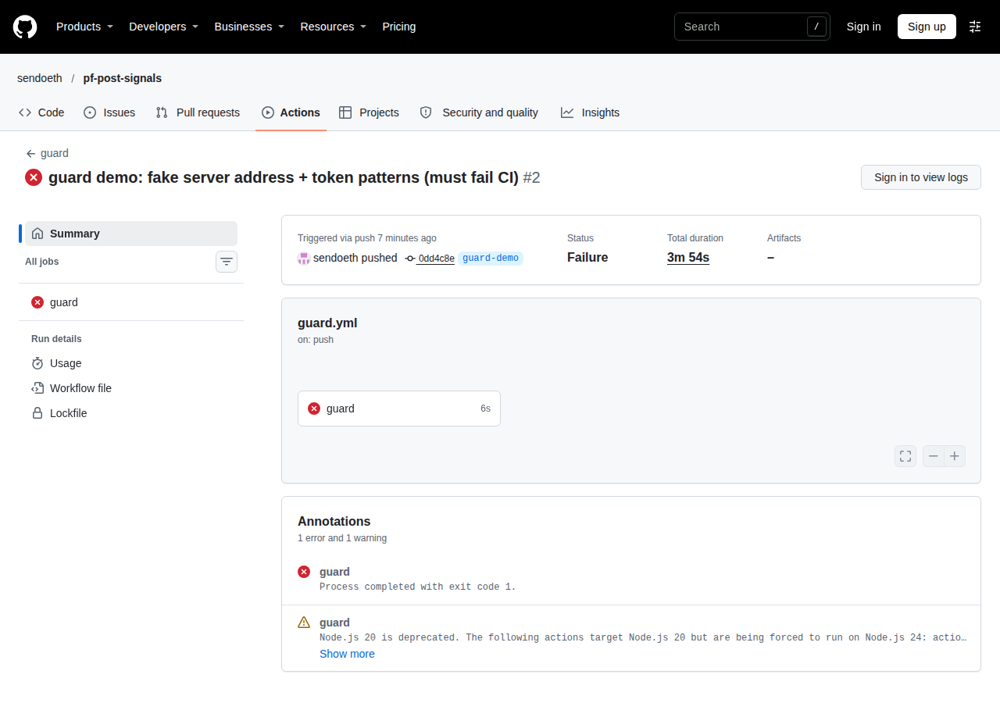

# Step 8 run notes: security hardening

## Where the work is

- **Hardening commit**: [`4d57658`](https://github.com/sendoeth/pf-post-signals/commit/4d57658afab1198660b8a9d33718cf0b14916730): CSP + frame guard + inline JS/CSS moved to files, self-hosted chart library, schema limits, attack fixtures, security test, CI guard + tests. The notes commit after it pins `actions/checkout` to v7.0.1 (Node 24) and adds this file and the screenshots.
- **Full step 8 diff**: https://github.com/sendoeth/pf-post-signals/compare/a5ff3f741ad3e98ba8aaaabc3aff609f6b7be345...4d57658afab1198660b8a9d33718cf0b14916730
- **Live site**: https://sendoeth.com/pf-post-signals/web/ and every position page, e.g. https://sendoeth.com/pf-post-signals/web/position.html?post=2104977267109896477&asset=SILVER
- **CI runs**: guard passed on main: https://github.com/sendoeth/pf-post-signals/actions/runs/41111330797 · guard **rejected** the demo branch `guard-demo` (fake address + token patterns): https://github.com/sendoeth/pf-post-signals/actions/runs/41111368938

The site is static (GitHub Pages): no backend, no PHP, no database, and no page talks to our server; the request-origin lists below show every request staying on https://sendoeth.com.

## Results

| Check | Result |
|---|---|
| HTTPS | before: `http://` answered 200 on every URL. After enforcing HTTPS on both Pages sites: every `http://` URL answers **301 -> https://** (raw curl below) |
| CSP (meta) | `default-src 'none'; script-src 'self'; style-src 'self' 'sha256-3pRED1tOXas1FXFoPb9TGCjmYe9XQsmO9OV23khV2nY='; img-src 'self'; connect-src 'self'; base-uri 'none'; form-action 'none'; object-src 'none'; frame-src 'none'; worker-src 'none'; manifest-src 'none'; media-src 'none'; font-src 'none'; upgrade-insecure-requests` (index.html has the same without the one style hash) |
| Referrer / framing | `no-referrer`; `assets/frame-guard.js`: in a frame on another origin, plain or `sandbox=allow-scripts`, both pages hide (top navigation from a cross-origin frame is blocked by the browser, so the page stays hidden) |
| Chart library | self-hosted `web/vendor/lightweight-charts-4.2.3/` + Apache-2.0 LICENSE (the package has no NOTICE). `tools/check_vendor.py`: npm tarball sha512 = registry integrity, vendored file and LICENSE equal the tarball's byte for byte. Its one inline `<style>` (attribution logo) is allowed by sha256 `3pRED1tO…` only, computed from the library source |
| Hostile X content | 7 fixtures (`tests/fixtures/attack_records`): 5 refused by the schema (HTML author, `javascript:` url, look-alike domain, HTML asset name, 30,000-char text), 2 drawn and shown as literal text with 0 injected elements. Tampered avatar index -> initials. Non-image / foreign-host avatars refused at ingest (unit tests) |
| Canary | `window.__pwned` unset on every page, real and attack site |
| Requests | live: 330 requests over 37 page states, **only origin https://sendoeth.com**; attack site: only its own origin |
| CSP violations / console errors | 0 / 0 on every page, live and local |
| History scan | `tools/guard.py --history`: 16 commits, **0 hits**; `--tree`: 408 files, 0 hits (also run in CI on main) |
| CI guard | rejects: demo commit `0dd4c8e` -> 3 hits (IPv4 address, AWS key id, Telegram bot token), job failed. Unit tests build fake addresses/tokens at runtime and check GitHub, fine-grained GitHub, Slack, AWS, sk-, Telegram and PEM private-key patterns |
| Repo protections | secret scanning **enabled**, push protection **enabled**, main: no force push, no deletion, required check `guard` (API output + screenshots below). Non-provider patterns and validity checks were requested but GitHub keeps them disabled for this repo |

## 1. HTTPS before / after

```text
# captured 2026-10-30T18:48:46Z
$ curl -sI http://sendoeth.com/pf-post-signals/web/
HTTP/1.1 200 OK
Server: GitHub.com
$ curl -sI http://sendoeth.com/pf-post-signals/web/position.html
HTTP/1.1 200 OK
Server: GitHub.com
$ curl -sI http://sendoeth.com/
HTTP/1.1 200 OK
Server: GitHub.com
$ curl -sI http://sendoeth.github.io/pf-post-signals/web/
HTTP/1.1 301 Moved Permanently
Server: GitHub.com
Location: http://sendoeth.com/pf-post-signals/web/

# captured 2026-10-30T19:06:34Z
$ curl -sI 'http://sendoeth.com/pf-post-signals/web/'
HTTP/1.1 301 Moved Permanently
Location: https://sendoeth.com/pf-post-signals/web/
$ curl -sI 'http://sendoeth.com/pf-post-signals/web/position.html?post=2104977267109896477&asset=SILVER'
HTTP/1.1 301 Moved Permanently
Location: https://sendoeth.com/pf-post-signals/web/position.html?post=2104977267109896477&asset=SILVER
$ curl -sI 'http://sendoeth.com/pf-post-signals/web/position.html'
HTTP/1.1 301 Moved Permanently
Location: https://sendoeth.com/pf-post-signals/web/position.html
$ curl -sI 'http://sendoeth.com/'
HTTP/1.1 301 Moved Permanently
Location: https://sendoeth.com/
```

## 2. Local: vendor check, history scan, guard tests, attack fixtures, security test, regressions

```text
$ python3 tools/check_vendor.py
registry lightweight-charts@4.2.3 tarball https://registry.npmjs.org/lightweight-charts/-/lightweight-charts-4.2.3.tgz
tarball sha512 integrity: registry 5kS/2hY3wNYNzhnS8Gb+GAS0... computed 5kS/2hY3wNYNzhnS8Gb+GAS0... -> OK
OK   web/vendor/lightweight-charts-4.2.3/lightweight-charts.standalone.production.js sha256 c7dda807d662a95b3d257119ed315cec669e3bdf5aaece75c480a39307f23540 (package copy c7dda807d662a95b...)
OK   web/vendor/lightweight-charts-4.2.3/LICENSE sha256 70c9d5382506dd184465425c08a99ad9bd6d9ac1313c252968ba0b585e5ef823 (package copy 70c9d5382506dd18...)
vendored library: matches the npm package byte for byte
[exit 0]
$ python3 tools/guard.py --history
guard: scanned 16 commits (all added lines + messages) -> 0 hits
[exit 0]
$ python3 tools/guard.py --tree
guard: scanned 408 files -> 0 hits
[exit 0]
$ python3 -m unittest -v tests.test_guard
test_allows_loopback_and_github_pages (tests.test_guard.Guard.test_allows_loopback_and_github_pages) ... ok
test_cli_rejects_a_file_and_passes_a_clean_one (tests.test_guard.Guard.test_cli_rejects_a_file_and_passes_a_clean_one) ... ok
test_ignores_versions_and_prices (tests.test_guard.Guard.test_ignores_versions_and_prices) ... ok
test_rejects_any_unknown_ipv4 (tests.test_guard.Guard.test_rejects_any_unknown_ipv4) ... ok
test_rejects_token_patterns (tests.test_guard.Guard.test_rejects_token_patterns) ... ok
test_values_are_masked_in_output (tests.test_guard.Guard.test_values_are_masked_in_output) ... ok
test_word_slugs_are_not_keys (tests.test_guard.Guard.test_word_slugs_are_not_keys) ... ok

----------------------------------------------------------------------
Ran 7 tests in 0.065s

OK
[exit 0]
$ python3 build_chart.py --records tests/fixtures/attack_records --out /tmp/step8_attack_bundle.json
REFUSED tests/fixtures/attack_records/asset_name_html.json: schema: asset/name: '<b onmouseover="window.__pwned=5">BTC</b>' does not match '^[A-Za-z0-9:=.^-]{1,32}$'
REFUSED tests/fixtures/attack_records/author_html.json: schema: post/author: '">' does not match '^[A-Za-z0-9_]{1,15}$'
REFUSED tests/fixtures/attack_records/text_oversized.json: schema: post/text: 'AAAAAAAAAAAAAAAAAAAAAAAAAAAAAAAAAAAAAAAAAAAAAAAAAAAAAAAAAAAAAAAAAAAAAAAAAAAAAAAAAAAAAAAAAAAAAAAAAAAAAAAAAAAAAAAAAAAAAAAAAAAAAAAAAAAAAAAAAAAAAAAAAAAAAAAAAAAAAAAAAAAAAAAAAAAAAAAAAAAAAAAAAAAAAAAAAAAAAAA... (30014 chars)
REFUSED tests/fixtures/attack_records/url_javascript.json: schema: post/url: 'javascript:window.__pwned=4' does not match '^https://x\\.com/[A-Za-z0-9_]{1,15}/status/\\d+$'
REFUSED tests/fixtures/attack_records/url_lookalike_domain.json: schema: post/url: 'https://x.com.evil.example/a/status/1' does not match '^https://x\\.com/[A-Za-z0-9_]{1,15}/status/\\d+$'
BTC     binance:BTCUSDT  27 bars, 2 posts
7 records scanned, 2 drawn, 0 superseded, 5 refused -> ../../../tmp/step8_attack_bundle.json
[exit 0]
$ node tests/security_test.js
site local: 37 page states checked (index + 36 position loads), 18 bubbles clicked, 330 requests, origins: http://127.0.0.1:39233
  resources loaded: / /assets/favicon.svg /assets/frame-guard.js /assets/index.css /assets/index.js /assets/position.css /assets/position.js /avatars/bobloukas.jpg /avatars/index.json /data/charts.json /data/ohlc/BTC.json /data/ohlc/COPX.json /data/ohlc/GOLD.json /data/ohlc/SILVER.json /data/ohlc/STOCKS.json /position.html /vendor/lightweight-charts-4.2.3/lightweight-charts.standalone.production.js
attack fixtures: text_html_payloads=drawn, text_unicode_tricks=drawn, author_html=refused, url_javascript=refused, url_lookalike_domain=refused, asset_name_html=refused, text_oversized=refused
attack site: 5 page states, 2 bubbles clicked, origins: http://127.0.0.1:36051; card shows payload as text: true, injected elements: 0; position page text literal: true, injected: 0, tampered avatar -> initials; canary: unset
framing plain index: hidden inside the frame
framing sandboxed index: hidden inside the frame
framing plain position.html?post=2104977267109896477&asset=SILVER: hidden inside the frame
framing sandboxed position.html?post=2104977267109896477&asset=SILVER: hidden inside the frame
canary window.__pwned: unset on every page; CSP violations: 0; console errors: 0
ALL PASS
[exit 0]
$ python3 -m unittest tests.test_resolve tests.test_ingest_detect
.........................................
----------------------------------------------------------------------
Ran 41 tests in 0.156s

OK
[exit 0]
$ python3 check_bundle.py
bundle: 20 record files -> 18 drawn, 2 superseded, 0 refused; 54 horizon cells, 18 best-since-post values checked -> ALL MATCH
[exit 0]
$ python3 parity.py
EXACT 2094827036812435935 BTC    call        entry 77596.01 @ 2026-09-01T17:00:00Z | 1d -0.55% 7d +1.47% 30d +8.51%
EXACT 2097324043334451439 COPX   call        entry 95.31 @ 2026-09-08T14:30:00Z | 1d +0.22% 7d -11.56% 30d -12.54%
EXACT 2100953898630443447 BTC    call        entry 80937.83 @ 2026-09-18T15:00:00Z | 1d +0.80% 7d +3.80% 30d +0.20%
EXACT 2102014028855820403 BTC    reiteration entry 85323.0 @ 2026-09-21T13:00:00Z | 1d +0.82% 7d -2.04% 30d -2.13%
EXACT 2102024327075877097 BTC    reiteration entry 85466.35 @ 2026-09-21T14:00:00Z | 1d +1.03% 7d -2.13% 30d -1.92%
EXACT 2104977267109896477 SILVER call        entry 61.105 @ 2026-09-29T17:00:00Z | 1d +0.83% 7d -0.80% 30d unresolved
EXACT 2105699317004583026 BTC    call        entry 84202.0 @ 2026-10-01T17:00:00Z | 1d +1.14% 7d -3.86% 30d unresolved
EXACT 2106744910896312646 SILVER reiteration entry 61.06 @ 2026-10-04T22:00:00Z | 1d -0.57% 7d -0.27% 30d unresolved
EXACT 2106750657877434407 COPX   call        entry 86.0 @ 2026-10-05T13:30:00Z | 1d -0.33% 7d -0.83% 30d unresolved
EXACT 2107063137958564197 STOCKS call        entry 769.69 @ 2026-10-05T13:30:00Z | 1d +1.10% 7d +1.18% 30d unresolved
EXACT 2107475725573906895 STOCKS reiteration entry 778.85 @ 2026-10-06T14:30:00Z | 1d -0.56% 7d -0.17% 30d unresolved
EXACT 2110764348981612915 BTC    call        entry 82108.01 @ 2026-10-15T17:00:00Z | 1d -0.82% 7d -1.00% 30d unresolved
EXACT 2112915214479798344 BTC    reiteration entry 84575.71 @ 2026-10-21T15:00:00Z | 1d -3.18% 7d -4.70% 30d unresolved
EXACT 2112919830357577753 BTC    reiteration entry 84575.71 @ 2026-10-21T15:00:00Z | 1d -3.18% 7d -4.70% 30d unresolved
EXACT 2112919830357577753 GOLD   call        entry 4148.5 @ 2026-10-21T15:00:00Z | 1d +1.78% 7d +2.27% 30d unresolved
EXACT 2113613893662588966 SILVER call        entry 53.84 @ 2026-10-23T13:00:00Z | 1d -0.73% 7d unresolved 30d unresolved
parity: 16/16 exact, 16 records schema-valid, 0 duplicates, 0 errors
[exit 0]
```

## 3. Live site

```text
$ node tests/security_test.js --url https://sendoeth.com/pf-post-signals/web/
site https://sendoeth.com/pf-post-signals/web/: 37 page states checked (index + 36 position loads), 18 bubbles clicked, 330 requests, origins: https://sendoeth.com
  resources loaded: /pf-post-signals/web/ /pf-post-signals/web/assets/favicon.svg /pf-post-signals/web/assets/frame-guard.js /pf-post-signals/web/assets/index.css /pf-post-signals/web/assets/index.js /pf-post-signals/web/assets/position.css /pf-post-signals/web/assets/position.js /pf-post-signals/web/avatars/bobloukas.jpg /pf-post-signals/web/avatars/index.json /pf-post-signals/web/data/charts.json /pf-post-signals/web/data/ohlc/BTC.json /pf-post-signals/web/data/ohlc/COPX.json /pf-post-signals/web/data/ohlc/GOLD.json /pf-post-signals/web/data/ohlc/SILVER.json /pf-post-signals/web/data/ohlc/STOCKS.json /pf-post-signals/web/position.html /pf-post-signals/web/vendor/lightweight-charts-4.2.3/lightweight-charts.standalone.production.js
framing plain index: hidden inside the frame
framing sandboxed index: hidden inside the frame
framing plain position.html?post=2104977267109896477&asset=SILVER: hidden inside the frame
framing sandboxed position.html?post=2104977267109896477&asset=SILVER: hidden inside the frame
canary window.__pwned: unset on every page; CSP violations: 0; console errors: 0
ALL PASS
[exit 0]
$ node tests/position_test.js --url https://sendoeth.com/pf-post-signals/web/
page https://sendoeth.com/pf-post-signals/web/
position pages opened 36 (18 posts x default + 1h), recap fields checked 636, entry-bubble placements checked 36, unresolved cells 54, console errors 0
ALL PASS
[exit 0]
$ node tests/browser_test.js --url https://sendoeth.com/pf-post-signals/web/
page https://sendoeth.com/pf-post-signals/web/
assets 5, cards opened 18, card fields checked 264, unresolved cells checked 27, same-hour bubbles 2, console errors 0
ALL PASS
[exit 0]
$ curl -s https://sendoeth.com/pf-post-signals/web/position.html | grep -o "Content-Security-Policy[^>]*"
Content-Security-Policy" content="default-src 'none'; script-src 'self'; style-src 'self' 'sha256-3pRED1tOXas1FXFoPb9TGCjmYe9XQsmO9OV23khV2nY='; img-src 'self'; connect-src 'self'; base-uri 'none'; form-action 'none'; object-src 'none'; frame-src 'none'; worker-src 'none'; manifest-src 'none'; media-src 'none'; font-src 'none'; upgrade-insecure-requests"
$ curl -s https://sendoeth.com/pf-post-signals/web/ | sha256sum
2dc58f5e054cad7ecbb7f84930fd4c7020d9570d53921cc0de7d2ad85ef9d832  -
$ curl -s https://sendoeth.com/pf-post-signals/web/position.html | sha256sum
530b5be64f38fc73090b3afaafc888685ddc8dbacaa1cb1b86299f9c8d15a721  -
$ curl -s https://sendoeth.com/pf-post-signals/web/assets/index.js | sha256sum
c7adc3e6e9a0d0b01eb0532ca50693bd4c756379636880501a5ec5cacd651733  -
$ curl -s https://sendoeth.com/pf-post-signals/web/assets/position.js | sha256sum
36e08c410c5bea4ee6693b37c0d962797deff300d28dc2d97ac3d2ba3130a7e7  -
$ curl -s https://sendoeth.com/pf-post-signals/web/assets/frame-guard.js | sha256sum
cf1e521a616ec2ebd22002fdd11179dbfbe18b1ddf5187f9b0e9c41994394ee4  -
$ curl -s https://sendoeth.com/pf-post-signals/web/vendor/lightweight-charts-4.2.3/lightweight-charts.standalone.production.js | sha256sum
c7dda807d662a95b3d257119ed315cec669e3bdf5aaece75c480a39307f23540  -
$ curl -s https://sendoeth.com/pf-post-signals/web/data/charts.json | sha256sum
4620e7c57f975e88b1f057fefbcc2911a590c8ff15d1a01f685b1f8cf0eed59c  -
```

## 4. CI

Demo branch (must fail), job log excerpt:

```text
HIT commit 0dd4c8e1819c: ipv4 address 198.…23
HIT commit 0dd4c8e1819c: aws access key id AKIA…53
HIT commit 0dd4c8e1819c: telegram bot token 6793…OT
guard: scanned 17 commits (all added lines + messages) -> 3 hits: REJECTED
##[error]Process completed with exit code 1.
```

main, job log excerpt:

```text
guard: scanned 16 commits (all added lines + messages) -> 0 hits
guard: scanned 408 files -> 0 hits
Ran 7 tests in 0.051s
OK
Ran 41 tests in 0.125s
OK
bundle: 20 record files -> 18 drawn, 2 superseded, 0 refused; 54 horizon cells, 18 best-since-post values checked -> ALL MATCH
```

## 5. Repository protections

API responses (captured with the owner's token, rendered because the settings pages need a login): [verification/step8/repo_protections_api.png](step8/repo_protections_api.png)

```json
{
    "captured_at": "2026-10-30T19:05:37Z",
    "repo_security_and_analysis": {
        "secret_scanning": {
            "status": "enabled"
        },
        "secret_scanning_push_protection": {
            "status": "enabled"
        },
        "dependabot_security_updates": {
            "status": "disabled"
        },
        "secret_scanning_non_provider_patterns": {
            "status": "disabled"
        },
        "secret_scanning_validity_checks": {
            "status": "disabled"
        }
    },
    "main_branch_protection": {
        "required_status_checks": {
            "url": "https://api.github.com/repos/sendoeth/pf-post-signals/branches/main/protection/required_status_checks",
            "strict": false,
            "contexts": [
                "guard"
            ],
            "contexts_url": "https://api.github.com/repos/sendoeth/pf-post-signals/branches/main/protection/required_status_checks/contexts",
            "checks": [
                {
                    "context": "guard",
                    "app_id": null
                }
            ]
        },
        "enforce_admins": {
            "url": "https://api.github.com/repos/sendoeth/pf-post-signals/branches/main/protection/enforce_admins",
            "enabled": false
        },
        "allow_force_pushes": {
            "enabled": false
        },
        "allow_deletions": {
            "enabled": false
        },
        "required_linear_history": {
            "enabled": false
        }
    },
    "pages_https": {
        "sendoeth.github.io": {
            "https_enforced": true,
            "cname": "sendoeth.com",
            "https_certificate": "approved"
        },
        "pf-post-signals": {
            "https_enforced": true,
            "cname": null,
            "https_certificate": "approved"
        }
    }
}
```



Public branches page (main shows the protected-branch shield and 4/4 checks; guard-demo 0/1): [verification/step8/branches_protected.png](step8/branches_protected.png)



CI rejected the demo commit: [verification/step8/ci_guard_demo_rejected.png](step8/ci_guard_demo_rejected.png) · CI passed on main: [verification/step8/ci_main_passed.png](step8/ci_main_passed.png)



## SHA-256

```text
2dc58f5e054cad7ecbb7f84930fd4c7020d9570d53921cc0de7d2ad85ef9d832  web/index.html
530b5be64f38fc73090b3afaafc888685ddc8dbacaa1cb1b86299f9c8d15a721  web/position.html
7e35ad2bebbc1a9c5f5bae09bfa00a87a5b148f2a570363baa0907eeaf190aba  web/assets/favicon.svg
cf1e521a616ec2ebd22002fdd11179dbfbe18b1ddf5187f9b0e9c41994394ee4  web/assets/frame-guard.js
dd4ba1ffcaa8480839241ca8d7ef0edbc91478a1e81e73d8f1003c716c30dff3  web/assets/index.css
c7adc3e6e9a0d0b01eb0532ca50693bd4c756379636880501a5ec5cacd651733  web/assets/index.js
6ab3ddb69ea9def56790737bf1254c89395a1ec5141f01a2b3a23f438af0ca82  web/assets/position.css
36e08c410c5bea4ee6693b37c0d962797deff300d28dc2d97ac3d2ba3130a7e7  web/assets/position.js
70c9d5382506dd184465425c08a99ad9bd6d9ac1313c252968ba0b585e5ef823  web/vendor/lightweight-charts-4.2.3/LICENSE
c7dda807d662a95b3d257119ed315cec669e3bdf5aaece75c480a39307f23540  web/vendor/lightweight-charts-4.2.3/lightweight-charts.standalone.production.js
7d8cd06cee5b8d51f79cccd3709aa5bf07ed2f49af5ddae670dfdac2c6b0076c  tools/guard.py
8d494bd71ee7fcc6a74b74a1a32d1547e85eff0bcba2b1760de38ed91c219aef  tools/check_vendor.py
47e8284d262b1569aa2f6f31753ab1c61420092225ad724c188aef6896b62c41  tools/make_attack_fixtures.py
147510d0bd3f452c32f866fb595ed2def4643bc71bd2842ade329cadfd7c9933  tests/security_test.js
64131cce5501f0744d1ed823f1e2ba9e28ebb240161306ef89ce5a8f5ebd2932  tests/test_guard.py
239565264853b5479ccd59e50595c574068c7750a515063910880fe31e5656d5  tests/fixtures/attack_records/asset_name_html.json
dfaefdb1d85e079b925bf350abf828ac32ae4b5157d30d9248effcb85bfda055  tests/fixtures/attack_records/author_html.json
53a853142c69e8578c25c5bf9ac239c1e045980436f28a0df48e9460fdb20a10  tests/fixtures/attack_records/text_html_payloads.json
a75875722c8b087dc7733d3969b9a9fb71543af29ac603320c875feb86f928e1  tests/fixtures/attack_records/text_oversized.json
fb72d3bcaca313a1ac7b820f9ae8f054dc70de805895da4ebacc6598fbdb4a12  tests/fixtures/attack_records/text_unicode_tricks.json
05b26baed35847b3ba330bcc7c41d1c7adb0d2233e2441c91d07c5d494367ad0  tests/fixtures/attack_records/url_javascript.json
ef151087a3679d0a80a9ce0586c75e499666a15667a2625d38a09204a01f8d3c  tests/fixtures/attack_records/url_lookalike_domain.json
44b7726fa28cfd7a07b684244d510fdd706912c092724ad8de8af2f570376b30  .github/workflows/guard.yml
67354f9c866bf7e9cc4750643982c38ed56e801ed36edbdcc8f9de936e7fd57c  verification/step8/branches_protected.png
8e9adaf3dc7852ebc051ae339ccffa58d27d34504a7480652276411537e5e740  verification/step8/ci_guard_demo_rejected.png
c3eb0cc72dd1db3b5e818c7f7322a088cd07308b7d7db7a04814121fb30e15c5  verification/step8/ci_main_passed.png
e78fffeee149a95ade168b092f9dd0737bfc4b0bc96cec557004e60787d6a6d5  verification/step8/repo_protections_api.png
```
