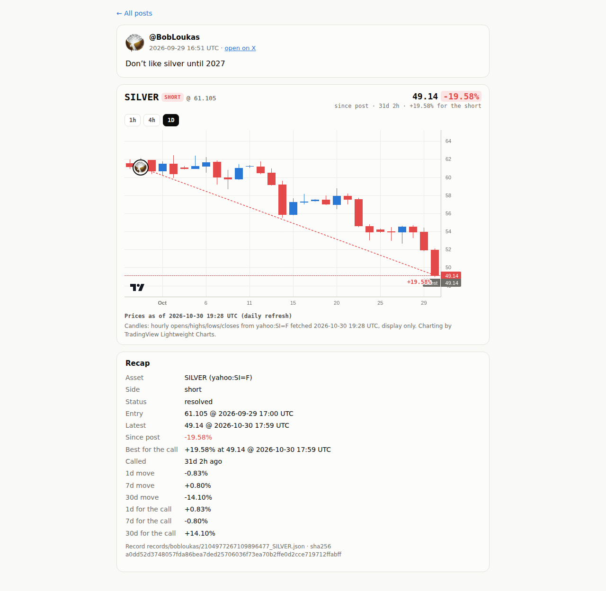
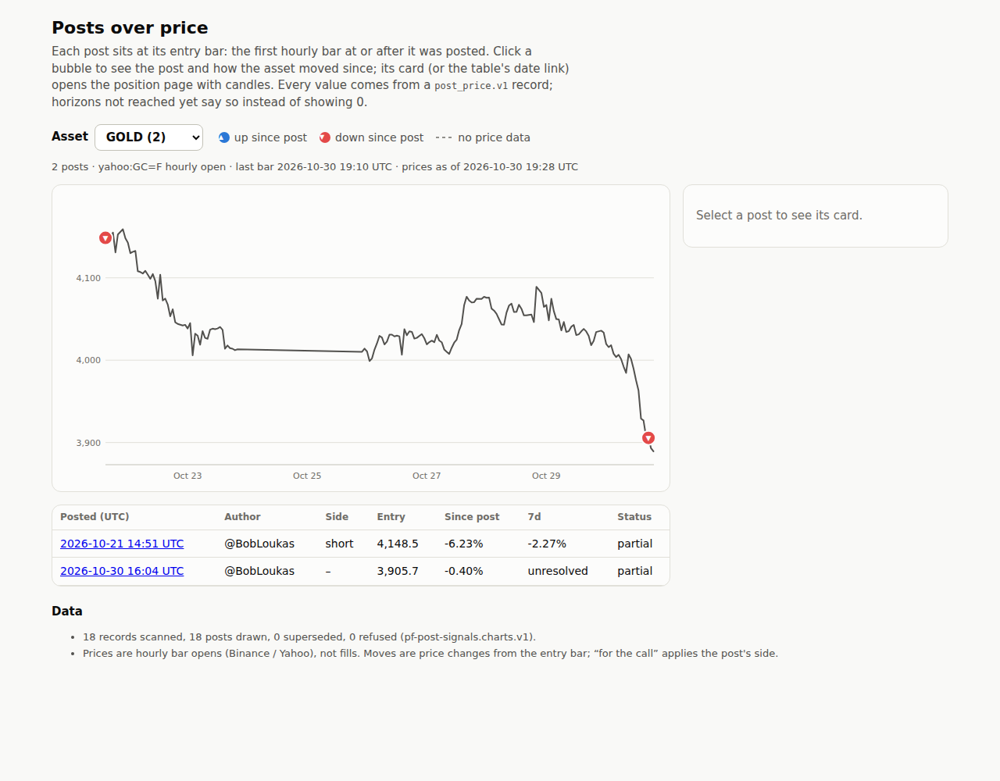

# Step 9 run notes: daily price refresh

## Where the work is

- **Code**: [`8854fed`](https://github.com/sendoeth/pf-post-signals/commit/8854fed24fe98f64b6383489f1e2b1fb579df3da) (refresh.py, refresh workflow, frozen values + revision log, prices-as-of on the pages) and the fix [`5afc891`](https://github.com/sendoeth/pf-post-signals/commit/5afc891fb814769c60acf474aad7a57982d49639) (see *Incident* below).
- **Refresh run that updated the live page**: https://github.com/sendoeth/pf-post-signals/actions/runs/41115464244 -> data commit [`ff14e53`](https://github.com/sendoeth/pf-post-signals/commit/ff14e53) "refresh: prices as of 2026-10-30T19:28:07Z" by github-actions[bot], `guard` status success on that commit.
- **Full step 9 diff**: https://github.com/sendoeth/pf-post-signals/compare/cc84c01e5e19d66721bcf8cec50facdfcad6eb63...ff14e53
- **Live**: https://sendoeth.com/pf-post-signals/web/ ("prices as of 2026-10-30 19:28 UTC"), e.g. https://sendoeth.com/pf-post-signals/web/position.html?post=2104977267109896477&asset=SILVER

## What the refresh does

- `refresh.py` re-resolves every record from its receipt with fresh hourly prices; `build_chart.py` rebuilds the bundle; `fetch_ohlc.py` refetches the candles. Latest, % since post, best since post and newly reached horizons come from the fresh bars; the pages show "prices as of" from `data/refresh_log.json`.
- **Frozen values**: entry bars and resolved exits never change. All frozen bars of an asset are written into one shared series for that asset before re-resolving; each provider revision or missing bar is logged with its frozen and fetched value, and the frozen value stays. Duplicate records for the same post and asset fail the refresh.
- **Fails closed**: refresh, schema, invariants, entry-bar check, bundle check (now including *no refused records*), parity, 51 unit tests and the guard all run before the commit; any failure stops the job and `main` keeps the last good data.
- **Protection unchanged**: main still requires `guard`, no force push, no deletion. The job runs `tools/guard.py --history` and `--tree` on its own commit, pushes it to a temporary `refresh-staging` ref, records the result as the `guard` status on exactly that commit, fast-forwards main, deletes the temporary ref and requests a Pages build. Permissions: workflow default `contents: read`; the refresh job only gets `contents`, `statuses` and `pages` write. Actions pinned to commits.

## Results of the run that updated the live page (41115464244)

- 18/18 records refreshed, 0 failures, 18 drawn / 0 refused, all 5 assets on the chart; parity 16/16; entry bars 18/18 (one is a logged revision, see below); 51 tests OK; guard 0 hits.
- **5 provider revisions, frozen values kept** (Yahoo moves historical hourly opens by a tick between fetches):

| record | bar | what | frozen (kept) | provider now |
|---|---|---|---|---|
| records/bobloukas/2112919830357577753_GOLD.json | 2026-10-22T15:00:00Z | 1d exit | 4074.8 | 4074.8999 |
| records/posts/2116199680157647216_GOLD.json | 2026-10-30T17:00:00Z | entry | 3905.7 | 3905.6001 |
| records/bobloukas/2106744910896312646_SILVER.json | 2026-10-05T14:00:00Z | 1d exit | 61.405 | 61.41 |
| records/bobloukas/2113613893662588966_SILVER.json | 2026-10-30T13:00:00Z | 7d exit | 50.055 | 50.06 |
| records/bobloukas/2107063137958564197_STOCKS.json | 2026-10-06T13:30:00Z | 1d exit | 778.15 | 778.17 |

  The GOLD entry candle therefore opens at 3905.6001 while the record keeps 3905.7; `fetch_ohlc.py` and the browser test accept exactly that logged (bar, value) pair and nothing else.

## Incident: the first refresh dropped GOLD and SILVER for 6 minutes

The first run (https://github.com/sendoeth/pf-post-signals/actions/runs/41114671318, data commit `6b46129`, live 19:23-19:29 UTC) froze bars per record. Two records were copies of the same posts (step 4 demo files in `records/live/`, superseded but still present) and one of them froze a silver bar at 50.06 while the other carried the revised 50.055; the bundle builder correctly refused SILVER and GOLD as conflicting, and **no check treated a refused real record as a failure**, so the run committed 13 of 18 posts. Fix [`5afc891`](https://github.com/sendoeth/pf-post-signals/commit/5afc891fb814769c60acf474aad7a57982d49639): one shared frozen series per asset, duplicate records fail the refresh, `check_bundle.py` fails on any refused record (the first run's bundle now fails it), and the two duplicate files were removed (each post keeps its records/bobloukas record). The second run restored all 18. Its `2113613893662588966` SILVER 7d exit is frozen at 50.055, the value its canonical record resolved.

## 1. Live site (after run 41115464244)

```text
$ node tests/position_test.js --url https://sendoeth.com/pf-post-signals/web/
page https://sendoeth.com/pf-post-signals/web/
position pages opened 36 (18 posts x default + 1h), recap fields checked 672, entry-bubble placements checked 36, unresolved cells 50, console errors 0
ALL PASS
[exit 0]
$ node tests/browser_test.js --url https://sendoeth.com/pf-post-signals/web/
page https://sendoeth.com/pf-post-signals/web/
assets 5, cards opened 18, card fields checked 264, unresolved cells checked 25, same-hour bubbles 2, console errors 0
ALL PASS
[exit 0]
$ node tests/security_test.js --url https://sendoeth.com/pf-post-signals/web/
site https://sendoeth.com/pf-post-signals/web/: 37 page states checked (index + 36 position loads), 18 bubbles clicked, 330 requests, origins: https://sendoeth.com
  resources loaded: /pf-post-signals/web/ /pf-post-signals/web/assets/favicon.svg /pf-post-signals/web/assets/frame-guard.js /pf-post-signals/web/assets/index.css /pf-post-signals/web/assets/index.js /pf-post-signals/web/assets/position.css /pf-post-signals/web/assets/position.js /pf-post-signals/web/avatars/bobloukas.jpg /pf-post-signals/web/avatars/index.json /pf-post-signals/web/data/charts.json /pf-post-signals/web/data/ohlc/BTC.json /pf-post-signals/web/data/ohlc/COPX.json /pf-post-signals/web/data/ohlc/GOLD.json /pf-post-signals/web/data/ohlc/SILVER.json /pf-post-signals/web/data/ohlc/STOCKS.json /pf-post-signals/web/position.html /pf-post-signals/web/vendor/lightweight-charts-4.2.3/lightweight-charts.standalone.production.js
framing plain index: hidden inside the frame
framing sandboxed index: hidden inside the frame
framing plain position.html?post=2104977267109896477&asset=SILVER: hidden inside the frame
framing sandboxed position.html?post=2104977267109896477&asset=SILVER: hidden inside the frame
canary window.__pwned: unset on every page; CSP violations: 0; console errors: 0
ALL PASS
[exit 0]
$ curl -s https://sendoeth.com/pf-post-signals/web/data/charts.json | sha256sum
5e45fc93da7c22f4cca80ec7dc1f6d938c893cc78e9d250f543eef5c2d970705  -
```

## 2. Local checks on the refreshed commit + the first run's bundle

```text
$ python3 -m unittest -v tests.test_refresh
test_missing_bar_keeps_frozen_value (tests.test_refresh.Refresh.test_missing_bar_keeps_frozen_value) ... ok
test_new_horizon_fills_and_latest_moves (tests.test_refresh.Refresh.test_new_horizon_fills_and_latest_moves) ... ok
test_revision_keeps_frozen_entry_and_exits_and_is_logged (tests.test_refresh.Refresh.test_revision_keeps_frozen_entry_and_exits_and_is_logged) ... ok

----------------------------------------------------------------------
Ran 3 tests in 0.016s

OK
[exit 0]
$ python3 fetch_ohlc.py --check-only
OK   BTC     2094827036812435935 entry 2026-09-01T17:00:00Z record 77596.01 candle open 77596.01
OK   BTC     2100953898630443447 entry 2026-09-18T15:00:00Z record 80937.83 candle open 80937.83
OK   BTC     2102014028855820403 entry 2026-09-21T13:00:00Z record 85323.0 candle open 85323.0
OK   BTC     2102024327075877097 entry 2026-09-21T14:00:00Z record 85466.35 candle open 85466.35
OK   BTC     2105699317004583026 entry 2026-10-01T17:00:00Z record 84202.0 candle open 84202.0
OK   BTC     2110764348981612915 entry 2026-10-15T17:00:00Z record 82108.01 candle open 82108.01
OK   BTC     2112915214479798344 entry 2026-10-21T15:00:00Z record 84575.71 candle open 84575.71
OK   BTC     2112919830357577753 entry 2026-10-21T15:00:00Z record 84575.71 candle open 84575.71
OK   BTC     2115823513915290059 entry 2026-10-29T16:00:00Z record 81778.01 candle open 81778.01
OK   COPX    2097324043334451439 entry 2026-09-08T14:30:00Z record 95.31 candle open 95.31
OK   COPX    2106750657877434407 entry 2026-10-05T13:30:00Z record 86.0 candle open 86.0
OK   GOLD    2112919830357577753 entry 2026-10-21T15:00:00Z record 4148.5 candle open 4148.5
OK   GOLD    2116199680157647216 entry 2026-10-30T17:00:00Z record 3905.7 candle open 3905.6001
OK   SILVER  2104977267109896477 entry 2026-09-29T17:00:00Z record 61.105 candle open 61.105
OK   SILVER  2106744910896312646 entry 2026-10-04T22:00:00Z record 61.06 candle open 61.06
OK   SILVER  2113613893662588966 entry 2026-10-23T13:00:00Z record 53.84 candle open 53.84
OK   STOCKS  2107063137958564197 entry 2026-10-05T13:30:00Z record 769.69 candle open 769.69
OK   STOCKS  2107475725573906895 entry 2026-10-06T14:30:00Z record 778.85 candle open 778.85
entry bars: 18/18 candle opens equal the record entry price
[exit 0]
$ python3 check_bundle.py
bundle: 18 record files -> 18 drawn, 0 superseded, 0 refused; 54 horizon cells, 18 best-since-post values checked -> ALL MATCH
[exit 0]
$ python3 validate_records.py
records: 18 checked against post_price.v1 -> ALL VALID
[exit 0]
$ python3 parity.py
EXACT 2094827036812435935 BTC    call        entry 77596.01 @ 2026-09-01T17:00:00Z | 1d -0.55% 7d +1.47% 30d +8.51%
EXACT 2097324043334451439 COPX   call        entry 95.31 @ 2026-09-08T14:30:00Z | 1d +0.22% 7d -11.56% 30d -12.54%
EXACT 2100953898630443447 BTC    call        entry 80937.83 @ 2026-09-18T15:00:00Z | 1d +0.80% 7d +3.80% 30d +0.20%
EXACT 2102014028855820403 BTC    reiteration entry 85323.0 @ 2026-09-21T13:00:00Z | 1d +0.82% 7d -2.04% 30d -2.13%
EXACT 2102024327075877097 BTC    reiteration entry 85466.35 @ 2026-09-21T14:00:00Z | 1d +1.03% 7d -2.13% 30d -1.92%
EXACT 2104977267109896477 SILVER call        entry 61.105 @ 2026-09-29T17:00:00Z | 1d +0.83% 7d -0.80% 30d unresolved
EXACT 2105699317004583026 BTC    call        entry 84202.0 @ 2026-10-01T17:00:00Z | 1d +1.14% 7d -3.86% 30d unresolved
EXACT 2106744910896312646 SILVER reiteration entry 61.06 @ 2026-10-04T22:00:00Z | 1d -0.57% 7d -0.27% 30d unresolved
EXACT 2106750657877434407 COPX   call        entry 86.0 @ 2026-10-05T13:30:00Z | 1d -0.33% 7d -0.83% 30d unresolved
EXACT 2107063137958564197 STOCKS call        entry 769.69 @ 2026-10-05T13:30:00Z | 1d +1.10% 7d +1.18% 30d unresolved
EXACT 2107475725573906895 STOCKS reiteration entry 778.85 @ 2026-10-06T14:30:00Z | 1d -0.56% 7d -0.17% 30d unresolved
EXACT 2110764348981612915 BTC    call        entry 82108.01 @ 2026-10-15T17:00:00Z | 1d -0.82% 7d -1.00% 30d unresolved
EXACT 2112915214479798344 BTC    reiteration entry 84575.71 @ 2026-10-21T15:00:00Z | 1d -3.18% 7d -4.70% 30d unresolved
EXACT 2112919830357577753 BTC    reiteration entry 84575.71 @ 2026-10-21T15:00:00Z | 1d -3.18% 7d -4.70% 30d unresolved
EXACT 2112919830357577753 GOLD   call        entry 4148.5 @ 2026-10-21T15:00:00Z | 1d +1.78% 7d +2.27% 30d unresolved
EXACT 2113613893662588966 SILVER call        entry 53.84 @ 2026-10-23T13:00:00Z | 1d -0.73% 7d unresolved 30d unresolved
parity: 16/16 exact, 16 records schema-valid, 0 duplicates, 0 errors
[exit 0]
$ python3 tools/guard.py --history
guard: scanned 21 commits (all added lines + messages) -> 0 hits
[exit 0]
$ python3 -m unittest tests.test_resolve tests.test_ingest_detect tests.test_guard
................................................
----------------------------------------------------------------------
Ran 48 tests in 0.237s

OK
[exit 0]
$ git show 6b46129:web/data/charts.json > work/bundle_6b46129.json  # the first refresh commit (GOLD + SILVER dropped)
$ python3 -c "...posts_drawn / refused of work/bundle_6b46129.json"
posts_drawn 13 refused 5 assets ['BTC', 'COPX', 'STOCKS']
```

## 3. Workflow logs (excerpts)

Run 41115464244 (updated the live page):

```text
REVISION records/bobloukas/2112919830357577753_GOLD.json 1d exit 2026-10-22T15:00:00Z: frozen 4074.8 fetched 4074.8999 (provider revision; frozen value kept)
REVISION records/posts/2116199680157647216_GOLD.json entry 2026-10-30T17:00:00Z: frozen 3905.7 fetched 3905.6001 (provider revision; frozen value kept)
REVISION records/bobloukas/2106744910896312646_SILVER.json 1d exit 2026-10-05T14:00:00Z: frozen 61.405 fetched 61.41 (provider revision; frozen value kept)
REVISION records/bobloukas/2113613893662588966_SILVER.json 7d exit 2026-10-30T13:00:00Z: frozen 50.055 fetched 50.06 (provider revision; frozen value kept)
REVISION records/bobloukas/2107063137958564197_STOCKS.json 1d exit 2026-10-06T13:30:00Z: frozen 778.15 fetched 778.17 (provider revision; frozen value kept)
refresh 2026-10-30T19:28:07Z: 18/18 records refreshed, 0 horizons filled, 5 provider revisions logged (frozen values kept), 0 failures
18 records scanned, 18 drawn, 0 superseded, 0 refused -> web/data/charts.json
entry bars: 18/18 candle opens equal the record entry price
bundle: 18 record files -> 18 drawn, 0 superseded, 0 refused; 54 horizon cells, 18 best-since-post values checked -> ALL MATCH
records: 18 checked against post_price.v1 -> ALL VALID
parity: 16/16 exact, 16 records schema-valid, 0 duplicates, 0 errors
Ran 51 tests in 0.135s
OK
guard: scanned 21 commits (all added lines + messages) -> 0 hits
guard: scanned 415 files -> 0 hits
##[group]Run git push --force origin "HEAD:refs/heads/refresh-staging"
git push --force origin "HEAD:refs/heads/refresh-staging"
git push origin --delete refresh-staging
remote: Create a pull request for 'refresh-staging' on GitHub by visiting:        
remote:      https://github.com/sendoeth/pf-post-signals/pull/new/refresh-staging        
To https://github.com/sendoeth/pf-post-signals
 * [new branch]      HEAD -> refresh-staging
To https://github.com/sendoeth/pf-post-signals
   5afc891..ff14e53  HEAD -> main
To https://github.com/sendoeth/pf-post-signals
 - [deleted]         refresh-staging
```

Run 41114671318 (the first run, see Incident):

```text
REVISION records/bobloukas/2112919830357577753_GOLD.json 1d exit 2026-10-22T15:00:00Z: frozen 4074.8 fetched 4074.7 (provider revision; frozen value kept)
REVISION records/live/2113613893662588966_SILVER.json 7d exit 2026-10-30T13:00:00Z: frozen 50.06 fetched 50.055 (provider revision; frozen value kept)
REVISION records/posts/2116199680157647216_GOLD.json entry 2026-10-30T17:00:00Z: frozen 3905.7 fetched 3905.5 (provider revision; frozen value kept)
refresh 2026-10-30T19:22:15Z: 20/20 records refreshed, 2 horizons filled, 3 provider revisions logged (frozen values kept), 0 failures
20 records scanned, 13 drawn, 2 superseded, 5 refused -> web/data/charts.json
bundle: 20 record files -> 13 drawn, 2 superseded, 5 refused; 39 horizon cells, 13 best-since-post values checked -> ALL MATCH
```

## Screenshots

Position page, prices as of 19:28 UTC, SILVER short now fully resolved (30d filled by the refresh): [verification/step9/live_position_refreshed.png](step9/live_position_refreshed.png)



Main page, GOLD back on the chart, "prices as of 2026-10-30 19:28 UTC": [verification/step9/live_index_refreshed.png](step9/live_index_refreshed.png)



## SHA-256

```text
7e49fd422806fefbe0af8589ec78fb922c860d5542866c77e836e22b9b335e56  data/refresh_log.json
5e45fc93da7c22f4cca80ec7dc1f6d938c893cc78e9d250f543eef5c2d970705  web/data/charts.json
879b525fc8e5472bc433b2904c55afdb0c91552b8884e53bb012121fcd692cb4  records/bobloukas/2094827036812435935_BTC.json
8b2f079e0219606d9c8bb4131aeee5934b2426ca2b334c6585d511fe9a8b82ee  records/bobloukas/2097324043334451439_COPX.json
022868bb6728ba4f841977a1594de02348793a2c66a1dfb7ebf05e641f78b5d9  records/bobloukas/2100953898630443447_BTC.json
4a87d777ad328912f478593f18f5eb3b70d257ed1827bb51eefbd2c8f10d38f9  records/bobloukas/2102014028855820403_BTC.json
fba44c3114e27fc02076e5d01d8dc5e96126c65f4ef9f63fbea69872944487eb  records/bobloukas/2102024327075877097_BTC.json
a0dd52d3748057fda86bea7ded25706036f73ea70b2ffe0d2cce719712ffabff  records/bobloukas/2104977267109896477_SILVER.json
86112a7aa774794dbd70518a2882f651c4f9c811429fe5d6b6c3ad8174411064  records/bobloukas/2105699317004583026_BTC.json
6340fe2d197ae34aa0f94fbb27de1288ef7141c31fc6bfce52887f390f0ef50c  records/bobloukas/2106744910896312646_SILVER.json
9ade33a2f7ef47cf2b8ce08c6e5616c03dd12b830e9d433e056b98dff2f191e0  records/bobloukas/2106750657877434407_COPX.json
b0d0cb4fb05330b7d2a22cc0db49dba8426c49cd31e8c790dc73daab10076c41  records/bobloukas/2107063137958564197_STOCKS.json
57efb5e971c7bf41174024302d44e9d904c8195513210d746101b533a1f13573  records/bobloukas/2107475725573906895_STOCKS.json
f2b79bf0afaf953dac50966a4c96766be7e10f0a2d0e14862e41206227f37564  records/bobloukas/2110764348981612915_BTC.json
378dce3f2c58568a259effb2c5761a0e92d8598be00b4b8721424a89aeaecdd2  records/bobloukas/2112915214479798344_BTC.json
3f0a924438a85267a5b024f27c52e0e63a761ff1f966dc604e8aab5f6e785998  records/bobloukas/2112919830357577753_BTC.json
4dff0a1cc76beb9b8b17277ee04bdfd65a41edc7fa0028052e9928bfc3240c3c  records/bobloukas/2112919830357577753_GOLD.json
fb2abafe575d7fe31f8f111be31560a0a9a405c2b7b20b964aa7bc3a762a07e4  records/bobloukas/2113613893662588966_SILVER.json
a5321ebd7dd129b4c5b876e7d50065e71fecb8239d03825d3ea1da7bc89d5bd2  records/posts/2115823513915290059_BTC.json
9aa02ada22bde7fbde7c40a6da384c90a6903387fe6eef76ccaccf5d82176e1f  records/posts/2116199680157647216_GOLD.json
eed7a430518e0e9a200008b75f1f29e5d60b2a04efe46f22a2d1b19d5b6c384d  refresh.py
afb822b88393a6a03f631f64b28f55283854d13b41b2c4a13aca10892d80e242  build_chart.py
7a5991445c7ce17483d14db066fc8372a747e5e151556c8ac111cc255ac950d9  fetch_ohlc.py
ca12415c9d44773fd0c699ae5d74c22dcbd43f3b7e8fd3403f842c20d421d88c  check_bundle.py
7ab77d12fd8f960ec65bd27df2a64748ab85440bd76cf59a9c48fe00da5806c9  parity.py
02db1a3bdb3f5efe579426d9d4f3c0a30346a533833f01832266043e7ffda35c  .github/workflows/refresh.yml
3baa6022cbcbdeb3510484970618f9c2f4f0670a2a482cb1cd1a3ef0d98ea7c7  tests/test_refresh.py
f92a9a3143671af1d35fe2fd5f382c55c28635d77eac706ace44444f2b4b5d5a  tests/position_test.js
0c1d2cd207f3668b9bd16720aa997893676ef47f10338ae13ba753b6ea2c7b5f  verification/step9/live_index_refreshed.png
0d73a995e994b9b9cc7097b0873222c65b2c1c67078f235447660d485ba99ec4  verification/step9/live_position_refreshed.png
```
